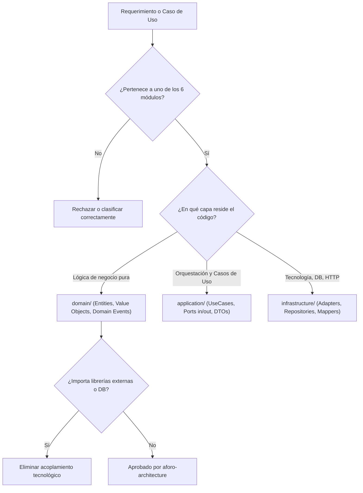

# Skill: aforo-architecture

## 1. Propósito Específico
Esta habilidad guía a los agentes de software en la toma de decisiones, diseño y estructuración de código respetando estrictamente los principios de **Monolito Modular** y **Arquitectura Hexagonal (Puertos y Adaptadores)** formalizados en la Constitución y los ADRs de AFORO.

---

## 2. Condiciones de Activación
Esta skill se activa automáticamente ante:
- Creación, refactorización o revisión estructural de carpetas, módulos o archivos de backend.
- Definición de nuevas entidades, casos de uso o adaptadores.
- Establecimiento de comunicación o intercambio de datos entre módulos del sistema.
- Consultas o auditorías sobre el cumplimiento arquitectónico frente al Modelo C4 y ADRs.

---

## 3. Responsabilidades Permitidas
- Validar que cada componente del backend resida dentro de uno de los 6 módulos autorizados (`catalog`, `reservations`, `payments`, `tickets`, `access`, `identity`).
- Asegurar que la estructura interna de cada módulo siga el patrón canónico: `domain/`, `application/`, `infrastructure/`.
- Garantizar que la comunicación entre módulos se realice exclusivamente mediante contratos públicos en memoria (`I<Nombre>ModuleFacade`).
- Supervisar la trazabilidad entre el diseño documentado en [`docs/04-modelo-c4/`](../../../docs/04-modelo-c4/) (C1..C4) y el código fuente.
- Identificar de manera explícita qué partes de la arquitectura son `[DISEÑO PROPUESTO]` y cuáles son `[IMPLEMENTADO]`.
- **Garantizar la Preservación Histórica de Decisiones**: Cumplir la Política de Preservación Histórica ([`AGENTS.md`](../../../AGENTS.md#8-política-de-preservación-histórica-y-trazabilidad-innegociable)), asegurando que cualquier cambio sustancial de arquitectura preserve el ADR original y formalice la sustitución mediante un nuevo ADR con relación explícita de supersesión.

---

## 4. Restricciones y Prohibiciones Innegociables
- **PROHIBIDO introducir Microservicios**: Queda vetado crear proyectos independientes, servicios HTTP internos o contenedores distribuidos no contemplados en [ADR-001](../../../docs/complementos/adrs/ADR-001-seleccion-estilo-monolito-modular.md).
- **PROHIBIDO contaminar la Capa de Dominio**: Las clases en `domain/` no pueden importar decoradores de ORMs, librerías de frameworks web (Fastify, Express), clientes de bases de datos (pg, Prisma, Kysely) ni clientes de caché (ioredis).
- **PROHIBIDO el acoplamiento cruzado de infraestructura**: Un módulo jamás puede acceder a la base de datos, tablas, esquemas o adaptadores secundarios de otro módulo.
- **PROHIBIDO alterar la estructura oficial de `docs/`**: El árbol de documentación académica es inmutable.
- **PROHIBIDO reescribir silenciosamente decisiones arquitectónicas**: No sobrescribir ni eliminar ADRs previos ni alterar retrospectivamente fechas de aprobación o ratificación. Toda evolución debe ser incremental y trazable según [`AGENTS.md`](../../../AGENTS.md#8-política-de-preservación-histórica-y-trazabilidad-innegociable).

---

## 5. Procedimiento de Trabajo



1. **Clasificación Modular**: Ubicar el componente en su módulo correspondiente según la responsabilidad funcional.
2. **Asignación de Capa Concéntrica**:
   - `domain/`: Reglas de negocio puras, entidades ricas, objetos de valor inmutables, excepciones semánticas.
   - `application/`: Casos de uso de orquestación, puertos de entrada (`ports/in/`) y salida (`ports/out/`), DTOs.
   - `infrastructure/`: Controladores REST, adaptadores de PostgreSQL, adaptadores de Redis, mappers de datos.
3. **Revisión de Dependencias**: Verificar que la dirección de las importaciones apunte siempre de afuera hacia adentro: `infrastructure ➔ application ➔ domain`.

---

## 6. Criterios de Aceptación
1. Cero importaciones de infraestructura dentro de `domain/`.
2. Toda comunicación inter-modular se realiza vía interfaces de fachada `I<Modulo>Facade`.
3. Ninguna llamada directa entre adaptadores secundarios de distintos módulos.
4. La arquitectura respeta la plantilla canónica [`docs/tecnologia/boilerplate-clean-arquitectura/README.md`](../../../docs/tecnologia/boilerplate-clean-arquitectura/README.md).

---

## 7. Verificación de Resultados
- Ejecutar análisis estático de dependencias o compilación con `npm run check`.
- Comprobar que no existan ciclos de importación entre módulos.
- Verificar que las pruebas unitarias de dominio se ejecuten sin requerir base de datos ni mocks de red.

---

## 8. Ejemplos Concretos

### Ejemplo Correcto (Arquitectura Hexagonal Pura)
```typescript
// src/modules/reservations/domain/entities/reservation.entity.ts
// CORRECTO: Dominio puro sin dependencias de frameworks ni persistencia
export class Reservation {
  private constructor(
    public readonly id: string,
    public readonly sectorId: string,
    public readonly customerId: string,
    public readonly quantity: number,
    public readonly expiresAt: Date,
    private status: 'PENDING_PAYMENT' | 'CONFIRMED' | 'EXPIRED'
  ) {}

  public isExpired(now: Date): boolean {
    return now.getTime() > this.expiresAt.getTime();
  }

  public confirm(): void {
    if (this.status !== 'PENDING_PAYMENT') {
      throw new Error('Solo se pueden confirmar reservas pendientes');
    }
    this.status = 'CONFIRMED';
  }
}
```

### Ejemplo Incorrecto (Contaminación Tecnológica Prohibida)
```typescript
// INCORRECTO: Entidad de dominio acoplada a Fastify y Prisma
import { FastifyReply } from 'fastify'; // VIOLACIÓN: Framework HTTP en dominio
import { prisma } from '../../../infra/db'; // VIOLACIÓN: Persistencia acoplada en dominio

export class Reservation {
  async save(reply: FastifyReply) { // VIOLACIÓN: Lógica de transporte en entidad
    await prisma.reservation.create({ ... });
  }
}
```

