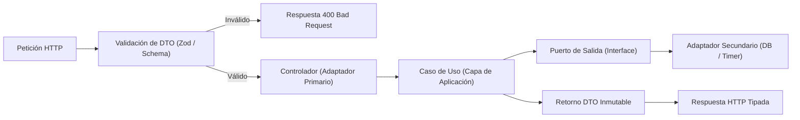

# Skill: aforo-backend

## 1. Propósito Específico
Estandarizar las prácticas de codificación e implementación de la capa de aplicación y adaptadores de transporte (API REST) en el backend de AFORO, asegurando contratos desacoplados, inyección de dependencias mediante interfaces, validación robusta y manejo uniforme de excepciones, en conformidad con la Constitución ([`.specify/memory/constitution.md`](../../../.specify/memory/constitution.md)) y [`AGENTS.md`](../../../AGENTS.md).

---

## 2. Condiciones de Activación
Esta skill se activa ante:
- Creación o modificación de casos de uso (`use-cases/`).
- Implementación de controladores HTTP o adaptadores primarios (`adapters/primary/`).
- Definición de contratos de entrada/salida (DTOs) y esquemas de validación.
- Configuración de cableado de dependencias o inyección de servicios.
- Manejo de respuestas de error de la API (códigos HTTP, formatos RFC 7807).

---

## 3. Responsabilidades Permitidas
- Diseñar casos de uso que implementen una única responsabilidad funcional (Single Responsibility Principle).
- Inyectar adaptadores secundarios mediante puertos de salida abstractos (`ports/out/`).
- Validar rigurosamente los datos de entrada en el límite de la infraestructura antes de invocar la aplicación.
- Mapear excepciones de dominio a códigos de estado HTTP estandarizados (400, 404, 409, 422, 500).
- Diseñar contratos API compatibles con el frontend existente de AFORO Web ([`src/`](../../../src/)).
- Alinear cada caso de uso con su especificación en [`specs/`](../../../specs/) y sus tareas en `tasks.md`.
- Garantizar el cumplimiento de la Política de Preservación Histórica ([`AGENTS.md`](../../../AGENTS.md#8-política-de-preservación-histórica-y-trazabilidad-innegociable)).

---

## 4. Restricciones y Prohibiciones Innegociables
- **PROHIBIDO imponer tecnologías no aprobadas como hechos consumados**: Mantener el desacoplamiento mediante abstracciones para que la elección final del framework HTTP (Fastify vs. Express) no altere la lógica de aplicación.
- **PROHIBIDO mezclar responsabilidades de transporte con orquestación**: Los casos de uso no deben recibir objetos `Request` o `Response` de HTTP, ni conocer cookies, cabeceras o sockets.
- **PROHIBIDO omitir validación de DTOs**: Ninguna petición externa puede procesarse sin validación estructural previa.
- **PROHIBIDO silenciar errores**: Todo fallo de negocio o infraestructura debe propagarse de forma semántica y tipada.

---

## 5. Procedimiento de Trabajo



1. **Definir el Contrato (DTO)**: Crear los esquemas de entrada y salida con tipado estricto.
2. **Definir el Puerto de Salida**: Crear la interfaz en `ports/out/` (ej. `IReservationRepository`).
3. **Implementar el Caso de Uso**: Orquestar el flujo llamando al puerto, aplicando las reglas de negocio y devolviendo el resultado sin conocer la tecnología subyacente.
4. **Implementar el Controlador**: Recibir el DTO validado, invocar el caso de uso y transformar la salida o el error en la respuesta HTTP correspondiente.

---

## 6. Criterios de Aceptación
1. Casos de uso 100 % desacoplados de frameworks web.
2. Dependencias inyectadas por constructor a través de interfaces TypeScript.
3. Formato de error estandarizado con código de error legible, mensaje descriptivo y detalles de validación.
4. Pruebas unitarias del caso de uso ejecutables mediante mocks o dobles de prueba sin levantar servidores HTTP.

---

## 7. Verificación de Resultados
- Ejecutar pruebas unitarias de casos de uso con `npm run test`.
- Validar tipos estáticos con `npm run typecheck`.
- Comprobar que los DTOs rechacen cargas útiles corruptas o incompletas en pruebas de límites (*boundary tests*).

---

## 8. Ejemplos Concretos

### Ejemplo Correcto (Caso de Uso Desacoplado con Inyección de Dependencias)
```typescript
// src/modules/reservations/application/use-cases/hold-tickets.use-case.ts
import { IReservationRepository } from '../ports/out/reservation-repository.port';
import { ITimerNotifier } from '../ports/out/timer-notifier.port';
import { HoldTicketsCommand, HoldTicketsResult } from '../dtos/hold-tickets.dto';
import { Reservation } from '../../domain/entities/reservation.entity';

export class HoldTicketsUseCase {
  constructor(
    private readonly reservationRepo: IReservationRepository,
    private readonly timerNotifier: ITimerNotifier
  ) {}

  async execute(command: HoldTicketsCommand): Promise<HoldTicketsResult> {
    // 1. Ejecutar transacción y validación a través de puertos
    const reservation = await this.reservationRepo.createHold({
      sectorId: command.sectorId,
      customerId: command.customerId,
      quantity: command.quantity,
      ttlSeconds: 600
    });

    // 2. Programar notificación de expiración
    await this.timerNotifier.scheduleExpiration(reservation.id, 600);

    return {
      reservationId: reservation.id,
      expiresAt: reservation.expiresAt,
      quantity: reservation.quantity
    };
  }
}
```

### Ejemplo Incorrecto (Acoplamiento a Framework y Dependencia Concreta)
```typescript
// INCORRECTO: Caso de uso acoplado a Fastify y clase concreta sin interfaz
import { FastifyRequest, FastifyReply } from 'fastify'; // VIOLACIÓN: Framework HTTP en aplicación
import { PostgresRepo } from '../../infra/postgres-repo'; // VIOLACIÓN: Depende de implementación concreta

export class HoldTicketsUseCase {
  private repo = new PostgresRepo(); // VIOLACIÓN: No hay inyección de dependencias

  async execute(req: FastifyRequest, reply: FastifyReply) { // VIOLACIÓN: Acoplado al transporte
    const data = req.body as any; // VIOLACIÓN: Sin validación de tipos
    const result = await this.repo.save(data);
    reply.send(result);
  }
}
```

