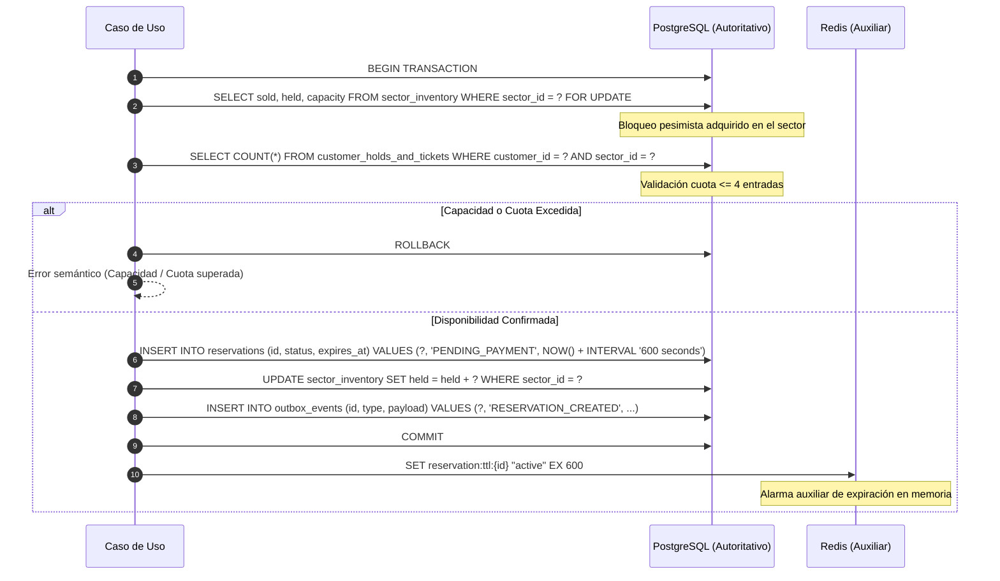

# Skill: aforo-persistence

## 1. Propósito Específico
Garantizar la integridad transaccional, consistencia estricta ACID y prevención absoluta de sobreventa (*overbooking*) en el almacenamiento de datos de AFORO, asegurando el cumplimiento de las reglas de negocio [RN-01 a RN-08](../../../docs/complementos/03-reglas-de-negocio.md), la Constitución ([`.specify/memory/constitution.md`](../../../.specify/memory/constitution.md)) y los ADRs [ADR-003](../../../docs/complementos/adrs/ADR-003-concurrencia-integridad-inventario.md), [ADR-004](../../../docs/complementos/adrs/ADR-004-idempotencia-pagos-webhooks.md) y [ADR-006](../../../docs/complementos/adrs/ADR-006-persistencia-operacion-offline-access.md).

---

## 2. Condiciones de Activación
Esta skill se activa ante:
- Creación o modificación de esquemas relacionales, tablas, índices o migraciones de base de datos.
- Implementación de adaptadores de persistencia (`adapters/secondary/`).
- Consultas transaccionales de reserva, compra, confirmación de pago o validación en molinete.
- Manejo de claves con tiempo de vida (TTL) y alarmas en Redis.
- Implementación del patrón Transactional Outbox (`outbox_events`).

---

## 3. Responsabilidades Permitidas
- Definir y ejecutar transacciones PostgreSQL con nivel de aislamiento adecuado.
- Aplicar bloqueos pesimistas mediante `SELECT ... FOR UPDATE` sobre la fila del inventario del sector en operaciones de reserva.
- Comprobar la invariante crítica de capacidad antes de confirmar cualquier reserva:
  $$\text{entradas\_vendidas} + \text{reservas\_activas} + \text{solicitadas} \le \text{aforo\_total}$$
- Verificar la cuota máxima permitida por titular: máximo 4 entradas por comprador y sector, considerando conjuntamente entradas ya adquiridas y reservas temporalmente vigentes.
- Configurar expiración determinista de reservas a los 600 segundos (10 minutos), tomando `CURRENT_TIMESTAMP` de PostgreSQL como reloj autoritativo.
- Utilizar Redis exclusivamente como almacén auxiliar de soporte para temporizadores TTL y caché volátil.
- Implementar la inserción atómica de eventos en la tabla `outbox_events` dentro de la misma transacción SQL que muta el estado de negocio.
- Asegurar idempotencia en transacciones mediante claves únicas (`idempotency_key`, `payment_intent_id`, `event_id`).
- Garantizar el cumplimiento de la Política de Preservación Histórica ([`AGENTS.md`](../../../AGENTS.md#8-política-de-preservación-histórica-y-trazabilidad-innegociable)), preservando esquemas y datos sin migraciones destructivas.

---

## 4. Restricciones y Prohibiciones Innegociables
- **PROHIBIDO delegar la verdad a Redis**: Redis jamás actúa como base de datos autoritativa. La pérdida o reinicio de Redis no puede causar pérdida de reservas o sobreventa; PostgreSQL es la única fuente de verdad.
- **PROHIBIDO ejecutar migraciones destructivas sin autorización**: Queda vetado ejecutar comandos que borren tablas (`DROP TABLE`), alteren columnas con pérdida de datos o reinicien esquemas sin respaldo explícito ([`AGENTS.md`](../../../AGENTS.md#8-política-de-preservación-histórica-y-trazabilidad-innegociable)).
- **PROHIBIDO consultas de inventario no bloqueantes en compras concurrentes**: No consultar disponibilidad con un `SELECT` simple previo a la reserva; debe utilizarse bloqueo pesimista o actualización atómica condicional.
- **PROHIBIDO mantener transacciones abiertas durante operaciones externas**: No realizar llamadas HTTP a pasarelas de pago dentro de una transacción PostgreSQL abierta.

---

## 5. Procedimiento de Trabajo



---

## 6. Criterios de Aceptación
1. Toda operación de reserva ocurre en una única transacción atómica en PostgreSQL.
2. Invariante de capacidad respetada bajo concurrencia masiva sin sobreventa.
3. Límite de 4 entradas aplicado sumando compras confirmadas y reservas activas.
4. Las reservas no pagadas liberan el inventario al expirar los 600 segundos mediante transacción en PostgreSQL.
5. Los eventos de dominio se persisten en `outbox_events` en la misma transacción que el cambio de estado.

---

## 7. Verificación de Resultados
- Ejecutar pruebas automatizadas de integración contra PostgreSQL con múltiples hilos o promesas concurrentes (`Promise.all`).
- Verificar que 10 intentos concurrentes de reservar el último asiento resulten en exactamente 1 éxito y 9 rechazos ordenados.
- Comprobar que tras 600 segundos el caso de uso `ReleaseExpiredHoldsUseCase` restablezca el contador `held` sin alterar `sold`.

---

## 8. Ejemplos Concretos

### Ejemplo Correcto (Transacción ACID con Bloqueo Pesimista en PostgreSQL)
```typescript
// src/modules/reservations/infrastructure/adapters/secondary/postgres-reservation.adapter.ts
// CORRECTO: Transacción ACID con SELECT FOR UPDATE y verificación de invariante
export class PostgresReservationAdapter implements IReservationRepository {
  constructor(private readonly dbPool: any) {}

  async createHold(params: CreateHoldParams): Promise<Reservation> {
    const client = await this.dbPool.connect();
    try {
      await client.query('BEGIN');

      // 1. Bloqueo pesimista del inventario del sector
      const sectorRes = await client.query(
        `SELECT capacity, sold_count, held_count 
         FROM sector_inventory 
         WHERE sector_id = $1 FOR UPDATE`,
        [params.sectorId]
      );
      const { capacity, sold_count, held_count } = sectorRes.rows[0];

      // 2. Verificación de invariante de capacidad
      if (sold_count + held_count + params.quantity > capacity) {
        throw new Error('CAPACITY_EXCEEDED');
      }

      // 3. Verificación de límite de 4 entradas por titular
      const quotaRes = await client.query(
        `SELECT COALESCE(SUM(quantity), 0) as current_quota
         FROM active_holds_and_tickets
         WHERE customer_id = $1 AND sector_id = $2`,
        [params.customerId, params.sectorId]
      );
      if (Number(quotaRes.rows[0].current_quota) + params.quantity > 4) {
        throw new Error('MAX_QUOTA_EXCEEDED');
      }

      // 4. Inserción de reserva y actualización de inventario
      await client.query(
        `INSERT INTO reservations (id, sector_id, customer_id, quantity, expires_at, status)
         VALUES ($1, $2, $3, $4, CURRENT_TIMESTAMP + INTERVAL '600 second', 'PENDING_PAYMENT')`,
        [params.id, params.sectorId, params.customerId, params.quantity]
      );
      await client.query(
        `UPDATE sector_inventory SET held_count = held_count + $1 WHERE sector_id = $2`,
        [params.quantity, params.sectorId]
      );

      // 5. Inserción en outbox dentro de la misma transacción
      await client.query(
        `INSERT INTO outbox_events (id, event_type, payload, status)
         VALUES ($1, 'RESERVATION_CREATED', $2, 'PENDING')`,
        [crypto.randomUUID(), JSON.stringify({ reservationId: params.id })]
      );

      await client.query('COMMIT');
      return new Reservation(...);
    } catch (error) {
      await client.query('ROLLBACK');
      throw error;
    } finally {
      client.release();
    }
  }
}
```

### Ejemplo Incorrecto (Sin Transacción y Confianza Ciega en Redis)
```typescript
// INCORRECTO: Concurrencia rota, sin transacción y Redis como fuente de verdad
export class BrokenReservationAdapter {
  async createHold(params: any) {
    // VIOLACIÓN: Consulta sin bloqueo (Race Condition inmediata)
    const available = await redisClient.get(`sector:${params.sectorId}:available`);
    if (Number(available) < params.quantity) {
      throw new Error('Sin cupo');
    }
    // VIOLACIÓN: Si falla la siguiente línea, Redis queda inconsistente
    await redisClient.decrby(`sector:${params.sectorId}:available`, params.quantity);
    await postgresClient.query('INSERT INTO reservations ...'); // Sin transacción
  }
}
```

