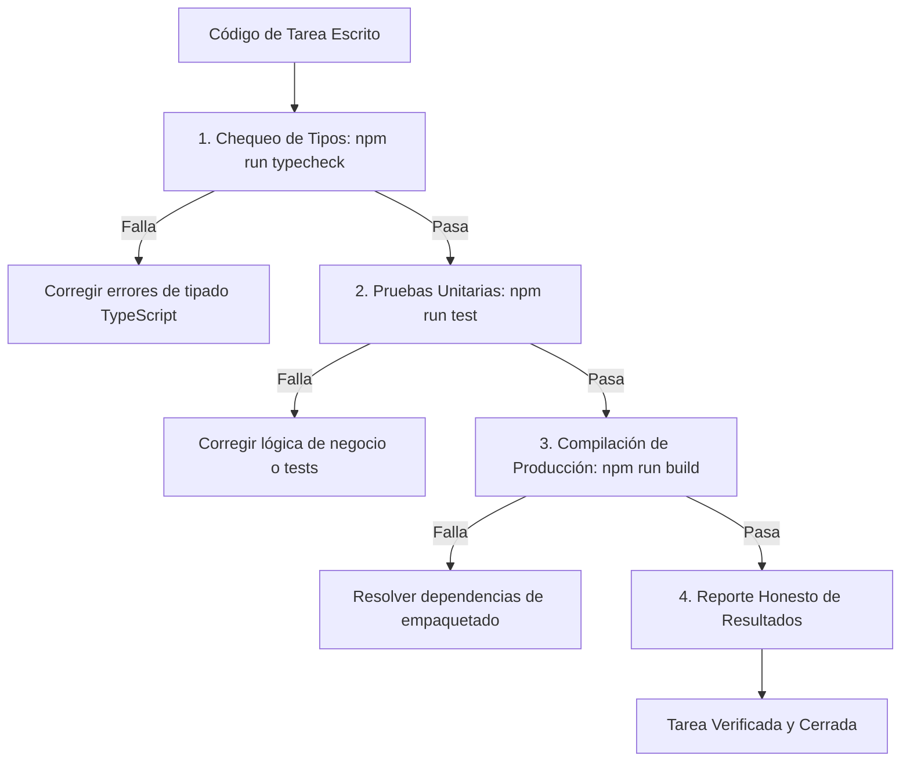

# Skill: aforo-quality

## 1. Propósito Específico
Establecer los estándares de calidad de código, cobertura de pruebas y verificación empírica en AFORO, asegurando que ninguna tarea se dé por completada sin validación real y que los resultados reportados sean fidedignos según el [Principio IV de la Constitución](../../../.specify/memory/constitution.md#iv-transparencia-de-simulación-y-honestidad-técnica-innegociable) y [`AGENTS.md`](../../../AGENTS.md).

---

## 2. Condiciones de Activación
Esta skill se activa ante:
- Cierre de tareas de implementación (`/speckit-implement`).
- Ejecución de suites de pruebas automáticas (`npm test`, `npm run check`).
- Introducción o modificación de lógica de cálculo (carrito, aforos, cuotas, criptografía).
- Comprobación de tipos con TypeScript (`tsc --noEmit`).
- Reporte de métricas de calidad en PRs, commits o entregables académicos.

---

## 3. Responsabilidades Permitidas
- Exigir la ejecución y paso exitoso de `npm run check` antes de cerrar cualquier tarea técnica.
- Diseñar pruebas unitarias para entidades de dominio y casos de uso con cobertura de casos límite (*edge cases*).
- Formular pruebas de concurrencia que simulen solicitudes simultáneas compitiendo por un mismo inventario.
- Preservar íntegras las 30 pruebas automatizadas ya existentes en [`src/`](../../../src/).
- Reportar de forma explícita el número de pruebas ejecutadas, pasando y fallidas.
- Validar que las definiciones de TypeScript compilen sin suprimir errores con `any` o `@ts-ignore` injustificados.
- **Trazabilidad y Balance Documental en Cierre**: Cumplir la Política de Preservación Histórica ([`AGENTS.md`](../../../AGENTS.md#8-política-de-preservación-histórica-y-trazabilidad-innegociable)), detallando en el balance final de cada tarea la lista exacta de archivos creados, modificados, conservados y propuestos para sustitución, respetando siempre las modificaciones locales previas.

---

## 4. Restricciones y Prohibiciones Innegociables
- **PROHIBIDO afirmar cumplimiento de rendimiento sin medición**: No afirmar que el sistema "soporta 2500 req/s con latencia < 200 ms" a menos que se haya ejecutado una prueba de carga real con k6 o herramienta equivalente y se disponga del informe de salida.
- **PROHIBIDO simular o fabricar salidas de pruebas**: Queda estrictamente vetado imprimir salidas falsas de pruebas o asumir que el código compila sin haber ejecutado los comandos en el entorno.
- **PROHIBIDO degradar la suite de pruebas existente**: No comentar, omitir (`test.skip`) ni eliminar pruebas que fallan para forzar la aprobación de un build.
- **PROHIBIDO romper el build de producción**: El comando `npm run build` debe culminar con código de salida 0.
- **PROHIBIDO descartar modificaciones locales o evidencias históricas**: Queda vetado descartar cambios locales de otros agentes o borrar silenciosamente especificaciones o resultados de pruebas previas ([`AGENTS.md`](../../../AGENTS.md#8-política-de-preservación-histórica-y-trazabilidad-innegociable)).

---

## 5. Procedimiento de Trabajo



1. **Chequeo Estático**: Ejecutar `npm run typecheck` (`tsc --noEmit`).
2. **Ejecución de Pruebas**: Ejecutar `npm run test` verificando tanto pruebas existentes como nuevas.
3. **Verificación de Empaquetado**: Ejecutar `npm run build` para asegurar la integridad de artefactos.
4. **Comprobación Consolidada**: Ejecutar `npm run check` como compuerta final obligatoria.

---

## 6. Criterios de Aceptación
1. 100 % de pruebas en estado `pass`.
2. Cero advertencias críticas de TypeScript en modo estricto.
3. Las pruebas de concurrencia demuestran que ninguna ejecución sobrepasa el aforo configurado.
4. Todo resultado reportado incluye el comando exacto ejecutado y su salida real.

---

## 7. Verificación de Resultados
- Confirmar la salida de `npm run check`.
- Inspeccionar el código de retorno (`$LASTEXITCODE` / exit code 0).
- Verificar que el número total de pruebas sea $\ge 30$ (el valor base verificado del Sprint 01).

---

## 8. Ejemplos Concretos

### Ejemplo Correcto (Prueba Unitaria Exhaustiva de Invariante de Aforo)
```typescript
// src/modules/reservations/domain/entities/reservation.test.ts
import { describe, it } from 'node:test';
import assert from 'node:assert/strict';

describe('Invariante de Aforo y Cuota Máxima', () => {
  it('debe rechazar una reserva si excede la cuota de 4 entradas por titular', () => {
    const currentHolds = 3;
    const requested = 2;
    const maxQuota = 4;

    const wouldExceed = (currentHolds + requested) > maxQuota;
    assert.equal(wouldExceed, true, 'La solicitud debe ser rechazada');
  });

  it('debe permitir exactamente hasta el límite de 4 entradas', () => {
    const currentHolds = 2;
    const requested = 2;
    const maxQuota = 4;

    const wouldExceed = (currentHolds + requested) > maxQuota;
    assert.equal(wouldExceed, false, 'La solicitud debe ser permitida');
  });
});
```

### Ejemplo Incorrecto (Aserción Falsa o Métricas No Medidas)
```typescript
// INCORRECTO: Prueba trivial que no valida nada o reporte falso
it('soporta 2500 req/s', () => {
  // VIOLACIÓN: Prueba vacía que finge validar un atributo de calidad no medido
  assert.equal(true, true);
});
```

