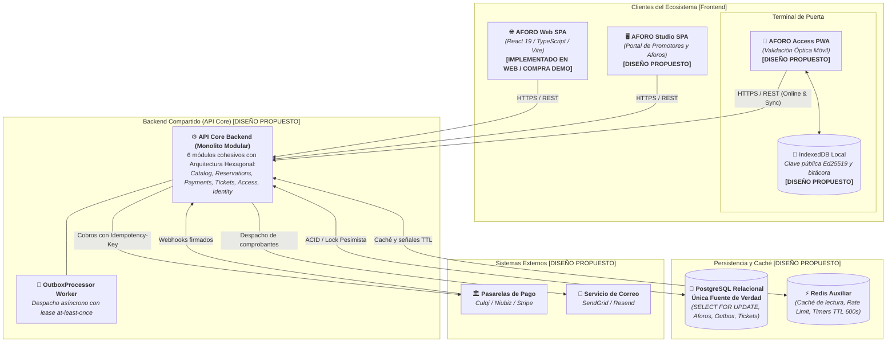
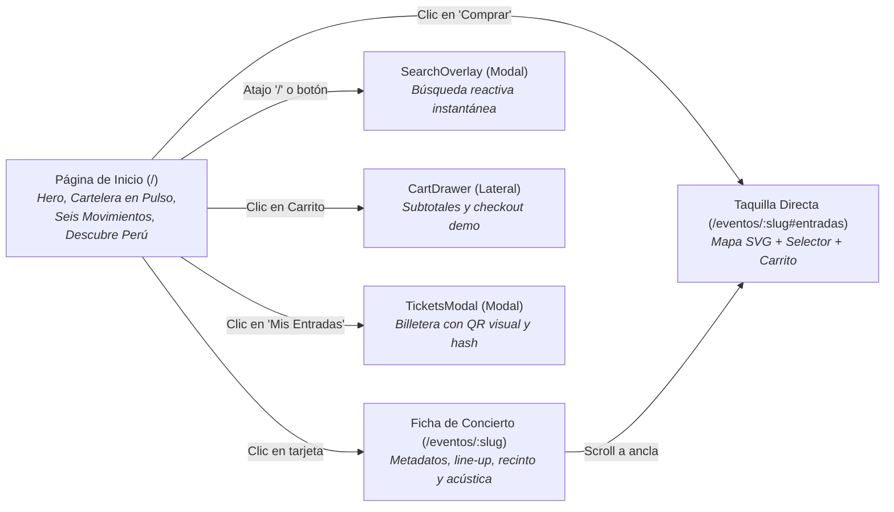
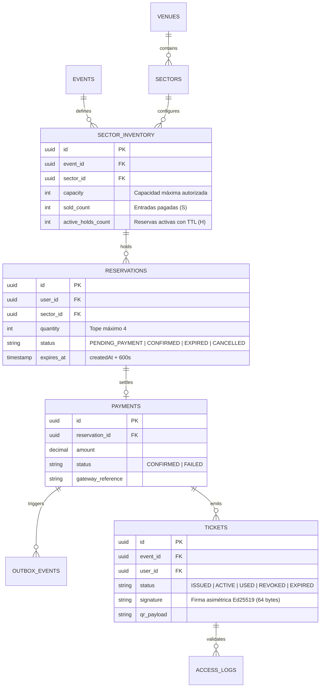

# AFORO — Transferencia de Contexto y Auditoría Técnica Integral

**Documento:** `AFORO_CONTEXTO_ACTUAL.md`  
**Destinatario:** Asistente de IA (ChatGPT GPT-6 / Relevo de Desarrollo)  
**Autoría de Auditoría:** Software Architect Senior & Tech Lead  
**Fecha de Emisión:** 30 de Octubre de 2026  
**Repositorio:** `AFORO-Fusion` / `AFORO` (GitHub: `https://github.com/CARDBELL96/AFORO.git`)  
**Rama Activa:** `main` (Sincronizada con `origin/main` en commit `535e805`)  
**Contexto Académico:** Universidad Nacional de San Cristóbal de Huamanga (UNSCH) — Escuela Profesional de Ingeniería de Sistemas — Curso: Arquitectura de Software (IS-488) — Docente: Ing. Lizbeth Jaico  

---

## 1. Resumen Ejecutivo

**AFORO** es un proyecto universitario de ingeniería de software enfocado en resolver los problemas estructurales de la taquilla digital y control de acceso en eventos masivos y conciertos en vivo en el Perú (sobreventa bajo concurrencia extrema, reventa automatizada por bots, colapso de servidores en preventas, cobros duplicados en pasarelas y pérdida de conectividad en puertas de recintos).

El proyecto se encuentra formalmente en el **cierre del Sprint 01**. La realidad técnica del repositorio se compone de dos dimensiones estrictamente diferenciadas en apego al Principio IV de su Constitución (*Honestidad Técnica y Transparencia de Simulación*):

1. **Frontend Implementado y Operativo (`AFORO Web SPA`)**:  
   Construido en [`src/`](src/) con **React 19**, **TypeScript 5.7**, **Vite 6** y CSS nativo modular con *Container Queries*. Cuenta con navegación SPA propia sin librerías externas ([`src/router.tsx`](src/router.tsx)), catálogo editorial (*Pulso Nocturno*), mapas vectoriales interactivos de recintos en SVG nativo sin dependencias cartográficas ([`src/components/VenueStageMap.tsx`](src/components/VenueStageMap.tsx)), carrito lateral con sincronización multi-pestaña mediante eventos nativos `storage` ([`src/lib/store.tsx`](src/lib/store.tsx)) y una suite automatizada de **30 pruebas unitarias y de integración** pasando al 100 % (`npm run check`).
2. **Backend, Persistencia y Clientes Especializados Propuestos (`[DISEÑO PROPUESTO]` / No implementados en código)**:  
   El backend central (**`API Core Backend`**), los almacenes de datos (**`PostgreSQL`** relacional y **`Redis`** auxiliar volátil), las aplicaciones cliente complementarias (**`AFORO Studio SPA`** para promotores y **`AFORO Access PWA`** con IndexedDB para operadores de molinete) y las integraciones con pasarelas de pago reales (**Culqi, Niubiz, Stripe**) y servicios de correo (**SendGrid**) **no existen como código ejecutable en `src/`**. Han sido exhaustivamente formalizados y aprobados a nivel de especificación técnica, requisitos, reglas de negocio, decisiones arquitectónicas (6 ADRs), patrones de diseño (8 patrones), principios SOLID y diagramas C4 (Niveles C1, C2, C3 y C4) en la carpeta [`docs/`](docs/). En el frontend actual, el proceso de reserva, pasarela de pago y emisión de boletos QR opera como una **demostración interactiva en cliente (`[DEMO / SIMULADO]`)** con pases en estado `ACTIVA_DEMO` y almacenamiento en `localStorage`.

---

## 2. Identidad y Objetivos de AFORO

### 2.1. ¿Qué es AFORO?
AFORO es una plataforma integral de taquilla digital, descubrimiento editorial y validación de accesos para conciertos y eventos culturales masivos en el Perú. Combina una experiencia de usuario inmersiva orientada al descubrimiento cultural con un diseño de arquitectura de sistemas de misión crítica.

### 2.2. ¿Cuál es su objetivo principal?
Demostrar la concepción, especificación, modelado arquitectónico y prototipado frontend de un sistema de venta de entradas que garantice **cero sobreventa transaccional** ($S + H \le C$) bajo ráfagas masivas de concurrencia y **continuidad operativa en puertas de acceso** incluso durante el colapso total de telecomunicaciones celulares en el recinto.

### 2.3. ¿Qué problema resuelve?
1. **Sobreventa Transaccional (*Overselling*)**: La falta de serialización y aislamiento ACID en plataformas convencionales genera emisión de entradas por encima de la capacidad legal y física aprobada por Defensa Civil.
2. **Acaparamiento y Reventa Especulativa**: Usuarios maliciosos y bots compran lotes enteros en segundos para especulación. AFORO aplica selección visual no bloqueante (`RN-02`) y límite estricto de 4 entradas por titular y sector (`RN-04`).
3. **Colapso de Telecomunicaciones en Recintos**: La aglomeración en estadios bloquea las redes 4G/5G; los molinetes no pueden validar entradas si dependen de consultas síncronas a un servidor central. AFORO adopta firmas digitales asimétricas **Ed25519** y almacenamiento local en **IndexedDB** (`ADR-005`, `ADR-006`).
4. **Pérdida de Consistencia en Pagos**: Clientes que pagan pero no reciben sus entradas por fallos de red post-cobro (*ghost charges*). AFORO diseña el patrón **Transactional Outbox** (`ADR-004`).

### 2.4. ¿Qué tipo de aplicación es?
- **Ecosistema Global**: Monolito Modular con Arquitectura Hexagonal que da servicio a tres clientes web especializados:
  - `AFORO Web SPA`: Cliente público de descubrimiento, compra y billetera (React 19).
  - `AFORO Studio SPA`: Portal web administrativo para promotores y administradores de local.
  - `AFORO Access PWA`: Aplicación web progresiva móvil para terminales ópticas de molinete.
- **Backend Propuesto**: `API Core Backend` en Node.js/TypeScript, monolítico modular en un solo ejecutable desplegable.

### 2.5. ¿Quiénes son sus usuarios (Actores)?
*(Formalizados en [`docs/01-analisis-de-sistema/01-actores.md`](docs/01-analisis-de-sistema/01-actores.md))*
- **Asistente / Comprador (*Fan*)**: Consulta cartelera, selecciona entradas, gestiona su carrito y visualiza su pase digital en su billetera.
- **Promotor / Organizador**: Configura conciertos, fechas, precios y monitorea taquilla en vivo.
- **Administrador del Recinto**: Configura planos espaciales, capacidades máximas legales de sectores y puertas de evacuación.
- **Operador de Puerta / Molinete**: Escanea códigos QR en molinetes con terminal móvil en modo online u offline.
- **Administrador de Plataforma**: Gestiona conciliaciones financieras, auditoría forense de colisiones y seguridad del sistema.

### 2.6. Principales Funcionalidades y Estado de Realidad

| Funcionalidad | Aplicación / Componente | Estado de Realidad | Evidencia en el Repositorio |
| :--- | :--- | :---: | :--- |
| **Catálogo Editorial y Filtros Multicriterio** | AFORO Web | `IMPLEMENTADO` | [`src/components/PulseCatalogSection.tsx`](src/components/PulseCatalogSection.tsx), [`src/lib/filters.ts`](src/lib/filters.ts) |
| **Búsqueda Instantánea con Atajo `/`** | AFORO Web | `IMPLEMENTADO` | [`src/components/SearchOverlay.tsx`](src/components/SearchOverlay.tsx), [`src/App.tsx`](src/App.tsx) |
| **Navegación Segura en Nueva Pestaña** | AFORO Web | `IMPLEMENTADO` | [`src/router.tsx`](src/router.tsx) (`target="_blank" rel="noopener noreferrer"`) |
| **Mapa Vectorial SVG de Sectores** | AFORO Web | `IMPLEMENTADO` | [`src/components/VenueStageMap.tsx`](src/components/VenueStageMap.tsx) (SVG interactivo nativo propio) |
| **Selección Visual de Entradas (Tope 4)** | AFORO Web | `IMPLEMENTADO` | [`src/components/TicketPicker.tsx`](src/components/TicketPicker.tsx), [`src/lib/cart.ts`](src/lib/cart.ts) |
| **Carrito Lateral Sincronizado Multi-Pestaña** | AFORO Web | `IMPLEMENTADO` | [`src/components/CartDrawer.tsx`](src/components/CartDrawer.tsx), [`src/lib/store.tsx`](src/lib/store.tsx) |
| **Billetera Local de Entradas Demo con QR** | AFORO Web | `DEMO / SIMULADO` | [`src/components/TicketsModal.tsx`](src/components/TicketsModal.tsx), estado `ACTIVA_DEMO` |
| **Reserva Temporal Transaccional (TTL 10 min)** | API Core Backend | `DISEÑO PROPUESTO` | [`docs/04-modelo-c4/Nivel4-DiagramadeCodigo.md`](docs/04-modelo-c4/Nivel4-DiagramadeCodigo.md) (`HoldTicketsUseCase`) |
| **Cobro Idempotente y Webhooks de Pago** | API Core Backend | `DISEÑO PROPUESTO` | [`docs/complementos/adrs/ADR-004-idempotencia-pagos-webhooks.md`](docs/complementos/adrs/ADR-004-idempotencia-pagos-webhooks.md) |
| **Firma Criptográfica Asimétrica Ed25519** | API Core Backend | `DISEÑO PROPUESTO` | [`docs/complementos/adrs/ADR-005-criptografia-entradas-qr.md`](docs/complementos/adrs/ADR-005-criptografia-entradas-qr.md) |
| **Validación Offline e IndexedDB en Molinetes** | AFORO Access PWA | `DISEÑO PROPUESTO` | [`docs/complementos/adrs/ADR-006-persistencia-operacion-offline-access.md`](docs/complementos/adrs/ADR-006-persistencia-operacion-offline-access.md) |
| **Administración Editorial y Aforos de Recinto** | AFORO Studio SPA | `DISEÑO PROPUESTO` | [`docs/01-analisis-de-sistema/03-requisitos-funcionales.md`](docs/01-analisis-de-sistema/03-requisitos-funcionales.md) (`RF-STU-01..06`) |

### 2.7. Alcance del Proyecto Universitario (Trabajo Final)
- **Sprint 01 (Completado y Verificado)**:
  - Formulación de la Constitución del proyecto ([`.specify/memory/constitution.md`](.specify/memory/constitution.md)).
  - Especificación funcional y de diseño con GitHub Spec Kit ([`specs/001-frontend-proportions-and-ticket-page/`](specs/001-frontend-proportions-and-ticket-page/)).
  - Implementación frontend de AFORO Web con proporciones nativas al 100 % de zoom, suite de 30 pruebas automatizadas y compilación limpia en Vite.
  - Documentación exhaustiva conforme a la Guía 04 de Arquitectura de Software: Análisis (actores, historias, RF, RNF ISO 25010, restricciones, drivers, matriz trazabilidad), Arquitectura (inicial, monolito modular, hexagonal, componentes), Diseño Interno (SOLID, 8 patrones, 3 diagramas de secuencia, máquinas de estado de `Reservation` y `Ticket`) y los cuatro niveles del Modelo C4 (C1, C2, C3 y C4).
- **Sprint 02 (Proyectado para la fase de implementación backend)**:
  - Construcción del backend `API Core` en Node.js/TypeScript según el boilerplate proyectado en [`docs/tecnologia/boilerplate-clean-arquitectura/`](docs/tecnologia/boilerplate-clean-arquitectura/).
  - Conexión a PostgreSQL con migraciones y transacciones `SELECT ... FOR UPDATE`.
  - Implementación de Redis para temporizadores auxiliares de 600 segundos.
  - Conexión del frontend web a los endpoints reales de `API Core`.

### 2.8. Funcionalidades Fuera del Alcance Inicial
- **AFORO Creative AI**: Capacidad conceptual futura proyectada para AFORO Studio para asistir al promotor en la generación declarativa de paletas de color y estilos para la cartelera web. No altera inventario ni reglas de negocio.
- **Pasarelas de Pago en Producción**: Integración bancaria con credenciales de producción PCI-DSS SAQ A (se mantiene con adaptadores y sandbox/mocks).
- **Hardware de Molinetes Físicos**: Integración con torniquetes electromecánicos industriales mediante protocolos IoT.

---

## 3. Stack Tecnológico Confirmado

### 3.1. Frontend Implementado (`AFORO Web SPA`)
- **Lenguaje**: TypeScript 5.7.2 (`tsconfig.json` con `target: "ES2022"`, `moduleResolution: "bundler"`, `strict: true`).
- **Framework UI**: React 19.0.0 y React DOM 19.0.0.
- **Herramienta de Construcción y DevServer**: Vite 6.0.0 con `@vitejs/plugin-react` 4.3.4.
- **Enrutamiento**: Router minimalista propio en [`src/router.tsx`](src/router.tsx), basado en la History API nativa del navegador y sincronizado mediante `useSyncExternalStore` (cero dependencias de `react-router`).
- **Estilos y Maquetación**: CSS nativo modular estructurado en 9 hojas de estilo bajo [`src/styles/`](src/styles/), utilizando CSS Variables, CSS Cascade Layers (`@layer base, layout, components, utilities`), *Container Queries* (`@container`, unidades `cqi`) y escalado fluido (`clamp()`). Sin Tailwind ni preprocesadores.
- **Estado Global**: React Context API en [`src/lib/store.tsx`](src/lib/store.tsx) (`StoreProvider`), con persistencia en `localStorage` y sincronización entre pestañas mediante el evento nativo `storage` de la Web Storage API.
- **Iconografía y Gráficos**: Iconos SVG incrustados en [`src/components/Icon.tsx`](src/components/Icon.tsx) y plano de recinto vectorial interactivo en [`src/components/VenueStageMap.tsx`](src/components/VenueStageMap.tsx).
- **Tipografía**: Fuentes tipográficas autohospedadas en [`public/fonts/`](public/fonts/) (`CabinetGrotesk-Extrabold`, `ClashDisplay-Variable`, `GeneralSans-Variable`, `JetBrainsMono-Medium`).

### 3.2. Entorno de Ejecución, Herramientas y Pruebas
- **Gestor de Paquetes**: `npm` (respaldado por `package-lock.json`).
- **Runner de Pruebas**: Node.js Test Runner nativo (`node --import tsx --test "src/**/*.test.ts"`).
- **Ejecución TypeScript al Vuelo**: `tsx` 4.19.2.
- **Tipos de Node**: `@types/node` 22.10.0.
- **Scripts Disponibles en `package.json`**:
  - `npm run dev`: Inicia el servidor de desarrollo Vite local.
  - `npm run typecheck`: Ejecuta `tsc --noEmit` para comprobación estricta de tipos.
  - `npm run test`: Ejecuta los 30 tests unitarios y de integración con el runner nativo de Node.
  - `npm run build`: Ejecuta `tsc --noEmit && vite build`.
  - `npm run preview`: Previsualiza la compilación de producción en `dist/`.
  - `npm run check`: Ejecuta la compuerta de calidad completa (`typecheck && test && build`).

### 3.3. Tecnologías Formalizadas en el Diseño Propuesto (`[DISEÑO PROPUESTO]`)
- **Backend**: Node.js, TypeScript, Express o Fastify estructurado como Monolito Modular Hexagonal.
- **Base de Datos Relacional**: PostgreSQL (Única Fuente de Verdad para aforos, transacciones ACID con `SELECT ... FOR UPDATE`, claves de idempotencia y tabla `outbox_events`).
- **Caché y Temporización Auxiliar**: Redis (caché de cartelera pública, limitación de tráfico y alarmas volátiles de expiración TTL de 600 segundos).
- **Criptografía**: Ed25519 (curva elíptica asimétrica para firma digital de pases QR en 64 bytes).
- **Terminales de Puerta**: PWA con almacenamiento local IndexedDB para consultas indexadas en $O(\log N)$ y operación offline.

---

## 4. Estructura del Repositorio

A continuación se detalla el árbol de directorios real del proyecto (omitiendo `node_modules/`, `dist/` y `.git/`):

```text
AFORO-Fusion/
├── .agents/
│   └── skills/                       # Skills de GitHub Spec Kit para SDD
│       ├── speckit-analyze/SKILL.md
│       ├── speckit-checklist/SKILL.md
│       ├── speckit-clarify/SKILL.md
│       ├── speckit-constitution/SKILL.md
│       ├── speckit-converge/SKILL.md
│       ├── speckit-implement/SKILL.md
│       ├── speckit-plan/SKILL.md
│       ├── speckit-specify/SKILL.md
│       ├── speckit-tasks/SKILL.md
│       └── speckit-taskstoissues/SKILL.md
├── .specify/
│   ├── memory/
│   │   ├── .constitution-template.json
│   │   └── constitution.md           # Constitución innegociable de AFORO (v1.0.0)
│   ├── templates/                    # Plantillas de especificación, plan y tareas
│   └── ...
├── docs/                             # Documentación oficial de la Guía 04 de Arquitectura
│   ├── 01-analisis-de-sistema/
│   │   ├── 01-actores.md             # Catálogo de actores humanos y sistemas externos
│   │   ├── 02-historias-del-usuario.md # Historias de usuario priorizadas (HU-01 a HU-08)
│   │   ├── 03-requisitos-funcionales.md # Catálogo oficial RF-WEB, RF-STU, RF-ACC, RF-COR
│   │   ├── 04-atributos-de-calidad.md # Requisitos no funcionales ISO/IEC 25010
│   │   ├── 05-restricciones.md       # Restricciones técnicas, de negocio y metodológicas
│   │   ├── 06-driver-arquitectonicos.md # 5 Drivers prioritarios (DA-01 a DA-05)
│   │   ├── 07-decisiones-arquitectonicas.md # Resumen de los 6 ADRs aprobados
│   │   └── 08-escenarios-atributos-calidad.md # Escenarios SEI canónicos (EAC-01 a EAC-06)
│   ├── 02-arquitectura-software/
│   │   ├── arquitectura-inicial.md   # Fronteras del sistema, visión y trazabilidad
│   │   ├── componentes-arquitectonicos.md # Los 6 módulos, contratos y Outbox
│   │   ├── enfoque-aquitectonico.md  # Enfoque Hexagonal aplicado a Reservations
│   │   └── estilo-arquitectonico.md  # Monolito Modular, matriz de descarte y aislamiento
│   ├── 03-diseño-de-software/
│   │   └── diseño-interno/
│   │       ├── diseño-interno-de-modulos.md # Anatomía de módulos, estados y 3 secuencias
│   │       ├── patrones-de-diseño.md # 8 Patrones analizados en profundidad
│   │       └── principios-de-diseño.md # SOLID aplicado, capas concéntricas y gobernanza
│   ├── 04-modelo-c4/
│   │   ├── Nivel1-DiagramadeContextodelSistema.md # Diagrama C1 (Contexto del Sistema)
│   │   ├── Nivel2-DiagramadeContenedores.md # Diagrama C2 (Contenedores y Clientes)
│   │   ├── Nivel3-Diagrama-de-Componentes.md # Diagrama C3 (Componentes de API Core)
│   │   └── Nivel4-DiagramadeCodigo.md # Diagrama C4 (Código de Reservas e Inventario)
│   ├── complementos/                 # Documentación técnica de soporte
│   │   ├── 03-reglas-de-negocio.md   # Reglas de negocio RN-01 a RN-08
│   │   ├── 09-matriz-trazabilidad.md # Matriz de trazabilidad integral
│   │   └── adrs/                     # Registros de Decisión Arquitectónica individuales
│   │       ├── ADR-001-seleccion-estilo-monolito-modular.md
│   │       ├── ADR-002-adopcion-arquitectura-hexagonal.md
│   │       ├── ADR-003-concurrencia-integridad-inventario.md
│   │       ├── ADR-004-idempotencia-pagos-webhooks.md
│   │       ├── ADR-005-criptografia-entradas-qr.md
│   │       └── ADR-006-persistencia-operacion-offline-access.md
│   ├── img/
│   │   └── README.md
│   └── tecnologia/
│       └── boilerplate-clean-arquitectura/
│           └── README.md             # Plantilla canónica de paquetes Clean Architecture
├── public/
│   ├── fonts/                        # Fuentes web autohospedadas
│   ├── img/                          # Banners y pósters locales
│   └── favicon.svg
├── specs/
│   └── 001-frontend-proportions-and-ticket-page/ # Entrega Sprint 01 bajo metodología SDD
│       ├── contracts/                # Contratos de interfaz y mocks
│       ├── evidence/                 # Evidencias métricas y reportes de regresión
│       ├── plan.md                   # Plan de implementación SDD
│       ├── spec.md                   # Especificación funcional con escenarios Given/When/Then
│       └── tasks.md                  # Desglose de tareas completadas
├── src/                              # Código fuente implementado (AFORO Web SPA)
│   ├── components/                   # 19 Componentes React reutilizables
│   │   ├── Brand.tsx                 # Isotipo y logotipo de AFORO
│   │   ├── CartDrawer.tsx            # Carrito lateral deslizable
│   │   ├── CategoriesMosaicSection.tsx # Mosaico visual de categorías musicales
│   │   ├── Chrome.tsx                # Cabecera global con navegación y estados de scroll
│   │   ├── EventCard.tsx             # Tarjeta de concierto (Mosaico y Ledger)
│   │   ├── EventQuickModal.tsx       # Modal rápido de evento
│   │   ├── FilterPanel.tsx           # Barra y modal de filtros multicriterio
│   │   ├── Footer.tsx                # Pie de página editorial con créditos académicos
│   │   ├── Icon.tsx                  # Iconos SVG vectoriales optimizados
│   │   ├── Marquee.tsx               # Cinta animada de texto en marquesina
│   │   ├── PeruDiscoverySection.tsx  # Sección cultural regional (Lima, Cusco, Arequipa)
│   │   ├── Photo.tsx                 # Componente de imagen con fallback a póster local
│   │   ├── PulseCatalogSection.tsx   # Sección principal de cartelera y conmutador de vista
│   │   ├── Reveal.tsx                # Envoltura de animación con IntersectionObserver
│   │   ├── SearchOverlay.tsx         # Modal superpuesto de búsqueda instantánea
│   │   ├── States.tsx                # Componentes de estado (Loading, Error, Empty)
│   │   ├── Stepper.tsx               # Selector numérico con validación de tope (máx. 4)
│   │   ├── TicketPicker.tsx          # Taquilla interactiva y emisión demo de boletos
│   │   ├── TicketsModal.tsx          # Modal de billetera digital «Mis Entradas»
│   │   └── VenueStageMap.tsx         # Mapa interactivo vectorial SVG de sectores
│   ├── data/                         # Capa de datos en cliente
│   │   ├── editorial.ts              # Metadatos editoriales y entradas demo iniciales
│   │   ├── events.ts                 # Catálogo estático de 12 eventos de demostración
│   │   └── repository.ts             # Adaptador de datos con latencia simulada (500 ms)
│   ├── lib/                          # Funciones puras y lógica de dominio en cliente
│   │   ├── cart.test.ts              # Pruebas unitarias de lógica de carrito
│   │   ├── cart.ts                   # Reglas puras de adición, tope y cálculo de subtotales
│   │   ├── filters.test.ts           # Pruebas de normalización fonética y ordenamiento
│   │   ├── filters.ts                # Filtrado insensible a acentos, fechas y géneros
│   │   ├── format.test.ts            # Pruebas de formateo de moneda y fechas Lima
│   │   ├── format.ts                 # Formateo a Soles (PEN) y huso de Lima (UTC-5)
│   │   ├── hooks.ts                  # Hooks personalizados (useScrolled, useDebounce, etc.)
│   │   ├── store.test.ts             # Pruebas de reactividad y eventos multi-pestaña
│   │   └── store.tsx                 # Proveedor de estado global StoreProvider
│   ├── pages/                        # Vistas de página completa
│   │   ├── EventDetail.tsx           # Ficha de evento y taquilla `#entradas`
│   │   ├── Events.tsx                # Explorador general de cartelera y filtros
│   │   ├── Home.tsx                  # Portada editorial principal (Hero + Secciones)
│   │   └── NotFound.tsx              # Página 404 personalizada con enlace de retorno
│   ├── styles/                       # Sistema de diseño CSS nativo
│   │   ├── base.css                  # Variables CSS, reset y tipografía fluida
│   │   ├── cards.css                 # Estilos de tarjetas de concierto
│   │   ├── chrome.css                # Estilos de header, footer y drawer
│   │   ├── detail.css                # Estilos de ficha de detalle y taquilla
│   │   ├── editorial.css             # Estilos de secciones editoriales
│   │   ├── explore.css               # Estilos de filtros y vista de explorador
│   │   ├── home.css                  # Estilos de la portada y Hero calibrado al 100 %
│   │   ├── index.css                 # Punto de entrada de estilos globales
│   │   ├── layers.css                # Declaración de `@layer` para precedencia limpia
│   │   └── regression.test.ts        # Pruebas de regresión DOM y proporciones CSS
│   ├── App.tsx                       # Componente raíz con orquestación de vistas y modales
│   ├── main.tsx                      # Punto de montaje React DOM (`StoreProvider`)
│   ├── router.test.ts                # Pruebas unitarias de enrutamiento y atributos seguros
│   └── router.tsx                    # Enrutador History API sin dependencias
├── .gitignore
├── index.html                        # Plantilla HTML5 con precarga de fuentes
├── package.json                      # Manifiesto npm con dependencias y scripts
├── package-lock.json
├── tsconfig.json                     # Configuración estricta de TypeScript
└── vite.config.ts                    # Configuración de compilador Vite y plugin React
```

---

## 5. Arquitectura de Software

AFORO está concebido bajo el principio de que la arquitectura debe responder directamente a los **drivers de negocio y calidad** formalizados en el Capítulo 01 de Análisis.



### 5.1. Estilo Arquitectónico: Monolito Modular con Arquitectura Hexagonal
- **Selección Justificada (`ADR-001`)**: Se evaluaron 4 alternativas mediante matriz multicriterio ponderada: Monolito Tradicional (3.35/5.0), Microservicios Distribuidos (2.85/5.0), Serverless/FaaS (2.68/5.0) y **Monolito Modular Hexagonal (4.88/5.0 — Seleccionado)**.
- **Razón del Monolito Modular**: Permite coordinar transacciones ACID locales directas en PostgreSQL para garantizar que jamás se sobrevendan entradas (`RN-01`), elimina la latencia de serialización y saltos de red de microservicios durante ventas masivas, y mantiene la simplicidad de un único despliegue Docker con bajo costo operativo.
- **Razón de la Arquitectura Hexagonal (`ADR-002`)**: Desacopla estrictamente las reglas de negocio de los detalles tecnológicos (bases de datos, pasarelas de pago y frameworks web). Las entidades de dominio son clases puras de TypeScript sin decoradores de ORM.

### 5.2. Los Seis Módulos de Dominio en `API Core`
1. **`Catalog`**: Cartelera de conciertos, fechas, recintos y capacidad nominal autorizada por sector. Expone `ICatalogModuleFacade`.
2. **`Reservations`**: Control del aforo nominal ($S + H \le C$), retenciones temporales (*holds*) con expiración a los 600 segundos, cuota de máx. 4 entradas por comprador y sector (`RN-04`). Expone `IReservationsModuleFacade`.
3. **`Payments`**: Procesamiento de pagos, deduplicación con cabecera `Idempotency-Key`, recepción de webhooks firmados de Culqi/Niubiz/Stripe y persistencia atómica en `outbox_events` (`ADR-004`).
4. **`Tickets`**: Emisión formal de tickets tras confirmación bancaria, firma criptográfica asimétrica Ed25519 con clave privada custodiada en backend ($SK_E$), máquina de estados (`ISSUED → ACTIVE → USED / REVOKED / EXPIRED`) y despacho de correos. Expone `ITicketsModuleFacade`.
5. **`Access`**: Validación online atómica (`ACTIVE → USED`), distribución de claves públicas ($PK_E$) hacia terminales AFORO Access y reconciliación de bitácoras capturadas offline (`ADR-005`, `ADR-006`).
6. **`Identity`**: Autenticación de usuarios y operadores mediante tokens JWT y autorización basada en roles (RBAC: `FAN`, `ORGANIZER`, `VENUE_ADMIN`, `GATE_OPERATOR`). Expone `IIdentityModuleFacade`.

### 5.3. Patrones de Diseño Implementados y Formalizados
*(Detallados en [`docs/03-diseño-de-software/diseño-interno/patrones-de-diseño.md`](docs/03-diseño-de-software/diseño-interno/patrones-de-diseño.md))*
1. **Repository**: Puertos abstractos de colección (`ICatalogRepository`, `ITicketRepository`) desacoplados de implementaciones SQL (`PostgreSQLCatalogAdapter`).
2. **Unit of Work**: Delimitación transaccional estricta en `IReservationUnitOfWork` para que la adquisición del bloqueo de fila, comprobación de cuota y alta de reserva ocurran en la misma conexión SQL indivisible.
3. **Adapter**: Adaptadores primarios (controladores REST) y secundarios (adaptadores PostgreSQL, Redis, Ed25519, pasarelas de pago). En el frontend: router desacoplado ([`src/router.tsx`](src/router.tsx)) y almacenamiento de estado ([`src/lib/store.tsx`](src/lib/store.tsx)).
4. **Facade**: Fachadas públicas en memoria (`IReservationsModuleFacade`, `ICatalogModuleFacade`) que comunican módulos sin llamadas de red internas ni acoplamiento a tablas ajenas.
5. **Strategy**: Estrategias intercambiables de pago (`IPaymentGateway`: `CulqiPaymentAdapter`, `NiubizPaymentAdapter`, `StripePaymentAdapter`).
6. **Transactional Outbox**: Despacho recuperable con *lease* que garantiza emisión idempotente de entradas sin riesgo de cobros huérfanos ni necesidad de Kafka/RabbitMQ.
7. **Idempotent Consumer**: Inserción atómica con `ON CONFLICT DO NOTHING` sobre `payment_idempotency_keys` para rechazar webhooks repetidos o clics dobles.
8. **Dependency Injection**: En backend proyectado: inyección por constructor desde el *Composition Root*. En frontend implementado: provisión declarativa de estado y dependencias mediante React Context (`StoreProvider`).

---

## 6. Frontend y Pantallas

### 6.1. Arquitectura y Enrutamiento del Frontend
El frontend de AFORO Web SPA es un desarrollo a medida en React 19 sin librerías invasivas. El enrutamiento se resuelve mediante un router personalizado propio en [`src/router.tsx`](src/router.tsx), que escucha los eventos `popstate` y `hashchange`, resolviendo cuatro rutas canónicas:
- `/`: Portada principal con Hero, cartelera destacada, mosaico de movimientos y dossier cultural.
- `/eventos`: Explorador de eventos con filtros multicriterio en vivo.
- `/eventos/:slug`: Ficha técnica y editorial completa del concierto.
- `/eventos/:slug#entradas`: Ficha del concierto con foco automático suave a la taquilla sincronizada con el mapa del recinto.
- Cualquier otra ruta: Página 404 personalizada ([`src/pages/NotFound.tsx`](src/pages/NotFound.tsx)).

### 6.2. Pantallas Operativas y Listas para Demostración



1. **Portada Editorial (`Home.tsx`)**:
   - **Hero Calibrado al 100 % de Zoom**: Titular de impacto («LA NOCHE / NO SE CUENTA. / se vive.»), tarjeta del próximo evento en vivo y franja informativa. Ajustado con proporciones nativas sin zoom artificial (verificado con pruebas de regresión DOM).
   - **Cartelera en Pulso (`PulseCatalogSection.tsx`)**: Lista de eventos con conmutador dinámico de vistas («Mosaico Asimétrico» vs. «Taquilla Ledger»), filtros rápidos y acceso en nueva pestaña segura.
   - **Seis Movimientos (`CategoriesMosaicSection.tsx`)**: Mosaico visual de los seis géneros musicales principales (Rock/Indie, Cumbia/Chicha, Electrónica, Urbana, Festivales, Cultura).
   - **Descubre el Perú (`PeruDiscoverySection.tsx`)**: Dossier regional con selector de ciudades activas (Lima, Cusco, Arequipa).
2. **Explorador de Conciertos (`Events.tsx`)**:
   - Barra de filtros multicriterio (`FilterPanel.tsx`): filtrado reactivo por texto, ciudad, género y ordenamiento (por fecha o precio).
   - Integración con URL search params reversibles (`?ciudad=...&genero=...`).
3. **Ficha Completa de Concierto (`EventDetail.tsx`)**:
   - Cabecera editorial con imagen principal, fecha en hora local de Lima, hora de apertura de puertas, sinopsis y restricciones.
   - Perfil técnico del recinto: dirección, coordenadas geográficas y perfil acústico.
   - Line-up de artistas con horarios de presentación.
   - **Estación de Taquilla (`TicketPicker.tsx`)**: Desglose de sectores, selector numérico (`Stepper.tsx`) con tope estricto de 4 entradas, cálculo dinámico en soles y botón para emitir pases demo.
   - **Mapa Interactivo Vectorial (`VenueStageMap.tsx`)**: Gráfico SVG propio que resalta el sector activo al seleccionarlo en la lista y viceversa.
4. **Buscador Instantáneo (`SearchOverlay.tsx`)**:
   - Activado mediante clic en cabecera o pulsando la tecla `/` en cualquier pantalla.
   - Filtrado en memoria insensible a mayúsculas y acentos sobre títulos, artistas y ciudades.
5. **Carrito Lateral (`CartDrawer.tsx`)**:
   - Despliegue lateral con desglose de entradas seleccionadas, aviso explícito de modo DEMO y sincronización multi-pestaña inmediata.
6. **Billetera Digital «Mis Entradas» (`TicketsModal.tsx`)**:
   - Muestra las entradas adquiridas con código QR generado en cliente, estado `ACTIVA_DEMO`, titular y token simulado de verificación (`pulseHash`).

---

## 7. Backend y APIs

### 7.1. Estado de Realidad: `[DISEÑO PROPUESTO — NO IMPLEMENTADO]`
No existe código de servidor, controladores Express/Fastify ni endpoints activos desplegados en el repositorio. El frontend web interactúa exclusivamente con [`src/data/repository.ts`](src/data/repository.ts), el cual expone la función `fetchEvents()` que retorna los 12 eventos estáticos de [`src/data/events.ts`](src/data/events.ts) tras una latencia simulada de 500 ms.

### 7.2. Contratos de API Formalizados para el Backend
El diseño arquitectónico de API Core Backend formaliza los siguientes endpoints REST:

```text
# Módulo Catálogo
GET    /api/v1/events                  # Catálogo público con filtros y caché HTTP
GET    /api/v1/events/:slug            # Ficha técnica y configuración de sectores

# Módulo Reservas e Inventario
POST   /api/v1/reservations/hold       # Creación de hold transaccional (TTL 600s, máx 4)
POST   /api/v1/reservations/release    # Barrido y liberación de reservas vencidas

# Módulo Pagos & Facturación
POST   /api/v1/payments/charge         # Cobro con cabecera Idempotency-Key
POST   /api/v1/webhooks/payments       # Receptor de webhooks con firma HMAC

# Módulo Tickets & Emisión
GET    /api/v1/tickets/my-tickets      # Consulta de billetera del usuario autenticado
GET    /api/v1/tickets/:id             # Detalle y payload QR firmado con Ed25519

# Módulo Control de Acceso
POST   /api/v1/access/validate-entry   # Validación atómica online (ACTIVE → USED)
GET    /api/v1/access/preload-keys     # Descarga de clave pública Ed25519 para offline
POST   /api/v1/access/reconcile-batch  # Reconciliación diferida de ingresos fuera de línea
```

---

## 8. Base de Datos

### 8.1. Estado de Realidad: `[DISEÑO PROPUESTO]`
No existen conexiones de base de datos activas en el código de ejecución. Los datos de demostración del frontend se mantienen en variables estáticas en memoria (`src/data/events.ts`) y se persisten en el navegador vía `localStorage` (`aforo.fusion.cart.v1`, `aforo.fusion.saved.v1`, `aforo.fusion.tickets.v1`).

### 8.2. Modelo Relacional Formalizado en PostgreSQL
PostgreSQL está especificado como la **Única Fuente de Verdad Transaccional (`ADR-003`)**, organizado en esquemas o partición lógica de tablas:



---

## 9. Funcionalidades y Flujos

### 9.1. Matriz Integral de Funcionalidades del Ecosistema

| Módulo | Funcionalidad | Estado | Evidencia | Observaciones |
| :--- | :--- | :---: | :--- | :--- |
| **Web / Catálogo** | Exploración y filtrado de eventos | **Implementado y verificado** | [`src/components/PulseCatalogSection.tsx`](src/components/PulseCatalogSection.tsx) | Pruebas pasando en [`filters.test.ts`](src/lib/filters.test.ts). |
| **Web / Catálogo** | Búsqueda instantánea con modal | **Implementado y verificado** | [`src/components/SearchOverlay.tsx`](src/components/SearchOverlay.tsx) | Atajo de teclado `/` verificado. |
| **Web / UI** | Conmutación de vista Mosaico/Ledger | **Implementado y verificado** | [`src/components/PulseCatalogSection.tsx`](src/components/PulseCatalogSection.tsx) | Cambio dinámico de diseño visual. |
| **Web / UI** | Composición Hero al 100 % de zoom | **Implementado y verificado** | [`src/styles/home.css`](src/styles/home.css), [`regression.test.ts`](src/styles/regression.test.ts) | Verificado contra regresiones DOM. |
| **Web / Detalle** | Ficha de evento y ficha técnica | **Implementado y verificado** | [`src/pages/EventDetail.tsx`](src/pages/EventDetail.tsx) | Renderiza horarios, acústica y recinto. |
| **Web / Detalle** | Mapa interactivo SVG sincronizado | **Implementado y verificado** | [`src/components/VenueStageMap.tsx`](src/components/VenueStageMap.tsx) | Sincronizado bidireccionalmente con taquilla. |
| **Web / Carrito** | Selección con tope de 4 entradas | **Implementado y verificado** | [`src/lib/cart.ts`](src/lib/cart.ts), [`src/components/Stepper.tsx`](src/components/Stepper.tsx) | Pruebas pasando en [`cart.test.ts`](src/lib/cart.test.ts). |
| **Web / Carrito** | Sincronización multi-pestaña | **Implementado y verificado** | [`src/lib/store.tsx`](src/lib/store.tsx), [`src/lib/store.test.ts`](src/lib/store.test.ts) | Verificado vía evento `storage` ($< 100\text{ ms}$). |
| **Web / Compra** | Emisión local de pase QR | **Simulado / Mock** | [`src/components/TicketPicker.tsx`](src/components/TicketPicker.tsx) | Emite boletos en estado `ACTIVA_DEMO`. |
| **Web / Billetera** | Visualización de entradas «Mis Entradas» | **Simulado / Mock** | [`src/components/TicketsModal.tsx`](src/components/TicketsModal.tsx) | Lee datos simulados desde `localStorage`. |
| **Backend / Reservas** | Hold transaccional con `SELECT FOR UPDATE` | **Planificado** | [`docs/04-modelo-c4/Nivel4-DiagramadeCodigo.md`](docs/04-modelo-c4/Nivel4-DiagramadeCodigo.md) | Formalizado en ADR-003 y C4. No codificado en `src/`. |
| **Backend / Reservas** | Expiración de reservas (TTL 600s) | **Planificado** | [`docs/03-diseño-de-software/diseño-interno/diseño-interno-de-modulos.md`](docs/03-diseño-de-software/diseño-interno/diseño-interno-de-modulos.md) | Diseñado con alarmas reactivas en Redis. |
| **Backend / Pagos** | Procesamiento con Idempotency-Key | **Planificado** | [`docs/complementos/adrs/ADR-004-idempotencia-pagos-webhooks.md`](docs/complementos/adrs/ADR-004-idempotencia-pagos-webhooks.md) | Formalizado en ADR-004. |
| **Backend / Pagos** | Despacho Transactional Outbox | **Planificado** | [`docs/02-arquitectura-software/componentes-arquitectonicos.md`](docs/02-arquitectura-software/componentes-arquitectonicos.md) | Diseñado con tabla `outbox_events` y worker. |
| **Backend / Tickets** | Firma asimétrica Ed25519 en QR | **Planificado** | [`docs/complementos/adrs/ADR-005-criptografia-entradas-qr.md`](docs/complementos/adrs/ADR-005-criptografia-entradas-qr.md) | Clave privada custodiada en servidor. |
| **Access / Puerta** | Validación online atómica en molinete | **Planificado** | [`docs/04-modelo-c4/Nivel3-Diagrama-de-Componentes.md`](docs/04-modelo-c4/Nivel3-Diagrama-de-Componentes.md) | Transición `ACTIVE → USED` en PostgreSQL. |
| **Access / Puerta** | Validación offline e IndexedDB | **Planificado** | [`docs/complementos/adrs/ADR-006-persistencia-operacion-offline-access.md`](docs/complementos/adrs/ADR-006-persistencia-operacion-offline-access.md) | Almacén local en terminal móvil. |
| **Studio / Admin** | Gestión editorial de eventos y aforos | **Planificado** | [`docs/01-analisis-de-sistema/03-requisitos-funcionales.md`](docs/01-analisis-de-sistema/03-requisitos-funcionales.md) (`RF-STU-01..06`) | Diseñado para promotores de conciertos. |

### 9.2. Análisis de Flujos Críticos Diseñados
1. **Flujo A: Reserva Concurrente de Entradas (*Hold*)**: El usuario solicita reservar cupos; el caso de uso `HoldTicketsUseCase` adquiere el bloqueo pesimista en PostgreSQL (`SELECT ... FOR UPDATE`), comprueba la invariante $S + H \le C$ y el tope de 4 entradas, persiste la reserva en `PENDING_PAYMENT` y programa una alarma auxiliar en Redis (`EX 600`). Si falla, hace rollback automático.
2. **Flujo B: Pago Confirmado y Emisión Idempotente**: La pasarela externa confirma el cobro; el webhook se valida criptográficamente; se persiste el pago y el evento `PAYMENT_CONFIRMED` en `outbox_events` dentro de la misma transacción SQL; el worker `OutboxProcessor` reclama el evento con *lease* y el módulo `Tickets` emite el pase firmado con Ed25519 enviando la notificación transaccional.
3. **Flujo C: Validación en Puerta (Online vs. Offline)**: El operador escanea el QR en AFORO Access; la terminal verifica localmente la firma Ed25519 con la clave pública; si hay red, ejecuta la mutación atómica condicional `ACTIVE → USED` en PostgreSQL; si la red está caída, marca la entrada en su almacenamiento local IndexedDB para evitar el reúso en esa puerta y encola el registro para reconciliación posterior.

---

## 10. Estado de SDD y Requisitos

### 10.1. Aclaración Metodológica: Spec-Driven Development (SDD)
En AFORO, **Spec-Driven Development (SDD)** hace referencia a la **metodología de desarrollo guiada por especificaciones ejecutables** promovida por **GitHub Spec Kit** (no a un documento estático de diseño clásico de cascada *Software Design Document*).
- El ciclo formal de SDD se compone de: **Constitution $\rightarrow$ Specify $\rightarrow$ Clarify $\rightarrow$ Plan $\rightarrow$ Tasks $\rightarrow$ Implement $\rightarrow$ Verify**.
- El repositorio cuenta con la carpeta oficial [`.specify/`](.specify/) y las herramientas en [`.agents/skills/`](.agents/skills/).

### 10.2. Evidencias de SDD en el Repositorio
- [`.specify/memory/constitution.md`](.specify/memory/constitution.md): Constitución innegociable ratificada el 2026-10-20 (Principio I: Monolito Modular y Hexagonal; Principio II: Integridad Transaccional; Principio III: Coherencia Visual al 100 % de zoom; Principio IV: Transparencia de Simulación; Principio V: Trazabilidad SDD).
- [`specs/001-frontend-proportions-and-ticket-page/`](specs/001-frontend-proportions-and-ticket-page/):
  - `spec.md`: Historias de usuario (US1, US2, US3) con escenarios de aceptación en formato formal *Given / When / Then*.
  - `plan.md`: Plan técnico y compuerta *Constitution Check* aprobada.
  - `tasks.md`: Desglose estructurado de 38 tareas secuenciales ejecutadas e implementadas.
  - `evidence/`: Registros de métricas de rendimiento y verificación empírica (`performance-and-regression-report.md`, `metrics-after.json`).

---

## 11. Pruebas y Calidad

### 11.1. Estado de la Suite de Pruebas Automatizadas
La suite de pruebas automatizadas está construida con el runner nativo de Node.js (`node --import tsx --test`) y se ejecuta limpiamente mediante `npm test` o `npm run check`.
- **Resultado de Ejecución**: **30 pruebas ejecutadas, 30 aprobadas, 0 fallidas, 0 omitidas** en $\approx 4.0\text{ s}$.
- **Desglose de Cobertura de Pruebas**:
  1. [`src/lib/cart.test.ts`](src/lib/cart.test.ts) (6 pruebas): Adición de cantidades, tope máximo de 4 entradas (`MAX_PER_TIER`), eliminación por cantidad $\le 0$, cálculo de totales y sanitización de datos corruptos.
  2. [`src/lib/filters.test.ts`](src/lib/filters.test.ts) (11 pruebas): Normalización fonética (sin tildes ni mayúsculas), búsqueda multicriterio, filtrado por género/ciudad, cálculo de precios mínimos, ordenamientos cronológicos y filtros de fecha en hora local de Lima.
  3. [`src/lib/format.test.ts`](src/lib/format.test.ts) (4 pruebas): Formateo de precios en Soles (`S/`), formateo de fechas en huso peruano (UTC-5), límites de día y etiquetas para eventos de varios días.
  4. [`src/lib/store.test.ts`](src/lib/store.test.ts) (1 prueba): Integración de reactividad y propagación de eventos `storage` entre pestañas en menos de $100\text{ ms}$.
  5. [`src/router.test.ts`](src/router.test.ts) (4 pruebas): Resolución de rutas (`/`, `/eventos`, `/eventos/:slug`, 404), separación de path/hash/search y verificación de atributos de seguridad en nueva pestaña (`target="_blank" rel="noopener noreferrer"`).
  6. [`src/styles/regression.test.ts`](src/styles/regression.test.ts) (4 pruebas): Pruebas de regresión DOM para asegurar proporciones nativas al 100 % de zoom, prohibición de `zoom: 0.7` o `transform: scale()`, inmutabilidad de secciones inferiores y márgenes seguros de `clip-path`.

### 11.2. Chequeo Estático de Tipos y Compilación
- **TypeScript**: `npm run typecheck` (`tsc --noEmit`) finaliza con **cero errores de tipado** bajo modo estricto.
- **Build de Producción**: `vite build` genera el bundle de producción sin advertencias de código en $\approx 4.2\text{ s}$ (`dist/index.html`: 1.35 kB, `dist/assets/*.css`: 88.75 kB, `dist/assets/*.js`: 365.62 kB).

---

## 12. Estado Actual del Desarrollo

Para evaluar el estado del proyecto con rigor técnico sin porcentajes subjetivos, el avance se clasifica por subsistema:

```text
[SUBSISTEMA]                         [ESTADO DE AVANCE]
1. Especificación SDD y Constitución  COMPLETADO (Ratificado y versionado)
2. Documentación Guía 04 (Cap 01-04)  COMPLETADO (Análisis, C1-C4, SOLID, Patrones, ADRs)
3. Frontend AFORO Web (UI y Vistas)  COMPLETADO (100 % zoom, responsive, 4 vistas)
4. Lógica de Carrito y Billetera     COMPLETADO EN CLIENTE (Simulación interactiva demo)
5. Backend API Core                  PENDIENTE (Diseño propuesto formalizado; sin código)
6. Base de Datos Relacional SQL      PENDIENTE (Modelo especificado; sin migraciones activas)
7. Clientes Studio y Access          PENDIENTE (Especificados a nivel de arquitectura)
```

---

## 13. Problemas y Riesgos

1. **Riesgo Académico: Confusión entre lo Implementado y lo Propuesto**:  
   Si durante la exposición del Trabajo Final se afirma que el backend, PostgreSQL, Redis o los webhooks están "conectados y funcionando", se incurriría en una falta grave de honestidad académica. Es fundamental recordar que el frontend corre en modo DEMO con datos en memoria y `localStorage`.
2. **Riesgo CAP en Accesos Fuera de Línea (`ADR-006`)**:  
   Bajo desconexión simultánea de dos terminales de molinete, dos asistentes con copias idénticas del mismo QR podrían ingresar simultáneamente en puertas distintas. Este compromiso de disponibilidad ($AP$) está explícitamente documentado y se mitiga mediante auditoría forense posterior.
3. **Ausencia de Persistencia Centralizada**:  
   Cualquier compra demo realizada en AFORO Web solo existe en el navegador del usuario actual; no se sincroniza con otros navegadores ni dispositivos.
4. **Deuda Técnica Menor en Pruebas E2E de Navegador Completo**:  
   Aunque existen 30 pruebas unitarias y de integración que validan lógica y regresión DOM estática, no se ha configurado un framework de pruebas E2E de navegador real como Playwright o Cypress.

---

## 14. Decisiones Técnicas Confirmadas (Inmutables)

Las siguientes decisiones forman parte de la arquitectura aprobada y **no deben ser alteradas sin autorización expresa**:
- **ADR-001 (Monolito Modular)**: El backend no se dividirá en microservicios ni en funciones Serverless independientes.
- **ADR-002 (Arquitectura Hexagonal)**: Los módulos mantendrán el dominio puro desacoplado de frameworks e infraestructura mediante puertos y adaptadores.
- **ADR-003 (PostgreSQL como Fuente de Verdad)**: La integridad del inventario se gestiona con `SELECT ... FOR UPDATE` en PostgreSQL. Redis es exclusivamente soporte auxiliar.
- **ADR-004 (Idempotencia y Transactional Outbox)**: Desacoplamiento entre pago y emisión de tickets mediante la tabla `outbox_events` y worker con *lease*.
- **ADR-005 (Criptografía Ed25519)**: Códigos QR firmados digitalmente de forma asimétrica (clave privada en servidor, clave pública en molinetes).
- **ADR-006 (Operación Offline en IndexedDB)**: Terminales AFORO Access operan localmente con bases de datos indexadas en el navegador móvil.
- **Regla RN-02 y RT-01**: Selección de entradas en cliente estrictamente no bloqueante; proporciones nativas al 100 % de zoom sin `zoom: 0.7`.

---

## 15. Pendientes y Prioridades

Las cinco prioridades más importantes para consolidar el Trabajo Final son:

1. **Prioridad 1 — Mantener la Integridad y Coherencia de la Documentación Oficial**:  
   Asegurar que cualquier exposición, informe o diapositiva mantenga estricta consonancia con los 4 capítulos de [`docs/`](docs/) y el Modelo C4.
2. **Prioridad 2 — Construcción del Boilerplate Inicial de API Core (Backend)**:  
   Implementar el punto de entrada Node.js/TypeScript y la estructura de carpetas canónica detallada en [`docs/tecnologia/boilerplate-clean-arquitectura/`](docs/tecnologia/boilerplate-clean-arquitectura/).
3. **Prioridad 3 — Configuración de Contenedores Docker para Desarrollo**:  
   Generar `Dockerfile` y `docker-compose.yml` que levanten PostgreSQL y Redis localmente con esquemas iniciales para el backend.
4. **Prioridad 4 — Implementación del Módulo `Reservations` en Backend**:  
   Programar `HoldTicketsUseCase` con conexión real a PostgreSQL ejecutando el bloqueo pesimista y el TTL de 10 minutos.
5. **Prioridad 5 — Conexión del Frontend Web a la API Real**:  
   Sustituir el mock de [`src/data/repository.ts`](src/data/repository.ts) por llamadas `fetch` reales hacia los endpoints de `API Core`.

---

## 16. Recomendaciones para el Trabajo Final

1. **Estructura de la Exposición**: Comenzar mostrando el problema real de taquilla en el Perú, presentar la arquitectura Monolito Modular Hexagonal justificando por qué supera a los microservicios, navegar fluidamente por el frontend implementado al 100 % de zoom destacando el mapa SVG interactivo y explicar con diagramas C3/C4 cómo el backend garantiza la invariante de no sobreventa.
2. **Defensa de Decisiones de Arquitectura**: Si el jurado pregunta por qué no se usaron microservicios, apoyarse en la matriz comparativa de [`docs/02-arquitectura-software/estilo-arquitectonico.md`](docs/02-arquitectura-software/estilo-arquitectonico.md) destacando la consistencia ACID de PostgreSQL, la latencia en memoria y la eficiencia de costos.
3. **Manejo de la Concurrencia**: Enfatizar que el bloqueo pesimista `SELECT ... FOR UPDATE` no sustituye las reglas de negocio; se ejecuta dentro de la misma transacción para validar $S + H \le C$ antes de confirmar el cupo.

---

## 17. Guía para Continuar Trabajando con ChatGPT

Para que cualquier asistente de IA (ChatGPT GPT-6 u otro) continúe el trabajo de forma productiva y sin errores:

### 17.1. Qué Debe Saber ChatGPT Antes de Proponer Cambios
- **No inventar un backend existente**: En el repositorio actual NO hay backend programado en `src/`. No intentes importar modelos de base de datos inexistentes ni asumas que existe un servidor Express corriendo.
- **El frontend está completo en su alcance de Sprint 01**: No toques la portada, estilos base ni componentes a menos que se solicite explícitamente una corrección de bugs.
- **La suite de pruebas es sagrada**: Toda modificación debe mantener pasando los 30 tests de `npm run check`.

### 17.2. Qué Decisiones Ya Están Tomadas y Son Innegociables
- No propongas migrar a microservicios distribuidos ni serverless lambdas.
- No reemplaces PostgreSQL por bases de datos NoSQL como MongoDB o Firebase para la gestión de aforos.
- No utilices `zoom` ni `transform: scale()` en el CSS para solucionar problemas de maquetación.
- No introduzcas brokers de mensajería externos pesados (Kafka, RabbitMQ) para la comunicación interna; el monolito utiliza llamadas en memoria y el patrón Transactional Outbox en PostgreSQL.

### 17.3. Partes del Sistema que Requieren Especial Cuidado
- [`src/styles/home.css`](src/styles/home.css): Contiene la calibración milimétrica del Hero al 100 % de zoom. Está protegido por pruebas de regresión DOM en [`src/styles/regression.test.ts`](src/styles/regression.test.ts).
- [`src/lib/store.tsx`](src/lib/store.tsx): Maneja la sincronización multi-pestaña mediante eventos `storage`.
- [`src/router.tsx`](src/router.tsx): Enrutador desacoplado que garantiza atributos de seguridad en nueva pestaña (`target="_blank" rel="noopener noreferrer"`).

### 17.4. Archivos que ChatGPT Debe Consultar Primero
1. [`.specify/memory/constitution.md`](.specify/memory/constitution.md): La norma suprema de diseño del proyecto.
2. [`docs/04-modelo-c4/Nivel3-Diagrama-de-Componentes.md`](docs/04-modelo-c4/Nivel3-Diagrama-de-Componentes.md): Estructura modular del backend.
3. [`docs/04-modelo-c4/Nivel4-DiagramadeCodigo.md`](docs/04-modelo-c4/Nivel4-DiagramadeCodigo.md): Modelo de clases e interfaces del módulo de reservas.
4. [`docs/tecnologia/boilerplate-clean-arquitectura/README.md`](docs/tecnologia/boilerplate-clean-arquitectura/README.md): Estructura canónica para cuando se inicie la codificación del backend.
5. [`src/data/repository.ts`](src/data/repository.ts): El único punto de desacoplamiento de datos del frontend.

### 17.5. Información No Verificada en Entorno Real
- Rendimiento real bajo carga distribuida de 2500 req/s (constituye una meta de diseño a validar con k6 en fases futuras).
- Comportamiento de escaneo óptico en hardware de cámara móvil real bajo luz solar directa o pantallas atenuadas.
- Latencias de integración real con APIs de producción de pasarelas peruanas (Culqi/Niubiz).

