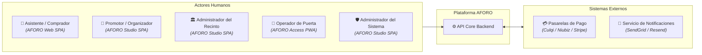

# Análisis del Sistema — 01. Actores del Sistema

**Sistema**: Plataforma de Descubrimiento, Venta y Validación de Entradas para Eventos y Conciertos en Vivo  
**Documento**: `docs/01-analisis-de-sistema/01-actores.md`  
**Versión**: `1.0.0` | **Fecha**: `2026-10-22`  
**Referencia Metodológica**: Guía 04 de Arquitectura de Software & Modelo C4 Nivel 1 (Contexto)  
**Alineación**: Conforme a la Constitution y la especificación funcional

---

## 1. Definición y Clasificación de Actores

En la plataforma **AFORO**, los actores representan entidades humanas o sistemas externos que interactúan directamente con los diferentes componentes del ecosistema:

---

## 2. Catálogo Detallado de Actores

### 2.1. Actores Humanos Principales

| Actor | Rol en el Negocio | Superficie de Interacción | Responsabilidades Clave |
| :--- | :--- | :--- | :--- |
| **Asistente / Comprador** | Asistente a eventos y conciertos en vivo. | AFORO Web SPA (`[IMPLEMENTADO EN WEB]`) | - Explora la cartelera de conciertos con filtros por ciudad y género. - Selecciona sectores en el mapa interactivo del recinto. - Solicita retenciones temporales (*holds* de 10 min, máx. 4 entradas). - Realiza el pago en pasarela y consulta sus pases digitales con QR. |
| **Promotor / Organizador** | Productora o empresa organizadora del espectáculo musical. | AFORO Studio SPA (`[DISEÑO PROPUESTO]`) | - Crea y edita la ficha técnica y editorial de conciertos. - Configura fases de venta (preventas, venta general) y precios por zona. - Monitorea en tiempo real la taquilla y ocupación de aforo. - Solicita liquidación financiera y reportes de recaudación. |
| **Administrador del Recinto** | Administrador de la infraestructura física del local (estadio, arena, teatro). | AFORO Studio SPA (`[DISEÑO PROPUESTO]`) | - Define la topología espacial de sectores y aforo nominal legal autorizado. - Asigna puertas de acceso físico y zonas de evacuación. - Audita reportes de aforo máximo para cumplimiento normativo de Defensa Civil. |
| **Operador de Puerta** | Personal de seguridad y logística en molinetes y torniquetes del recinto. | AFORO Access PWA (`[DISEÑO PROPUESTO]`) | - Inicia turno en una puerta específica con terminal móvil lectora. - Escanea ópticamente códigos QR de entradas en alta velocidad. - Valida acceso en modo online conectado o contingencia offline local. - Despacha colas de sincronización diferida al recuperar conectividad. |
| **Administrador del Sistema** | Equipo de ingeniería y soporte de la plataforma AFORO. | Consola / AFORO Studio (`[DISEÑO PROPUESTO]`) | - Administra cuentas, asigna roles RBAC y gestiona revocaciones. - Custodia y rota pares de claves criptográficas asimétricas Ed25519. - Supervisa bitácoras de auditoría forense de colisiones en acceso. .| 

---

### 2.2. Actores de Sistemas Externos

| Sistema Externo | Protocolo de Integración | Responsabilidades Clave |
| :--- | :--- | :--- |
| **Pasarelas de Pago (Culqi / Niubiz / Stripe)** | HTTPS REST / Webhooks asíncronos firmados | - Tokenización de tarjetas de crédito/débito y autenticación 3D Secure. - Captura de fondos y notificación de cobro confirmado mediante webhooks firmados. - Provisión de interfaces de consulta de estado para reconciliación. |
| **Servicio de Notificaciones (Email)** | HTTPS REST / API Mail | - Despacho de correos transaccionales con confirmación de compra y enlaces seguros a la billetera digital. |

