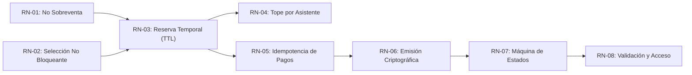
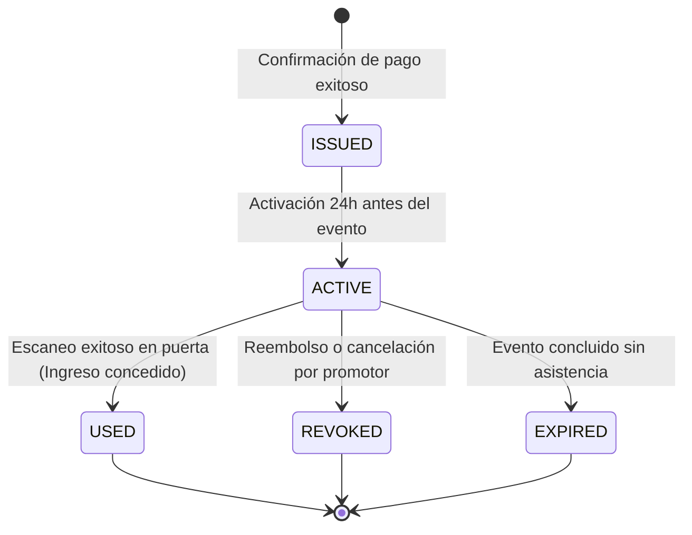

# Catálogo de Reglas de Negocio — AFORO

**Sistema**: Plataforma de Descubrimiento, Venta y Validación de Entradas para Eventos y Conciertos en Vivo  
**Documento**: `docs/01-analisis-de-sistema/03-reglas-de-negocio.md`  
**Versión**: `1.1.0` | **Fecha**: `2026-10-21`  
**Referencia Normativa**: Principios II y IV de la [Constitution de AFORO](../../.specify/memory/constitution.md)

---

## 1. Principios de Dominio e Integridad Transaccional

El modelo de dominio de AFORO se rige por un principio rector: **la confianza del asistente y del promotor se sustenta en la certeza matemática de que nunca se emitirá ni se permitirá el ingreso de más personas que el aforo legalmente autorizado para un recinto**.

A continuación se formalizan las reglas de negocio organizadas en seis áreas críticas:

---

## 2. Especificación Detallada de Reglas de Negocio

### 2.1 Gestión de Inventario y Concurrencia

#### RN-01: Invariante Estricta de No Sobreventa (Aforo Inviolable)
- **Declaración**: Para cualquier sector o zona $Z$ perteneciente a un evento $E$, la suma de las entradas efectivamente vendidas ($\text{Sold}$) más las reservas temporales activas no expiradas ($\text{ActiveHolds}$) jamás puede superar la capacidad máxima autorizada ($\text{Capacity}$).
- **Fórmula Formal**:
  $$\text{Sold}(Z) + \text{ActiveHolds}(Z) \le \text{Capacity}(Z) \quad \forall Z \in E$$
- **Mecanismo de Cumplimiento**: En el backend relacional (PostgreSQL), la verificación y deducción de cupos debe realizarse dentro de una transacción con aislamiento Serializable o bloqueo pesimista mediante `SELECT ... FOR UPDATE` sobre la fila del sector, o mediante contadores atómicos en Redis (`DECRBY`) verificando que el saldo resultante sea $\ge 0$.
- **Manejo de Violación**: Si la cantidad solicitada supera el aforo libre actual, la transacción es rechazada de inmediato con un error de dominio `SECTOR_CAPACITY_EXCEEDED`, impidiendo el registro de la reserva.
- **Estado de Realidad**: `[DISEÑO ARQUITECTÓNICO]`. En el frontend actual, los eventos indican porcentaje de disponibilidad referencial y estado visual `sold_out`.

---

#### RN-02: Selección Visual No Bloqueante de Inventario
- **Declaración**: La navegación en la página web, la exploración de sectores en el mapa interactivo y la adición de entradas al carrito de compras **NO bloquean ni descuentan inventario en el servidor**.
- **Justificación**: Permitir que la simple selección visual en el cliente bloquee cupos provocaría ataques de denegación de servicio (DoS) o acaparamiento pasivo, donde usuarios agotan artificialmente una preventa manteniendo carritos abiertos sin intención de compra.
- **Consecuencia Técnica**: El inventario real permanece disponible para otros compradores hasta que el usuario hace clic formalmente en «Continuar al pago» y el backend confirma la creación de la reserva temporal con TTL.
- **Estado de Realidad**: `[IMPLEMENTADO EN WEB]`. El frontend actual cumple estrictamente esta regla: el carrito opera sobre almacenamiento local ([`src/components/CartDrawer.tsx`](../../src/components/CartDrawer.tsx), [`src/lib/cart.ts`](../../src/lib/cart.ts)) y muestra el aviso explícito de que no se ha bloqueado aforo en servidor.

---

### 2.2 Reservas Temporales y Ciclo de Vida del Pago

#### RN-03: Reserva Temporal con Expiración Determinista (TTL de 10 Minutos)
- **Declaración**: Una reserva temporal de entradas solo nace cuando el usuario envía una solicitud formal de compra ante el backend y este confirma la disponibilidad. Dicha reserva posee un tiempo de vida estricto de **10 minutos** ($\text{TTL} = 600\text{ s}$).
- **Comportamiento**:
  1. Durante la ventana de 10 minutos, los cupos reservados se restan de la disponibilidad pública y quedan asegurados exclusivamente para el comprador.
  2. Si el pago es confirmado antes de la expiración, la reserva pasa a estado `CONFIRMED` y se emiten los tickets definitivos.
  3. Si transcurren los 10 minutos sin confirmación de pago, la reserva cambia automáticamente a estado `EXPIRED` y los cupos son reincorporados al inventario disponible para el público general.
- **Mecanismo de Liberación**: Claves con expiración en Redis (`SET reservation:{id} ... EX 600`) escuchadas vía *keyspace notifications* o un job recurrente en base de datos que libera las reservas vencidas.
- **Estado de Realidad**: `[DISEÑO ARQUITECTÓNICO]`. Actualmente ilustrado en la interfaz mediante el aviso `MODO DEMO`.

---

#### RN-04: Tope Máximo de Entradas por Asistente
- **Declaración**: Un mismo usuario o titular registrado no puede adquirir más de **4 entradas por sector** para un mismo evento en una única orden de compra.
- **Justificación**: Mitigación de prácticas de acaparamiento y reventa automatizada de entradas en conciertos y festivales de alta demanda.
- **Validación en Cliente y Servidor**:
  - En cliente: el componente [`Stepper.tsx`](../../src/components/Stepper.tsx) y la lógica de carrito en [`cart.ts`](../../src/lib/cart.ts) bloquean el botón de incremento al alcanzar `MAX_PER_TIER = 4`.
  - En servidor: el caso de uso `HoldTicketsUseCase` validará la regla $\sum \text{qty} \le 4$ por zona antes de generar el bloqueo en inventario.
- **Estado de Realidad**: `[IMPLEMENTADO EN CLIENTE / DISEÑO EN BACKEND]`.

---

#### RN-05: Idempotencia en Cobros y Procesamiento de Pagos
- **Declaración**: Toda orden de pago enviada a la pasarela o procesada mediante webhooks debe incluir una clave única de idempotencia (`Idempotency-Key = "ord_" + reservationId + "_" + attempt`).
- **Comportamiento**:
  - Si un usuario presiona dos veces el botón de pago por impaciencia o ante una reconexión de red, el backend detecta la clave ya procesada o en vuelo y no reenvía una segunda transacción a la pasarela externa.
  - La recepción de webhooks de notificación de pago (ej. webhook de Niubiz o Culqi) es estrictamente idempotente: recibir la misma notificación de cobro exitoso múltiples veces no generará entradas duplicadas ni alterará la contabilidad financiera.
- **Estado de Realidad**: `[DISEÑO ARQUITECTÓNICO]`.

---

### 2.3 Entradas QR y Validación de Acceso

#### RN-06: Emisión Atómica y Firma Criptográfica de Tickets QR
- **Declaración**: Un ticket QR solo puede ser generado tras la confirmación exitosa e irrevocable del cobro financiero. Cada ticket generado es único e inmutable, compuesto por:
  - `ticketId`: Identificador único universal (ej. `AFR-TK-2026-X892`).
  - `eventId` y `tierId`: Concierto y sector autorizado.
  - `holderName`: Nombre completo y documento de identidad del titular registrado.
  - `signature`: Firma criptográfica que certifica la autenticidad e integridad del payload.
- **Análisis de Mecanismos Criptográficos y Alternativa Preferida**:
  - *Alternativa 1 — HMAC-SHA256 (Clave Secreta Compartida / Simétrico)*: Es un código de autenticación simétrico rápido, pero requiere que todos los dispositivos lectores de puerta posean la clave secreta compartida $K_E$. Si un terminal físico en puerta es vulnerado o sustraído, la clave secreta queda expuesta, permitiendo potencialmente la falsificación de tickets.
  - *Alternativa Preferida — Firma Digital Asimétrica (Ed25519 o ECDSA)*: El backend central firma los tickets utilizando una clave privada que jamás abandona el servidor seguro. Los dispositivos lectores de **AFORO Access** únicamente requieren la clave pública correspondiente para verificar de forma instantánea y fuera de línea la autenticidad de la entrada, eliminando por completo el riesgo de falsificación ante la pérdida de un terminal lector.
  - *Decisión Arquitectónica*: La selección definitiva entre firma asimétrica (Ed25519) vs simétrica (HMAC-SHA256) queda formalmente diferida a su correspondiente **ADR** en el Capítulo 02.
- **Estado de Realidad**: `[DISEÑO ARQUITECTÓNICO]`. En el frontend actual, el ticket emitido en [`TicketsModal.tsx`](../../src/components/TicketsModal.tsx) porta el estado simulado `ACTIVA_DEMO` y un hash representativo `PULSO-LIM-XXXX-CART`.

---

#### RN-07: Máquina de Estados del Ticket
- **Declaración**: Todo ticket emitido transita de manera determinista a lo largo de su ciclo de vida según la siguiente máquina de estados finita:

- **Transiciones Prohibidas**: Un ticket en estado `USED` o `REVOKED` no puede transicionar jamás a ningún otro estado ni volver a habilitar acceso físico al recinto.

---

#### RN-08: Validación, Acceso en Puerta y Tolerancia a Desconexión (Anti-Reúso)
- **Declaración**: Un ticket concede acceso físico al recinto **una única vez**. Para garantizar la operación fluida en molinetes bajo diferentes condiciones de conectividad, se diferencian cuatro mecanismos técnicos:

1. **Verificación Criptográfica Local**:
   - La terminal lectora (**AFORO Access**) comprueba de forma autónoma la integridad del código QR y su firma criptográfica (utilizando la clave pública del evento o clave autorizada). Si los datos han sido adulterados o la firma no coincide, emite señal de **«TICKET INVÁLIDO / FALSIFICADO»**.
2. **Prevención de Reutilización Local**:
   - Cada terminal lectora mantiene una base de datos local (SQLite / IndexedDB) donde registra atómicamente cada ticket escaneado con timestamp y operador. Si un asistente intenta reingresar por la **misma puerta** con el mismo QR, la terminal detecta de inmediato el estado local `USED` y emite alarma sonora de **«TICKET YA UTILIZADO EN ESTA PUERTA»**.
3. **Validación Atómica Online (Conectividad Plena)**:
   - Con conexión al backend central, el cambio de estado `ACTIVE` $\rightarrow$ `USED` se ejecuta en la API Core con exclusión mutua estricta. Si la entrada ya fue ingresada por cualquier otra puerta del estadio hace segundos o minutos, el servidor rechaza el ingreso en tiempo real garantizando unicidad global ($0\text{ \%}$ de reingresos).
4. **Reconciliación Posterior**:
   - Al restablecerse la conectividad tras una desconexión, la terminal despacha su bitácora de escaneos al backend para su consolidación y auditoría forense.

- **Riesgo Operativo Explícito en Desconexión Simultánea (Teorema CAP)**:
  - En cumplimiento de la honestidad técnica, se formaliza que **no es matemáticamente posible garantizar la unicidad global en tiempo real entre múltiples puertas que se encuentran simultáneamente incomunicadas entre sí** (consecuencia directa del Teorema CAP: bajo partición de red se prioriza la disponibilidad local sobre la consistencia global inmediata).
  - *Riesgo Identificado*: Si una misma entrada duplicada (fotocopiada o compartida) es presentada de forma coordinada en dos puertas físicas distintas mientras ambas están sin conexión a internet, ambas terminales validarán la autenticidad criptográfica y permitirán el acceso localmente.
  - *Tratamiento del Riesgo*: Este riesgo de colisión inter-puerta se asume operativamente para no paralizar el flujo de miles de personas en las entradas del recinto. Se mitiga mediante:
    - Zonificación física y asignación estricta de puertas por sector (un ticket de Tribuna no es admitido en la lista de entradas de Campo).
    - Monitoreo de conectividad y reconexión celular automática de respaldo.
    - Detección automática de duplicados durante la reconciliación post-evento para auditoría forense y acciones legales.
- **Estado de Realidad**: `[DISEÑO ARQUITECTÓNICO]`.
