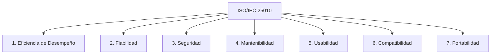

# Requisitos No Funcionales — AFORO (Alineados a ISO/IEC 25010)

**Sistema**: Plataforma de Descubrimiento, Venta y Validación de Entradas para Eventos y Conciertos en Vivo  
**Documento**: `docs/01-analisis-de-sistema/04-atributos-de-calidad.md`  
**Norma de Referencia**: ISO/IEC 25010:2011 — Modelo de Calidad del Producto de Software  
**Versión**: `1.1.0` | **Fecha**: `2026-10-21`

---

## 1. Clasificación y Criterios de Realidad Técnica

El estándar **ISO/IEC 25010** define las características clave para evaluar la calidad del software. En AFORO, en apego al **Principio IV (Transparencia de Simulación)** de la [Constitution](../../.specify/memory/constitution.md), se establece una distinción explícita e intransigente entre dos tipos de declaraciones métricas:

1. **`[RESULTADO EXPERIMENTAL VERIFICADO (Frontend)]`**: Métricas de rendimiento, renderizado y reactividad medidas empíricamente mediante pruebas automatizadas y capturas de rendimiento sobre el código implementado en Chromium v155.
2. **`[OBJETIVO ARQUITECTÓNICO / META DE DISEÑO]`**: Metas cuantitativas de diseño formuladas para guiar la construcción técnica del backend relacional, la infraestructura de caché y los clientes móviles/PWA especializados. Estas métricas constituyen requisitos de diseño pendientes de validación empírica mediante pruebas de carga y hardware físico en fases posteriores.

---

## 2. Catálogo de Requisitos No Funcionales

### 2.1 Eficiencia de Desempeño (Performance Efficiency)

| ID | Subcaracterística | Especificación del Requisito | Métrica / Umbral Objetivo | Estado de Realidad | Verificación Técnica |
| :--- | :--- | :--- | :--- | :--- | :--- |
| **RNF-PE-01** | **Comportamiento Temporal (Frontend)** | El desplazamiento suave y asignación de foco accesible sobre el contenedor `#entradas` en `/evento/:slug#entradas` debe completarse en menos de un segundo tras la carga del evento. | Tiempo de foco y posicionamiento $< 1000\text{ ms}$ (ideal $< 500\text{ ms}$). | `[RESULTADO EXPERIMENTAL VERIFICADO]` | Medición empírica en Chromium v155: **`33.64 ms`** tras `status === 'ready'` ([ver reporte](../../specs/001-frontend-proportions-and-ticket-page/evidence/performance-and-regression-report.md)). |
| **RNF-PE-02** | **Fluidez de Renderizado (UI)** | Las animaciones de interfaz (`@keyframes line-in`), apertura de drawers laterales ([`CartDrawer.tsx`](../../src/components/CartDrawer.tsx)) y scroll en catálogo deben sostener una tasa constante de cuadros por segundo. | Tasa de cuadros $\ge 60\text{ fps}$ (tiempo de frame promedio $\approx 16.67\text{ ms}$, p95 $< 18\text{ ms}$). | `[RESULTADO EXPERIMENTAL VERIFICADO]` | Medición empírica en Chromium v155: **`60.0 fps`** (`avgFrameMs: 16.67 ms`, `p95FrameMs: 16.70 ms`). |
| **RNF-PE-03** | **Sincronización Local entre Contextos** | La propagación reactiva de eventos `storage` entre pestañas abiertas para el carrito y tickets locales debe ser cuasi-instantánea. | Latencia de propagación y actualización en DOM $< 100\text{ ms}$. | `[RESULTADO EXPERIMENTAL VERIFICADO]` | Medición empírica en Chromium: **`36.20 ms`** (carrito) y **`23.50 ms`** (tickets); prueba en Node: `12.78 ms`. |
| **RNF-PE-04** | **Comportamiento Temporal (API Backend)** | Las consultas públicas de catálogo y detalle de evento (`GET /api/v1/events/:slug`) deben responder con baja latencia bajo carga normal. | Tiempo de respuesta al percentil 95 (p95) $< 200\text{ ms}$ en red local/servidor. | `[OBJETIVO ARQUITECTÓNICO / META DE DISEÑO]` | Meta de diseño arquitectónico; pendiente de validación empírica con k6 cuando se implemente el backend. |
| **RNF-PE-05** | **Capacidad de Concurrencia en Reservas** | El endpoint transaccional de reserva de entradas (`POST /api/v1/reservations`) debe procesar ráfagas concurrentes de compra en lanzamientos masivos (preventas) sin degradación crítica. | Rendimiento objetivo sostenido $\ge 1500\text{ a } 2500\text{ req/s}$ concurrentes sin errores 500 no controlados. | `[OBJETIVO ARQUITECTÓNICO / META DE DISEÑO]` | Meta de diseño basada en Redis Locks y pool de conexiones PostgreSQL; pendiente de pruebas de estrés. |
| **RNF-PE-06** | **Tiempo de Escaneo en Puerta (Access)** | La captura óptica, decodificación y validación de firma de un ticket QR en **AFORO Access** debe permitir un flujo continuo de ingreso en molinetes. | Tiempo objetivo total de validación $< 350\text{ ms}$ por asistente escaneado. | `[OBJETIVO ARQUITECTÓNICO / META DE DISEÑO]` | Meta de diseño para verificación local en memoria; pendiente de comprobación en hardware móvil/PWA real. |

---

### 2.2 Fiabilidad (Reliability)

| ID | Subcaracterística | Especificación del Requisito | Métrica / Umbral Objetivo | Estado de Realidad | Verificación Técnica |
| :--- | :--- | :--- | :--- | :--- | :--- |
| **RNF-RE-01** | **Disponibilidad del Servicio Central** | La API Core y la base de datos relacional deben mantener alta disponibilidad durante periodos críticos de comercialización. | Disponibilidad mensual $\ge 99.9\text{ \%}$ ($< 43.8\text{ min}$ de indisponibilidad no programada al mes). | `[OBJETIVO ARQUITECTÓNICO / META DE DISEÑO]` | Despliegue planificado en contenedores Docker orquestados con réplicas. |
| **RNF-RE-02** | **Tolerancia a Fallos de Pasarela** | Ante fallos temporales de conectividad o timeouts de pasarela externa, el sistema no debe dejar reservas en estado inconsistente ni emitir entradas sin cobro verificado. | Consistencia transaccional de órdenes: $100\text{ \%}$ (compensación automática o reintento determinista). | `[OBJETIVO ARQUITECTÓNICO / META DE DISEÑO]` | Patrón SAGA / Transacción compensatoria especificado en arquitectura. |
| **RNF-RE-03** | **Tolerancia a Desconexión en Puertas** | Si el dispositivo lector de **AFORO Access** pierde conectividad, continúa operando localmente mediante la lista precargada y previene la reutilización local del ticket en esa misma puerta. La unicidad global queda sujeta a la reconexión y reconciliación posterior, asumiéndose el riesgo operativo de doble ingreso en caso de desconexión simultánea de múltiples puertas (conforme al teorema CAP). | Cero detenciones de ingreso en la terminal por falta de red; cero pérdidas de registros en bitácora local. | `[OBJETIVO ARQUITECTÓNICO / META DE DISEÑO]` | Almacén local IndexedDB / SQLite con cola de reconciliación asíncrona y registro de auditoría forense. |

---

### 2.3 Seguridad (Security)

| ID | Subcaracterística | Especificación del Requisito | Métrica / Umbral Objetivo | Estado de Realidad | Verificación Técnica |
| :--- | :--- | :--- | :--- | :--- | :--- |
| **RNF-SE-01** | **Autenticidad e Integridad de Tickets QR** | Cada ticket emitido debe poseer una firma criptográfica que impida la falsificación o alteración. Como alternativa preferida para validación offline en múltiples puertas se plantea firma digital asimétrica (Ed25519 o ECDSA), donde el dispositivo validador sólo requiere la clave pública y la clave privada permanece en el servidor emisor. Alternativa analizada: HMAC-SHA256 con clave secreta compartida. | Payload firmado inviolable; detección de adulteración en el $100\text{ \%}$ de los casos. | `[OBJETIVO ARQUITECTÓNICO / META DE DISEÑO]` | La selección definitiva entre firma asimétrica vs simétrica HMAC queda formalmente diferida a su correspondiente ADR en el Capítulo 02. |
| **RNF-SE-02** | **Unicidad de Acceso y Prevención de Reingreso** | El sistema debe impedir el reingreso con un mismo código QR. En modo online: garantía atómica global en base de datos central ($0\,\%$ de reingresos). En modo offline: garantía estricta a nivel local en la terminal física, reconociéndose expresamente el riesgo de doble ingreso inter-puerta hasta la reconciliación posterior. | Tasa de reingreso en misma puerta $= 0\text{ \%}$; tasa de colisión online $= 0\text{ \%}$. | `[OBJETIVO ARQUITECTÓNICO / META DE DISEÑO]` | Marcado atómico `USED` en base de datos central o en base local con reconciliación post-evento. |
| **RNF-SE-03** | **Seguridad en Apertura de Enlaces Externos** | Todos los hipervínculos que abren nuevas pestañas en el navegador deben mitigar vulnerabilidades de tabnabbing inverso y fuga de referer. | Atributos `target="_blank"` y `rel="noopener noreferrer"` en el $100\text{ \%}$ de los enlaces de apertura. | `[RESULTADO EXPERIMENTAL VERIFICADO]` | Prueba unitaria automatizada en [`src/router.test.ts`](../../src/router.test.ts). |
| **RNF-SE-04** | **Protección de Datos Sensibles Financieros** | El sistema no debe almacenar números de tarjeta de crédito (PAN) ni códigos de seguridad (CVV) en su base de datos ni en logs de aplicación. | Cumplimiento estricto con PCI-DSS SAQ A (tokenización directa en cliente de pasarela). | `[OBJETIVO ARQUITECTÓNICO / META DE DISEÑO]` | Tokenización mediante SDK oficial del procesador de pagos (Culqi, Niubiz o Stripe). |

---

### 2.4 Mantenibilidad (Maintainability)

| ID | Subcaracterística | Especificación del Requisito | Métrica / Umbral Objetivo | Estado de Realidad | Verificación Técnica |
| :--- | :--- | :--- | :--- | :--- | :--- |
| **RNF-MA-01** | **Modularidad Arquitectónica** | El backend debe estructurarse como un Monolito Modular con límites claros entre módulos (Catálogo, Reservas, Pagos, Accesos, Identidad), evitando dependencias circulares. | Acoplamiento eferente estricto; comunicación inter-módulo únicamente vía interfaces públicas o eventos de dominio. | `[OBJETIVO ARQUITECTÓNICO / META DE DISEÑO]` | Especificado en Principio I de la Constitution. |
| **RNF-MA-02** | **Arquitectura Hexagonal (Puertos y Adaptadores)** | La lógica de dominio de cada módulo no debe depender de bibliotecas externas, frameworks HTTP ni drivers de base de datos. | Regla de dependencias: Dominio puro sin dependencias de Express, React ni Prisma/TypeORM. | `[OBJETIVO ARQUITECTÓNICO / META DE DISEÑO]` | Especificado en Principio I de la Constitution. |
| **RNF-MA-03** | **Comprobabilidad Automatizada (Testability)** | El código debe permitir la ejecución de pruebas unitarias y de integración sin requerir infraestructura externa obligatoria. | Cobertura sobre lógica de negocio $\ge 80\text{ \%}$; tiempo de ejecución de suite $< 10\text{ s}$. | `[RESULTADO EXPERIMENTAL VERIFICADO]` | En frontend: 30 pruebas aprobadas en $2.88\text{ s}$ (`npm run check`). |

---

### 2.5 Usabilidad y Accesibilidad (Usability)

| ID | Subcaracterística | Especificación del Requisito | Métrica / Umbral Objetivo | Estado de Realidad | Verificación Técnica |
| :--- | :--- | :--- | :--- | :--- | :--- |
| **RNF-US-01** | **Proporción Visual Nativa al 100 % de Zoom** | La interfaz de usuario debe presentar una composición equilibrada, tipografía armónica y sin espacios vacíos artificiales directamente al 100 % de zoom. | Prohibición absoluta de `zoom: 0.7` o `transform: scale()` como mecanismo de reducción en `:root`/`body`/`.hero*`. | `[RESULTADO EXPERIMENTAL VERIFICADO]` | Prueba automatizada de regresión en [`src/styles/regression.test.ts`](../../src/styles/regression.test.ts). |
| **RNF-US-02** | **Ausencia de Recorte Horizontal** | El titular principal editorial y los componentes de navegación deben mostrarse íntegros sin desbordar el viewport horizontal en escritorio, tablets y móviles. | `clipsRight = false` y `scrollWidthExceedsClient = false` en las 15 combinaciones de prueba. | `[RESULTADO EXPERIMENTAL VERIFICADO]` | Verificado en `metrics-after.json` y prueba DOM en `regression.test.ts`. |
| **RNF-US-03** | **Accesibilidad y Escalado de Fuentes** | Cumplimiento de pautas WCAG 2.1 AA para ampliación de texto, manteniendo operatividad y legibilidad al 150 % y 200 % de zoom del navegador. | Relación tamaño máximo/mínimo en `clamp()` $\le 2.5$; textos legibles sin solapamiento. | `[RESULTADO EXPERIMENTAL VERIFICADO]` | Aplicación de guía moderna `fluid-scaling` (`cqi`, ratio 2.49). |

---

### 2.6 Compatibilidad y Portabilidad (Compatibility & Portability)

| ID | Subcaracterística | Especificación del Requisito | Métrica / Umbral Objetivo | Estado de Realidad | Verificación Técnica |
| :--- | :--- | :--- | :--- | :--- | :--- |
| **RNF-CO-01** | **Compatibilidad Multi-Navegador** | Las aplicaciones web deben funcionar de manera consistente en los motores de renderizado modernos (Blink/Chromium, Gecko, WebKit). | Soporte verificado en Chrome $\ge 110$, Edge $\ge 110$, Firefox $\ge 115$, Safari $\ge 16.4$. | `[RESULTADO EXPERIMENTAL VERIFICADO]` | Pruebas ejecutadas en motor Chromium v155 y uso de CSS estándar. |
| **RNF-PO-01** | **Contenedorización del Ecosistema** | Todos los componentes del backend y herramientas de soporte deben desplegarse de manera determinista mediante contenedores. | Imágenes Docker reproducibles basadas en Alpine/Debian slim con multi-stage build. | `[OBJETIVO ARQUITECTÓNICO / META DE DISEÑO]` | Planificado en sprint de infraestructura Docker. |
