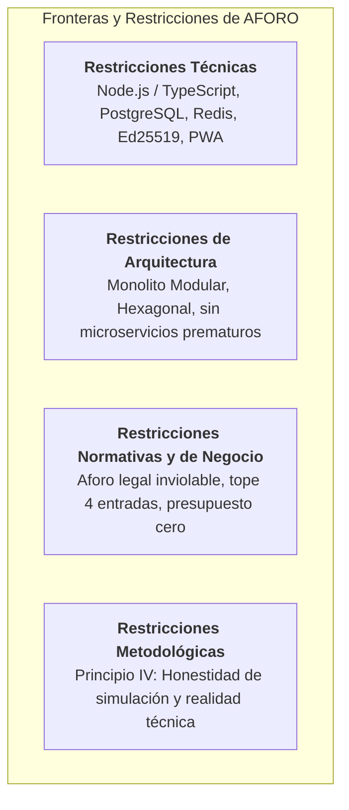

# Análisis del Sistema — 05. Restricciones del Sistema

**Sistema**: Plataforma de Descubrimiento, Venta y Validación de Entradas para Eventos y Conciertos en Vivo  
**Documento**: `docs/01-analisis-de-sistema/05-restricciones.md`  
**Versión**: `1.0.0` | **Fecha**: `2026-10-22`  
**Referencia Metodológica**: Guía 04 de Arquitectura de Software  
**Alineación**: Conforme a la Constitution y los ADRs 001 al 006

---

## 1. Clasificación de Restricciones

Las restricciones delimitan el espacio de diseño arquitectónico de **AFORO**, definiendo condiciones de contorno tecnológicas, de infraestructura, normativas y metodológicas que deben ser respetadas obligatoriamente:

---

## 2. Catálogo de Restricciones del Proyecto

### 2.1. Restricciones Técnicas y de Plataforma

| ID | Restricción | Descripción y Justificación |
| :--- | :--- | :--- |
| **RES-TEC-01** | **Ecosistema Tecnológico Unificado** | Todo el sistema se construye sobre **TypeScript**, utilizando Node.js en backend y React 19 en frontend, maximizando la reutilización de tipos y reduciendo la fricción cognitiva del equipo. |
| **RES-TEC-02** | **PostgreSQL como Autoridad de Verdad** | La persistencia transaccional y la fuente de verdad definitiva de inventario, reservas, pagos y tickets deben residir exclusivamente en **PostgreSQL**. No se permite delegar autoridad de aforo a bases NoSQL o almacenes volátiles. |
| **RES-TEC-03** | **Redis como Infraestructura Auxiliar** | Redis se restringe a funciones auxiliares de aceleración de lecturas (caché de cartelera) y disparadores de alarma volátil (TTL de 600 s). Su caída no debe corromper la consistencia de inventario. |
| **RES-TEC-04** | **Criptografía Asimétrica en Código QR** | La validación de tickets en puerta debe basarse en firmas digitales asimétricas **Ed25519**. La clave privada ($SK_E$) reside únicamente en el servidor central; las terminales solo reciben la clave pública ($PK_E$). |
| **RES-TEC-05** | **AFORO Access como PWA con IndexedDB** | El cliente de molinete debe desarrollarse como **Progressive Web App (PWA)** utilizando **IndexedDB** para persistencia local de entradas precargadas y cola de reconciliación fuera de línea. |

---

### 2.2. Restricciones de Arquitectura e Infraestructura

| ID | Restricción | Descripción y Justificación |
| :--- | :--- | :--- |
| **RES-ARQ-01** | **Estilo Monolito Modular Obligatorio** | Se prohíbe la fragmentación prematura en microservicios distribuidos o funciones Serverless (ADR-001). Todo el backend debe compilar y ejecutarse como un **único proceso Node.js** desplegable en un contenedor Docker estándar. |
| **RES-ARQ-02** | **Comunicación Inter-Módulo en Memoria** | Los seis módulos del backend deben comunicarse directamente en memoria mediante contratos de fachada tipados (`I<Nombre>ModuleFacade`), sin recurrir a llamadas HTTP internas ni brokers de mensajería externos (Kafka/RabbitMQ). |
| **RES-ARQ-03** | **Adopción de Arquitectura Hexagonal** | Ningún caso de uso de negocio puede importar librerías de infraestructura, frameworks HTTP o clientes de base de datos; toda interacción externa debe canalizarse a través de **Puertos** y **Adaptadores** (ADR-002). |

---

### 2.3. Restricciones Normativas y de Negocio

| ID | Restricción | Descripción y Justificación |
| :--- | :--- | :--- |
| **RES-NEG-01** | **Inviolabilidad del Aforo Nominal** | Ninguna consideración de rendimiento, contingencia o fallo de red puede justificar la emisión de entradas que superen la capacidad física y legal aprobada por Defensa Civil para el sector. |
| **RES-NEG-02** | **Tope de 4 Entradas por Titular** | No se autoriza la venta acumulada de más de 4 entradas por comprador y sector en un evento, como política activa de combate a la reventa especulativa (RN-04). |
| **RES-NEG-03** | **Presupuesto Económico Mínimo** | El diseño debe ser operable bajo infraestructura de bajo costo (PaaS gratuitos o instancias VPS básicas de bajo consumo de RAM), descartando arquitecturas cloud propietarias costosas. |

---

### 2.4. Restricción Metodológica y Ética del Proyecto

| ID | Restricción | Descripción y Justificación |
| :--- | :--- | :--- |
| **RES-MET-01** | **Transparencia de Simulación (Principio IV)** | Es mandatorio distinguir en toda documentación y en la interfaz de usuario qué componentes están físicamente implementados en código (`src/`), cuáles operan como demostración interactiva en cliente (`[DEMO / SIMULADO]`) y cuáles corresponden a diseño arquitectónico propuesto (`[DISEÑO PROPUESTO]`). |

