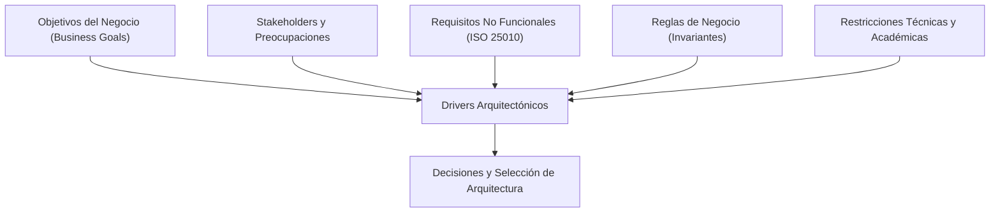

# Drivers Arquitectónicos y Restricciones del Sistema — AFORO

**Sistema**: Plataforma de Descubrimiento, Venta y Validación de Entradas para Eventos y Conciertos en Vivo  
**Documento**: `docs/01-analisis-de-sistema/06-driver-arquitectonicos.md`  
**Versión**: `1.1.0` | **Fecha**: `2026-10-21`  
**Referencia Normativa**: Principios I, II y IV de la [Constitution de AFORO](../../.specify/memory/constitution.md) y [Capítulo 01: Análisis del Sistema](03-requisitos-funcionales.md)

---

## 1. Introducción y Propósito

El éxito de una arquitectura de software se fundamenta en su capacidad para satisfacer los **drivers arquitectónicos**: el conjunto priorizado de objetivos de negocio, requisitos de calidad, invariantes de dominio y restricciones que condicionan la estructura del sistema.

En AFORO, cada decisión de diseño emana directamente de los requerimientos analizados en el [Capítulo 01](03-requisitos-funcionales.md), garantizando trazabilidad total entre la estrategia de la plataforma y su concreción técnica.

---

## 2. Objetivos del Negocio (Business Goals)

| ID | Objetivo del Negocio | Descripción Estratégica | Métrica de Éxito del Negocio |
| :--- | :--- | :--- | :--- |
| **BG-01** | **Cero Sobreventa e Integridad de Taquilla** | Garantizar a los promotores y autoridades civiles que jamás se emitirá ni se permitirá el ingreso de una sola persona por encima del aforo autorizado del recinto. | Tasa de sobreventa legal $= 0.0\text{ \%}$; auditoría transaccional sin descuadres de inventario. |
| **BG-02** | **Continuidad Operativa en Puerta (Resiliencia en Recintos)** | Asegurar que el ingreso de miles de asistentes por minuto no se detenga ante fallas de energía o caídas de señal celular/Wi-Fi en estadios y explanadas. | Tiempo de detención de colas en accesos $= 0\text{ segundos}$; validación continua en terminales de puerta. |
| **BG-03** | **Monetización e Idempotencia Financiera** | Evitar pérdidas económicas y reclamaciones por duplicación de cobros en pasarelas de pago externas durante ráfagas de preventa. | Incidencias de doble cargo $= 0$; trazabilidad total de órdenes mediante claves únicas de idempotencia. |
| **BG-04** | **Experiencia de Descubrimiento Visualmente Auténtica** | Proveer una interfaz web diferenciada bajo la identidad «Pulso Nocturno», sin degradación visual nativa al 100 % de zoom y con navegación segura para el usuario. | Composición nativa al 100 % sin artificios CSS de escalado; retención de usuarios e interactividad fluida a 60 fps. |
| **BG-05** | **Autonomía y Escalabilidad Operativa para Promotores** | Brindar herramientas analíticas y de configuración de recintos en tiempo real que permitan a productores independientes gestionar eventos con rapidez. | Reducción del tiempo de configuración de un concierto a menos de 15 minutos en AFORO Studio. |

---

## 3. Stakeholders y Preocupaciones Clave

| Stakeholder | Rol en el Ecosistema | Preocupaciones Arquitectónicas Principales (Concerns) |
| :--- | :--- | :--- |
| **Asistente al Concierto (Fan / Comprador)** | Usuario final que descubre carteleras, adquiere boletos y presenta su pase QR en puerta. | Rapidez de compra en preventa sin colapsos de página, claridad de precios en PEN, confirmación inmediata, custodia segura de sus entradas digitales y privacidad de datos financieros. |
| **Promotor / Organizador de Eventos** | Empresario que arrienda recintos, define etapas de venta y asume el riesgo comercial. | Respeto riguroso de capacidades máximas por zona, tablero de taquilla en vivo para toma de decisiones, liquidación financiera puntual y protección contra la reventa desleal. |
| **Operador de Acceso / Personal de Molinete** | Usuario operativo que valida los boletos en las entradas del recinto con lectores ópticos. | Interfaz de escaneo ultrarrápida, pantalla inequívoca de aceptación/rechazo, funcionamiento ininterrumpido sin internet y alertas sonoras de tickets clonados o ya usados. |
| **Administrador de Plataforma y Finanzas** | Equipo interno de AFORO responsable de la gobernanza, reconciliación y soporte. | Idempotencia contable con pasarelas (Culqi, Niubiz, Stripe), logs inmutables de auditoría, reversión de fondos ante transacciones fallidas y facilidad de mantenimiento. |
| **Equipo Académico y Docencia (Arquitectura de Software)** | Evaluadores del diseño arquitectónico conforme a la Guía 04 y estándares de ingeniería. | Aplicación rigurosa de principios SOLID, Arquitectura Hexagonal, patrones de diseño, evaluación razonada de alternativas, trazabilidad SDD y honestidad en el estado del software. |

---

## 4. Drivers Arquitectónicos Priorizados

Los drivers arquitectónicos representan las fuerzas rectoras que determinan la forma del sistema. En AFORO se priorizan cinco drivers fundamentales (`DA-01` a `DA-05`):

### Driver 1 (DA-01): Concurrencia Extrema con Aforo Inviolable (Integridad Transaccional de Inventario)
- **Origen**: [`RF-COR-02`](03-requisitos-funcionales.md), [`RN-01`](../complementos/03-reglas-de-negocio.md), [`RN-03`](../complementos/03-reglas-de-negocio.md), [`RNF-PE-05`](04-atributos-de-calidad.md), [`EAC-02`](08-escenarios-atributos-calidad.md).
- **Fuerza Arquitectónica**: Durante los primeros minutos del lanzamiento de un concierto masivo, cientos de compradores compiten simultáneamente por los últimos cupos de una zona. La arquitectura debe garantizar $\text{Sold} + \text{ActiveHolds} \le \text{Capacity}$ sin inconsistencias ni degradación crítica.
- **Impacto**: **PostgreSQL es la única fuente de verdad (Single Source of Truth)** para el inventario, disponibilidad, reservas temporales y emisión de entradas. La concurrencia se gestiona mediante bloqueos pesimistas a nivel de fila (`SELECT ... FOR UPDATE`) bajo nivel de aislamiento estándar `READ COMMITTED`, bloqueando exclusivamente las filas del sector afectado durante la transacción y evitando sobreventas. Redis se utiliza exclusivamente como infraestructura auxiliar de soporte (caché de lecturas públicas, estrangulamiento de tráfico/rate-limiting y temporizador de eventos de expiración TTL), nunca como autoridad decisoria de inventario.

### Driver 2 (DA-03): Tolerancia a Partición de Red y Operatividad Offline en Accesos (Resiliencia)
- **Origen**: [`RF-ACC-02`](03-requisitos-funcionales.md) al [`RF-ACC-06`](03-requisitos-funcionales.md), [`RN-08`](../complementos/03-reglas-de-negocio.md), [`RNF-RE-03`](04-atributos-de-calidad.md), [`EAC-05`](08-escenarios-atributos-calidad.md).
- **Fuerza Arquitectónica**: Las terminales de puerta en un estadio operan en entornos hostiles con pérdida frecuente de conectividad celular/Wi-Fi. La cola de miles de personas no puede detenerse bajo ninguna circunstancia.
- **Impacto**: Exige que la aplicación de acceso (`AFORO Access`) sea un cliente autónomo con almacenamiento local protegido (IndexedDB), capacidad de verificación criptográfica autónoma (Ed25519) y un modelo de sincronización eventual con bitácora de auditoría forense para reconciliación posterior, asumiendo el trade-off del Teorema CAP.

### Driver 3 (DA-04): Idempotencia Financiera y Consistencia de Pagos (Fiabilidad y Seguridad)
- **Origen**: [`RF-COR-04`](03-requisitos-funcionales.md), [`RN-05`](../complementos/03-reglas-de-negocio.md), [`RNF-RE-02`](04-atributos-de-calidad.md), [`RNF-SE-04`](04-atributos-de-calidad.md), [`EAC-04`](08-escenarios-atributos-calidad.md).
- **Fuerza Arquitectónica**: Inestabilidades de red entre el navegador del usuario y la pasarela de pagos provocan reintentos automáticos y recepción repetida de webhooks.
- **Impacto**: Requiere el diseño de una capa de transacciones con claves únicas de idempotencia (`Idempotency-Key`), verificación criptográfica de firmas de webhooks y desacoplamiento entre la captura del cobro y la emisión definitiva del ticket mediante **Transactional Outbox**.

### Driver 4 (DA-02): Rendimiento y Percepción Visual Frontend (Eficiencia y Usabilidad)
- **Origen**: [`RF-WEB-01`](03-requisitos-funcionales.md) al [`RF-WEB-09`](03-requisitos-funcionales.md), [`RNF-PE-01`](04-atributos-de-calidad.md) a [`RNF-PE-03`](04-atributos-de-calidad.md), [`RNF-US-01`](04-atributos-de-calidad.md) a [`RNF-US-03`](04-atributos-de-calidad.md).
- **Fuerza Arquitectónica**: La interfaz web debe ser visualmente atractiva sin comprometer la velocidad de carga ni la proporción estética al 100 % de zoom.
- **Impacto**: Impone una Single Page Application (SPA) modular en React/Vite, uso de CSS nativo con Container Queries (`cqi`), navegación segura en nuevas pestañas (`rel="noopener noreferrer"`) y sincronización reactiva local entre pestañas vía eventos `storage`.

### Driver 5 (DA-05): Mantenibilidad, Aislamiento de Dominio y Evolución Modular
- **Origen**: [`RNF-MA-01`](04-atributos-de-calidad.md) a [`RNF-MA-03`](04-atributos-de-calidad.md), Principio I de la Constitution.
- **Fuerza Arquitectónica**: El sistema debe desarrollarse con alta cohesión y bajo acoplamiento, permitiendo que la lógica de negocio permanezca pura, comprobable y desacoplada de frameworks web o bases de datos específicas.
- **Impacto**: Conduce a la selección de un **Monolito Modular con Arquitectura Hexagonal (Puertos y Adaptadores)**.

---

## 5. Restricciones Técnicas y Académicas

*(Detalladas asimismo en [`05-restricciones.md`](05-restricciones.md))*

### 5.1 Restricciones Técnicas
- **RT-01 (Prohibición de Soluciones Artificiales de Zoom)**: En cumplimiento estricto de la especificación `001-frontend-proportions-and-ticket-page`, queda terminantemente prohibido utilizar `zoom: 0.7`, `transform: scale()` o escalados globales en `:root`/`body` para solucionar desproporciones visuales. La interfaz debe adaptarse de manera nativa mediante diseño fluido.
- **RT-02 (Separación de Selección Visual y Bloqueo de Servidor)**: La selección de entradas en el navegador es estrictamente visual y local (`RN-02`); bajo ninguna circunstancia el cliente web interactuará con el stock de base de datos hasta que el usuario envíe una orden formal de compra.
- **RT-03 (Cumplimiento de Seguridad PCI-DSS SAQ A)**: El sistema nunca almacenará, transmitirá ni procesará números de tarjeta de crédito (PAN) ni códigos CVV en sus propios servidores. La captura de datos financieros debe delegarse al 100 % en el SDK del proveedor de pagos.
- **RT-04 (Topología de Despliegue Determinista)**: Toda la infraestructura backend y sus almacenes de datos deben ser orquestables mediante contenedores reproducibles en cualquier entorno operativo.

### 5.2 Restricciones Académicas y Metodológicas
- **RA-01 (Gobernanza del Proceso SDD)**: El desarrollo del software se rige por la metodología Spec-Driven Development (SDD) soportada por GitHub Spec Kit. No se modifica código sin especificación previa, plan técnico y descomposición de tareas aprobadas.
- **RA-02 (Honestidad Técnica y Transparencia de Simulación)**: Principio innegociable de la Constitution (Principio IV). Todo documento, diagrama y prueba debe declarar con absoluta veracidad qué componentes están implementados en código (`[IMPLEMENTADO]`), cuáles operan como simulación local (`[DEMO / SIMULADO]`) y cuáles corresponden a diseño arquitectónico futuro (`[DISEÑO PROPUESTO]`). Queda prohibido fabricar resultados de pruebas o afirmar la existencia de un backend no construido.
- **RA-03 (Alineación con la Guía 04 de Arquitectura de Software)**: La estructura de la documentación, la evaluación de alternativas, los ADRs y el modelado C4 deben satisfacer íntegramente los estándares y rúbricas del curso universitario.

---

## 6. Visión de Capacidad Futura: AFORO Creative AI (Estudio de Promotores)

En el marco de la evolución estratégica de la plataforma, se ha proyectado una capacidad arquitectónica denominada **AFORO Creative AI**, concebida como una herramienta de apoyo al promotor integrada en **AFORO Studio**.

- **Propósito y Alcance Conceptual**:
  - Permitir a los promotores generar **configuraciones visuales personalizadas** para las páginas públicas de cada evento en AFORO Web.
  - La IA podrá proponer combinaciones cromáticas (paletas de color dentro de la identidad Pulso Nocturno), escalas tipográficas complementarias, composición editorial, estilos temáticos y organización espacial de los componentes reutilizables de la cartelera.
- **Límites Arquitectónicos y Reglas de Seguridad**:
  1. *Sin Ejecución de Código Arbitrario*: La IA genera exclusivamente un payload de configuración declarativo (JSON con parámetros de diseño). AFORO Web procesa y renderiza dicha configuración utilizando **componentes oficiales y previamente validados del sistema de diseño**. Bajo ninguna circunstancia la IA genera código JavaScript/React ejecutable ni scripts dinámicos.
  2. *Inviolabilidad de la Lógica de Negocio*: La IA **no tiene acceso ni capacidad de alterar precios, cupos de inventario, reglas de negocio, transacciones de pago ni estados de entradas**. Su ámbito de acción está rígidamente confinado a atributos de presentación estética.
- **Delimitación de Alcance y Honestidad Técnica**:
  > **Nota de Realidad Técnica**: `AFORO Creative AI` es una **capacidad futura propuesta a nivel conceptual**. No está implementada en el repositorio, no altera los componentes existentes y queda estrictamente fuera del alcance del Sprint 01. Se documenta como vector de extensibilidad de AFORO Studio.
