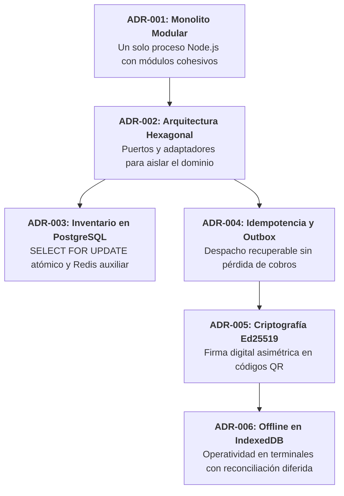

# Análisis del Sistema — 07. Decisiones Arquitectónicas

**Sistema**: Plataforma de Descubrimiento, Venta y Validación de Entradas para Eventos y Conciertos en Vivo  
**Documento**: `docs/01-analisis-de-sistema/07-decisiones-arquitectonicas.md`  
**Versión**: `1.0.0` | **Fecha**: `2026-10-22`  
**Referencia Metodológica**: Guía 04 de Arquitectura de Software & Architecture Decision Records (ADR - Michael Nygard)  
**Alineación**: Conforme al Capítulo 02 y el Modelo C4

---

## 1. Registro Central de Decisiones de Arquitectura (ADRs)

Las decisiones arquitectónicas de **AFORO** formalizan las elecciones de diseño fundamentales para atender los drivers arquitectónicos y mitigar riesgos técnicos. Cada decisión documenta su contexto, alternativas evaluadas, justificación técnica y compromisos (*trade-offs*) asumidos:

---

## 2. Resumen Ejecutivo de los Seis ADRs de AFORO

### ADR-001: Selección del Estilo Arquitectónico Monolito Modular
- **Estado**: `Aceptado y Aprobado`.
- **Contexto**: Necesidad de soportar alta concurrencia transaccional en preventas con un equipo pequeño y presupuesto acotado.
- **Alternativas Evaluadas**: Monolito Modular (4.88/5.00), Microservicios Distribuidos (2.88/5.00), Serverless / FaaS (3.30/5.00).
- **Decisión**: Se selecciona un **Monolito Modular** en un único ejecutable Node.js con seis módulos cohesivos comunicados en memoria mediante interfaces tipadas.
- **Compromisos Asumidos**: Despliegue unificado de todo el sistema; exige disciplina estricta de equipo para no vulnerar el encapsulamiento modular.
- **Documento Detallado**: [`docs/complementos/adrs/ADR-001-seleccion-estilo-monolito-modular.md`](../complementos/adrs/ADR-001-seleccion-estilo-monolito-modular.md).

---

### ADR-002: Adopción de Arquitectura Hexagonal (Puertos y Adaptadores)
- **Estado**: `Aceptado y Aprobado`.
- **Contexto**: Blindar el núcleo de aplicación frente a frameworks web, pasarelas de pago y motores de base de datos.
- **Decisión**: Cada módulo de API Core divide su código en tres capas concéntricas: **Dominio** (puro), **Aplicación** (casos de uso y puertos) e **Infraestructura** (adaptadores primarios y secundarios).
- **Compromisos Asumidos**: Mayor número de interfaces y clases de adaptación; sobrecosto menor de mapeo entre entidades y DTOs.
- **Documento Detallado**: [`docs/complementos/adrs/ADR-002-adopcion-arquitectura-hexagonal.md`](../complementos/adrs/ADR-002-adopcion-arquitectura-hexagonal.md).

---

### ADR-003: Concurrencia e Integridad de Inventario en PostgreSQL
- **Estado**: `Aceptado y Aprobado`.
- **Contexto**: Eliminar el riesgo de sobreventa de entradas ($S + H \le C$) bajo alta contención en aperturas de taquilla.
- **Decisión**: **PostgreSQL es la única fuente de verdad transaccional**. Se utiliza bloqueo pesimista `SELECT ... FOR UPDATE` sobre la fila del sector bajo nivel de aislamiento `READ COMMITTED`, validando cuota y capacidad en la misma transacción indivisible. Redis actúa únicamente como disparador auxiliar de alarmas temporizadas de 600 segundos.
- **Compromisos Asumidos**: Retención de bloqueos a nivel de fila durante la transacción (mitigado manteniendo la transacción ultracorta).
- **Documento Detallado**: [`docs/complementos/adrs/ADR-003-concurrencia-integridad-inventario.md`](../complementos/adrs/ADR-003-concurrencia-integridad-inventario.md).

---

### ADR-004: Idempotencia en Pagos y Despacho con Transactional Outbox
- **Estado**: `Aceptado y Aprobado`.
- **Contexto**: Garantizar que todo cobro exitoso emita entradas incondicionalmente, incluso ante reinicios del proceso o retransmisión de webhooks.
- **Decisión**: La confirmación de pago persiste el cobro y un evento en `outbox_events` dentro de la misma transacción SQL. Un worker interno despacha el evento de forma recuperable con garantías *at-least-once*, mientras que la deduplicación atómica en `payment_idempotency_keys` protege contra cobros duplicados (retención provisional de 72 horas).
- **Compromisos Asumidos**: Consistencia eventual breve entre cobro y visualización de tickets; exige que el emisor de tickets sea estrictamente idempotente.
- **Documento Detallado**: [`docs/complementos/adrs/ADR-004-idempotencia-pagos-webhooks.md`](../complementos/adrs/ADR-004-idempotencia-pagos-webhooks.md).

---

### ADR-005: Criptografía Asimétrica en Entradas QR (Ed25519)
- **Estado**: `Aceptado y Aprobado`.
- **Contexto**: Proteger los pases QR contra falsificaciones y permitir verificación rápida en molinetes con o sin internet.
- **Decisión**: Se selecciona **Ed25519 (criptografía de curva elíptica asimétrica)** sobre HMAC-SHA256 simétrico. El backend firma el payload con clave privada ($SK_E$); las terminales lectoras solo conocen la clave pública ($PK_E$), eliminando el riesgo de falsificación ante robo o pérdida de una terminal.
- **Compromisos Asumidos**: Firma de 64 bytes (ligeramente mayor que un HMAC de 32 bytes, pero fácilmente representable en códigos QR estándar).
- **Documento Detallado**: [`docs/complementos/adrs/ADR-005-criptografia-entradas-qr.md`](../complementos/adrs/ADR-005-criptografia-entradas-qr.md).

---

### ADR-006: Persistencia y Operación Offline en AFORO Access con IndexedDB
- **Estado**: `Aceptado y Aprobado`.
- **Contexto**: Habilitar el flujo continuo de asistentes en puertas cuando la red de telefonía colapsa en el recinto.
- **Decisión**: AFORO Access PWA precarga claves públicas y almacena localmente los ingresos en **IndexedDB** con índices B-Tree de consulta $O(\log N)$. En modo online la validación es atómica en el servidor central; en modo offline se previene el reúso localmente y se encolan los registros para reconciliación posterior.
- **Compromisos Asumidos**: **Reconocimiento del Teorema CAP**: dos terminales completamente desconectadas entre sí no pueden garantizar unicidad global concurrente de ingreso; el riesgo de doble entrada particionada se gestiona mediante bitácora de auditoría forense posterior.
- **Documento Detallado**: [`docs/complementos/adrs/ADR-006-persistencia-operacion-offline-access.md`](../complementos/adrs/ADR-006-persistencia-operacion-offline-access.md).

