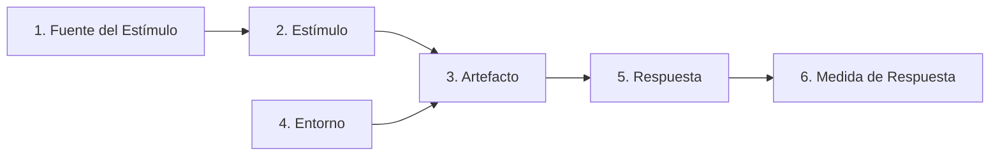

# Escenarios de Atributos de Calidad — AFORO

**Sistema**: Plataforma de Descubrimiento, Venta y Validación de Entradas para Eventos y Conciertos en Vivo  
**Documento**: `docs/01-analisis-de-sistema/08-escenarios-atributos-calidad.md`  
**Metodología de Referencia**: Software Engineering Institute (SEI) — *Software Architecture in Practice* (Bass, Clements & Kazman)  
**Versión**: `1.1.0` | **Fecha**: `2026-10-21`

---

## 1. Metodología de Especificación de Escenarios (SEI) y Honestidad Técnica

Para caracterizar los atributos de calidad de forma rigurosa, no ambigua y verificable, cada escenario se estructura utilizando las seis partes canónicas del método del **SEI**:

1. **Fuente del Estímulo (Source)**: Entidad que genera el evento (usuario, pasarela externa, temporizador, hardware lector).
2. **Estímulo (Stimulus)**: Condición o ráfaga de entrada que arriba al sistema y demanda una respuesta arquitectónica.
3. **Artefacto (Artifact)**: Componente, módulo o subsistema específico afectado. Se explicita si es un componente de código implementado o un artefacto de diseño propuesto.
4. **Entorno (Environment)**: Condiciones operativas en las que ocurre el estímulo (operación normal, alta contención, partición de red).
5. **Respuesta (Response)**: Comportamiento medible que el artefacto ejecuta para procesar el estímulo.
6. **Medida de Respuesta (Response Measure)**: Métrica cuantitativa y umbral de tolerancia.

> **Distinción Metodológica Fundamental**: Las medidas de respuesta asociadas al backend (`2500 req/s`, latencias `p95 < 250 ms`, etc.) y a la aplicación móvil de acceso (`< 300 ms` de validación en terminal físico) constituyen **Objetivos Arquitectónicos y Metas de Diseño** formuladas para guiar la construcción técnica de AFORO. No constituyen mediciones de un backend ya construido. Las únicas mediciones experimentales ejecutadas a la fecha corresponden al frontend web documentadas en [`performance-and-regression-report.md`](../../specs/001-frontend-proportions-and-ticket-page/evidence/performance-and-regression-report.md).

---

## 2. Catálogo de Escenarios de Atributos de Calidad

### Escenario EAC-01: Rendimiento y Escalabilidad — Ráfaga Masiva en Apertura de Preventa

| Elemento SEI | Descripción del Escenario EAC-01 |
| :--- | :--- |
| **Atributo de Calidad** | **Eficiencia de Desempeño (Rendimiento y Capacidad)** — ISO/IEC 25010 §4.2 |
| **Requisitos Trazables** | `RF-WEB-01`, `RF-COR-01`, `RNF-PE-04`, `RNF-PE-05` |
| **1. Fuente del Estímulo** | Asistentes concurrentes en todo el país (tráfico masivo generado por el anuncio de una gira internacional). |
| **2. Estímulo** | Arribo de una ráfaga sostenida de **$2500\text{ peticiones por segundo (req/s)}$** solicitando el catálogo de eventos y el detalle de sectores (`GET /api/v1/events/:slug`). |
| **3. Artefacto** | Capa de Presentación Web ([`AFORO Web SPA`](../../src/App.tsx) — *Implementado*), API Gateway y Módulo de Catálogo del Backend (*Diseño Propuesto*). |
| **4. Entorno** | Operación pico durante los primeros 15 minutos del lanzamiento de una preventa exclusiva. |
| **5. Respuesta del Sistema** | 1. La capa de caché HTTP y memoria distribuida (Redis / Cloudflare) entrega las respuestas de catálogo y metadatos de recinto sin impactar la base de datos relacional para lecturas repetitivas. 2. La SPA de AFORO Web mantiene navegación fluida y renderizado sin congelamiento de UI. |
| **6. Medida de Respuesta (Meta de Diseño)** | - Latencia de respuesta en la API: **$\text{p95} < 250\text{ ms}$** y **$\text{p99} < 450\text{ ms}$** (objetivo de diseño a validar con k6 en sprint de backend). - Tasa de errores HTTP 5xx: **$< 0.05\text{ \%}$** de las solicitudes. - Rendimiento UI verificado en frontend: renderizado sostenido a **$60.0\text{ fps}$** ([`RNF-PE-02`](04-atributos-de-calidad.md)). |
| **Estado de Realidad** | `[OBJETIVO ARQUITECTÓNICO / DISEÑO PROPUESTO]` para backend; `[VERIFICADO EXPERIMENTALMENTE]` para renderizado frontend. |

---

### Escenario EAC-02: Consistencia e Integridad Transaccional — Prevención de Sobreventa bajo Alta Contención

| Elemento SEI | Descripción del Escenario EAC-02 |
| :--- | :--- |
| **Atributo de Calidad** | **Fiabilidad e Integridad Transaccional** — ISO/IEC 25010 §4.3 |
| **Requisitos Trazables** | `RF-COR-02`, `RN-01`, `RN-02`, `RN-04`, `RNF-RE-01` |
| **1. Fuente del Estímulo** | 150 compradores concurrentes que intentan reservar simultáneamente los últimos 4 cupos disponibles en el sector «VIP» de un concierto (respetando el tope de 4 entradas por titular). |
| **2. Estímulo** | Envío concurrente y cuasi-simultáneo de solicitudes `POST /api/v1/reservations` compitiendo por la misma zona en una ventana de $500\text{ ms}$. |
| **3. Artefacto** | Módulo de Reservas y Gestión de Inventario del Monolito Modular y Base de Datos Relacional PostgreSQL (*Diseño Propuesto*). |
| **4. Entorno** | Alta contención de recursos en base de datos al borde del agotamiento de aforo de un sector. |
| **5. Respuesta del Sistema** | 1. El motor transaccional serializa las solicitudes mediante bloqueo pesimista (`SELECT ... FOR UPDATE`) o semáforos atómicos en Redis. 2. Solo las solicitudes cuya suma acumulada no exceda el aforo libre obtienen la reserva temporal con TTL de 10 minutos. 3. Las solicitudes restantes son rechazadas con error controlado `SECTOR_CAPACITY_EXCEEDED` sin corromper el inventario. |
| **6. Medida de Respuesta (Meta de Diseño)** | - **Sobreventa resultante: $0\text{ entradas}$** ($\text{Sold} + \text{ActiveHolds} \le \text{Capacity}$ se cumple en el $100.0\text{ \%}$ de los casos sin excepción). - Detección y rechazo de solicitudes excedentes en una meta de tiempo $< 300\text{ ms}$. - Cero estados inconsistentes o deadlocks no recuperados en base de datos. |
| **Estado de Realidad** | `[OBJETIVO ARQUITECTÓNICO / DISEÑO PROPUESTO]`. Fundamento innegociable fijado en Principio II de la Constitution. |

---

### Escenario EAC-03: Fiabilidad y Lógica de Negocio — Expiración Determinista de Reserva Temporal (TTL)

| Elemento SEI | Descripción del Escenario EAC-03 |
| :--- | :--- |
| **Atributo de Calidad** | **Disponibilidad y Lógica de Negocio** — ISO/IEC 25010 §4.3 |
| **Requisitos Trazables** | `RF-COR-03`, `RN-03`, `RNF-RE-01` |
| **1. Fuente del Estímulo** | Temporizador interno del sistema / Expiración de llave en Redis Keyspace. |
| **2. Estímulo** | Transcurren exactamente **10 minutos (600 segundos)** desde la creación de una reserva temporal sin que la pasarela de pagos haya notificado la confirmación del cobro. |
| **3. Artefacto** | Gestor de Eventos de Expiración (Redis Keyspace Listener / Scheduled Job) y Módulo de Reservas e Inventario (*Diseño Propuesto*). |
| **4. Entorno** | Operación normal y continua del sistema durante una jornada de venta masiva. |
| **5. Respuesta del Sistema** | 1. El sistema marca la orden en estado `EXPIRED`. 2. Reincorpora inmediatamente los cupos liberados a la disponibilidad pública del sector correspondiente. 3. Si el usuario intenta abonar la orden posterior al vencimiento, el pago es rechazado y no se debitan fondos. |
| **6. Medida de Respuesta (Meta de Diseño)** | - Tiempo objetivo de liberación efectiva del inventario: **$< 2\text{ segundos}$** tras los 600 s de TTL. - Reincorporación del $100\text{ \%}$ de las entradas liberadas a la disponibilidad del catálogo. - Tasa de duplicación de entradas o cupos fantasma: **$0\text{ \%}$**. |
| **Estado de Realidad** | `[OBJETIVO ARQUITECTÓNICO / DISEÑO PROPUESTO]`. En frontend actual: ilustrado mediante aviso `MODO DEMO` y selección no bloqueante. |

---

### Escenario EAC-04: Tolerancia a Fallos y Consistencia — Caída Temporal de Pasarela e Idempotencia

| Elemento SEI | Descripción del Escenario EAC-04 |
| :--- | :--- |
| **Atributo de Calidad** | **Fiabilidad (Tolerancia a Fallos) y Seguridad (No Repudio)** — ISO/IEC 25010 §4.3, §4.4 |
| **Requisitos Trazables** | `RF-COR-04`, `RN-05`, `RNF-RE-02`, `RNF-SE-04` |
| **1. Fuente del Estímulo** | Inestabilidad en la red del usuario o timeout de red en la comunicación con la pasarela de pago externa (Culqi / Niubiz). |
| **2. Estímulo** | El usuario reintenta la confirmación de pago enviando nuevamente la solicitud `POST /api/v1/payments/charge`, o la pasarela reenvía tres veces consecutivas el mismo webhook de cobro exitoso. |
| **3. Artefacto** | Módulo de Pagos y Facturación del Backend Monolítico (*Diseño Propuesto*). |
| **4. Entorno** | Conexión intermitente o latencia anormal en la pasarela externa ($> 8000\text{ ms}$). |
| **5. Respuesta del Sistema** | 1. El backend evalúa la cabecera `Idempotency-Key` en la tabla de transacciones de pago. 2. Detecta la clave ya procesada o en ejecución y retorna el resultado existente sin crear una segunda transacción de cobro ni debitar doblemente al usuario. 3. El webhook duplicado es reconocido con HTTP 200 sin emitir tickets duplicados. |
| **6. Medida de Respuesta (Meta de Diseño)** | - Cobros duplicados ejecutados: **$0$**. - Tickets emitidos duplicados por la misma orden: **$0$**. - Tiempo objetivo de respuesta a solicitudes idempotentes repetidas: **$< 80\text{ ms}$**. |
| **Estado de Realidad** | `[OBJETIVO ARQUITECTÓNICO / DISEÑO PROPUESTO]`. Principio innegociable II de la Constitution. |

---

### Escenario EAC-05: Disponibilidad y Resiliencia — Escaneo en Puerta Fuera de Línea (Offline)

| Elemento SEI | Descripción del Escenario EAC-05 |
| :--- | :--- |
| **Atributo de Calidad** | **Disponibilidad y Resiliencia (Tolerancia a Particiones)** — ISO/IEC 25010 §4.3 |
| **Requisitos Trazables** | `RF-ACC-02`, `RF-ACC-04`, `RF-ACC-05`, `RF-ACC-06`, `RN-08`, `RNF-RE-03`, `RNF-PE-06` |
| **1. Fuente del Estímulo** | Caída total de conectividad 4G/5G y red local en el estadio o recinto durante el ingreso masivo de asistentes. |
| **2. Estímulo** | Asistentes presentándose en las puertas de acceso en un intervalo continuo con los dispositivos de validación desconectados de internet. |
| **3. Artefacto** | Aplicación PWA/Móvil **AFORO Access** y su almacén local protegido (SQLite / IndexedDB) (*Diseño Propuesto*). |
| **4. Entorno** | Recinto masivo sin señal de red celular ni Wi-Fi disponible para las terminales de puerta. |
| **5. Respuesta del Sistema** | 1. AFORO Access conmuta de forma transparente al modo fuera de línea. 2. Ejecuta la verificación criptográfica del código QR (utilizando preferentemente la clave pública del evento en caso de adoptarse firma asimétrica Ed25519/ECDSA, o clave de verificación local sujeta a ADR en Cap. 02). 3. Ejecuta la **prevención de reutilización local**: marca el ticket como `USED` en su base local con timestamp y operador; si el mismo ticket se presenta de nuevo en la misma puerta, es rechazado de inmediato. 4. Al restablecerse la conexión, encola y despacha la bitácora hacia la API Core para reconciliación y auditoría forense posterior. |
| **6. Medida de Respuesta (Meta de Diseño y Riesgo Explícito)** | - Tiempo objetivo de validación local en hardware móvil: **$< 300\text{ ms}$** por asistente. - Detención de las colas de ingreso por falta de red: **$0\text{ segundos}$** (operatividad local continua). - Pérdida de registros de ingreso en la bitácora local: **$0\text{ entradas}$**. - **Riesgo Operativo Asumido (Teorema CAP)**: Se reconoce expresamente que no es factible garantizar unicidad global si copias de una misma entrada se presentan simultáneamente en dos puertas distintas mientras ambas están desconectadas. Dicha eventualidad se audita en la reconciliación post-evento. |
| **Estado de Realidad** | `[OBJETIVO ARQUITECTÓNICO / DISEÑO PROPUESTO]`. Especificado para el cliente especializado AFORO Access. |

---

### Escenario EAC-06: Seguridad e Integridad — Detección y Rechazo de Tickets QR Clonados

| Elemento SEI | Descripción del Escenario EAC-06 |
| :--- | :--- |
| **Atributo de Calidad** | **Seguridad (Autenticidad e Integridad)** — ISO/IEC 25010 §4.4 |
| **Requisitos Trazables** | `RF-ACC-04`, `RF-ACC-05`, `RN-06`, `RN-08`, `RNF-SE-01`, `RNF-SE-02` |
| **1. Fuente del Estímulo** | Persona que intenta ingresar utilizando una copia fotocopiada, captura de pantalla compartida o código QR manipulado en sus campos de zona o titular. |
| **2. Estímulo** | El operador escanea el código QR adulterado o escanea un código que ya fue ingresado con anterioridad. |
| **3. Artefacto** | Lector óptico y Módulo de Validación de AFORO Access en comunicación con la API Core (o en modo offline local) (*Diseño Propuesto*). |
| **4. Entorno** | Control de acceso en puerta bajo alta afluencia de público. |
| **5. Respuesta del Sistema** | 1. Si la firma criptográfica no coincide con los datos del payload: rechazo inmediato con pantalla roja de «FIRMA NO VÁLIDA / TICKET FALSIFICADO». 2. En modo online: si el ticket figura en estado `USED` en el servidor central, rechazo inmediato con alerta visual y sonora de «ENTRADA YA UTILIZADA», mostrando hora y puerta del primer ingreso. 3. En modo offline: rechazo inmediato si el ticket ya fue utilizado en la misma terminal; si fue utilizado en otra puerta desconectada, la colisión queda registrada en la reconciliación. 4. Bloqueo de torniquete o molinete. |
| **6. Medida de Respuesta (Meta de Diseño)** | - Ingresos no autorizados permitidos por entradas adulteradas: **$0\text{ incidentes}$**. - Tiempo objetivo de detección y emisión de la alerta en pantalla: **$< 200\text{ ms}$** tras el escaneo óptico. |
| **Estado de Realidad** | `[OBJETIVO ARQUITECTÓNICO / DISEÑO PROPUESTO]`. En frontend actual: el ticket simulado de demostración exhibe token y QR estático `ACTIVA_DEMO`. |
