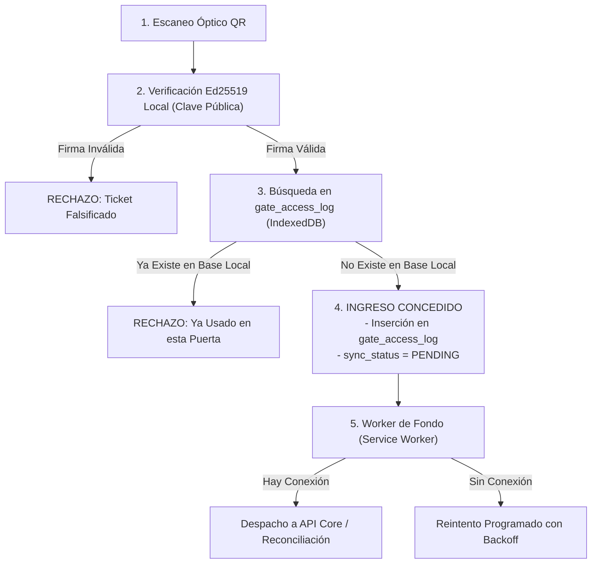

# ADR-006: Estrategia de Persistencia Local y Operación Offline en Terminales de Puerta (AFORO Access)

- **Estado**: `[PROPUESTO]`
- **Fecha**: `2026-10-21`
- **Área**: Control de Accesos / Aplicación Móvil-PWA / Resiliencia Fuera de Línea
- **Decisores**: Equipo de Arquitectura de Software AFORO
- **Estado de Realidad Técnica**: `[DISEÑO ARQUITECTÓNICO PROPUESTO]`

---

## 1. Contexto y Planteamiento del Problema

La aplicación para control de accesos en molinetes (**AFORO Access**) opera habitualmente en recintos masivos (estadios, explanadas y coliseos) donde la cobertura de red celular suele experimentar congestión severa o cortes intermitentes debido a la densidad de público.

Para mantener el flujo ininterrumpido en las filas de acceso (`BG-02`, `EAC-05`), la terminal debe implementar una estrategia **Offline-First**, requiriendo un motor de persistencia local en el dispositivo que permita:
1. Almacenar la lista precargada de entradas correspondientes al sector asignado a esa puerta y la clave pública criptográfica del evento (`RF-ACC-02`, `ADR-005`).
2. Registrar atómicamente cada ticket escaneado con marca temporal, operador y puerta para evitar el reingreso por la **misma terminal física** (`RN-08`).
3. Encolar los registros de acceso en una bitácora local persistente y sincronizarlos asíncronamente con la API Core cuando se restablezca la conectividad (`RF-ACC-06`).
4. Ejecutar búsquedas indexadas de baja latencia sin congelar el hilo de renderizado de la cámara en dispositivos móviles.

---

## 2. Alternativas Evaluadas

1. **Alternativa A: Almacenamiento Web Clave-Valor (`localStorage`)**:
   - *Descripción*: Almacén síncrono del navegador.
   - *Evaluación*: Presenta cuota reducida (máximo 5 MB), bloquea el hilo principal de la interfaz durante escrituras repetitivas y carece de soporte de índices para búsquedas estructuradas por sector o estado.

2. **Alternativa B: SQLite Compilado a WebAssembly (SQLite WASM con OPFS)**:
   - *Descripción*: Motor relacional SQLite embebido mediante WebAssembly y persistido en el *Origin Private File System*.
   - *Evaluación*: Provee capacidades SQL completas, pero introduce una sobrecarga considerable: incrementa el tamaño de descarga inicial del cliente (aproximadamente 1.5 a 2.5 MB adicionales de binario WASM), consume más memoria RAM en dispositivos de gama de entrada y presenta variaciones de soporte según el navegador móvil o WebView empleado.

3. **Alternativa C: IndexedDB Nativo con Capa Tipada y Cifrado de Aplicación**:
   - *Descripción*: Base de datos no relacional transaccional asíncrona estándar en todos los navegadores móviles modernos (Chromium, Safari iOS), con capacidad de almacenamiento dimensionada para miles de registros y soporte de índices basados en B-Trees para búsquedas logarítmicas eficientes $O(\log N)$.

---

## 3. Decisión Propuesta

Se decide adoptar la **Alternativa C: IndexedDB Nativo (gestionado mediante wrapper tipado ligero y cifrado de aplicación)** como el motor de persistencia local en **AFORO Access**.

### Estructura de Almacenes de Objetos (Object Stores):
1. **`preloaded_tickets`**:
   - Clave primaria: `ticketId`.
   - Índices: `sectorId`, `status`.
   - Almacena las entradas válidas descargadas durante la sincronización preliminar del evento.
2. **`gate_access_log`**:
   - Clave primaria autoincremental `id`.
   - Índices: `ticketId` (único localmente), `sync_status` (`PENDING`, `SYNCED`), `scanned_at`.
   - Registra de forma transaccional cada acceso concedido en esa terminal.
3. **`event_crypto_keys`**:
   - Almacena la clave pública Ed25519 del evento (`ADR-005`), protegida a nivel de aplicación mediante Web Crypto API.

### Protocolo de Validación y Límites de la Operación Offline:

---

## 4. Justificación

1. **Operación Asíncrona sin Bloqueo de UI**: Las lecturas y escrituras en IndexedDB no interfieren con el hilo de ejecución principal ni con la captura de la cámara web/móvil.
2. **Búsquedas Indexadas Eficientes $O(\log N)$**: Al emplear índices B-Tree nativos, las búsquedas por `ticketId` se resuelven con complejidad logarítmica $O(\log N)$, manteniendo baja latencia incluso con listados extensos de asistentes correspondientes al sector de la puerta.
3. **Cero Sobrecarga de Descarga de Binarios**: Al ser una API nativa del navegador, no requiere descargar bibliotecas WASM pesadas, agilizando el arranque inicial de AFORO Access en dispositivos móviles de gama económica.

---

## 5. Limitaciones Inherentes de la Operación Offline y Teorema CAP

Es fundamental explicitar las **limitaciones operativas que el sistema asume de forma consciente cuando las terminales pierden conectividad**:

1. **Alcance de la Prevención de Reúso**:
   - La terminal fuera de línea garantiza la prevención de reingreso **únicamente dentro de su propia base de datos local** (la misma puerta física).
2. **Riesgo de Doble Ingreso Inter-Puerta en Desconexión Simultánea**:
   - Si una misma entrada legítima es fotocopiada o compartida y presentada de forma casi simultánea en dos puertas distintas mientras ambas están desconectadas de internet, ambas terminales la admitirán como válida (pues ninguna tiene visibilidad del estado de la otra).
   - Esta condición representa un compromiso clásico de consistencia eventual bajo el **Teorema CAP (priorización de Disponibilidad y Tolerancia a Partición - AP)**.
   - *Mitigación Operativa*: Se mitiga mediante zonificación perimetral estricta (puertas físicas separadas por sectores), reintentos automáticos de conectividad celular y auditoría forense posterior en la API Core durante la reconciliación.
3. **Entradas Emitidas de Última Hora**:
   - Si un usuario adquiere una entrada mientras una terminal ya se encuentra desconectada, dicha entrada no figurará en la lista precargada `preloaded_tickets`. La terminal verificará la validez criptográfica de la firma Ed25519 y registrará el ingreso como evento provisional para reconciliación posterior, según la política que configure el organizador.

---

## 6. Consecuencias

### Consecuencias Positivas
- Operatividad continua en molinetes ante caídas temporales de red celular o Wi-Fi (`RNF-RE-03`).
- Búsquedas indexadas asíncronas sobre la base local sin bloquear el escaneo óptico.
- Bitácora estructurada para reconciliación asíncrona determinista con la API Core.

### Compromisos y Consecuencias Negativas (Trade-offs)
- Riesgo de doble ingreso entre puertas distintas durante particiones prolongadas de red, asumido por razones de seguridad física para no detener las filas.
- Posibilidad de pérdida de datos si el operador fuerza el borrado de almacenamiento del navegador (mitigado solicitando almacenamiento persistente con `navigator.storage.persist()`).

---

## 7. Riesgos y Mitigaciones

| Riesgo Identificado | Probabilidad / Impacto | Mitigación Arquitectónica |
| :--- | :---: | :--- |
| **Colisión Inter-Puerta por Desconexión Concurrente**. | Baja / Medio | Reconocido en `RN-08`. Se mitiga mediante zonificación física de accesos, reintentos de reconexión y auditoría forense post-evento en la API Core. |
| **Pérdida de Transacciones por Cierre Repentino de Batería**. | Baja / Alto | Cada escaneo aprobado ejecuta un commit transaccional explícito en IndexedDB antes de presentar la pantalla verde de autorización al operador. |

---

## 8. Trazabilidad

- **Requisitos Funcionales**: [`RF-ACC-02`](../01-analisis-de-sistema/01-requisitos-funcionales.md), [`RF-ACC-05`](../01-analisis-de-sistema/01-requisitos-funcionales.md), [`RF-ACC-06`](../01-analisis-de-sistema/01-requisitos-funcionales.md).
- **Requisitos No Funcionales**: [`RNF-RE-03`](../01-analisis-de-sistema/02-requisitos-no-funcionales.md), [`RNF-PE-06`](../01-analisis-de-sistema/02-requisitos-no-funcionales.md).
- **Reglas de Negocio**: [`RN-08`](../01-analisis-de-sistema/03-reglas-de-negocio.md).
- **Escenarios de Calidad**: [`EAC-05`](../01-analisis-de-sistema/08-escenarios-atributos-calidad.md).
- **Decisión Previa Relacionada**: [`ADR-005`](ADR-005-criptografia-entradas-qr.md).
