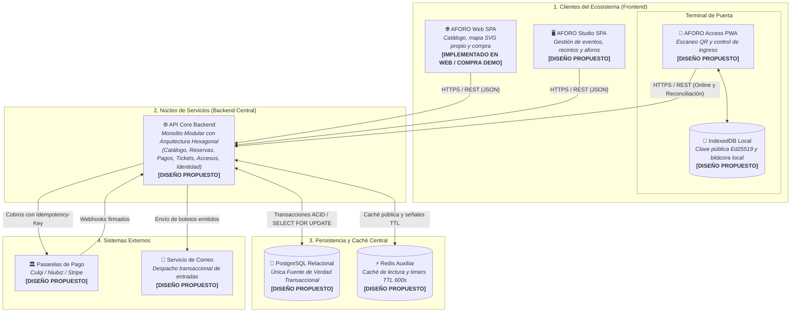

# Arquitectura de Software — Arquitectura Inicial

**Sistema**: Plataforma de Descubrimiento, Venta y Validación de Entradas para Eventos y Conciertos en Vivo  
**Documento**: `docs/02-arquitectura-software/arquitectura-inicial.md`  
**Versión**: `1.1.0` | **Fecha**: `2026-10-29`  
**Referencia Metodológica**: Guía 04 de Arquitectura de Software & C4 Model  
**Alineación**: Conforme al [Capítulo 01 de Análisis](../01-analisis-de-sistema/06-driver-arquitectonicos.md), las [Decisiones Arquitectónicas (ADRs 001 al 006)](../01-analisis-de-sistema/07-decisiones-arquitectonicas.md) y el [Modelo C4](../04-modelo-c4/Nivel1-DiagramadeContextodelSistema.md)

---

## 1. Visión General y Objetivos del Sistema AFORO

**AFORO** es una plataforma integral de taquilla digital, descubrimiento editorial y validación de accesos para conciertos y eventos masivos en vivo. Su arquitectura está concebida para resolver cuatro desafíos estructurales del dominio de espectáculos: sobreventa de entradas en aperturas de alta demanda, acaparamiento automatizado mediante compras masivas, pérdida de operatividad en puertas cuando colapsan las telecomunicaciones del recinto y complejidad desmedida de costos de infraestructura.

### 1.1. Objetivos de Negocio y Garantías Arquitectónicas
1. **Conservación Absoluta del Aforo Nominal (Cero Sobreventa)**:  
   Garantizar mediante invariantes transaccionales ([`RN-01`](../complementos/03-reglas-de-negocio.md#rn-01-invariante-estricta-de-no-sobreventa-aforo-inviolable)) que la suma de entradas vendidas ($S$) y reservas temporales activas ($H$) jamás supere la capacidad física y legal autorizada para cada sector ($C$): $S + H \le C$.
2. **Equidad en el Acceso y Control Antirrevendedores**:  
   Aplicar un límite estricto de máximo 4 entradas acumuladas por titular y sector ([`RN-04`](../complementos/03-reglas-de-negocio.md#rn-04-tope-máximo-de-entradas-por-asistente)), complementado con selección visual no bloqueante en el navegador ([`RN-02`](../complementos/03-reglas-de-negocio.md#rn-02-selección-visual-no-bloqueante-de-inventario)) y reservas preventivas con tiempo de vida determinista de 10 minutos ($\text{TTL} = 600\text{ s}$, [`RN-03`](../complementos/03-reglas-de-negocio.md#rn-03-reserva-temporal-con-expiración-determinista-ttl-de-10-minutos)).
3. **Continuidad Operativa en Puertas de Acceso**:  
   Permitir que los operadores de molinetes verifiquen la autenticidad criptográfica de los códigos QR tanto en modo conectado (mutación atómica `ACTIVE → USED`) como en modo desconectado de contingencia con reconciliación posterior ([`RN-06`](../complementos/03-reglas-de-negocio.md#rn-06-emisión-atómica-y-firma-criptográfica-de-tickets-qr), [`RN-08`](../complementos/03-reglas-de-negocio.md#rn-08-validación-acceso-en-puerta-y-tolerancia-a-desconexión-anti-reúso)).
4. **Sostenibilidad Económica y Simplicidad Operativa**:  
   Centralizar la lógica de negocio en un único artefacto desplegable bien modularizado, evitando la sobrecarga de red, orquestación y costos fijos asociados a microservicios distribuidos prematuros ([`ADR-001`](../complementos/adrs/ADR-001-seleccion-estilo-monolito-modular.md)).

> [!IMPORTANT]
> **Declaración de Realidad Técnica del Repositorio**:  
> - **`[IMPLEMENTADO EN WEB]`**: La aplicación pública [`AFORO Web SPA`](../../src/App.tsx) está implementada en React / TypeScript con catálogo editorial, filtros multicriterio, sincronización entre pestañas y mapas interactivos de recintos en SVG nativo ([`VenueStageMap.tsx`](../../src/components/VenueStageMap.tsx)).  
> - **`[DEMO / SIMULADO]`**: El flujo de reserva temporal, selección de pasarela de pago y emisión de pases QR (`ACTIVA_DEMO`) opera actualmente como una simulación interactiva en el navegador (`localStorage`).  
> - **`[DISEÑO PROPUESTO]`**: El contenedor `API Core Backend`, las aplicaciones `AFORO Studio` y `AFORO Access`, la persistencia en `PostgreSQL` / `Redis` y las integraciones con pasarelas de pago y correo constituyen la arquitectura objetivo formalizada en esta especificación.

---

## 2. Modelo Arquitectónico General y Delimitación de Fronteras

El modelo estructural de AFORO se organiza en cuatro bloques claramente delimitados: **Clientes del Ecosistema**, **Núcleo de Servicios (API Core Backend)**, **Persistencia Central** y **Sistemas Externos**. El desglose exhaustivo de actores e interacciones de contexto se encuentra en el [Diagrama C1 (Contexto)](../04-modelo-c4/Nivel1-DiagramadeContextodelSistema.md) y la especificación de contenedores y protocolos en el [Diagrama C2 (Contenedores)](../04-modelo-c4/Nivel2-DiagramadeContenedores.md).

### 2.1. Delimitación de Clientes del Ecosistema
- **AFORO Web SPA (`[IMPLEMENTADO EN WEB]` / `[DEMO / SIMULADO]` en checkout)**:  
  Aplicación de cara al asistente final. Permite explorar eventos, filtrar por ciudad o género, visualizar sectores mediante vectores SVG propios sin depender de servicios cartográficos externos (como Google Maps, OpenStreetMap o Leaflet) y gestionar el carrito sin bloquear inventario del servidor hasta solicitar formalmente el *hold* de pago.
- **AFORO Studio SPA (`[DISEÑO PROPUESTO]`)**:  
  Aplicación web administrativa para promotores y organizadores. Centraliza la creación de conciertos, configuración de recintos, asignación de capacidades máximas por sector y monitoreo de ventas.
- **AFORO Access PWA (`[DISEÑO PROPUESTO]`)**:  
  Aplicación web progresiva diseñada para operadores de puerta. Integra un almacén local **IndexedDB** dentro del propio cliente móvil (no como servidor externo) donde conserva las claves públicas de verificación Ed25519 ($PK_E$), el padrón de entradas del evento y la bitácora de ingresos para operar con o sin conexión a internet.

### 2.2. Delimitación del API Core Backend (`[DISEÑO PROPUESTO]`)
- Constituye la única frontera lógica de negocio entre los clientes y los almacenes de datos centrales.
- Se estructura como un **Monolito Modular** compuesto por seis módulos de dominio cohesivos (`Catalog`, `Reservations`, `Payments`, `Tickets`, `Access`, `Identity`), diseñados internamente bajo **Arquitectura Hexagonal** ([`estilo-arquitectonico.md`](estilo-arquitectonico.md), [`enfoque-aquitectonico.md`](enfoque-aquitectonico.md) y [`componentes-arquitectonicos.md`](componentes-arquitectonicos.md)).
- Ningún cliente frontend ni sistema externo accede directamente a PostgreSQL ni a Redis; toda operación atraviesa los adaptadores primarios del API Core.

### 2.3. Delimitación de Persistencia y Caché Central (`[DISEÑO PROPUESTO]`)
- **PostgreSQL (Única Fuente de Verdad)**:  
  Sustenta la autoridad exclusiva sobre el inventario de sectores, la vigencia efectiva de las reservas temporales (`expires_at > NOW()`), el registro idempotente de pagos, la tabla `outbox_events` y el estado de los tickets (`ISSUED`, `ACTIVE`, `USED`, `REVOKED`, `EXPIRED`).
- **Redis (Infraestructura Auxiliar Volátil)**:  
  Desempeña funciones estrictamente complementarias: caché de cartelera pública para absorber picos de lectura, limitación de tasa de peticiones (*rate limiting*) y temporizadores auxiliares de 600 segundos (`EX 600`) que notifican la expiración de reservas sin sustituir la validación temporal en PostgreSQL ([`ADR-003`](../complementos/adrs/ADR-003-concurrencia-integridad-inventario.md)).

### 2.4. Delimitación de Servicios Externos (`[DISEÑO PROPUESTO]`)
- **Pasarelas de Pago Externas (Culqi, Niubiz, Stripe)**:  
  Procesan la autorización financiera tokenizada y notifican confirmaciones asíncronas mediante webhooks verificados criptográficamente según el mecanismo propio de cada proveedor ([`ADR-004`](../complementos/adrs/ADR-004-idempotencia-pagos-webhooks.md)).
- **Servicio de Correo Transaccional (SendGrid / AWS SES)**:  
  Canal externo invocado por el módulo de Tickets tras la emisión formal para entregar los comprobantes y códigos QR al comprador.

---

## 3. Relación entre Drivers Arquitectónicos y Decisiones Adoptadas

La arquitectura inicial de AFORO responde directamente a los cinco drivers arquitectónicos identificados en [`06-driver-arquitectonicos.md`](../01-analisis-de-sistema/06-driver-arquitectonicos.md) y evaluados mediante los escenarios de calidad en [`08-escenarios-atributos-calidad.md`](../01-analisis-de-sistema/08-escenarios-atributos-calidad.md):

| Driver Arquitectónico | Escenario / Regla Vinculada | Decisión Arquitectónica Adoptada | Materialización en el Modelo General |
| :--- | :--- | :--- | :--- |
| **`DA-01`: Cero Sobreventa Transaccional** | `EAC-02`, `RN-01`, `RN-03`, `RN-04` | **[ADR-003](../complementos/adrs/ADR-003-concurrencia-integridad-inventario.md)**: Concurrencia e Integridad en PostgreSQL | Bloqueo pesimista `SELECT ... FOR UPDATE` bajo `READ COMMITTED` en PostgreSQL como única fuente de verdad; validación de $S + H \le C$ y cuota de 4 entradas en una misma transacción indivisible. |
| **`DA-02`: Disponibilidad en Preventas Masivas** | `EAC-01`, `RF-WEB-01`, `RN-02` | **[ADR-001](../complementos/adrs/ADR-001-seleccion-estilo-monolito-modular.md)** & **[ADR-003](../complementos/adrs/ADR-003-concurrencia-integridad-inventario.md)** | Separación entre exploración visual no bloqueante (servida desde caché auxiliar en Redis) y reservas formales serializadas en PostgreSQL; comunicación intermodular en memoria sin latencia de red interna. |
| **`DA-03`: Continuidad Offline en Puertas** | `EAC-04`, `EAC-05`, `RN-06`, `RN-08` | **[ADR-005](../complementos/adrs/ADR-005-criptografia-entradas-qr.md)** (Ed25519) & **[ADR-006](../complementos/adrs/ADR-006-persistencia-operacion-offline-access.md)** (IndexedDB) | Firma asimétrica en backend con clave privada ($SK_E$) y verificación autónoma en AFORO Access con clave pública ($PK_E$) e IndexedDB local, reconociendo el compromiso CAP ante desconexión simultánea de múltiples puertas. |
| **`DA-04`: Resiliencia y Emisión Segura** | `EAC-03`, `RN-05`, `RN-07` | **[ADR-004](../complementos/adrs/ADR-004-idempotencia-pagos-webhooks.md)**: Idempotencia y Transactional Outbox | Claves de idempotencia atómicas en PostgreSQL (`ON CONFLICT DO NOTHING`) y persistencia conjunta de pago + evento en `outbox_events` para garantizar entrega *at-least-once* al emisor de tickets. |
| **`DA-05`: Simplicidad Operativa y Costo** | `RES-ARQ-01`, `RES-NEG-03` | **[ADR-001](../complementos/adrs/ADR-001-seleccion-estilo-monolito-modular.md)** (Monolito Modular) & **[ADR-002](../complementos/adrs/ADR-002-adopcion-arquitectura-hexagonal.md)** (Hexagonal) | Un único backend desplegable sin brokers externos ni mallas de microservicios, preservando fronteras limpias mediante puertos, adaptadores y fachadas públicas. |

---

## 4. Referencias de Navegación Arquitectónica

Para profundizar en las vistas específicas del modelo sin duplicar especificaciones:
- **Contexto y Frontera del Sistema**: [Nivel 1 — Diagrama de Contexto (C1)](../04-modelo-c4/Nivel1-DiagramadeContextodelSistema.md).
- **Contenedores y Protocolos**: [Nivel 2 — Diagrama de Contenedores (C2)](../04-modelo-c4/Nivel2-DiagramadeContenedores.md).
- **Justificación del Estilo Monolito Modular**: [Estilo Arquitectónico](estilo-arquitectonico.md).
- **Aplicación de Puertos y Adaptadores**: [Enfoque Arquitectónico](enfoque-aquitectonico.md).
- **Módulos, Contratos y Fachadas**: [Componentes Arquitectónicos](componentes-arquitectonicos.md) y [Nivel 3 — Diagrama de Componentes (C3)](../04-modelo-c4/Nivel3-Diagrama-de-Componentes.md).
