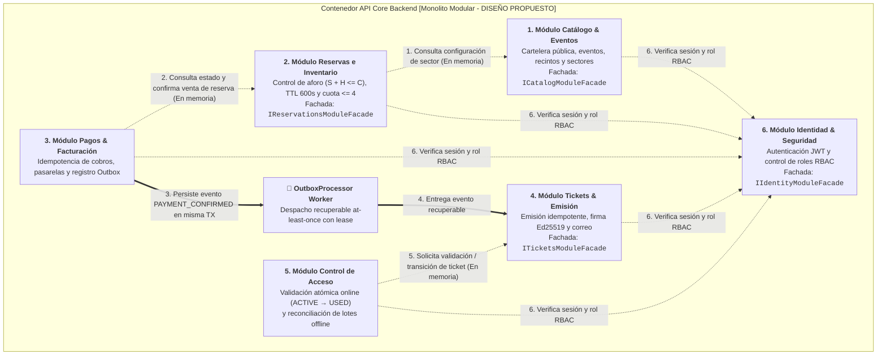

# Arquitectura de Software — Componentes Arquitectónicos

**Sistema**: Plataforma de Descubrimiento, Venta y Validación de Entradas para Eventos y Conciertos en Vivo  
**Contenedor**: `API Core Backend` (Monolito Modular)  
**Documento**: `docs/02-arquitectura-software/componentes-arquitectonicos.md`  
**Versión**: `1.1.0` | **Fecha**: `2026-10-29`  
**Referencia Metodológica**: Guía 04 de Arquitectura de Software & C4 Model Nivel 3  
**Alineación**: Conforme a [ADR-001](../complementos/adrs/ADR-001-seleccion-estilo-monolito-modular.md), [ADR-002](../complementos/adrs/ADR-002-adopcion-arquitectura-hexagonal.md) y [Nivel 3 (Componentes)](../04-modelo-c4/Nivel3-Diagrama-de-Componentes.md)  
**Estado de Implementación**: **`[DISEÑO PROPUESTO — NO IMPLEMENTADO]`**

---

## 1. Descomposición Modular de API Core

El backend central de AFORO se estructura como un **Monolito Modular** organizado en seis módulos de dominio cohesivos, interconectados exclusivamente mediante **fachadas públicas en memoria** y un despachador recuperable basado en el patrón **Transactional Outbox**:

---

## 2. Responsabilidades y Colaboraciones de los Seis Módulos

### 2.1. Módulo 1: Catálogo & Eventos (`Catalog`)
- **Responsabilidad de Dominio**: Administración editorial de conciertos, programación de fechas, configuración de recintos y definición de sectores con su capacidad nominal autorizada (`RF-WEB-01`, `RF-STU-02`, `RF-STU-03`, `RF-COR-01`).
- **Componentes Internos Principales**:
  - *Inbound*: `CatalogController`, `GetCatalogUseCase`, `GetEventDetailUseCase`, `ICatalogModuleFacade`.
  - *Outbound*: `ICatalogRepository` (`PostgreSQLCatalogAdapter`), `ICatalogCache` (`RedisCatalogCacheAdapter`).
- **Tablas Privadas bajo Custodia**: `events`, `venues`, `sectors`.
- **Colaboraciones**: Provee a `Reservations` los metadatos de eventos y la capacidad autorizada por sector a través de `ICatalogModuleFacade`.

### 2.2. Módulo 2: Reservas e Inventario (`Reservations`)
- **Responsabilidad de Dominio**: Custodia del invariante de no sobreventa ($S + H \le C$, [`RN-01`](../complementos/03-reglas-de-negocio.md#rn-01-invariante-estricta-de-no-sobreventa-aforo-inviolable)), creación de retenciones temporales con vigencia de 600 segundos ([`RN-03`](../complementos/03-reglas-de-negocio.md#rn-03-reserva-temporal-con-expiración-determinista-ttl-de-10-minutos)), validación del tope de 4 entradas por titular y sector ([`RN-04`](../complementos/03-reglas-de-negocio.md#rn-04-tope-máximo-de-entradas-por-asistente)) y liberación automática de reservas expiradas ([`ADR-003`](../complementos/adrs/ADR-003-concurrencia-integridad-inventario.md)).
- **Componentes Internos Principales**:
  - *Inbound*: `ReservationsController`, `HoldTicketsUseCase`, `ReleaseExpiredHoldsUseCase`, `IReservationsModuleFacade` (`ReservationsModuleFacadeImpl`).
  - *Dominio*: `SectorInventory`, `Reservation` (`PENDING_PAYMENT`, `CONFIRMED`, `EXPIRED`, `CANCELLED`).
  - *Outbound*: `IReservationUnitOfWork` (`PostgreSQLReservationAdapter` con `SELECT ... FOR UPDATE`), `ITimerNotifier` (`RedisTTLTimerAdapter`).
- **Tablas Privadas bajo Custodia**: `sector_inventory`, `reservations`.
- **Colaboraciones**: Consume `ICatalogModuleFacade` para validar sectores; expone `IReservationsModuleFacade` hacia `Payments` para verificar vigencia y confirmar la conversión de reserva temporal a venta definitiva (`confirmReservationSold`).

### 2.3. Módulo 3: Pagos & Facturación (`Payments`)
- **Responsabilidad de Dominio**: Procesamiento de órdenes de cobro con pasarelas externas (Culqi, Niubiz, Stripe), verificación criptográfica de webhooks según proveedor, deduplicación atómica mediante `Idempotency-Key` y `gateway_event_id` ([`RN-05`](../complementos/03-reglas-de-negocio.md#rn-05-idempotencia-en-cobros-y-procesamiento-de-pagos)) y persistencia transaccional del evento de emisión en Outbox ([`ADR-004`](../complementos/adrs/ADR-004-idempotencia-pagos-webhooks.md)).
- **Componentes Internos Principales**:
  - *Inbound*: `PaymentsController`, `WebhooksController`, `ProcessPaymentUseCase`, `HandleGatewayWebhookUseCase`.
  - *Outbound*: `IPaymentRepository` (`PostgreSQLPaymentAdapter`), `IPaymentGateway` (`CulqiPaymentAdapter`, `NiubizPaymentAdapter`, `StripePaymentAdapter`), `IOutboxRepository`.
- **Tablas Privadas bajo Custodia**: `payments`, `payment_idempotency_keys`, `outbox_events`.
- **Colaboraciones**: Invoca `IReservationsModuleFacade.confirmReservationSold()` al confirmar el pago y escribe el evento `PAYMENT_CONFIRMED` en `outbox_events` para que el `OutboxProcessor Worker` notifique al módulo `Tickets`.

### 2.4. Módulo 4: Tickets & Emisión (`Tickets`)
- **Responsabilidad de Dominio**: Emisión idempotente de entradas tras confirmación de pago, firma digital asimétrica Ed25519 del payload QR con clave privada por evento ($SK_E$, [`RN-06`](../complementos/03-reglas-de-negocio.md#rn-06-emisión-atómica-y-firma-criptográfica-de-tickets-qr), [`ADR-005`](../complementos/adrs/ADR-005-criptografia-entradas-qr.md)), gestión de la máquina de estados del boleto (`ISSUED`, `ACTIVE`, `USED`, `REVOKED`, `EXPIRED`, [`RN-07`](../complementos/03-reglas-de-negocio.md#rn-07-máquina-de-estados-del-ticket)) y envío de correo de confirmación.
- **Componentes Internos Principales**:
  - *Inbound*: `TicketIssuanceListener` (consumidor Outbox), `TicketsController`, `IssueTicketsUseCase`, `GetTicketDetailUseCase`, `ITicketsModuleFacade`.
  - *Outbound*: `ITicketRepository` (`PostgreSQLTicketAdapter`), `ISignatureService` (`Ed25519SignatureAdapter`), `INotificationService` (`EmailNotificationAdapter`).
- **Tablas Privadas bajo Custodia**: `tickets`.
- **Colaboraciones**: Recibe eventos desde `OutboxProcessor Worker` y expone `ITicketsModuleFacade` hacia el módulo `Access` para consultar claves públicas de eventos y ejecutar la transición atómica del estado de los boletos.

### 2.5. Módulo 5: Control de Acceso (`Access`)
- **Responsabilidad de Dominio**: Validación de ingresos en puertas conectadas mediante transición condicional atómica `ACTIVE → USED`, entrega de padrón y clave pública ($PK_E$) hacia terminales `AFORO Access`, y reconciliación posterior de bitácoras capturadas fuera de línea con detección forense de colisiones ([`RN-08`](../complementos/03-reglas-de-negocio.md#rn-08-validación-acceso-en-puerta-y-tolerancia-a-desconexión-anti-reúso), [`ADR-006`](../complementos/adrs/ADR-006-persistencia-operacion-offline-access.md)).
- **Componentes Internos Principales**:
  - *Inbound*: `AccessGateController`, `ValidateTicketOnlineUseCase`, `ReconcileGateLogsUseCase`.
  - *Outbound*: `IAccessRepository` (`PostgreSQLAccessAdapter`).
- **Tablas Privadas bajo Custodia**: `access_logs`, `access_audit_collisions`.
- **Colaboraciones**: Coordina con `Tickets` la mutación atómica del boleto validado y registra la trazabilidad de auditoría de molinetes.

### 2.6. Módulo 6: Identidad & Seguridad (`Identity`)
- **Responsabilidad de Dominio**: Registro y autenticación de usuarios, emisión y verificación de credenciales JWT y autorización por roles RBAC (`FAN`, `ORGANIZER`, `GATE_OPERATOR`, `PLATFORM_ADMIN`).
- **Componentes Internos Principales**:
  - *Inbound*: `AuthController`, `AuthenticateUserUseCase`, `VerifyTokenUseCase`, `IIdentityModuleFacade`.
  - *Outbound*: `IUserRepository` (`PostgreSQLUserAdapter`), `ITokenProvider` (`JwtTokenAdapter`).
- **Tablas Privadas bajo Custodia**: `users`, `roles`.
- **Colaboraciones**: Provee verificación transversal de identidad y permisos a los adaptadores primarios de los demás módulos a través de `IIdentityModuleFacade`.

---

## 3. Matriz de Dependencias Intermodulares

La siguiente matriz resume las únicas colaboraciones permitidas entre los seis módulos dentro de `API Core Backend`:

| Módulo Origen (Consumidor) | Módulo Destino (Proveedor) | Mecanismo de Integración | Contrato / Evento Público | Propósito de la Colaboración |
| :--- | :--- | :---: | :--- | :--- |
| **Reservations** | **Catalog** | Fachada en Memoria | `ICatalogModuleFacade` | Consultar existencia de evento, sector y capacidad nominal autorizada. |
| **Payments** | **Reservations** | Fachada en Memoria | `IReservationsModuleFacade` | Consultar vigencia (`PENDING_PAYMENT`) y confirmar venta (`confirmReservationSold`). |
| **Payments** | **Tickets** | Transactional Outbox | Evento `PAYMENT_CONFIRMED` | Solicitar de forma asíncrona, recuperable e idempotente la emisión de boletos pagados. |
| **Access** | **Tickets** | Fachada en Memoria | `ITicketsModuleFacade` | Ejecutar transición atómica `ACTIVE → USED` y obtener clave pública $PK_E$ del evento. |
| **Todos los Módulos** | **Identity** | Fachada en Memoria | `IIdentityModuleFacade` | Validar tokens JWT, identidad del titular y permisos RBAC por operación. |

> [!CAUTION]
> **Prohibición Estricta de Acceso Directo a Tablas Privadas**:  
> Ningún módulo tiene permitido ejecutar consultas SQL (`SELECT`, `JOIN`, `UPDATE`, `INSERT`, `DELETE`) sobre las tablas custodiadas por otro módulo. Por ejemplo, el módulo `Payments` jamás ejecuta un `UPDATE` directo sobre la tabla `reservations` ni un `INSERT` sobre `tickets`; delega la confirmación de la reserva en `IReservationsModuleFacade` y dispara la emisión de entradas mediante el evento persistido en `outbox_events`.

---

## 4. Contratos Públicos: Fachadas y Eventos Outbox

### 4.1. Contratos de Fachadas Públicas en Memoria
Cada fachada actúa como una barrera de encapsulamiento que oculta las entidades de dominio y los detalles de persistencia del módulo proveedor:
- **`IReservationsModuleFacade`** (definida en [C4 Código](../04-modelo-c4/Nivel4-DiagramadeCodigo.md)):
  - `getReservationStatus(reservationId: string): ReservationDTO`
  - `confirmReservationSold(reservationId: string): boolean`
  - `cancelHoldManually(reservationId: string, reason: string): boolean`
- **`ICatalogModuleFacade`**:
  - `getSectorConfiguration(eventId: string, sectorId: string): SectorConfigDTO`
- **`ITicketsModuleFacade`**:
  - `consumeTicketAtomically(ticketId: string, gateId: string, operatorId: string): TicketConsumptionResultDTO`
  - `getEventPublicKey(eventId: string): string`
- **`IIdentityModuleFacade`**:
  - `verifySessionToken(token: string): AuthenticatedUserDTO`

### 4.2. Contrato Asíncrono mediante Transactional Outbox
Para desacoplar la confirmación financiera de la generación criptográfica y el envío de correos sin depender de un bus en memoria volátil ni de brokers externos:
1. **Persistencia Atómica del Evento**: Al confirmar un cobro, `PostgreSQLPaymentAdapter` inserta el pago y el registro en `outbox_events` (`type = 'PAYMENT_CONFIRMED'`, `status = 'PENDING'`) en la misma transacción SQL.
2. **Reclamo Recuperable con Lease**: `OutboxProcessor Worker` selecciona lotes pendientes o con arrendamiento vencido (`SELECT ... FOR UPDATE SKIP LOCKED`), marcándolos como `CLAIMED` con un `lease_until` de 30 segundos en una transacción SQL corta antes de liberar la conexión.
3. **Despacho e Idempotencia**: El worker invoca `TicketIssuanceListener` en el módulo `Tickets`. `IssueTicketsUseCase` verifica el identificador del evento Outbox para garantizar que, ante entregas repetidas (*at-least-once delivery*), las entradas del comprador se emitan y firmen con Ed25519 exactamente una sola vez.
