# Arquitectura de Software — Enfoque Arquitectónico

**Sistema**: Plataforma de Descubrimiento, Venta y Validación de Entradas para Eventos y Conciertos en Vivo  
**Documento**: `docs/02-arquitectura-software/enfoque-aquitectonico.md`  
**Versión**: `1.1.0` | **Fecha**: `2026-10-29`  
**Referencia Metodológica**: Guía 04 de Arquitectura de Software, Arquitectura Hexagonal (Alistair Cockburn) & Clean Architecture  
**Alineación**: Conforme a [ADR-002](../complementos/adrs/ADR-002-adopcion-arquitectura-hexagonal.md), [Nivel 3 (Componentes)](../04-modelo-c4/Nivel3-Diagrama-de-Componentes.md) y [Nivel 4 (Código)](../04-modelo-c4/Nivel4-DiagramadeCodigo.md)  
**Estado de Implementación**: **`[DISEÑO PROPUESTO — NO IMPLEMENTADO]`**

---

## 1. El Enfoque Hexagonal (Puertos y Adaptadores)

Para blindar las reglas de negocio de AFORO frente a dependencias tecnológicas volátiles y cambios en frameworks externos, cada uno de los seis módulos de `API Core Backend` adopta estrictamente la **Arquitectura Hexagonal (Puertos y Adaptadores)** ([ADR-002](../complementos/adrs/ADR-002-adopcion-arquitectura-hexagonal.md)).

### 1.1. Principios Rectores del Enfoque
1. **Inversión de Dependencias (DIP)**:  
   Las dependencias de código fuente apuntan siempre hacia adentro (hacia el dominio). La capa de Dominio no conoce a la capa de Aplicación, y la capa de Aplicación no conoce a los Adaptadores de Infraestructura.
2. **Aislamiento Tecnológico del Dominio**:  
   Las entidades y agregados (`SectorInventory`, `Reservation`, `Ticket`) se conciben como clases de TypeScript puras, libres de decoradores de ORM, clientes HTTP o librerías de bases de datos. Todas las invariantes críticas ($S + H \le C$, límite de 4 entradas por titular y sector, transiciones de estado) residen en el dominio.
3. **Delimitación Transaccional Explícita**:  
   La consistencia de inventario y reservas se delega en el motor relacional PostgreSQL a través de puertos transaccionales (`IReservationUnitOfWork`), manteniendo a Redis exclusivamente como notificador auxiliar post-commit ([ADR-003](../complementos/adrs/ADR-003-concurrencia-integridad-inventario.md)).

---

## 2. Arquitectura Hexagonal Aplicada al Módulo `Reservations` (`[DISEÑO PROPUESTO]`)

El siguiente diagrama modela la aplicación concreta de la Arquitectura Hexagonal en el **Módulo Reservas e Inventario** (`Reservations`), mostrando sus adaptadores de entrada, puertos de entrada, casos de uso de aplicación, núcleo de dominio, puertos de salida y adaptadores secundarios de infraestructura, en correspondencia directa con el [Diagrama C4 de Código](../04-modelo-c4/Nivel4-DiagramadeCodigo.md):

```mermaid
flowchart TB
    subgraph INBOUND_ADAPTERS["1. Adaptadores de Entrada (Inbound Adapters) [Infraestructura]"]
        CTRL["<b>ReservationsController</b><br/><i>Adaptador Primario HTTP / REST</i><br/><code>POST /api/v1/reservations/hold</code>"]
        SWEEP["<b>Timer / Sweep Trigger</b><br/><i>Invocador de Liberación de Vencidos</i>"]
        EXT_MOD["<b>Módulo Payments (Consumidor Externo)</b><br/><i>Invocación en memoria dentro del monolito</i>"]
    end

    subgraph APPLICATION_LAYER["2. Capa de Aplicación (Application Core)"]
        subgraph INBOUND_PORTS["Puertos de Entrada y Casos de Uso"]
            UC_HOLD["<b>HoldTicketsUseCase</b><br/><i>Orquesta retención temporal (TTL 600s)</i>"]
            UC_REL["<b>ReleaseExpiredHoldsUseCase</b><br/><i>Reincorpora cupos de reservas vencidas</i>"]
            FAC_PORT["<b>&lt;&lt;interface&gt;&gt; IReservationsModuleFacade</b><br/><i>Contrato público intermodular</i>"]
            FAC_IMPL["<b>ReservationsModuleFacadeImpl</b><br/><i>Implementación de fachada en aplicación</i>"]
        end

        subgraph DOMAIN_CORE["3. Capa de Dominio (Núcleo Puro)"]
            INV["<b>SectorInventory (Aggregate Root)</b><br/>Invariante: <code>soldCount + activeHoldsCount &lt;= capacity</code><br/>Cuota: <code>validateHolderQuota(&lt;= 4)</code>"]
            RES["<b>Reservation (Entity)</b><br/>Estados: <code>PENDING_PAYMENT | CONFIRMED | EXPIRED | CANCELLED</code><br/>Vigencia: <code>expiresAt = createdAt + 600s</code>"]
        end

        subgraph OUTBOUND_PORTS["Puertos de Salida (Outbound Ports)"]
            PORT_UOW["<b>&lt;&lt;interface&gt;&gt; IReservationUnitOfWork</b><br/><code>executeInTransaction()</code><br/><code>findSectorInventoryWithLock()</code><br/><code>countAccumulatedByHolder()</code><br/><code>saveHoldAndInventoryAtomic()</code>"]
            PORT_TMR["<b>&lt;&lt;interface&gt;&gt; ITimerNotifier</b><br/><code>scheduleHoldExpirationKey(id, 600)</code><br/><code>cancelHoldExpirationKey(id)</code>"]
        end
    end

    subgraph OUTBOUND_ADAPTERS["4. Adaptadores de Salida (Outbound Adapters) [Infraestructura]"]
        ADAPT_PG["<b>PostgreSQLReservationAdapter</b><br/><i>Transacción ACID + SELECT ... FOR UPDATE</i>"]
        ADAPT_RD["<b>RedisTTLTimerAdapter</b><br/><i>SET hold:ttl:{id} EX 600</i>"]
    end

    subgraph INFRA_ENGINES["Motores de Persistencia [DISEÑO PROPUESTO]"]
        PG[("🐘 PostgreSQL<br/>(Fuente de Verdad)")]
        RD[("⚡ Redis<br/>(Alarma Auxiliar)")]
    end

    %% Flujo desde Adaptadores de Entrada hacia Aplicación
    CTRL -->|"Traduce Request a HoldTicketsCommand"| UC_HOLD
    SWEEP -->|"Dispara barrido"| UC_REL
    EXT_MOD -->|"Consume fachada"| FAC_PORT
    FAC_IMPL -.->|"Implementa"| FAC_PORT

    %% Uso del Dominio y Puertos de Salida por Aplicación
    UC_HOLD -->|"Valida invariantes y crea entidad"| INV & RES
    UC_HOLD -->|"Delimita transacción única"| PORT_UOW
    UC_HOLD -->|"Programa alarma post-commit"| PORT_TMR
    UC_REL -->|"Libera condicionalmente"| PORT_UOW
    FAC_IMPL -->|"Confirma o cancela reserva"| PORT_UOW
    FAC_IMPL -->|"Cancela alarma"| PORT_TMR

    %% Inversión de Dependencias en Adaptadores de Salida
    ADAPT_PG -.->|"Implementa interfaz (DIP)"| PORT_UOW
    ADAPT_RD -.->|"Implementa interfaz (DIP)"| PORT_TMR

    ADAPT_PG -->|"SQL"| PG
    ADAPT_RD -->|"TCP"| RD
```

---

## 3. Dirección de Dependencias y Flujo de una Solicitud

### 3.1. Regla de Dirección de Dependencias
- **De Afuera hacia Adentro**:  
  Tanto `ReservationsController` (entrada) como `PostgreSQLReservationAdapter` y `RedisTTLTimerAdapter` (salida) pertenecen a la capa externa de infraestructura y dependen de la capa de Aplicación.
- **Inversión en los Puertos de Salida**:  
  `HoldTicketsUseCase` no importa el driver `pg` ni `ioredis`; invoca únicamente las interfaces `IReservationUnitOfWork` e `ITimerNotifier` definidas dentro de la propia capa de Aplicación. Son los adaptadores secundarios quienes importan y realizan (`implements`) dichas interfaces.
- **Pureza del Núcleo de Dominio**:  
  `SectorInventory` y `Reservation` no dependen de ningún puerto, caso de uso ni adaptador.

### 3.2. Recorrido Paso a Paso de una Solicitud de Reserva (*Hold*)
Cuando un asistente solicita reservar entradas para un sector (`POST /api/v1/reservations/hold`):
1. **Adaptador de Entrada (`ReservationsController`)**: Recibe la petición HTTP, valida el esquema sintáctico de los parámetros (`eventId`, `sectorId`, `quantity`, `Idempotency-Key`) y construye el objeto `HoldTicketsCommand`, invocando `HoldTicketsUseCase.execute(command)`.
2. **Caso de Uso (`HoldTicketsUseCase`)**: Inicia una unidad de trabajo atómica invocando `unitOfWork.executeInTransaction(...)` sobre el puerto de salida `IReservationUnitOfWork`.
3. **Adaptador de Salida Relacional (`PostgreSQLReservationAdapter`)**: Adquiere una conexión del pool, ejecuta `BEGIN TRANSACTION (READ COMMITTED)` y bloquea la fila del sector mediante `SELECT ... FROM sector_inventory WHERE id = $1 FOR UPDATE` (`findSectorInventoryWithLock`), además de consultar las entradas acumuladas por el titular (`countAccumulatedByHolder`).
4. **Evaluación en el Dominio (`SectorInventory` y `Reservation`)**: Con la fila bloqueada, el caso de uso verifica en las entidades de dominio:
   - Que exista disponibilidad suficiente: $C - (S + H) \ge \text{quantity}$ (`RN-01`).
   - Que el comprador no supere el máximo de 4 entradas acumuladas entre compras confirmadas y reservas activas (`RN-04`).
   - Incrementa `activeHoldsCount` (`registerHold`) e instancia `Reservation` en estado `PENDING_PAYMENT` con `expiresAt = createdAt + 600s` (`RN-03`).
5. **Persistencia Atómica y Commit**: El caso de uso ordena `saveHoldAndInventoryAtomic(inventory, reservation)`. El adaptador ejecuta el `UPDATE` en `sector_inventory` y el `INSERT` en `reservations`, cerrando la transacción con `COMMIT` y liberando el bloqueo de fila.
6. **Notificación Auxiliar Post-Commit (`ITimerNotifier` $\rightarrow$ `RedisTTLTimerAdapter`)**: Una vez asegurada la transacción en PostgreSQL, el caso de uso invoca `scheduleHoldExpirationKey(reservationId, 600)` para registrar la alarma auxiliar en Redis sin retener la transacción SQL.
7. **Respuesta al Cliente**: `HoldTicketsUseCase` devuelve `HoldTicketsResult` al controlador, el cual emite la respuesta HTTP `201 Created` con el `reservationId` y el tiempo restante.

---

## 4. Ensamblaje Mediante *Composition Root* (`[DISEÑO PROPUESTO]`)

Para que los casos de uso reciban las implementaciones concretas de sus puertos sin acoplarse a ellas con `new PostgreSQLReservationAdapter()`, la arquitectura contempla un **Composition Root (Raíz de Composición)** como parte del diseño propuesto del backend (no existente como archivo físico en el repositorio actual, dado que `src/` contiene únicamente el frontend AFORO Web):

1. **Responsabilidad del Composition Root Proyectado**:  
   En la fase de inicialización del proceso del servidor backend, este componente central es el único lugar que conoce simultáneamente todas las capas para ensamblar el grafo de objetos:
   - Inicializa el pool de conexiones de PostgreSQL y el cliente de Redis.
   - Instancia los adaptadores secundarios: `PostgreSQLReservationAdapter` y `RedisTTLTimerAdapter`.
   - Inyecta dichos adaptadores por constructor en `HoldTicketsUseCase`, `ReleaseExpiredHoldsUseCase` y `ReservationsModuleFacadeImpl`.
   - Inyecta los casos de uso en el adaptador primario `ReservationsController` y expone `IReservationsModuleFacade` para su consumo en memoria por el módulo `Payments`.
2. **Ventaja Arquitectónica**:  
   Al concentrar el cableado en la raíz de composición, las pruebas unitarias de `HoldTicketsUseCase` y `SectorInventory` podrán ejecutarse en aislamiento inyectando dobles de prueba en memoria (*fakes/stubs* de `IReservationUnitOfWork`), sin requerir una instancia activa de PostgreSQL ni de Redis.
