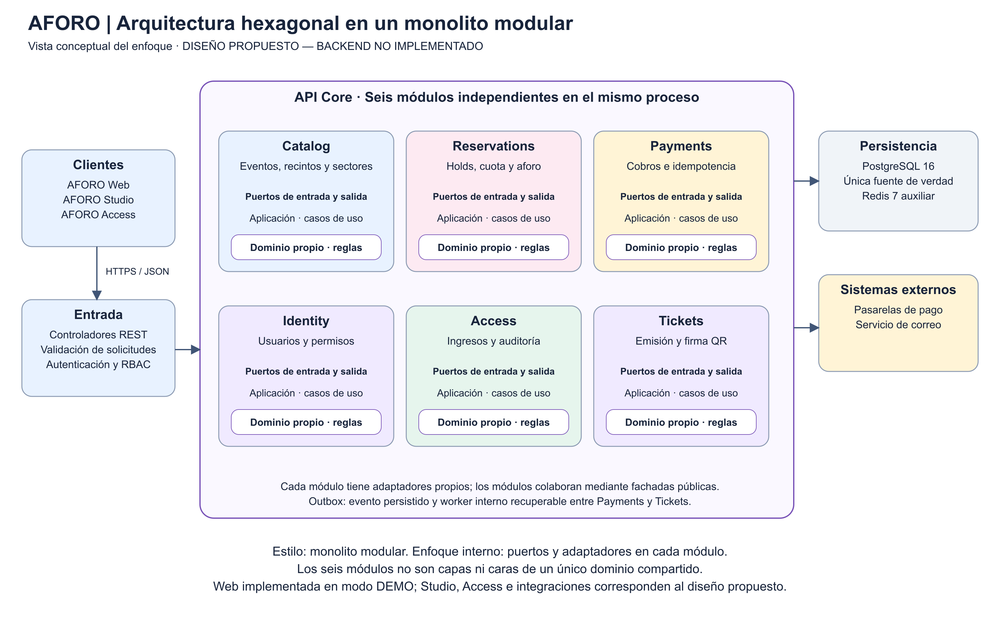

# Arquitectura de Software — Enfoque Arquitectónico

**Sistema**: Plataforma de Descubrimiento, Venta y Validación de Entradas para Eventos y Conciertos en Vivo  
**Documento**: `docs/02-arquitectura-software/enfoque-aquitectonico.md`  
**Versión**: `1.2.0` | **Actualización**: `2026-11-06`

**Cambios de esta revisión**: vista conceptual general, convención DIP uniforme y composición visual clara. La versión anterior se conserva en Git.
**Referencia Metodológica**: Guía 04 de Arquitectura de Software, Arquitectura Hexagonal (Alistair Cockburn) & Clean Architecture  
**Alineación**: Conforme a [ADR-002](../complementos/adrs/ADR-002-adopcion-arquitectura-hexagonal.md), [Nivel 3 (Componentes)](../04-modelo-c4/Nivel3-Diagrama-de-Componentes.md) y [Nivel 4 (Código)](../04-modelo-c4/Nivel4-DiagramadeCodigo.md)  
**Estado de Implementación**: **`[DISEÑO PROPUESTO — NO IMPLEMENTADO]`**

---

## 1. El Enfoque Hexagonal (Puertos y Adaptadores)

Para blindar las reglas de negocio de AFORO frente a dependencias tecnológicas volátiles y cambios en frameworks externos, cada uno de los seis módulos de `API Core Backend` adopta estrictamente la **Arquitectura Hexagonal (Puertos y Adaptadores)** ([ADR-002](../complementos/adrs/ADR-002-adopcion-arquitectura-hexagonal.md)).

### 1.0. Vista conceptual del enfoque

Imagen original proporcionada por el usuario, incorporada sin modificaciones el 2026-11-06. Las relaciones formales entre módulos se detallan en C3.

**Adaptación del modelo docente**: el Marketplace utiliza Clean Architecture con interfaces en dominio y presentación separada. AFORO mantiene ADR-002: puertos en aplicación y adaptadores primarios/secundarios en infraestructura. La carpeta presentation/ usada en diseño interno es una separación organizativa para adaptadores primarios, no una capa adicional del núcleo.

### 1.1. Principios Rectores del Enfoque
1. **Inversión de Dependencias (DIP)**:  
   Las dependencias de código fuente apuntan siempre hacia adentro (hacia el dominio). La capa de Dominio no conoce a la capa de Aplicación, y la capa de Aplicación no conoce a los Adaptadores de Infraestructura.
2. **Aislamiento Tecnológico del Dominio**:  
   Las entidades y agregados (`SectorInventory`, `Reservation`, `Ticket`) se conciben como clases de TypeScript puras, libres de decoradores de ORM, clientes HTTP o librerías de bases de datos. Todas las invariantes críticas ($S + H \le C$, límite de 4 entradas por titular y sector, transiciones de estado) residen en el dominio.
3. **Delimitación Transaccional Explícita**:  
   La consistencia de inventario y reservas se delega en el motor relacional PostgreSQL a través de puertos transaccionales (`IReservationUnitOfWork`), manteniendo a Redis exclusivamente como notificador auxiliar post-commit ([ADR-003](../complementos/adrs/ADR-003-concurrencia-integridad-inventario.md)).
4. **Precisión Conceptual (Módulos Paralelos con Capas Concéntricas)**:
   El contenedor `API Core Backend` no es un único hexágono cuyas seis caras sean los módulos de negocio, ni tampoco son "seis hexágonos anidados/concéntricos entre sí". Por el contrario, el monolito modular alberga **seis módulos independientes en paralelo** (`Catalog`, `Reservations`, `Payments`, `Tickets`, `Access`, `Identity`), donde **cada módulo aplica internamente tres capas concéntricas** (Dominio $\subset$ Aplicación $\subset$ Infraestructura) y se comunica con otros módulos exclusivamente mediante contratos de fachada en memoria (`I<Module>Facade`) o eventos persistidos en `outbox_events`.

### 1.2. Matriz Compacta de Puertos y Adaptadores de los Seis Módulos (`[DISEÑO PROPUESTO]`)

| Módulo | Dominio Puro (Entidades / Agregados / VOs) | Casos de Uso (Aplicación) | Puertos de Entrada (Inbound Ports / Fachadas) | Adaptadores Primarios (Inbound Adapters) | Puertos de Salida (Outbound Ports) | Adaptadores Secundarios (Outbound Adapters) |
| :--- | :--- | :--- | :--- | :--- | :--- | :--- |
| **1. `Catalog`** | `Event`, `Venue`, `Sector`, `SectorCapacity` | `GetCatalogUseCase`, `GetEventDetailUseCase`, `ConfigureEventUseCase` | `ICatalogModuleFacade` (`CatalogModuleFacadeImpl`) | `CatalogController` (REST público y Studio) | `ICatalogRepository`, `ICatalogCache` | `PostgreSQLCatalogAdapter`, `RedisCatalogCacheAdapter` |
| **2. `Reservations`** | `SectorInventory` (Aggregate Root), `Reservation`, `ReservationStatus` | `HoldTicketsUseCase`, `ReleaseExpiredHoldsUseCase` | `IReservationsModuleFacade` (`ReservationsModuleFacadeImpl`) | `ReservationsController` (REST), `ExpirationSweepTrigger` (Timer/Worker) | `IReservationUnitOfWork`, `ITimerNotifier` | `PostgreSQLReservationAdapter` (`SELECT FOR UPDATE`), `RedisTTLTimerAdapter` |
| **3. `Payments`** | `Payment`, `PaymentStatus`, `IdempotencyRecord`, `OutboxEvent` | `ProcessPaymentUseCase`, `HandleGatewayWebhookUseCase`, `RefundExpiredPaymentUseCase` | *(Sin fachada síncrona entrante; publica vía Outbox)* | `PaymentsController` (REST), `WebhooksController` (REST) | `IPaymentRepository`, `IPaymentGateway`, `IOutboxRepository` | `PostgreSQLPaymentAdapter`, `CulqiPaymentAdapter`, `NiubizPaymentAdapter`, `StripePaymentAdapter` |
| **4. `Tickets`** | `Ticket` (Aggregate Root), `TicketStatus`, `QrPayload`, `EventKeyPair` | `IssueTicketsUseCase`, `GetTicketDetailUseCase`, `ConsumeTicketUseCase` | `ITicketsModuleFacade` (`TicketsModuleFacadeImpl`) | `TicketIssuanceListener` (Outbox Consumer), `TicketsController` (REST) | `ITicketRepository`, `ISignatureService`, `INotificationService` | `PostgreSQLTicketAdapter`, `Ed25519SignatureAdapter`, `EmailNotificationAdapter` |
| **5. `Access`** | `AccessLog`, `AccessCollisionAudit`, `ValidationResult` | `ValidateTicketOnlineUseCase`, `ReconcileGateLogsUseCase`, `GetGatePreloadUseCase` | *(Consumido por terminales AFORO Access vía HTTP)* | `AccessGateController` (REST Online y Reconciliación Batch) | `IAccessRepository` | `PostgreSQLAccessAdapter` |
| **6. `Identity`** | `User`, `Role` (`FAN`, `ORGANIZER`, `GATE_OPERATOR`, `PLATFORM_ADMIN`), `SessionClaims` | `AuthenticateUserUseCase`, `VerifyTokenUseCase` | `IIdentityModuleFacade` (`IdentityModuleFacadeImpl`) | `AuthController` (REST) | `IUserRepository`, `ITokenProvider`, `IPasswordHasher` | `PostgreSQLUserAdapter`, `JwtTokenAdapter`, `Argon2PasswordAdapter` |

---

## 2. Arquitectura Hexagonal Aplicada al Módulo `Reservations` (`[DISEÑO PROPUESTO]`)

El siguiente diagrama modela la aplicación concreta de la Arquitectura Hexagonal en un único módulo del monolito (**Módulo `Reservations`**), separando a los consumidores externos (clientes HTTP y el módulo `Payments` que invoca su fachada pública en memoria) de sus tres capas internas (Adaptadores de Infraestructura, Aplicación/Puertos y Dominio Puro), en correspondencia directa con el [Diagrama C4 de Código](../04-modelo-c4/Nivel4-DiagramadeCodigo.md):

> **Formatos exportados disponibles**: [SVG Vectorial (`reservations-hexagonal.svg`)](../diagramas-exportados/reservations-hexagonal.svg) | [PNG Alta Resolución (`reservations-hexagonal.png`)](../diagramas-exportados/reservations-hexagonal.png)

```mermaid
flowchart TD
    subgraph EXT_CONSUMERS["Consumidores Externos al Modulo Reservations"]
        HTTP_CLI["<b>AFORO Web SPA (Cliente HTTP)</b><br/>Solicita hold temporal<br/>[IMPLEMENTADO EN WEB / COMPRA DEMO]"]
        PAY_MOD["<b>Modulo Payments (Consumidor Intermodular)</b><br/>Invoca fachada en memoria con txContext<br/>[DISENO PROPUESTO]"]
    end

    subgraph RES_MODULE["Frontera del Modulo Reservations [DISENO PROPUESTO]"]
        direction TB

        subgraph INBOUND_ADAPTERS["1. Adaptadores Primarios de Entrada (Infraestructura)"]
            CTRL["<b>ReservationsController</b><br/>Adaptador HTTP / REST<br/>POST /api/v1/reservations/hold"]
            SWEEP["<b>ExpirationSweepTrigger</b><br/>Invocador de liberacion de vencidos"]
        end

        subgraph APPLICATION_LAYER["2. Capa de Aplicacion (Casos de Uso y Puertos)"]
            direction TB
            subgraph INBOUND_PORTS["Puertos de Entrada y Casos de Uso"]
                FAC_PORT["<b>[Inbound Port] IReservationsModuleFacade</b><br/>confirmReservationSold(id, txContext)<br/>getReservationStatus(id)"]
                FAC_IMPL["<b>ReservationsModuleFacadeImpl</b><br/>Servicio de aplicacion de fachada"]
                UC_HOLD["<b>HoldTicketsUseCase</b><br/>Orquesta retencion temporal (TTL 600s)"]
                UC_REL["<b>ReleaseExpiredHoldsUseCase</b><br/>Reincorpora cupos vencidos idempotentemente"]
            end

            subgraph DOMAIN_CORE["3. Capa de Dominio (Nucleo Puro)"]
                INV["<b>SectorInventory (Aggregate Root)</b><br/>Invariante: soldCount + activeHoldsCount &lt;= capacity<br/>Cuota: validateHolderQuota(&lt;= 4)"]
                RES["<b>Reservation (Entity)</b><br/>Estados: PENDING_PAYMENT | CONFIRMED | EXPIRED | CANCELLED<br/>Reloj: expiresAt = NOW() + 600s"]
            end

            subgraph OUTBOUND_PORTS["Puertos de Salida (Interfaces de Aplicacion)"]
                PORT_UOW["<b>[Outbound Port] IReservationUnitOfWork</b><br/>executeInTransaction(work, txContext)<br/>findSectorInventoryWithLock(sectorId)<br/>countAccumulatedByHolder(sectorId, userId)<br/>saveHoldAndInventoryAtomic(inv, res)"]
                PORT_TMR["<b>[Outbound Port] ITimerNotifier</b><br/>scheduleHoldExpirationKey(id, 600)<br/>cancelHoldExpirationKey(id)"]
            end
        end

        subgraph OUTBOUND_ADAPTERS["4. Adaptadores Secundarios de Salida (Infraestructura)"]
            ADAPT_PG["<b>PostgreSQLReservationAdapter</b><br/>Transaccion ACID + SELECT FOR UPDATE"]
            ADAPT_RD["<b>RedisTTLTimerAdapter</b><br/>SET hold:ttl:{id} EX 600 (Auxiliar)"]
        end
    end

    subgraph INFRA_ENGINES["Motores de Persistencia [DISENO PROPUESTO]"]
        PG[("<b>PostgreSQL 16</b><br/>Tablas: sector_inventory, reservations<br/>(Unica Fuente de Verdad)")]
        RD[("<b>Redis 7</b><br/>Alarma Auxiliar TTL (600s)")]
    end

    %% Flujo desde Consumidores y Adaptadores de Entrada hacia Aplicacion
    HTTP_CLI -->|"HTTPS / JSON"| CTRL
    CTRL -->|"HoldTicketsCommand"| UC_HOLD
    SWEEP -->|"Dispara barrido"| UC_REL
    PAY_MOD -->|"Invoca contrato publico"| FAC_PORT
    FAC_IMPL -.->|"Implementa contrato"| FAC_PORT

    %% Uso del Dominio y Puertos de Salida por Aplicacion
    UC_HOLD -->|"Valida invariantes"| INV & RES
    UC_HOLD -->|"Delimita TX atomica"| PORT_UOW
    UC_HOLD -->|"Alarma post-commit"| PORT_TMR
    UC_REL -->|"Libera expirados"| PORT_UOW
    FAC_IMPL -->|"Transacciona (txContext)"| PORT_UOW
    FAC_IMPL -->|"Cancela alarma"| PORT_TMR

    %% Inversion de Dependencias en Adaptadores de Salida (DIP)
    ADAPT_PG -.->|"Implementa (DIP)"| PORT_UOW
    ADAPT_RD -.->|"Implementa (DIP)"| PORT_TMR

    ADAPT_PG -->|"TCP / SQL"| PG
    ADAPT_RD -->|"TCP / RESP"| RD

    classDef client fill:#1e3a8a,stroke:#3b82f6,stroke-width:2px,color:#ffffff;
    classDef app fill:#3b0764,stroke:#a855f7,stroke-width:2px,color:#ffffff;
    classDef domain fill:#064e3b,stroke:#10b981,stroke-width:2px,color:#ffffff;
    classDef infra fill:#1f2937,stroke:#64748b,stroke-width:2px,color:#ffffff;

    class HTTP_CLI,PAY_MOD client;
    class FAC_PORT,FAC_IMPL,UC_HOLD,UC_REL,PORT_UOW,PORT_TMR app;
    class INV,RES domain;
    class CTRL,SWEEP,ADAPT_PG,ADAPT_RD,PG,RD infra;
```

<b>Ver código fuente Mermaid editable (reservations-hexagonal)</b>

---

## 3. Dirección de Dependencias y Flujo de una Solicitud

**Convención gráfica**: una invocación en tiempo de ejecución no es lo mismo que una dependencia de código. En las vistas exportadas, la realización de interfaces se representa con línea discontinua y triángulo hueco hacia el contrato de aplicación.

### 3.1. Regla de Dirección de Dependencias
- **De Afuera hacia Adentro**:  
  Tanto `ReservationsController` (entrada) como `PostgreSQLReservationAdapter` y `RedisTTLTimerAdapter` (salida) pertenecen a la capa externa de infraestructura y dependen de la capa de Aplicación.
- **Inversión en los Puertos de Salida**:  
  `HoldTicketsUseCase` no importa el driver `pg` ni `ioredis`; invoca únicamente las interfaces `IReservationUnitOfWork` e `ITimerNotifier` definidas dentro de la propia capa de Aplicación. Son los adaptadores secundarios quienes importan y realizan (`implements`) dichas interfaces.
- **Pureza del Núcleo de Dominio**:  
  `SectorInventory` y `Reservation` no dependen de ningún puerto, caso de uso ni adaptador.

### 3.2. Recorrido Paso a Paso de una Solicitud de Reserva (*Hold*)
Cuando un asistente solicita reservar entradas para un sector (`POST /api/v1/reservations/hold`):
1. **Adaptador de Entrada (`ReservationsController`)**: Recibe la petición HTTP, valida el esquema sintáctico de los parámetros (`eventId`, `sectorId`, `quantity`, `Idempotency-Key`) y construye el objeto `HoldTicketsCommand`, invocando `HoldTicketsUseCase.execute(command)`.
2. **Caso de Uso (`HoldTicketsUseCase`)**: Inicia una unidad de trabajo atómica invocando `unitOfWork.executeInTransaction(...)` sobre el puerto de salida `IReservationUnitOfWork`.
3. **Adaptador de Salida Relacional (`PostgreSQLReservationAdapter`)**: Adquiere una conexión del pool, ejecuta `BEGIN TRANSACTION (READ COMMITTED)` y bloquea la fila del sector mediante `SELECT ... FROM sector_inventory WHERE id = $1 FOR UPDATE` (`findSectorInventoryWithLock`), además de consultar las entradas acumuladas por el titular (`countAccumulatedByHolder`).
4. **Evaluación en el Dominio (`SectorInventory` y `Reservation`)**: Con la fila bloqueada, el caso de uso verifica en las entidades de dominio:
   - Que exista disponibilidad suficiente: $C - (S + H) \ge \text{quantity}$ (`RN-01`).
   - Que el comprador no supere el máximo de 4 entradas acumuladas entre compras confirmadas y reservas activas (`RN-04`).
   - Incrementa `activeHoldsCount` (`registerHold`) e instancia `Reservation` en estado `PENDING_PAYMENT` con `expiresAt = createdAt + 600s` (`RN-03`).
5. **Persistencia Atómica y Commit**: El caso de uso ordena `saveHoldAndInventoryAtomic(inventory, reservation)`. El adaptador ejecuta el `UPDATE` en `sector_inventory` y el `INSERT` en `reservations`, cerrando la transacción con `COMMIT` y liberando el bloqueo de fila.
6. **Notificación Auxiliar Post-Commit (`ITimerNotifier` $\rightarrow$ `RedisTTLTimerAdapter`)**: Una vez asegurada la transacción en PostgreSQL, el caso de uso invoca `scheduleHoldExpirationKey(reservationId, 600)` para registrar la alarma auxiliar en Redis sin retener la transacción SQL.
7. **Respuesta al Cliente**: `HoldTicketsUseCase` devuelve `HoldTicketsResult` al controlador, el cual emite la respuesta HTTP `201 Created` con el `reservationId` y el tiempo restante.

---

## 4. Ensamblaje Mediante *Composition Root* (`[DISEÑO PROPUESTO]`)

Para que los casos de uso reciban las implementaciones concretas de sus puertos sin acoplarse a ellas con `new PostgreSQLReservationAdapter()`, la arquitectura contempla un **Composition Root (Raíz de Composición)** como parte del diseño propuesto del backend (no existente como archivo físico en el repositorio actual, dado que [`frontend/src/`](../../frontend/src/) contiene únicamente el frontend AFORO Web):

1. **Responsabilidad del Composition Root Proyectado**:  
   En la fase de inicialización del proceso del servidor backend, este componente central es el único lugar que conoce simultáneamente todas las capas para ensamblar el grafo de objetos:
   - Inicializa el pool de conexiones de PostgreSQL y el cliente de Redis.
   - Instancia los adaptadores secundarios: `PostgreSQLReservationAdapter` y `RedisTTLTimerAdapter`.
   - Inyecta dichos adaptadores por constructor en `HoldTicketsUseCase`, `ReleaseExpiredHoldsUseCase` y `ReservationsModuleFacadeImpl`.
   - Inyecta los casos de uso en el adaptador primario `ReservationsController` y expone `IReservationsModuleFacade` para su consumo en memoria por el módulo `Payments`.
2. **Ventaja Arquitectónica**:  
   Al concentrar el cableado en la raíz de composición, las pruebas unitarias de `HoldTicketsUseCase` y `SectorInventory` podrán ejecutarse en aislamiento inyectando dobles de prueba en memoria (*fakes/stubs* de `IReservationUnitOfWork`), sin requerir una instancia activa de PostgreSQL ni de Redis.
