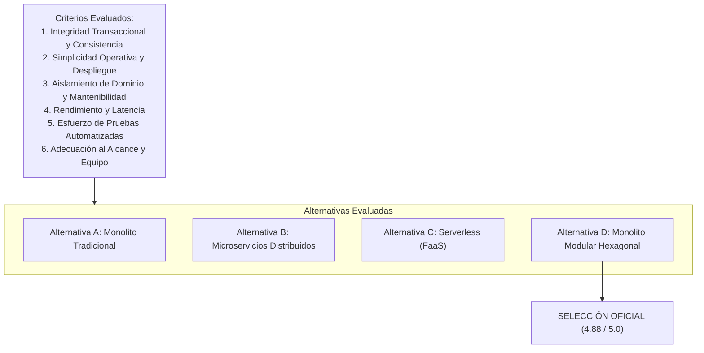
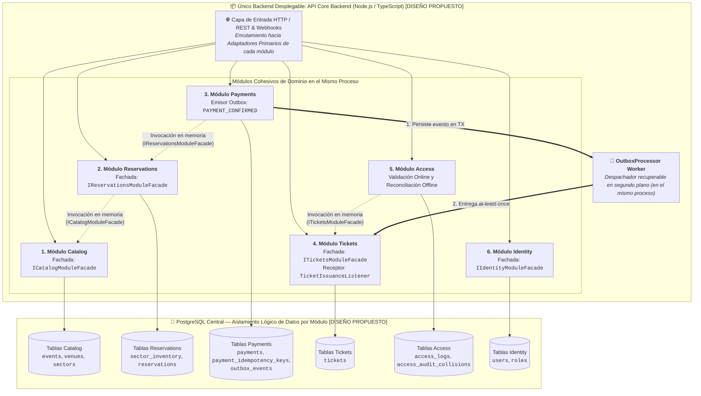

# Arquitectura de Software — Estilo Arquitectónico

**Sistema**: Plataforma de Descubrimiento, Venta y Validación de Entradas para Eventos y Conciertos en Vivo  
**Documento**: `docs/02-arquitectura-software/estilo-arquitectonico.md`  
**Versión**: `1.1.0` | **Fecha**: `2026-10-29`  
**Referencia Normativa**: Principios I, II y IV de la [Constitution de AFORO](../../.specify/memory/constitution.md), [Drivers Arquitectónicos](../01-analisis-de-sistema/06-driver-arquitectonicos.md) y [ADR-001](../complementos/adrs/ADR-001-seleccion-estilo-monolito-modular.md)  
**Decisión**: Selección de Monolito Modular con Arquitectura Hexagonal (`[DISEÑO PROPUESTO]`)

---

## 1. Introducción y Criterio Metodológico de Evaluación

El diseño arquitectónico de AFORO responde a una premisa fundamental de ingeniería: **la complejidad accidental debe minimizarse, concentrando el esfuerzo técnico en resolver la complejidad inherente del dominio de taquilla de alta demanda y control de accesos**.

Para determinar la arquitectura del sistema, se contrastaron cuatro estilos arquitectónicos reconocidos frente a los drivers y restricciones formalizados en el análisis del sistema:
1. **Monolito Tradicional en Capas** (Layered Monolith).
2. **Microservicios Distribuidos** (Distributed Microservices Architecture).
3. **Arquitectura Serverless Basada en Funciones** (FaaS / Event-Driven Cloud Functions).
4. **Monolito Modular con Arquitectura Hexagonal** (Modular Monolith with Ports & Adapters — **Seleccionada**).

---

## 2. Evaluación Razonada de Alternativas Arquitectónicas

### 2.1 Análisis Detallado de Cada Alternativa

#### Alternativa A: Monolito Tradicional en Capas (Layered Monolith)
- **Descripción**: Aplicación única estructurada en capas horizontales genéricas (Controladores, Servicios, Repositorios, Base de Datos compartida).
- **Ventajas**: Despliegue simple, desarrollo inicial acelerado y llamadas directas en memoria.
- **Desventajas Críticas**:
  - Propensión alta a la erosión arquitectónica (*Big Ball of Mud*): la lógica de catálogo termina acoplada a pagos, inventario y tickets.
  - Dependencias circulares entre servicios y esquemas de datos compartidos sin fronteras explícitas.
  - Imposibilidad de aislar el dominio respecto a frameworks web o bibliotecas de infraestructura.
- **Veredicto**: **Rechazada**. Su falta de límites modulares viola el Principio I de la Constitution y compromete la mantenibilidad a mediano plazo.

#### Alternativa B: Microservicios Distribuidos (Microservices Architecture)
- **Descripción**: Descomposición temprana en servicios independientes (Catálogo, Reservas, Pagos, Tickets, Accesos), cada uno con su propio ciclo de despliegue y base de datos aislada.
- **Ventajas**: Escalabilidad horizontal granular, despliegues independientes por servicio y aislamiento físico de fallos.
- **Evaluación Razonada de Descarte**:
  - Aunque los microservicios *pueden* garantizar consistencia transaccional mediante patrones avanzados (SAGAs orquestadas, Transacciones Compensatorias y *Transactional Outbox*), estos mecanismos introducen una **complejidad distribuida innecesaria** para el alcance actual del proyecto.
  - Añade sobrecarga de latencia de red en cada comunicación inter-servicio, necesidad de mallas de servicios (Service Mesh), observabilidad distribuida compleja y pipelines de despliegue múltiples, lo cual resulta desproporcionado para el tamaño del equipo de desarrollo y el alcance del Sprint 01.
- **Veredicto**: **Rechazada**. Introduce complejidad operativa y costos de infraestructura prematuros sin aportar beneficios indispensables en la etapa actual.

#### Alternativa C: Arquitectura Serverless / FaaS (Cloud Functions)
- **Descripción**: Endpoints ejecutados como funciones efímeras en la nube (AWS Lambda / Google Cloud Functions) con bases de datos gestionadas.
- **Ventajas**: Autoescalado masivo y modelo de costos por demanda efectiva.
- **Evaluación Razonada de Descarte**:
  - Aunque Serverless *puede* interactuar con bases de datos transaccionales relacionales (mediante proxys de conexión como PgBouncer o AWS RDS Proxy), presenta compromisos operativos significativos:
    - *Latencia de arranque en frío (Cold Starts)*: Puede degradar la experiencia en aperturas masivas de preventa donde la respuesta al usuario debe mantenerse baja y predecible.
    - *Gestión de pools de conexiones*: Las ráfagas súbitas de funciones concurrentes pueden saturar rápidamente el límite de conexiones de la base de datos relacional si no se gestiona una infraestructura de proxy compleja.
    - *Dificultad de pruebas locales y portabilidad*: Complica la reproducibilidad exacta en entornos de desarrollo locales y pruebas unitarias aisladas.
- **Veredicto**: **Rechazada**. Los compromisos de latencia, gestión de conexiones y dependencia del proveedor no se alinean con los drivers prioritarios de taquilla masiva.

#### Alternativa D: Monolito Modular con Arquitectura Hexagonal (Seleccionada)
- **Descripción**: Un único artefacto desplegable en backend cuyos componentes internos están organizados en **módulos de dominio verticalmente cohesivos y rígidamente delimitados**, donde cada módulo sigue la **Arquitectura Hexagonal (Puertos y Adaptadores)**.
- **Ventajas Estratégicas y Adecuación**:
  - **Simplicidad Operativa y Transacciones Locales**: Al residir en el mismo proceso, los módulos pueden coordinar transacciones ACID locales sobre una única base de datos relacional (PostgreSQL), garantizando la regla matemática de no sobreventa (`RN-01`) sin la fragilidad de redes distribuidas.
  - **Aislamiento Estricto de Dominio**: El núcleo de cada módulo (entidades y casos de uso) es TypeScript puro, completamente independiente de frameworks HTTP y drivers de base de datos (Principio I de la Constitution).
  - **Adecuación al Equipo y Proyecto**: Permite avanzar a alta velocidad sin sobrecarga de DevOps, manteniendo un único pipeline de integración y despliegue.
  - **Extensibilidad a Microservicios**: Al mantener módulos aislados que se comunican exclusivamente por interfaces públicas y eventos Outbox, cualquier módulo (ej. Catálogo o Accesos) puede desacoplarse hacia un microservicio independiente en el futuro si la demanda lo justifica, sin alterar la lógica de negocio.
- **Veredicto**: **SELECCIONADA COMO LA ARQUITECTURA OFICIAL DE AFORO**.

---

### 2.2 Matriz Comparativa y Sustento del Cálculo Ponderado

La evaluación se formaliza mediante una matriz multicriterio con escala de 1 a 5 (donde 1 = Deficiente, 3 = Aceptable, 5 = Excelente) y factores de ponderación que reflejan los drivers de AFORO:

$$\text{Puntuación Total} = \sum_{i=1}^{n} (\text{Calificación}_i \times \text{Peso}_i)$$

| Criterio de Decisión | Peso | A: Monolito en Capas | B: Microservicios | C: Serverless (FaaS) | D: Monolito Modular Hexagonal |
| :--- | :---: | :---: | :---: | :---: | :---: |
| **1. Integridad Transaccional y Consistencia de Inventario** | **25 %** | 4.0 | 3.0 | 2.5 | **5.0** |
| **2. Simplicidad Operativa, Despliegue y Costo** | **20 %** | 4.0 | 1.5 | 3.0 | **5.0** |
| **3. Aislamiento de Dominio y Mantenibilidad (SOLID)** | **20 %** | 1.5 | 4.5 | 3.0 | **5.0** |
| **4. Rendimiento, Latencia Predecible y Concurrencia** | **15 %** | 4.0 | 3.5 | 2.5 | **4.5** |
| **5. Esfuerzo y Velocidad de Pruebas Automatizadas** | **10 %** | 3.0 | 2.0 | 2.5 | **5.0** |
| **6. Adecuación al Alcance del Proyecto y Equipo** | **10 %** | 3.5 | 1.5 | 2.5 | **4.5** |
| **PUNTUACIÓN TOTAL PONDERADA** | **100 %** | **3.35 / 5.0** | **2.85 / 5.0** | **2.68 / 5.0** | **4.88 / 5.0** |

#### Desglose del Cálculo para la Alternativa Seleccionada (D):
$$\text{Puntaje}_D = (5.0 \times 0.25) + (5.0 \times 0.20) + (5.0 \times 0.20) + (4.5 \times 0.15) + (5.0 \times 0.10) + (4.5 \times 0.10)$$
$$\text{Puntaje}_D = 1.25 + 1.00 + 1.00 + 0.675 + 0.50 + 0.45 = \mathbf{4.875} \approx \mathbf{4.88 / 5.0}$$

---

## 3. Estructura del Monolito Modular (`[DISEÑO PROPUESTO]`)

El estilo **Monolito Modular** adoptado organiza todo el `API Core Backend` dentro de **un único backend desplegable** (proceso Node.js / TypeScript), dividido internamente en seis módulos de dominio independientes y cohesivos que comparten la misma instancia de PostgreSQL bajo un estricto aislamiento lógico de tablas:

---

## 4. Justificación Transaccional y Límites Intermodulares

### 4.1 PostgreSQL como Única Fuente de Verdad y Estrategia Transaccional
- **PostgreSQL como Autoridad de Inventario**:
  Se establece de manera categórica que **PostgreSQL es la única fuente de verdad (Single Source of Truth)** para el aforo, disponibilidad, reservas temporales y emisión definitiva de entradas ([ADR-003](../complementos/adrs/ADR-003-concurrencia-integridad-inventario.md)).
- **Rol Auxiliar de Redis**:
  Redis actúa estrictamente como **infraestructura auxiliar**:
  1. *Caché de lecturas públicas*: Almacena representaciones serializadas del catálogo público para descargar la base de datos de lecturas masivas.
  2. *Estrangulamiento de tráfico (Rate Limiting)*: Protege los endpoints transaccionales contra ataques de denegación de servicio.
  3. *Temporizador de eventos*: Provee notificaciones de expiración basadas en llaves con TTL (600 s) para detonar la liberación de reservas abandonadas.
  Redis **nunca opera como autoridad decisoria ni almacén primario del inventario**.
- **Estrategia Transaccional y de Concurrencia**:
  Para prevenir la sobreventa garantizando el cumplimiento estricto de `RN-01` ($\text{Sold} + \text{ActiveHolds} \le \text{Capacity}$), se adopta la siguiente estrategia:
  - Se ejecuta una transacción en PostgreSQL bajo el nivel de aislamiento estándar `READ COMMITTED`, utilizando un **bloqueo pesimista a nivel de fila (`SELECT ... FOR UPDATE`)** sobre el registro del sector o zona solicitado.
  - **Comprobación y actualización atómicas dentro de la misma transacción**: El bloqueo pesimista garantiza la exclusión mutua para que ninguna otra transacción concurrentemente modifique la fila del sector, pero **no sustituye la validación de los invariantes de negocio**. La comprobación de disponibilidad libre ($\text{Capacidad} - (\text{Vendidas} + \text{ReservasActivas}) \ge \text{CantidadSolicitada}$), la cuota acumulada ($\le 4$) y la posterior inserción de la reserva y actualización de contadores se ejecutan obligatoriamente **dentro de la misma transacción PostgreSQL**.

### 4.2 Comunicación Interna mediante Fachadas Públicas y Outbox
En apego estricto al **Principio I (Modularidad y Desacoplamiento)** de la Constitution:
1. **Comunicación Síncrona mediante Fachadas Públicas en Memoria**: Cuando un módulo requiere datos u operaciones de otro, consume exclusivamente una **Interfaz Pública Tipada** (`ICatalogModuleFacade`, `IReservationsModuleFacade`, `ITicketsModuleFacade`, `IIdentityModuleFacade`) expuesta por el módulo proveedor, intercambiando únicamente DTOs inmutables en memoria sin llamadas HTTP internas.
2. **Comunicación Asíncrona Recuperable mediante Transactional Outbox**: Para efectos colaterales críticos entre módulos (confirmación de cobro en `Payments` detonando la emisión de boletos en `Tickets`), el evento `PAYMENT_CONFIRMED` se persiste en `outbox_events` dentro de la misma transacción SQL del cobro y es despachado por `OutboxProcessor Worker` con entrega *at-least-once* e idempotencia ([ADR-004](../complementos/adrs/ADR-004-idempotencia-pagos-webhooks.md)).

### 4.3 Aislamiento Lógico de Datos y Dependencias Prohibidas
- **Propiedad Exclusiva de Tablas**: Aunque los seis módulos comparten el motor PostgreSQL, cada módulo es dueño exclusivo de sus tablas privadas (`Catalog`: `events/venues/sectors`; `Reservations`: `sector_inventory/reservations`; `Payments`: `payments/payment_idempotency_keys/outbox_events`; `Tickets`: `tickets`; `Access`: `access_logs/access_audit_collisions`; `Identity`: `users/roles`).
- **Dependencias Prohibidas**:
  - Prohibido que un módulo importe entidades de dominio, casos de uso internos o adaptadores de otro módulo.
  - Prohibido ejecutar `SELECT`, `JOIN`, `UPDATE` o `DELETE` directos sobre tablas pertenecientes a otro módulo.
  - Prohibido establecer dependencias circulares ($A \leftrightarrow B$): el grafo intermodular debe ser un Grafo Acíclico Dirigido (DAG).

---

## 5. Compromisos de Diseño (Trade-offs)

| Compromiso / Trade-off | Decisión Adoptada | Justificación y Mitigación |
| :--- | :--- | :--- |
| **Consistencia Transaccional vs Escalabilidad Distribuida** | Se prioriza la **consistencia ACID en PostgreSQL** (`READ COMMITTED` con `SELECT ... FOR UPDATE` por sector) sobre bases distribuidas multimaestro. | El negocio no tolera sobreventas (`RN-01`). Un pool transaccional de PostgreSQL con transacciones breves y caché auxiliar está proyectado para satisfacer la meta arquitectónica de concurrencia sin incurrir en la fragilidad de redes distribuidas. |
| **Disponibilidad Offline en Puertas vs Riesgo de Doble Ingreso Inter-Puerta** | Se prioriza la **disponibilidad local continua (AP)** en molinetes sobre la consistencia global inmediata (Teorema CAP). | Detener el flujo físico de ingreso en recintos genera riesgos de seguridad civil. El riesgo de doble ingreso cruzado durante particiones simultáneas se asume operativamente y se mitiga mediante zonificación física y reconciliación forense posterior. |
| **Selección Visual Local vs Bloqueo Previo de Inventario** | La navegación y el carrito web son estrictamente **locales y no bloqueantes** (`RN-02`). | Previene ataques de denegación de servicio por carritos abandonados. El bloqueo de inventario únicamente opera cuando el asistente inicia la reserva formal. |
