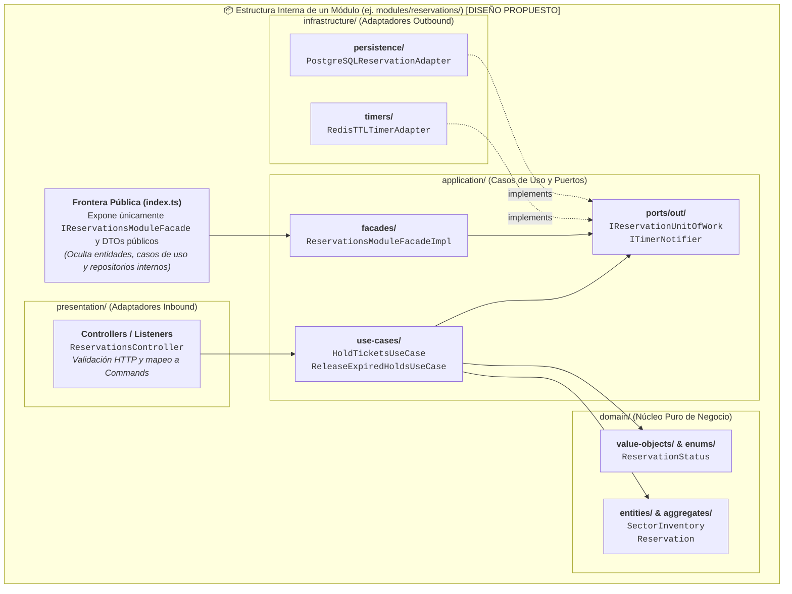
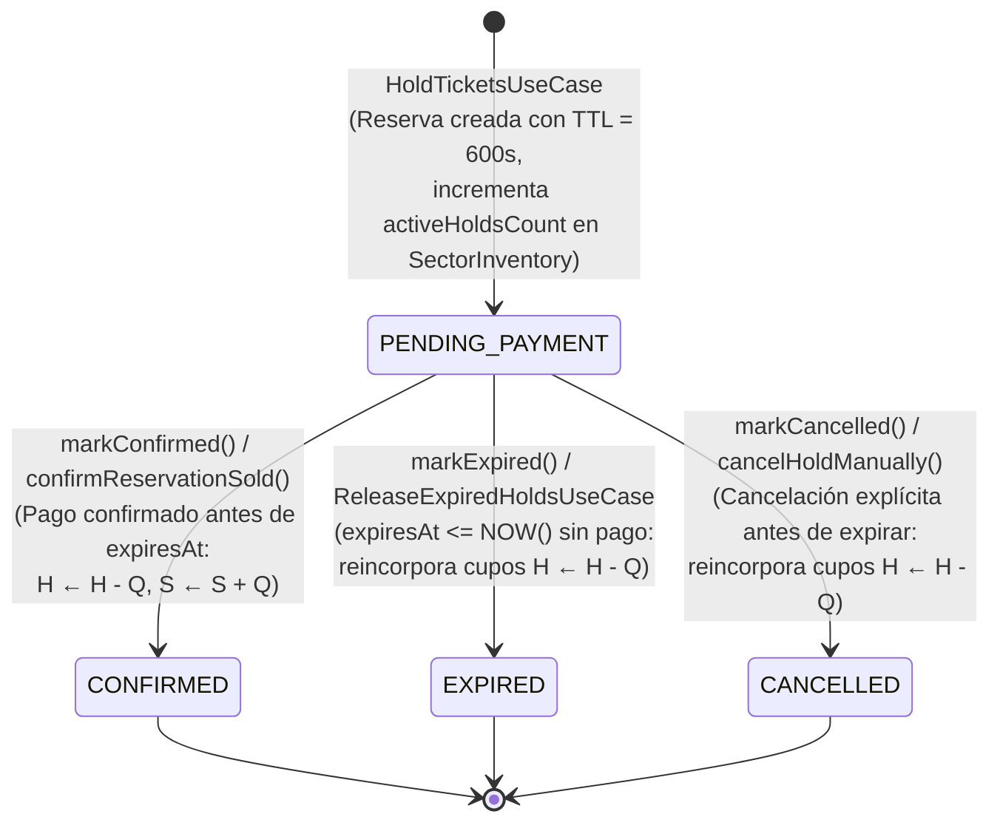
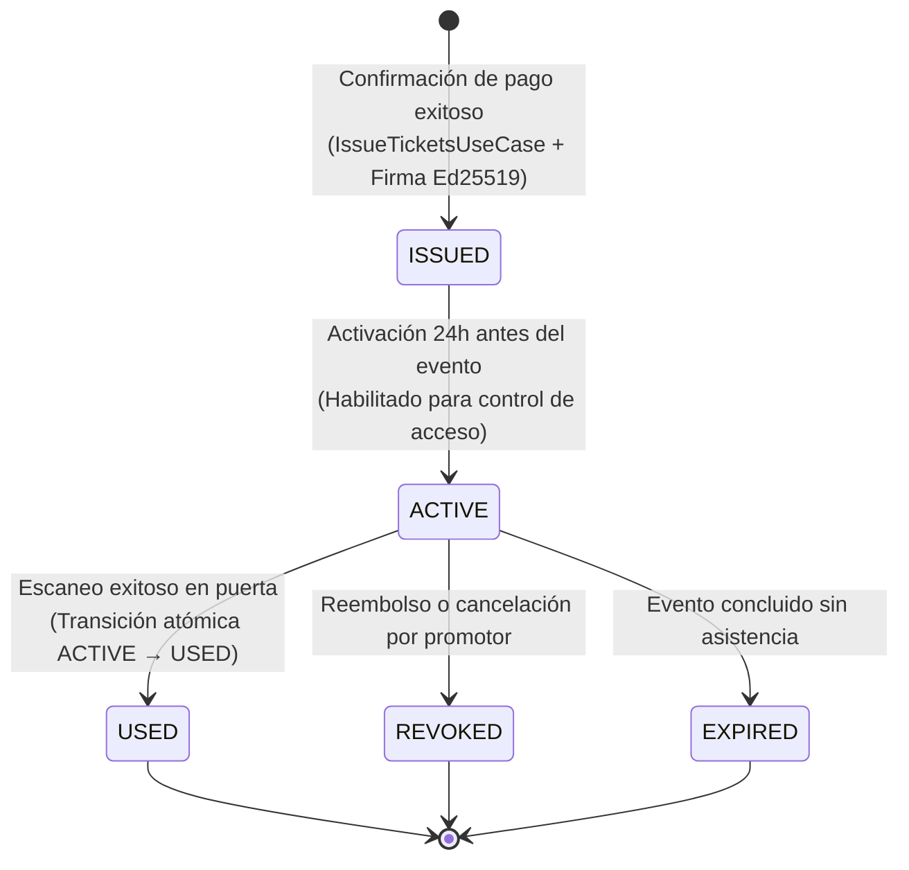
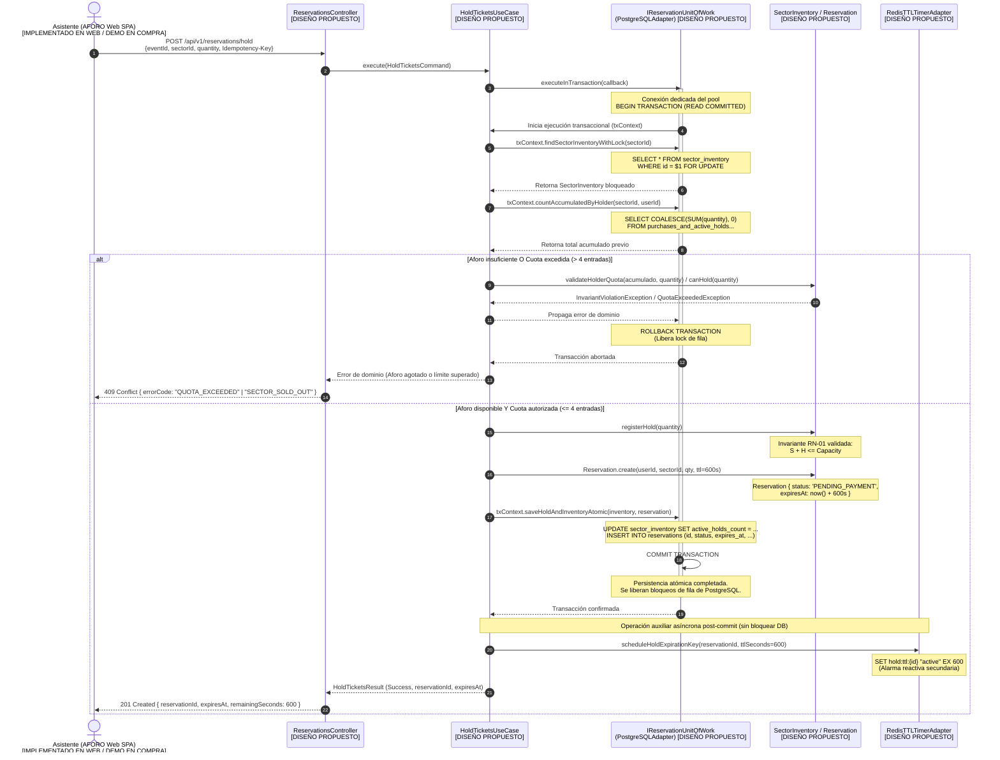
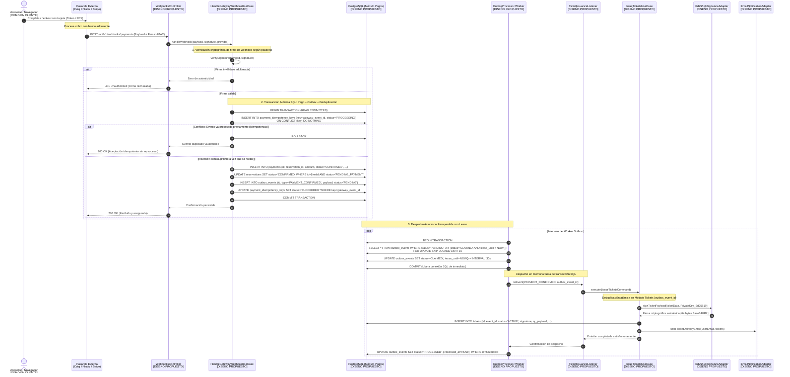
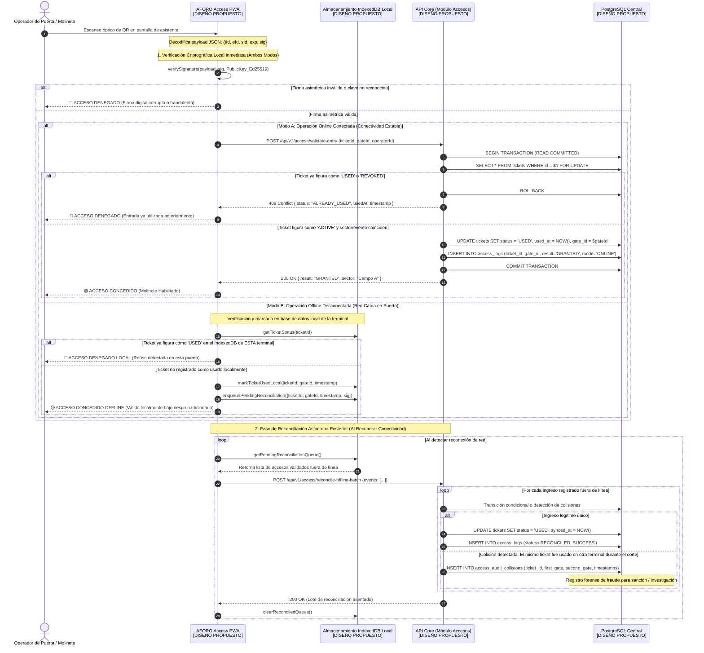

# Capítulo 03: Diseño de Software — Diseño Interno de Módulos

**Sistema**: Plataforma de Descubrimiento, Venta y Validación de Entradas para Eventos y Conciertos en Vivo  
**Contenedor**: `API Core Backend` (Monolito Modular) & Clientes (`AFORO Web`, `AFORO Access`)  
**Documento**: `docs/03-diseño-de-software/diseño-interno/diseño-interno-de-modulos.md`  
**Versión**: `1.1.0` | **Fecha**: `2026-10-29`  
**Referencia Metodológica**: Guía 04 de Arquitectura de Software, Diseño Hexagonal de Módulos & Diagramas de Interacción UML  
**Alineación Arquitectónica**: Conforme a la [Constitution](../../../.specify/memory/constitution.md), las [Decisiones Arquitectónicas (ADRs 001 al 006)](../../01-analisis-de-sistema/07-decisiones-arquitectonicas.md) y el [Modelo C4](../../04-modelo-c4/Nivel3-Diagrama-de-Componentes.md)

---

## 1. Propósito y Alcance del Diseño Interno de Módulos

El presente documento especifica la estructura interna y el comportamiento dinámico de los módulos que conforman el `API Core Backend` de **AFORO**. Articula tres dimensiones complementarias del diseño de software:
1. **Organización Interna de un Módulo Hexagonal**: La estructura canónica de paquetes, puertos, casos de uso, entidades y adaptadores que encapsula cada módulo del monolito modular.
2. **Máquinas de Estado del Dominio**: El ciclo de vida determinista de las dos entidades transaccionales críticas (`Reservation` y `Ticket`), gobernado por las reglas de negocio ([`RN-03`](../../complementos/03-reglas-de-negocio.md#rn-03-reserva-temporal-con-expiración-determinista-ttl-de-10-minutos), [`RN-07`](../../complementos/03-reglas-de-negocio.md#rn-07-máquina-de-estados-del-ticket)) y el [Diagrama C4 de Código](../../04-modelo-c4/Nivel4-DiagramadeCodigo.md).
3. **Diagramas de Secuencia de Flujos Críticos**: El intercambio temporal de mensajes, la delimitación transaccional y el control de concurrencia en:
   - **Flujo A**: Reserva Temporal Concurrente de Entradas (*Hold*).
   - **Flujo B**: Confirmación de Pago y Emisión Idempotente de Tickets.
   - **Flujo C**: Validación de Código QR en Puerta (Modos Online y Offline).

> [!IMPORTANT]
> **Declaración de Realidad Técnica**:  
> Conforme al Principio IV de la Constitución del proyecto:  
> - Los componentes de backend ([API Core](principios-de-diseño.md)), organizadores ([AFORO Studio](../../01-analisis-de-sistema/03-requisitos-funcionales.md#22-aforo-studio-aplicación-web-de-gestión-para-organizadores-y-promotores)) y control de acceso ([AFORO Access](../../01-analisis-de-sistema/03-requisitos-funcionales.md#23-aforo-access-aplicación-especializada-para-control-de-acceso-y-operadores-de-puerta)) corresponden a un **`[DISEÑO PROPUESTO — NO IMPLEMENTADO]`**.  
> - En el frontend ([AFORO Web SPA](../../../src/App.tsx)), la navegación, mapas SVG y selección visual de sectores están **`[IMPLEMENTADO EN WEB]`**, mientras que el paso de reserva, pasarela de pago y generación de pases operan actualmente como **`[DEMO / SIMULADO]`** en cliente.

---

## 2. Organización Interna de un Módulo Hexagonal (`[DISEÑO PROPUESTO]`)

Cada uno de los seis módulos del monolito (`catalog`, `reservations`, `payments`, `tickets`, `access`, `identity`) se estructura internamente siguiendo una convención uniforme de paquetes que separa la frontera pública intermodular, los adaptadores de infraestructura, la capa de aplicación y el núcleo de dominio:

### 2.1. Reglas de Organización Interna
- **`domain/`**: Contiene exclusivamente agregados, entidades, objetos de valor y excepciones de dominio en TypeScript puro. No importa nada de `application/`, `infrastructure/` ni `presentation/`.
- **`application/`**: Contiene los casos de uso (`*UseCase`), la implementación de la fachada pública (`*ModuleFacadeImpl`), los comandos/resultados y las interfaces de los puertos de salida (`ports/out/`). Solo depende de `domain/`.
- **`presentation/` y `infrastructure/`**: Contienen los adaptadores primarios (controladores HTTP, consumidores de eventos) y secundarios (repositorios PostgreSQL, adaptadores Redis, pasarelas de pago, criptografía Ed25519). Dependen hacia adentro de `application/`.
- **`index.ts` (Barrera de Encapsulamiento)**: Es el único punto de exportación visible para otros módulos del monolito, exponiendo exclusivamente el contrato de la fachada (`I<Modulo>ModuleFacade`) y sus DTOs inmutables.

---

## 3. Máquinas de Estado de las Entidades Críticas (`[DISEÑO PROPUESTO]`)

### 3.1. Máquina de Estados de `Reservation`
Extraída fielmente de [`RN-03`](../../complementos/03-reglas-de-negocio.md#rn-03-reserva-temporal-con-expiración-determinista-ttl-de-10-minutos), [`ADR-003`](../../complementos/adrs/ADR-003-concurrencia-integridad-inventario.md) y la enumeración `ReservationStatus` del [Diagrama C4 de Código](../../04-modelo-c4/Nivel4-DiagramadeCodigo.md):

- **Garantía de Exclusión Mutua**: Las transiciones desde `PENDING_PAYMENT` hacia `CONFIRMED`, `EXPIRED` o `CANCELLED` son terminales y mutuamente excluyentes, ejecutadas en PostgreSQL mediante sentencias condicionales atómicas (`WHERE status = 'PENDING_PAYMENT'`).

### 3.2. Máquina de Estados de `Ticket`
Extraída fielmente de [`RN-07`](../../complementos/03-reglas-de-negocio.md#rn-07-máquina-de-estados-del-ticket), [`RN-08`](../../complementos/03-reglas-de-negocio.md#rn-08-validación-acceso-en-puerta-y-tolerancia-a-desconexión-anti-reúso), [`ADR-005`](../../complementos/adrs/ADR-005-criptografia-entradas-qr.md), [`ADR-006`](../../complementos/adrs/ADR-006-persistencia-operacion-offline-access.md) y el [Diagrama C3 de Componentes](../../04-modelo-c4/Nivel3-Diagrama-de-Componentes.md):

- **Invariante de No Reingreso (`RN-07`, `RN-08`)**: Un boleto que alcanza los estados terminales `USED`, `REVOKED` o `EXPIRED` no puede volver a transicionar a `ACTIVE` ni conceder un segundo ingreso. *(Nota de realidad técnica: en el flujo simulado actual de AFORO Web, los boletos locales emplean el estado de demostración `ACTIVA_DEMO`).*

---

## 4. Flujo A: Reserva Temporal Concurrente de Entradas (Hold)

### 4.1. Diagrama de Secuencia (Mermaid)

### 4.2. Explicación del Protocolo y Delimitación Transaccional
1. **Adquisición de Lock y Validación Atómica**:  
   El caso de uso no dispersa la comprobación en pasos desacoplados. La adquisición del bloqueo pesimista (`SELECT ... FOR UPDATE`), la suma de entradas acumuladas por el titular, la mutación de contadores y el alta de la reserva ocurren en **una única transacción y sobre la misma conexión dedicada de PostgreSQL**.
2. **Evaluación Estricta de Invariantes**:  
   El bloqueo pesimista serializa las solicitudes concurrentes sobre el sector pero no sustituye la lógica de dominio: dentro del bloqueo se valida que la disponibilidad neta sea suficiente ($C - (S + H) \ge \text{quantity}$) y que el titular no exceda el tope acumulado de 4 entradas ([RN-04](../../complementos/03-reglas-de-negocio.md#rn-04-tope-máximo-de-entradas-por-asistente)).
3. **Rol Auxiliar de Redis**:  
   La programación de la clave temporizada en Redis (`SET hold:ttl:... EX 600`) ocurre **estrictamente después del COMMIT** de PostgreSQL. Si Redis no está disponible o falla la red, la reserva permanece válida y segura en PostgreSQL; la expiración será gestionada por el worker de reconciliación periódica en base de datos ([ADR-003](../../complementos/adrs/ADR-003-concurrencia-integridad-inventario.md)).

---

## 5. Flujo B: Pago Confirmado y Emisión Idempotente de Tickets

### 5.1. Diagrama de Secuencia (Mermaid)

### 5.2. Explicación de Resiliencia, Idempotencia y Resultados Inciertos
1. **Deduplicación en Tres Niveles**:  
   - A nivel de webhook mediante `gateway_event_id` con inserción condicional atómica `ON CONFLICT DO NOTHING`.
   - A nivel de reserva mediante transición condicional `WHERE status = 'PENDING_PAYMENT'`.
   - A nivel de emisión en el Módulo Tickets verificando el identificador del evento Outbox para prevenir entradas duplicadas ante reintentos del worker.
2. **Desacoplamiento Temporal mediante Outbox con Lease**:  
   El cobro queda formalmente registrado y asegurado en la tabla `payments` y en `outbox_events` en una única transacción corta. La llamada a librerías de firma criptográfica y el despacho de correos se realizan fuera de la transacción SQL principal, eliminando la retención de conexiones de base de datos.
3. **Manejo de Resultados Inciertos de Cobro**:  
   Si una solicitud de pago directa sufre un timeout de red o estado ambiguo, no se reintenta automáticamente con otra pasarela ni se cancela la reserva. Se consulta el estado del cobro mediante la API de conciliación del proveedor original o se aguarda la llegada del webhook asíncrono firmado.

---

## 6. Flujo C: Validación de Código QR en Puerta (Modos Online y Offline)

### 6.1. Diagrama de Secuencia (Mermaid)

### 6.2. Explicación de Consistencia Asimétrica y Límite Offline
1. **Verificación Criptográfica sin Conexión**:  
   Gracias al uso de firmas asimétricas Ed25519 ([ADR-005](../../complementos/adrs/ADR-005-criptografia-entradas-qr.md)), cualquier terminal AFORO Access que cuente con la clave pública del evento ($PK_E$) puede comprobar matemáticamente la autenticidad del boleto sin necesidad de consultar al servidor central ni exponer claves maestras secretas.
2. **Diferencia Fundamental entre Validación Criptográfica y Derecho de Admisión**:  
   Una firma criptográfica válida únicamente certifica que el boleto fue emitido legítimamente por AFORO; **no garantiza por sí sola que el portador deba ingresar**. La admisión efectiva exige verificar que el evento sea el correcto, la puerta autorizada, que el ticket no haya sido revocado y que no haya sido utilizado con anterioridad.
3. **Reconocimiento Explícito del Límite del Modo Offline (CAP Theorem)**:  
   **Dos o más terminales desconectadas entre sí no pueden garantizar la unicidad global del ingreso**. Si dos asistentes presentan copias idénticas del mismo código QR en puertas desconectadas simultáneamente, ambas terminales validarán la firma y marcarán el ingreso local como exitoso. Esta limitación se documenta como un compromiso arquitectónico inevitable ([ADR-006](../../complementos/adrs/ADR-006-persistencia-operacion-offline-access.md)), resolviéndose mediante bitácora de auditoría forense y reconciliación posterior para detectar incidentes de duplicación.

---

## 7. Matriz de Trazabilidad del Diseño Interno y Secuencias

| Artefacto de Diseño Interno | Requisitos Funcionales Asociados | Reglas de Negocio / Escenarios | Decisiones Arquitectónicas |
| :--- | :--- | :--- | :--- |
| **Organización Interna de Módulo** | Todos los RF de `API Core` | Separación de capas y fronteras modulares | **ADR-001** (Monolito Modular) **ADR-002** (Arquitectura Hexagonal) |
| **Máquina de Estados: `Reservation`** | **RF-WEB-12, RF-COR-02, RF-COR-03** | **RN-01** ($S + H \le C$) **RN-03** (TTL 600 s) | **ADR-003** (Vigencia determinista en PostgreSQL) |
| **Máquina de Estados: `Ticket`** | **RF-COR-05, RF-ACC-04, RF-ACC-05** | **RN-06, RN-07, RN-08** (`ISSUED → ACTIVE → USED / REVOKED / EXPIRED`) | **ADR-005** (Ed25519) **ADR-006** (Reconciliación de estados) |
| **Flujo A: Reserva Concurrente** | **RF-WEB-08, RF-WEB-12, RF-COR-01, RF-COR-02, RF-COR-03** | **RN-01** (Aforo Nominal $S + H \le C$) **RN-03** (TTL 600 s) **RN-04** (Tope 4 entradas) **EAC-01, EAC-02** | **ADR-001** (Monolito) **ADR-002** (Hexagonal) **ADR-003** (Persistencia y Bloqueo Pesimista en PostgreSQL) |
| **Flujo B: Pago y Emisión** | **RF-WEB-13, RF-COR-04, RF-COR-05, RF-COR-06** | **RN-05** (Idempotencia y Emisión) **EAC-03** (Recuperación de eventos) | **ADR-001** (Outbox sin broker externo) **ADR-004** (Idempotencia en Pagos) **ADR-005** (Firma Asimétrica Ed25519) |
| **Flujo C: Validación en Puerta** | **RF-ACC-01, RF-ACC-02, RF-ACC-03, RF-ACC-04, RF-ACC-05, RF-ACC-06, RF-COR-07** | **RN-06, RN-07, RN-08** (Validación de Acceso y Prevención de Reúso) **EAC-04, EAC-05** | **ADR-005** (Firma Asimétrica Ed25519) **ADR-006** (Operación Offline y Reconciliación en IndexedDB) |
