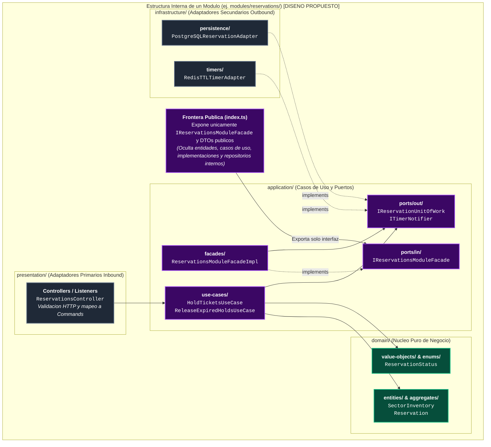
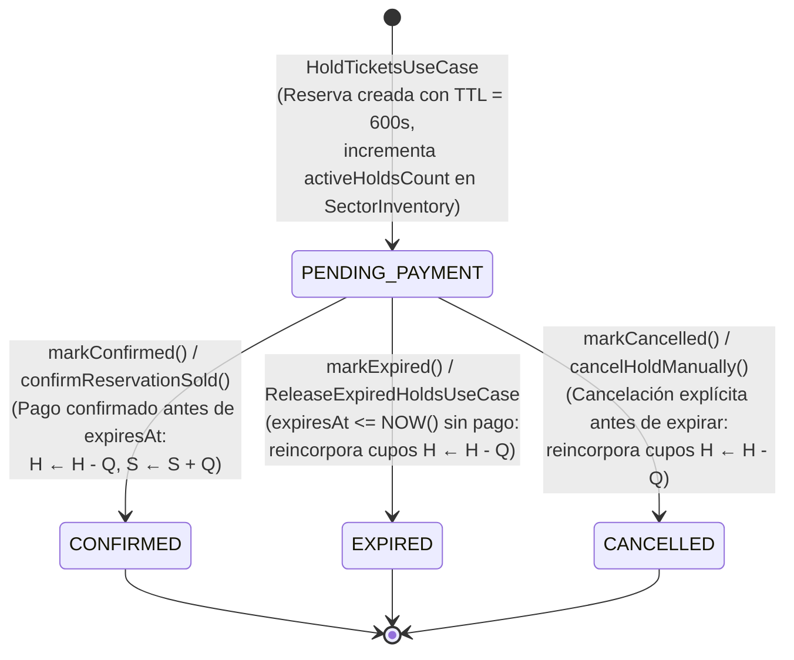
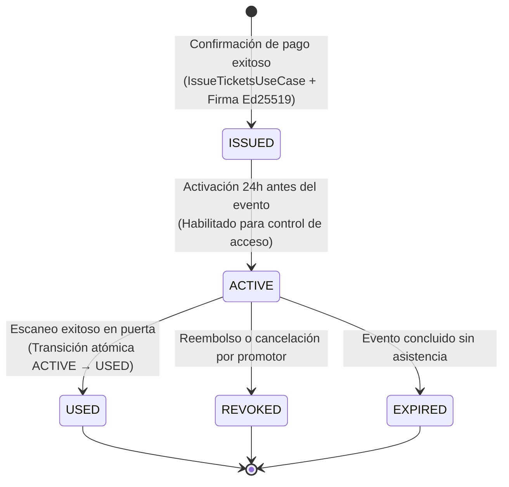
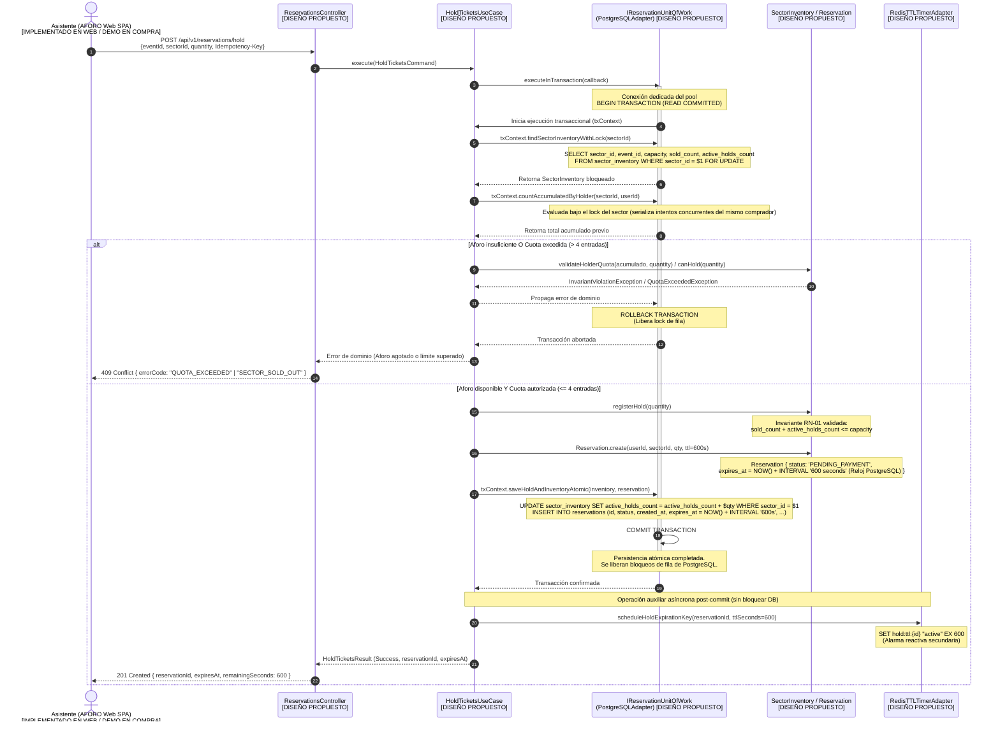
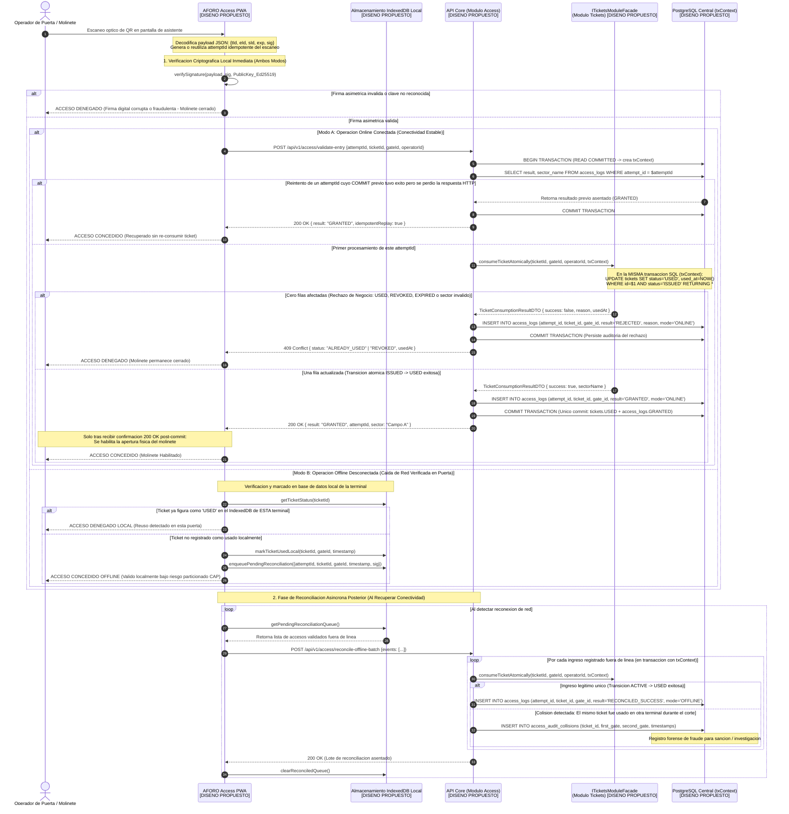

# Capítulo 03: Diseño de Software — Diseño Interno de Módulos

**Sistema**: Plataforma de Descubrimiento, Venta y Validación de Entradas para Eventos y Conciertos en Vivo  
**Contenedor**: `API Core Backend` (Monolito Modular) & Clientes (`AFORO Web`, `AFORO Access`)  
**Documento**: `docs/03-diseño-de-software/diseño-interno/diseño-interno-de-modulos.md`  
**Versión**: `1.1.0` | **Fecha**: `2026-10-29`  
**Referencia Metodológica**: Guía 04 de Arquitectura de Software, Diseño Hexagonal de Módulos & Diagramas de Interacción UML  
**Alineación Arquitectónica**: Conforme a la [Constitution](../../../.specify/memory/constitution.md), las [Decisiones Arquitectónicas (ADRs 001 al 006)](../../01-analisis-de-sistema/07-decisiones-arquitectonicas.md) y el [Modelo C4](../../04-modelo-c4/Nivel3-Diagrama-de-Componentes.md)

---

## 1. Propósito y Alcance del Diseño Interno de Módulos

El presente documento especifica la estructura interna y el comportamiento dinámico de los módulos que conforman el `API Core Backend` de **AFORO**. Articula tres dimensiones complementarias del diseño de software:
1. **Organización Interna de un Módulo Hexagonal**: La estructura canónica de paquetes, puertos, casos de uso, entidades y adaptadores que encapsula cada módulo del monolito modular.
2. **Máquinas de Estado del Dominio**: El ciclo de vida determinista de las dos entidades transaccionales críticas (`Reservation` y `Ticket`), gobernado por las reglas de negocio ([`RN-03`](../../complementos/03-reglas-de-negocio.md#rn-03-reserva-temporal-con-expiración-determinista-ttl-de-10-minutos), [`RN-07`](../../complementos/03-reglas-de-negocio.md#rn-07-máquina-de-estados-del-ticket)) y el [Diagrama C4 de Código](../../04-modelo-c4/Nivel4-DiagramadeCodigo.md).
3. **Diagramas de Secuencia de Flujos Críticos**: El intercambio temporal de mensajes, la delimitación transaccional y el control de concurrencia en:
   - **Flujo A**: Reserva Temporal Concurrente de Entradas (*Hold*).
   - **Flujo B**: Confirmación de Pago y Emisión Idempotente de Tickets.
   - **Flujo C**: Validación de Código QR en Puerta (Modos Online y Offline).

> [!IMPORTANT]
> **Declaración de Realidad Técnica**:  
> Conforme al Principio IV de la Constitución del proyecto:  
> - Los componentes de backend ([API Core](principios-de-diseño.md)), organizadores ([AFORO Studio](../../01-analisis-de-sistema/03-requisitos-funcionales.md#22-aforo-studio-aplicación-web-de-gestión-para-organizadores-y-promotores)) y control de acceso ([AFORO Access](../../01-analisis-de-sistema/03-requisitos-funcionales.md#23-aforo-access-aplicación-especializada-para-control-de-acceso-y-operadores-de-puerta)) corresponden a un **`[DISEÑO PROPUESTO — NO IMPLEMENTADO]`**.  
> - En el frontend ([AFORO Web SPA](../../../frontend/src/App.tsx)), la navegación, mapas SVG y selección visual de sectores están **`[IMPLEMENTADO EN WEB]`**, mientras que el paso de reserva, pasarela de pago y generación de pases operan actualmente como **`[DEMO / SIMULADO]`** en cliente.

---

## 2. Organización Interna de un Módulo Hexagonal (`[DISEÑO PROPUESTO]`)

Cada uno de los seis módulos del monolito (`catalog`, `reservations`, `payments`, `tickets`, `access`, `identity`) se estructura internamente siguiendo una convención uniforme de paquetes que separa la frontera pública intermodular, los adaptadores de infraestructura, la capa de aplicación y el núcleo de dominio:



### 2.1. Reglas de Organización Interna
- **`domain/`**: Contiene exclusivamente agregados, entidades, objetos de valor y excepciones de dominio en TypeScript puro. No importa nada de `application/`, `infrastructure/` ni `presentation/`.
- **`application/`**: Contiene los casos de uso (`*UseCase`), la implementación de la fachada pública (`*ModuleFacadeImpl`), los comandos/resultados y las interfaces de los puertos de salida (`ports/out/`). Solo depende de `domain/`.
- **`presentation/` y `infrastructure/`**: Contienen los adaptadores primarios (controladores HTTP, consumidores de eventos) y secundarios (repositorios PostgreSQL, adaptadores Redis, pasarelas de pago, criptografía Ed25519). Dependen hacia adentro de `application/`.
- **`index.ts` (Barrera de Encapsulamiento)**: Es el único punto de exportación visible para otros módulos del monolito, exponiendo exclusivamente el contrato de la fachada (`I<Modulo>ModuleFacade`) y sus DTOs inmutables.

---

## 3. Máquinas de Estado de las Entidades Críticas (`[DISEÑO PROPUESTO]`)

### 3.1. Máquina de Estados de `Reservation`
Extraída fielmente de [`RN-03`](../../complementos/03-reglas-de-negocio.md#rn-03-reserva-temporal-con-expiración-determinista-ttl-de-10-minutos), [`ADR-003`](../../complementos/adrs/ADR-003-concurrencia-integridad-inventario.md) y la enumeración `ReservationStatus` del [Diagrama C4 de Código](../../04-modelo-c4/Nivel4-DiagramadeCodigo.md):



- **Garantía de Exclusión Mutua**: Las transiciones desde `PENDING_PAYMENT` hacia `CONFIRMED`, `EXPIRED` o `CANCELLED` son terminales y mutuamente excluyentes, ejecutadas en PostgreSQL mediante sentencias condicionales atómicas (`WHERE status = 'PENDING_PAYMENT'`).

### 3.2. Máquina de Estados de `Ticket`
Extraída fielmente de [`RN-07`](../../complementos/03-reglas-de-negocio.md#rn-07-máquina-de-estados-del-ticket), [`RN-08`](../../complementos/03-reglas-de-negocio.md#rn-08-validación-acceso-en-puerta-y-tolerancia-a-desconexión-anti-reúso), [`ADR-005`](../../complementos/adrs/ADR-005-criptografia-entradas-qr.md), [`ADR-006`](../../complementos/adrs/ADR-006-persistencia-operacion-offline-access.md) y el [Diagrama C3 de Componentes](../../04-modelo-c4/Nivel3-Diagrama-de-Componentes.md):



- **Invariante de No Reingreso (`RN-07`, `RN-08`)**: Un boleto que alcanza los estados terminales `USED`, `REVOKED` o `EXPIRED` no puede volver a transicionar a `ACTIVE` ni conceder un segundo ingreso. *(Nota de realidad técnica: en el flujo simulado actual de AFORO Web, los boletos locales emplean el estado de demostración `ACTIVA_DEMO`).*

---

## 4. Flujo A: Reserva Temporal Concurrente de Entradas (Hold)

### 4.1. Diagrama de Secuencia (Mermaid)



### 4.2. Explicación del Protocolo, Reloj Único y Prevención de Deadlocks
1. **Adquisición de Lock Canónico (`sector_inventory` $\rightarrow$ `reservations`)**:
   En toda operación que afecte el inventario (`Hold`, `ConfirmSale` y `ReleaseExpired`), los bloqueos se adquieren siempre en el mismo orden jerárquico: primero la fila en `sector_inventory` (`ORDER BY sector_id ASC FOR UPDATE` si hay más de un sector) y luego la fila en `reservations`. Esta política única elimina interbloqueos (*deadlocks*) entre compras, confirmaciones y expiraciones concurrentes.
2. **Evaluación Concurrente de la Cuota de 4 Entradas (`RN-04`)**:
   Dado que `countAccumulatedByHolder(sectorId, userId)` se ejecuta **después** de adquirir `SELECT ... FROM sector_inventory WHERE sector_id = $1 FOR UPDATE`, múltiples peticiones simultáneas enviadas por un mismo comprador para ese sector quedan serializadas en cola esperando el bloqueo de fila del sector; cuando la primera confirma (`COMMIT`), la siguiente lee inmediatamente el nuevo acumulado bajo aislamiento `READ COMMITTED`, impidiendo superar las 4 entradas.
3. **Reloj Único Autoritativo (`NOW()` de PostgreSQL) y Liberación Idempotente**:
   Tanto el cálculo de `expires_at = NOW() + INTERVAL '600 seconds'` como las comparaciones de vigencia utilizan exclusivamente el reloj transaccional de PostgreSQL (`NOW()`), evitando derivas de reloj (*clock skew*) entre instancias de Node.js. La liberación por expiración ejecuta `UPDATE reservations SET status = 'EXPIRED' WHERE id = $1 AND status = 'PENDING_PAYMENT' AND expires_at <= NOW() RETURNING sector_id, quantity`, descontando `active_holds_count` únicamente si la transición afectó `1` fila.
4. **Rol Auxiliar de Redis**:
   La programación de la clave temporizada en Redis (`SET hold:ttl:... EX 600`) ocurre **estrictamente después del COMMIT** de PostgreSQL ([ADR-003](../../complementos/adrs/ADR-003-concurrencia-integridad-inventario.md)).

---

## 5. Flujo B: Pago Confirmado y Emisión Idempotente de Tickets

### 5.1. Diagrama de Secuencia (Mermaid)

```mermaid
sequenceDiagram
    autonumber
    actor ASIS as Asistente / Navegador<br/>[DEMO EN CLIENTE]
    participant GW as Pasarela Externa<br/>(Culqi / Niubiz / Stripe)
    participant WH_CTRL as WebhooksController<br/>[DISENO PROPUESTO]
    participant PAY_UC as HandleGatewayWebhookUseCase<br/>[DISENO PROPUESTO]
    participant RES_FAC as IReservationsModuleFacade<br/>[DISENO PROPUESTO]
    participant DB as PostgreSQL (Sesion Unica txContext)<br/>[DISENO PROPUESTO]
    participant WORKER as OutboxProcessor Worker<br/>[DISENO PROPUESTO]
    participant TCK_SUB as TicketIssuanceListener<br/>[DISENO PROPUESTO]
    participant TCK_UC as IssueTicketsUseCase<br/>[DISENO PROPUESTO]
    participant CRYPTO as Ed25519SignatureAdapter<br/>[DISENO PROPUESTO]
    participant NOTIF as EmailNotificationAdapter<br/>[DISENO PROPUESTO]

    ASIS->>GW: Completa checkout con tarjeta (Token / 3DS)
    Note over GW: Procesa cobro con banco adquirente
    
    GW->>WH_CTRL: POST /api/v1/webhooks/payments (Payload + Firma HMAC)
    WH_CTRL->>PAY_UC: handleWebhook(payload, signature, provider)
    
    Note over PAY_UC: 1. Verificacion criptografica de firma de webhook segun pasarela
    PAY_UC->>PAY_UC: verifySignature(payload, signature)
    
    alt Firma invalida o adulterada
        PAY_UC-->>WH_CTRL: Error de autenticidad
        WH_CTRL-->>GW: 401 Unauthorized (Firma rechazada)
    else Firma valida
        Note over PAY_UC,DB: 2. Transaccion Compartida (txContext: ITransactionContext)
        PAY_UC->>DB: BEGIN TRANSACTION (READ COMMITTED -> crea txContext)
        
        PAY_UC->>DB: INSERT INTO payment_idempotency_keys (key=gateway_event_id, status='PROCESSING')<br/>ON CONFLICT (key) DO NOTHING
        
        alt Conflicto: Evento ya procesado previamente (Idempotencia)
            PAY_UC->>DB: ROLLBACK
            PAY_UC-->>WH_CTRL: Evento duplicado ya atendido
            WH_CTRL-->>GW: 200 OK (Aceptacion idempotente sin reprocesar)
        else Insercion exitosa (Primera vez que se recibe)
            PAY_UC->>RES_FAC: confirmReservationSold(reservationId, txContext)
            Note over RES_FAC,DB: En la MISMA conexion SQL (txContext):<br/>1. Lock sector_inventory FOR UPDATE<br/>2. UPDATE reservations SET status='CONFIRMED' WHERE status='PENDING_PAYMENT' AND expires_at > NOW()<br/>3. UPDATE sector_inventory SET active_holds_count = H - Q, sold_count = S + Q
            
            alt Retorno: CONFIRMED_NOW (Reserva vigente confirmada)
                PAY_UC->>DB: INSERT INTO payments (id, reservation_id, amount, status='CONFIRMED', ...)
                PAY_UC->>DB: INSERT INTO outbox_events (id, type='PAYMENT_CONFIRMED', payload, status='PENDING')
                PAY_UC->>DB: UPDATE payment_idempotency_keys SET status='SUCCEEDED' WHERE key=gateway_event_id
                PAY_UC->>DB: COMMIT TRANSACTION (Unico commit atomico para Payments + Reservations)
                PAY_UC-->>WH_CTRL: Confirmacion persistida
                WH_CTRL-->>GW: 200 OK (Recibido y asegurado)
            else Retorno: EXPIRED o CANCELLED (La reserva ya vencio en t >= 600s y libero su cupo)
                PAY_UC->>DB: INSERT INTO payments (id, reservation_id, amount, status='REQUIRES_REFUND', ...)
                PAY_UC->>DB: INSERT INTO outbox_events (id, type='PAYMENT_EXPIRED_REFUND_REQUIRED', payload, status='PENDING')
                PAY_UC->>DB: UPDATE payment_idempotency_keys SET status='SUCCEEDED' WHERE key=gateway_event_id
                PAY_UC->>DB: COMMIT TRANSACTION
                Note over PAY_UC,DB: No se emiten tickets (preserva invariante S + H <= C).<br/>El worker ejecutara RefundExpiredPaymentUseCase ante la pasarela.
                PAY_UC-->>WH_CTRL: Cobro tardio registrado para reembolso automatico
                WH_CTRL-->>GW: 200 OK (Webhook reconocido; reembolso encolado)
            end
        end
    end

    Note over WORKER,DB: 3. Despacho Asincrono Recuperable con Lease
    loop Intervalo del Worker Outbox
        WORKER->>DB: BEGIN TRANSACTION
        WORKER->>DB: SELECT * FROM outbox_events WHERE status='PENDING' OR (status='CLAIMED' AND lease_until < NOW())<br/>FOR UPDATE SKIP LOCKED LIMIT 10
        WORKER->>DB: UPDATE outbox_events SET status='CLAIMED', lease_until=NOW() + INTERVAL '30s'
        WORKER->>DB: COMMIT (Libera conexion SQL de inmediato)
        
        Note over WORKER,TCK_SUB: Despacho en memoria fuera de transaccion SQL
        WORKER->>TCK_SUB: onEvent(PAYMENT_CONFIRMED, outbox_event_id)
        TCK_SUB->>TCK_UC: execute(IssueTicketsCommand)
        
        Note over TCK_UC: Deduplicacion atomica en Modulo Tickets (outbox_event_id / order_id)
        TCK_UC->>CRYPTO: signTicketPayload(ticketData, PrivateKey_Ed25519)
        CRYPTO-->>TCK_UC: Firma criptografica asimetrica (64 bytes Base64URL)
        
        TCK_UC->>DB: INSERT INTO tickets (id, event_id, status='ISSUED', signature, qr_payload, ...)
        Note over TCK_UC,DB: Nace en estado ISSUED (RN-07) y pasa a ACTIVE 24h antes del evento
        TCK_UC->>NOTIF: sendTicketDeliveryEmail(userEmail, tickets)
        
        TCK_UC-->>TCK_SUB: Emision completada satisfactoriamente
        TCK_SUB-->>WORKER: Confirmacion de despacho
        
        WORKER->>DB: UPDATE outbox_events SET status='PROCESSED', processed_at=NOW() WHERE id=$outboxId
    end
```

### 5.2. Explicación de Coordinación Transaccional (`ITransactionContext`), Idempotencia y Pagos Tardíos
1. **Coordinación Transaccional mediante `ITransactionContext` (Un Solo Commit/Rollback)**:
   `HandleGatewayWebhookUseCase` inicia la unidad de trabajo transaccional en PostgreSQL obteniendo un token opaco `txContext: ITransactionContext` y lo pasa a `IReservationsModuleFacade.confirmReservationSold(reservationId, txContext)`. De este modo, tanto `PostgreSQLReservationAdapter` como `PostgreSQLPaymentAdapter` ejecutan sus sentencias SQL sobre **la misma conexión física de PostgreSQL y un único `COMMIT` o `ROLLBACK`**, sin exponer repositorios ni tablas privadas entre módulos y evitando *commits* parciales independientes.
2. **Retorno Tipado (`ReservationConfirmationStatus`) y Reembolso por Expiración**:
   `confirmReservationSold` retorna `'CONFIRMED_NOW' | 'ALREADY_CONFIRMED' | 'EXPIRED' | 'CANCELLED' | 'NOT_FOUND'`. Si retorna `'EXPIRED'` o `'CANCELLED'` (webhook tardío recibido en $t \ge 600\text{ s}$ tras la liberación del hold), jamás se emiten entradas; en la misma transacción se registra el pago como `REQUIRES_REFUND` y se inserta `PAYMENT_EXPIRED_REFUND_REQUIRED` en `outbox_events` para que `RefundExpiredPaymentUseCase` ejecute el reembolso automático con la pasarela.
3. **Consumidores Outbox Idempotentes**:
   Tanto `IssueTicketsUseCase` (`order_id` / `outbox_event_id` único en `tickets`) como `RefundExpiredPaymentUseCase` son estrictamente idempotentes frente a entregas repetidas (*at-least-once*) del `OutboxProcessor Worker`.

---

## 6. Flujo C: Validación de Código QR en Puerta (Modos Online y Offline)

### 6.1. Diagrama de Secuencia (Mermaid)



### 6.2. Coherencia Transaccional `Tickets` $\leftrightarrow$ `Access`, Idempotencia de Escaneo y Hardware de Molinete
1. **Atomicidad entre Consumo de Ticket y Auditoría (`ITransactionContext`)**:
   `ValidateTicketOnlineUseCase` inicia una transacción SQL (`txContext`) y la propaga a `ITicketsModuleFacade.consumeTicketAtomically(ticketId, gateId, operatorId, txContext)`. Tanto el `UPDATE tickets SET status = 'USED'` (en `Tickets`) como el `INSERT INTO access_logs` (en `Access`) se confirman en **un único `COMMIT`**. Si ocurre un fallo técnico de base de datos, se ejecuta `ROLLBACK` de ambos cambios y el boleto conserva su estado `ACTIVE`.
2. **Diferenciación entre Rechazo de Negocio y Error Técnico (Regla de Apertura Segura)**:
   - **Rechazo de Negocio (`409 Conflict` / `403 Forbidden`):** El boleto ya fue usado, está revocado o no pertenece al sector. No se modifica `tickets`, pero **sí se hace `COMMIT` del intento rechazado en `access_logs`** para auditoría de seguridad. El molinete jamás se abre.
   - **Fallo Técnico (`5xx` / Error SQL):** Se revierte la transacción (`ROLLBACK`). **Jamás se abre físicamente una puerta antes de tener confirmación suficiente de la operación** (confirmación `200 OK` online o validación criptográfica + commit local en `IndexedDB` cuando la terminal opera en modo de contingencia offline).
3. **Resolución del Caso de Commit Exitoso con Respuesta HTTP Perdida (`attemptId`)**:
   Cada lectura de código QR genera un identificador determinista o UUID de intento (`attemptId`) que viaja en la solicitud. Si PostgreSQL ejecuta el `COMMIT` (`tickets.USED` + `access_logs.GRANTED`) pero la respuesta HTTP se pierde por microcorte Wi-Fi/4G en el estadio, el reintento automático de la terminal envía el **mismo `attemptId`**. `ValidateTicketOnlineUseCase` consulta primero `access_logs` por `attempt_id` (`UNIQUE`), detecta que ese intento específico ya fue concedido y devuelve `200 OK (GRANTED)` sin intentar consumir el ticket por segunda vez.
4. **Frontera entre Transacción SQL y Accionamiento Físico del Molinete**:
   El destrabe electromecánico del molinete físico ocurre en el mundo real **después** del `COMMIT` de la transacción SQL y no forma parte del ámbito ACID de PostgreSQL. Si el hardware del torniquete reporta atasco mecánico tras el `200 OK`, la aplicación del operador registra la incidencia operativa local vinculada al `attemptId` para permitir el paso supervisado por el operador de puerta sin requerir un nuevo consumo en base de datos.
5. **Reconocimiento Explícito del Límite del Modo Offline (Teorema CAP)**:
   Dos o más terminales desconectadas simultáneamente entre sí no pueden garantizar la unicidad global del ingreso en tiempo real ([ADR-006](../../complementos/adrs/ADR-006-persistencia-operacion-offline-access.md)); cualquier uso duplicado inter-puerta durante un apagón de red se detecta de forma determinista en la reconciliación posterior y se registra en `access_audit_collisions`.

---

## 7. Matriz de Trazabilidad del Diseño Interno y Secuencias

| Artefacto de Diseño Interno | Requisitos Funcionales Asociados | Reglas de Negocio / Escenarios | Decisiones Arquitectónicas |
| :--- | :--- | :--- | :--- |
| **Organización Interna de Módulo** | Todos los RF de `API Core` | Separación de capas y fronteras modulares | **ADR-001** (Monolito Modular)<br/>**ADR-002** (Arquitectura Hexagonal) |
| **Máquina de Estados: `Reservation`** | **RF-WEB-12, RF-COR-02, RF-COR-03** | **RN-01** ($S + H \le C$)<br/>**RN-03** (TTL 600 s) | **ADR-003** (Vigencia determinista en PostgreSQL) |
| **Máquina de Estados: `Ticket`** | **RF-COR-05, RF-ACC-04, RF-ACC-05** | **RN-06, RN-07, RN-08** (`ISSUED → ACTIVE → USED / REVOKED / EXPIRED`) | **ADR-005** (Ed25519)<br/>**ADR-006** (Reconciliación de estados) |
| **Flujo A: Reserva Concurrente** | **RF-WEB-08, RF-WEB-12, RF-COR-01, RF-COR-02, RF-COR-03** | **RN-01** (Aforo Nominal $S + H \le C$)<br/>**RN-03** (TTL 600 s)<br/>**RN-04** (Tope 4 entradas)<br/>**EAC-01, EAC-02** | **ADR-001** (Monolito)<br/>**ADR-002** (Hexagonal)<br/>**ADR-003** (Persistencia y Bloqueo Pesimista en PostgreSQL) |
| **Flujo B: Pago y Emisión** | **RF-WEB-13, RF-COR-04, RF-COR-05, RF-COR-06** | **RN-05** (Idempotencia y Emisión)<br/>**EAC-03** (Recuperación de eventos) | **ADR-001** (Outbox sin broker externo)<br/>**ADR-004** (Idempotencia en Pagos)<br/>**ADR-005** (Firma Asimétrica Ed25519) |
| **Flujo C: Validación en Puerta** | **RF-ACC-01, RF-ACC-02, RF-ACC-03, RF-ACC-04, RF-ACC-05, RF-ACC-06, RF-COR-07** | **RN-06, RN-07, RN-08** (Validación de Acceso y Prevención de Reúso)<br/>**EAC-04, EAC-05** | **ADR-005** (Firma Asimétrica Ed25519)<br/>**ADR-006** (Operación Offline y Reconciliación en IndexedDB) |
