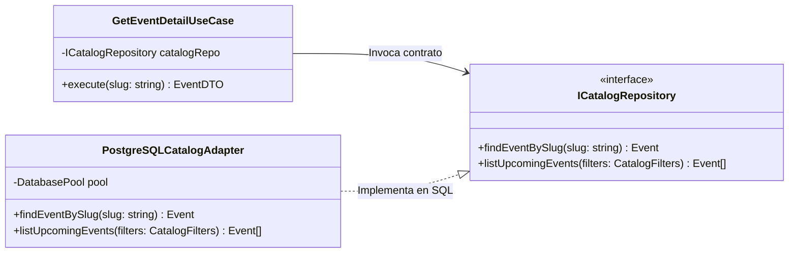
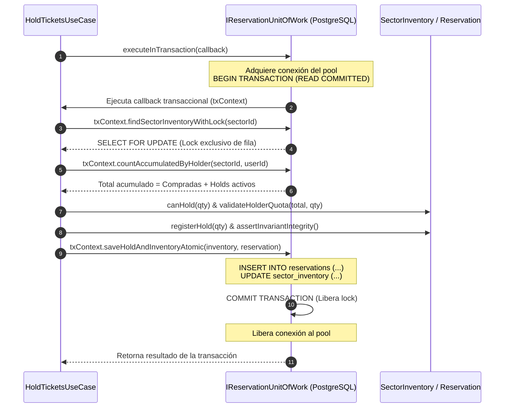
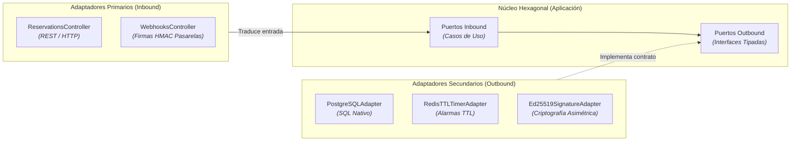
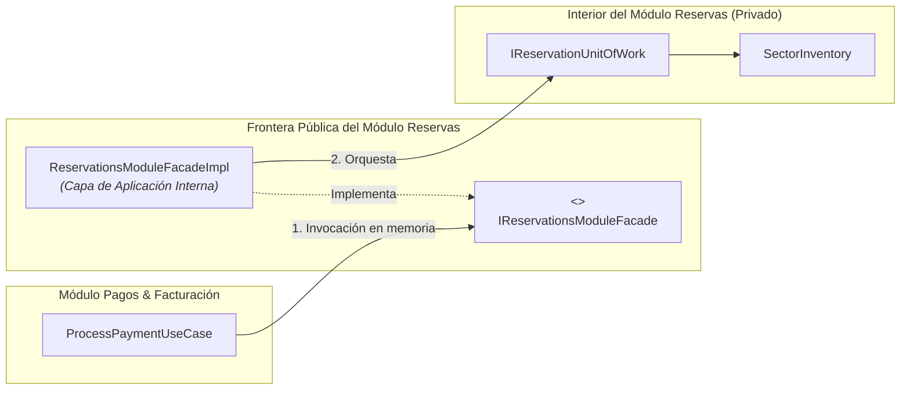
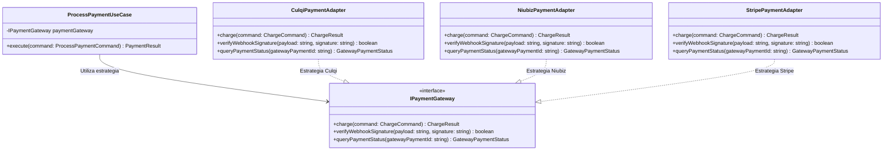
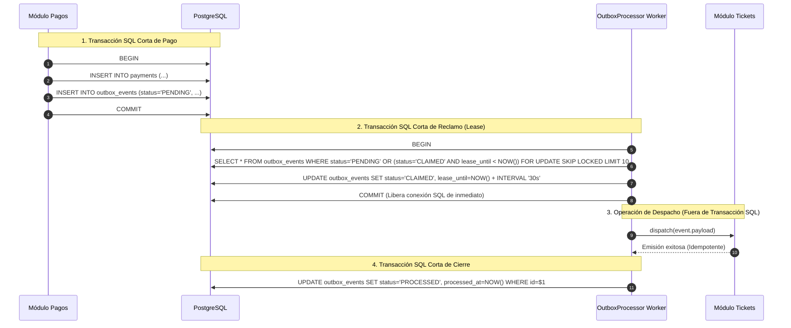
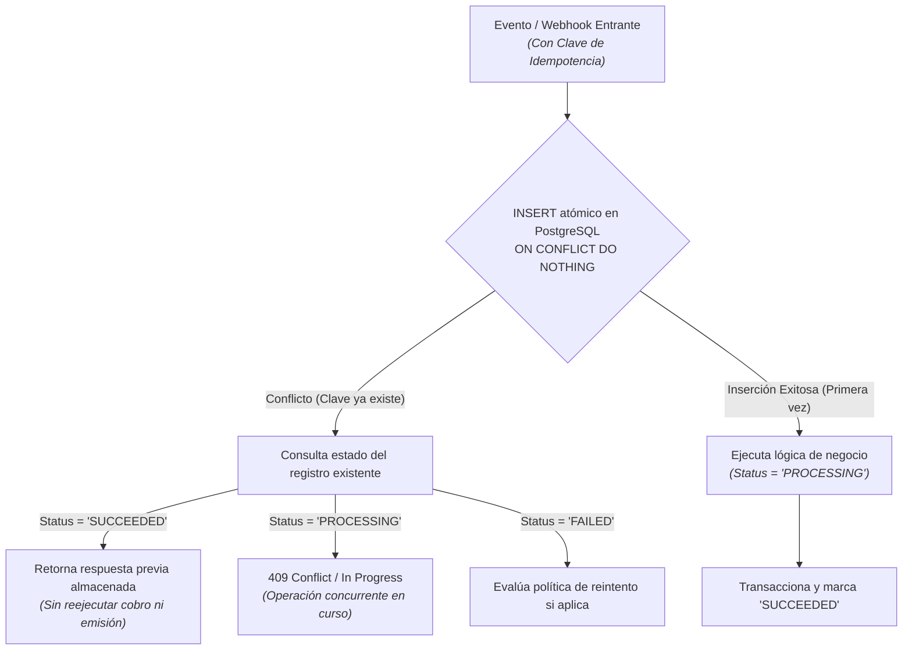
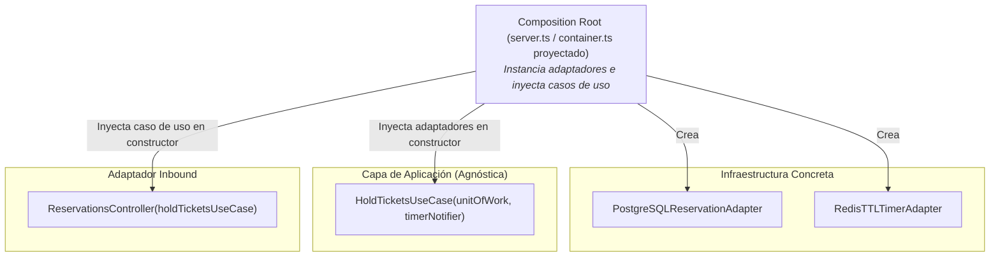

# Capítulo 03: Diseño de Software — 02. Patrones de Diseño

**Sistema**: Plataforma de Descubrimiento, Venta y Validación de Entradas para Eventos y Conciertos en Vivo  
**Contenedor**: `API Core Backend` (Monolito Modular) & Clientes del Ecosistema (`AFORO Web`, `AFORO Studio`, `AFORO Access`)  
**Documento**: `docs/03-diseño-de-software/diseño-interno/patrones-de-diseño.md`  
**Versión**: `1.1.0` | **Fecha**: `2026-10-21`  
**Referencia Metodológica**: Guía 04 de Arquitectura de Software, Patrones de Arquitectura y Diseño Empresarial (Erich Gamma et al., Martin Fowler)  
**Alineación Arquitectónica**: Conforme a la [Constitution](../../../.specify/memory/constitution.md), los [ADRs 001 al 006](../../01-analisis-de-sistema/07-decisiones-arquitectonicas.md) y el [Modelo C4](../../04-modelo-c4/Nivel3-Diagrama-de-Componentes.md)

---

## 1. Propósito y Criterios de Selección de Patrones

El presente documento especifica el catálogo de **patrones de diseño de software** adoptados para estructurar los componentes de la plataforma **AFORO**. La selección de estos patrones no responde a modas tecnológicas ni al uso de catálogos exhaustivos abstractos, sino a la resolución rigurosa de problemas específicos del dominio de venta de entradas y espectáculos en vivo:

1. **Gestión de Alta Concurrencia**: Serialización transaccional y prevención matemática de sobreventa (*zero overselling* como meta arquitectónica).
2. **Desacoplamiento Hexagonal**: Independencia del núcleo de dominio respecto a motores SQL, SDKs de terceros y protocolos web.
3. **Resiliencia Operativa sin Complejidad Externa**: Procesamiento asíncrono y recuperable de eventos de cobro y emisión de tickets dentro del mismo proceso del monolito, prescindiendo deliberadamente de colas distribuidas complejas (como Apache Kafka o RabbitMQ).
4. **Idempotencia Transaccional**: Mecanismos de protección contra cobros duplicados y webhooks retransmitidos por pasarelas externas.

> [!IMPORTANT]
> **Declaración de Realidad Técnica**:  
> Conforme al Principio IV de la Constitución del proyecto:  
> - Los patrones vinculados al backend ([API Core](principios-de-diseño.md)) corresponden a un **`[DISEÑO PROPUESTO — NO IMPLEMENTADO]`**.  
> - En el frontend ([AFORO Web SPA](../../../src/App.tsx)), ciertos patrones se encuentran **`[IMPLEMENTADO EN WEB]`** (como Adaptadores y provisión de contexto) o **`[DEMO / SIMULADO]`** (como el flujo simulado de pago y reserva en cliente).

---

## 2. Cuadro Resumen de Patrones de Diseño Seleccionados

| Patrón de Diseño | Clasificación / Rol | Módulos de AFORO donde Aplica | Estado de Realidad Técnica |
| :--- | :--- | :--- | :---: |
| **1. Repository** | Estructural / Persistencia | Catálogo, Reservas, Pagos, Tickets, Accesos | `[DISEÑO PROPUESTO]` |
| **2. Unit of Work** | Comportamiento / Transaccional | Módulo Reservas e Inventario | `[DISEÑO PROPUESTO]` |
| **3. Adapter** | Estructural / Hexagonal | Todos los módulos (Controladores, DB, Redis, Gateways) | `[IMPLEMENTADO EN WEB]` / `[DISEÑO PROPUESTO]` |
| **4. Facade** | Estructural / Modularidad | Fronteras públicas entre los seis módulos del monolito | `[DISEÑO PROPUESTO]` |
| **5. Strategy** | Comportamiento / Extensibilidad | Módulo Pagos & Facturación (Pasarelas de cobro) | `[DEMO EN WEB]` / `[DISEÑO PROPUESTO]` |
| **6. Transactional Outbox** | Arquitectural / Mensajería | Módulo Pagos $\rightarrow$ Módulo Tickets | `[DISEÑO PROPUESTO]` |
| **7. Idempotent Consumer** | Comportamiento / Integridad | Webhooks de Pagos y Consumidor de Outbox | `[DISEÑO PROPUESTO]` |
| **8. Dependency Injection** | Creacional / Arquitectural | Raíz de composición (*Composition Root*) y Frontend | `[IMPLEMENTADO EN WEB]` / `[DISEÑO PROPUESTO]` |

---

## 3. Especificación Detallada de Patrones de Diseño

---

### 3.1. Patrón Repository (Repositorio de Dominio)



#### Problema Concreto que Resuelve
Acoplamiento directo entre la lógica de negocio y las consultas SQL relacionales, fragmentando las sentencias de base de datos a lo largo de controladores o servicios y dificultando la creación de pruebas unitarias sin dependencias de infraestructura.

#### Contexto dentro de AFORO
Se aplica en todos los módulos de dominio de API Core que requieren persistir o consultar colecciones de entidades: Catálogo ([`ICatalogRepository`](../../04-modelo-c4/Nivel3-Diagrama-de-Componentes.md)), Tickets ([`ITicketRepository`](../../04-modelo-c4/Nivel3-Diagrama-de-Componentes.md)), Pagos ([`IPaymentRepository`](../../04-modelo-c4/Nivel3-Diagrama-de-Componentes.md)) y Accesos ([`IAccessRepository`](../../04-modelo-c4/Nivel3-Diagrama-de-Componentes.md)).

#### Componentes Participantes
- **Puerto de Salida (`ICatalogRepository`, `ITicketRepository`)**: Define la interfaz abstracta orientada a colección de objetos (`findById`, `save`, `findUpcoming`).
- **Adaptador de Persistencia (`PostgreSQLCatalogAdapter`, `PostgreSQLTicketAdapter`)**: Implementa el puerto traduciendo las peticiones en sentencias SQL sobre PostgreSQL y mapeando los registros relacionales a entidades ricas de dominio.
- **Caso de Uso Consumidor (`GetEventDetailUseCase`, `IssueTicketsUseCase`)**: Interactúa exclusivamente con la abstracción.

#### Funcionamiento Propuesto
El caso de uso invoca métodos con semántica de colección de dominio (ej. `catalogRepo.findEventBySlug(slug)`). El repositorio ejecuta la consulta parametrizada contra la base de datos relacional, convierte el resultado tabular en una instancia de la entidad `Event` (reconstituyendo sus invariantes) y la entrega al caso de uso.

#### Ventajas y Compromisos
- **Ventajas**: Aísla el núcleo de negocio de la tecnología de base de datos; favorece la testeabilidad mediante dobles de prueba en memoria (`InMemoryCatalogRepository`).
- **Compromisos**: Introduce código de traducción entre filas de bases de datos relacionales y entidades de dominio (*data mapping overhead*), que debe mantenerse sincronizado con el esquema.

#### Relación con ADRs y C3/C4
- Conforme a [ADR-002 (Arquitectura Hexagonal)](../../complementos/adrs/ADR-002-adopcion-arquitectura-hexagonal.md) y visible en los seis módulos del [Diagrama C3 (Componentes)](../../04-modelo-c4/Nivel3-Diagrama-de-Componentes.md).

#### Estado Real de Implementación
- **`[DISEÑO PROPUESTO — NO IMPLEMENTADO]`**: En el estado actual del repositorio, los eventos y sectores del catálogo web se cargan desde un archivo estático en cliente ([`src/data/events.ts`](../../../src/data/events.ts)).

---

### 3.2. Patrón Unit of Work (Unidad de Trabajo Transaccional)



#### Problema Concreto que Resuelve
Dispersión transaccional y riesgo de operaciones parciales o condiciones de carrera concurrentes al actualizar múltiples registros relacionados (reserva temporal y contadores de inventario sectorial) en la base de datos.

#### Contexto dentro de AFORO
Concentrado exclusivamente en el [Módulo Reservas e Inventario](../../04-modelo-c4/Nivel4-DiagramadeCodigo.md) para garantizar la regla de oro: la adquisición del bloqueo de fila, la consulta de cupos, la comprobación de límites por comprador y la persistencia del *hold* deben ejecutarse dentro de **una única e indivisible transacción relacional en PostgreSQL sobre la misma conexión**.

#### Componentes Participantes
- **Puerto Outbound (`IReservationUnitOfWork`)**: Expone el método de delimitación `executeInTransaction(work)` y las operaciones atómicas asociadas sobre el contexto transaccional (`findSectorInventoryWithLock`, `countAccumulatedByHolder`, `saveHoldAndInventoryAtomic`, `transitionHoldConditionally`).
- **Adaptador Outbound (`PostgreSQLReservationAdapter`)**: Gestiona la conexión dedicada del pool de PostgreSQL (`pg.PoolClient`), controlando los comandos `BEGIN`, `COMMIT` y `ROLLBACK`.
- **Consumidor de Aplicación (`HoldTicketsUseCase`)**: Define el bloque de lógica que debe ejecutarse atómicamente dentro del callback transaccional.

#### Funcionamiento Propuesto
El caso de uso llama a `executeInTransaction(async (txContext) => { ... })`. El adaptador adquiere una conexión del pool y abre una transacción en PostgreSQL bajo nivel de aislamiento `READ COMMITTED`. Dentro de esa misma conexión y transacción:
1. Adquiere el bloqueo pesimista `SELECT ... FOR UPDATE` sobre la fila del sector.
2. Consulta las entradas previamente acumuladas por el titular en dicho sector.
3. Carga el agregado `SectorInventory` y comprueba las reglas de negocio ([RN-01](../../complementos/03-reglas-de-negocio.md#rn-01-invariante-estricta-de-no-sobreventa-aforo-inviolable) y [RN-04](../../complementos/03-reglas-de-negocio.md#rn-04-tope-máximo-de-entradas-por-asistente)).
4. Inserta la reserva y actualiza los contadores de inventario.
Si todo el callback concluye sin errores, el adaptador ejecuta `COMMIT`; si ocurre una excepción de dominio (ej. aforo superado o cuota excedida), se ejecuta `ROLLBACK` total y se libera la conexión al pool.

#### Ventajas y Compromisos
- **Ventajas**: Garantiza la integridad transaccional ACID de principio a fin; establece la base arquitectónica para prevenir sobreventas.
- **Compromisos**: Mantiene un bloqueo de fila durante la transacción. Para mitigar la contención, la transacción debe ser ultracorta (sin llamadas de red externas, pasarelas ni Redis dentro de la transacción SQL).

#### Relación con ADRs y C3/C4
- Base fundamental de [ADR-003 (Concurrencia e Integridad de Inventario)](../../complementos/adrs/ADR-003-concurrencia-integridad-inventario.md) y centro del diseño en [C4 Código](../../04-modelo-c4/Nivel4-DiagramadeCodigo.md).

#### Estado Real de Implementación
- **`[DISEÑO PROPUESTO — NO IMPLEMENTADO]`**: En el estado actual del repositorio, la reserva opera como simulación en memoria del cliente ([`src/components/TicketPicker.tsx`](../../../src/components/TicketPicker.tsx)).

---

### 3.3. Patrón Adapter (Puertos y Adaptadores)



#### Problema Concreto que Resuelve
El acoplamiento del software a frameworks web específicos (Express/Fastify), librerías de infraestructura (Redis, drivers PostgreSQL) o algoritmos criptográficos concretos, lo que provocaría que cualquier cambio tecnológico impacte directamente en las reglas del negocio.

#### Contexto dentro de AFORO
Aplica en la totalidad de la frontera del sistema AFORO (estilo Hexagonal):
- **Adaptadores Primarios (Entrada)**: Controladores HTTP que reciben JSON, validan esquemas y despachan hacia casos de uso.
- **Adaptadores Secundarios (Salida)**: Implementaciones técnicas para PostgreSQL, Redis, firmas asimétricas Ed25519 ([ADR-005](../../complementos/adrs/ADR-005-criptografia-entradas-qr.md)) y pasarelas de pago ([ADR-004](../../complementos/adrs/ADR-004-idempotencia-pagos-webhooks.md)).

#### Componentes Participantes
- **Puertos (Interfaces de Dominio/Aplicación)**: `IReservationUnitOfWork`, `ITimerNotifier`, `ISignatureService`, `IPaymentGateway`.
- **Adaptadores Primarios**: `ReservationsController`, `WebhooksController`.
- **Adaptadores Secundarios**: `PostgreSQLReservationAdapter`, `RedisTTLTimerAdapter`, `Ed25519SignatureAdapter`, `CulqiPaymentAdapter`.

#### Funcionamiento Propuesto
Los adaptadores primarios absorben las peculiaridades del protocolo HTTP (cabeceras, cookies, códigos de estado) y entregan DTOs limpios a la aplicación. Los adaptadores secundarios reciben solicitudes de la aplicación y las convierten al formato exigido por librerías externas o bases de datos.

#### Ventajas y Compromisos
- **Ventajas**: Modularidad e intercambiabilidad tecnológica; el dominio permanece agnóstico de frameworks y libre de dependencias de terceros.
- **Compromisos**: Requiere escribir capas de adaptación para cada componente externo, aumentando el número total de clases del proyecto.

#### Relación con ADRs y C3/C4
- Pilar de [ADR-002 (Arquitectura Hexagonal)](../../complementos/adrs/ADR-002-adopcion-arquitectura-hexagonal.md) y visible en [C3 Componentes](../../04-modelo-c4/Nivel3-Diagrama-de-Componentes.md) y [C4 Código](../../04-modelo-c4/Nivel4-DiagramadeCodigo.md).

#### Estado Real de Implementación
- **En Frontend**: **`[IMPLEMENTADO EN WEB]`**. Enrutador desacoplado ([`src/router.tsx`](../../../src/router.tsx)) que adapta la API nativa del navegador a componentes React, y almacén de estado persistente ([`src/lib/store.tsx`](../../../src/lib/store.tsx)) que adapta eventos nativos `storage`.
- **En Backend**: **`[DISEÑO PROPUESTO — NO IMPLEMENTADO]`**.

---

### 3.4. Patrón Facade (Fachada Pública Inter-Módulo)



#### Problema Concreto que Resuelve
Degeneración del monolito modular en un sistema fuertemente acoplado (*Big Ball of Mud*), donde los casos de uso de un módulo importan directamente repositorios, entidades o esquemas de base de datos de otros módulos.

#### Contexto dentro de AFORO
Regula la comunicación entre los seis módulos cohesivos de API Core dentro del mismo proceso Node.js ([ADR-001](../../complementos/adrs/ADR-001-seleccion-estilo-monolito-modular.md)):
- El Módulo Pagos necesita conocer el estado de la reserva y confirmarla tras el cobro sin acceder a la tabla `reservations`.
- El Módulo Tickets consulta datos del evento a través de la fachada de Catálogo sin acceder a la tabla `events`.

#### Componentes Participantes
- **Interfaz Pública (`IReservationsModuleFacade`, `ICatalogModuleFacade`)**: Define el subconjunto estricto de operaciones y DTOs inmutables expuestos al resto del monolito.
- **Servicio de Implementación (`ReservationsModuleFacadeImpl`)**: Clase de aplicación interna que implementa el contrato e interactúa con los casos de uso internos del módulo. Es un componente **independiente del controlador HTTP**, consumible directamente en memoria por otros módulos.
- **Módulo Consumidor**: Casos de uso de módulos externos que inyectan la interfaz de la fachada.

#### Funcionamiento Propuesto
Cuando el Módulo de Pagos confirma un cobro, invoca `reservationsFacade.confirmReservationSold(reservationId)` en memoria. La fachada ejecuta internamente la transición condicional atómica a través de `IReservationUnitOfWork`, sin que Pagos conozca cómo se actualizan los contadores en PostgreSQL.

#### Ventajas y Compromisos
- **Ventajas**: Encapsulamiento estricto; permite evolucionar la estructura interna de un módulo sin romper a los módulos que lo consumen; llamadas directas en memoria sin sobrecarga de red de microservicios.
- **Compromisos**: Exige definir y mantener DTOs públicos para no exponer entidades internas de dominio.

#### Relación con ADRs y C3/C4
- Directamente alineado con [ADR-001 (Monolito Modular)](../../complementos/adrs/ADR-001-seleccion-estilo-monolito-modular.md), [C3 Componentes](../../04-modelo-c4/Nivel3-Diagrama-de-Componentes.md) y [C4 Código](../../04-modelo-c4/Nivel4-DiagramadeCodigo.md).

#### Estado Real de Implementación
- **`[DISEÑO PROPUESTO — NO IMPLEMENTADO]`**.

---

### 3.5. Patrón Strategy (Estrategia de Integración de Pagos)



#### Problema Concreto que Resuelve
Manejo de múltiples pasarelas de pago y medios de recaudación (Culqi, Niubiz, Stripe) sin condicionar el flujo de negocio con bloques condicionales `if/switch` dispersos por el código, permitiendo seleccionar el proveedor adecuado según la configuración comercial del evento.

#### Contexto dentro de AFORO
Módulo de Pagos & Facturación ([ADR-004](../../complementos/adrs/ADR-004-idempotencia-pagos-webhooks.md)), donde un concierto puede requerir procesamiento con pasarelas locales peruanas (Culqi o Niubiz) o pasarelas internacionales (Stripe) dependiendo del tipo de evento y moneda.

#### Componentes Participantes
- **Estrategia Común (`IPaymentGateway`)**: Contrato unificado que define las operaciones `charge()`, `verifyWebhookSignature()` y `queryPaymentStatus()`.
- **Estrategias Concretas**: `CulqiPaymentAdapter`, `NiubizPaymentAdapter`, `StripePaymentAdapter`.
- **Factoría / Contexto de Aplicación (`ProcessPaymentUseCase`, `PaymentGatewayFactory`)**: Resuelve la estrategia adecuada a partir de la configuración del evento y ejecuta el cobro.

#### Funcionamiento Propuesto y Protocolo ante Incertidumbre
1. **Asociación Estricta de Intento**: Cada intento de cobro se vincula inequívocamente a un proveedor específico y a una clave de idempotencia (`Idempotency-Key`).
2. **Prohibición de Conmutación Automática Incierta**: Si un cobro resulta en timeout de red o estado desconocido, **el sistema no debe cambiar automáticamente de pasarela para reintentar el cobro de la misma reserva**, ya que esto generaría un riesgo severo de doble cargo al usuario en dos entidades bancarias distintas.
3. **Reconciliación Obligatoria**: Ante un resultado incierto, el sistema marca el intento en estado `UNCERTAIN` y exige una consulta explícita de estado (`queryPaymentStatus`) o la recepción del webhook firmado de ese mismo proveedor antes de liberar la reserva o permitir un nuevo intento de cobro.

#### Ventajas y Compromisos
- **Ventajas**: Cumple el Principio Abierto/Cerrado (OCP); facilita la incorporación de nuevos procesadores de pago que satisfagan el contrato; favorece la testeabilidad mediante simulación (`MockPaymentGateway`).
- **Compromisos**: La intercambiabilidad está condicionada a que los proveedores compartan modelos de interacción compatibles; pasarelas con flujos asíncronos complejos o múltiples pasos interactivos pueden requerir extensiones en la interfaz.

#### Relación con ADRs y C3/C4
- Conforme a [ADR-004 (Idempotencia en Pagos y Webhooks)](../../complementos/adrs/ADR-004-idempotencia-pagos-webhooks.md) y visible en [C3 Componentes](../../04-modelo-c4/Nivel3-Diagrama-de-Componentes.md).

#### Estado Real de Implementación
- **En Frontend**: **`[DEMO / SIMULADO]`**. El selector visual de medios de pago en la pasarela simulada del cliente ([`src/components/TicketPicker.tsx`](../../../src/components/TicketPicker.tsx)) genera entradas con estado `ACTIVA_DEMO`.
- **En Backend**: **`[DISEÑO PROPUESTO — NO IMPLEMENTADO]`**.

---

### 3.6. Patrón Transactional Outbox (Despacho Confiable de Eventos)



#### Problema Concreto que Resuelve
Pérdida de eventos de negocio críticos ante reinicios del servidor. Si tras confirmar el cobro en la pasarela el sistema intenta emitir las entradas mediante un evento volátil en memoria y el proceso se reinicia abruptamente en ese instante, el dinero fue cobrado pero el usuario jamás recibe sus tickets (*ghost charge*).

#### Contexto dentro de AFORO
Interconexión entre el Módulo de Pagos & Facturación y el Módulo de Tickets & Emisión dentro del monolito modular. Garantiza la emisión de los boletos digitales tras cada pago exitoso sin recurrir a middlewares externos de mensajería (como Kafka o RabbitMQ) que excederían la justificación operativa del sistema ([ADR-001](../../complementos/adrs/ADR-001-seleccion-estilo-monolito-modular.md)).

#### Componentes Participantes
- **Tabla Relacional (`outbox_events` en PostgreSQL)**: Almacena los eventos de dominio persistidos de forma transaccional.
- **Emisor (`ProcessPaymentUseCase` / `PostgreSQLPaymentAdapter`)**: Persiste el cobro y el evento Outbox dentro de la misma transacción SQL.
- **Despachador en Segundo Plano (`OutboxProcessor Worker`)**: Tarea ligera que corre dentro del proceso del monolito.
- **Receptor Inbound (`TicketIssuanceListener` en Módulo Tickets)**: Recibe el evento y orquesta el caso de uso `IssueTicketsUseCase`.

#### Funcionamiento Propuesto y Delimitación de Transacciones
1. **Transacciones SQL Breves**: Para no saturar el pool de conexiones, **nunca se mantiene abierta una transacción PostgreSQL durante llamadas externas o tareas prolongadas**.
2. **Reclamo por Arrendamiento (*Lease Mechanism*)**: El worker reclama eventos pendientes en una transacción corta actualizando su estado a `CLAIMED` con un tiempo límite (`lease_until = NOW() + INTERVAL '30s'`). Si el worker sufre una caída imprevista durante el despacho, otro ciclo de trabajo recuperará automáticamente los eventos cuyo arrendamiento haya expirado.
3. **Garantía de Entrega Al Menos Una Vez (*At-Least-Once Delivery*)**: El patrón asegura que ningún evento confirmado se perderá, pero admite la posibilidad de entregas duplicadas si ocurre un fallo justo antes de actualizar a `PROCESSED`. Por consiguiente, el consumidor de tickets debe ser **estrictamente idempotente**.

#### Ventajas y Compromisos
- **Ventajas**: Resiliencia ante caídas de proceso sin requerir infraestructura externa de mensajería; utiliza la misma base de datos PostgreSQL.
- **Compromisos**: Consistencia eventual entre el cobro y la emisión; requiere control de reintentos con retroceso exponencial (*exponential backoff*) y lógica de deduplicación en el receptor.

#### Relación con ADRs y C3/C4
- Base de [ADR-001 (Monolito Modular)](../../complementos/adrs/ADR-001-seleccion-estilo-monolito-modular.md), [ADR-004 (Idempotencia)](../../complementos/adrs/ADR-004-idempotencia-pagos-webhooks.md) y visible explícitamente en [C3 Componentes](../../04-modelo-c4/Nivel3-Diagrama-de-Componentes.md).

#### Estado Real de Implementación
- **`[DISEÑO PROPUESTO — NO IMPLEMENTADO]`**.

---

### 3.7. Patrón Idempotent Consumer (Consumidor Idempotente)



#### Problema Concreto que Resuelve
Duplicación de cobros o duplicación de entradas generadas cuando una pasarela externa retransmite un webhook de pago debido a latencias de red, o cuando el despachador Outbox reintenta la entrega de un evento.

#### Contexto dentro de AFORO y Distinción de Identificadores
El sistema distingue tres identificadores con propósitos y ciclos de vida diferentes:
1. **`Idempotency-Key` (Clave de Solicitud de Cliente)**: Generada por AFORO Web en el encabezado HTTP para evitar cobros duplicados iniciados por múltiples clics del usuario.
2. **`gateway_event_id` / `charge_id` (Identificador del Webhook)**: Provisto por Culqi/Niubiz/Stripe para evitar procesar dos veces la misma notificación de cobro.
3. **`outbox_event_id` (Identificador del Evento Outbox)**: UUID único interno asignado por el Módulo de Pagos para que el Módulo de Tickets descarte entregas duplicadas del worker.

#### Componentes Participantes
- **Almacén de Idempotencia**: Tabla `payment_idempotency_keys` en PostgreSQL con restricción de unicidad estricta (`UNIQUE (idempotency_key)`).
- **Consumidores de Entrada**: `HandleGatewayWebhookUseCase`, `IssueTicketsUseCase`.

#### Funcionamiento Propuesto mediante Unicidad Atómica
Para evitar condiciones de carrera, **no se realiza una comprobación previa mediante `SELECT`**, sino que se confía en la atomicidad del motor relacional:
1. Se ejecuta una inserción atómica condicional:
   ```sql
   INSERT INTO payment_idempotency_keys (idempotency_key, status, created_at)
   VALUES ($1, 'PROCESSING', NOW())
   ON CONFLICT (idempotency_key) DO NOTHING
   RETURNING *;
   ```
2. Si la consulta retorna la fila insertada, la petición adquiere el derecho exclusivo de procesamiento. Al finalizar satisfactoriamente, transiciona a `SUCCEEDED` junto con la respuesta en caché; si falla definitivamente, transiciona a `FAILED`.
3. Si la inserción produce conflicto (0 filas retornadas), se consulta el estado actual:
   - Si está en `PROCESSING`, se responde con rechazo temporal de concurrencia (`409 Conflict`).
   - Si está en `SUCCEEDED`, se entrega la respuesta persistida sin reejecutar la lógica de cobro ni emisión.
4. **Política de Retención**: Se adopta el plazo provisional de **72 horas** formalizado en [ADR-004](../../complementos/adrs/ADR-004-idempotencia-pagos-webhooks.md) para la purga periódica de claves de idempotencia resueltas.

#### Ventajas y Compromisos
- **Ventajas**: Mitiga el riesgo de cobros duplicados y generación redundante de tickets ante reintentos automáticos.
- **Compromisos**: Exige almacenamiento adicional y un proceso periódico de mantenimiento para depurar registros después de la ventana de 72 horas.

#### Relación con ADRs y C3/C4
- Conforme a [ADR-004 (Idempotencia en Pagos y Webhooks)](../../complementos/adrs/ADR-004-idempotencia-pagos-webhooks.md) y [C3 Componentes](../../04-modelo-c4/Nivel3-Diagrama-de-Componentes.md).

#### Estado Real de Implementación
- **`[DISEÑO PROPUESTO — NO IMPLEMENTADO]`**.

---

### 3.8. Patrón Dependency Injection (Inyección de Dependencias)



#### Problema Concreto que Resuelve
El acoplamiento directo provocado por la instanciación de clases con la palabra reservada `new` dentro de la lógica de negocio, lo que impediría sustituir componentes de infraestructura, dificultaría la configuración centralizada y obstaculizaría las pruebas unitarias aisladas.

#### Contexto dentro de AFORO
Aplica como principio de diseño tanto en la arquitectura proyectada para API Core como en la provisión de estado en el frontend web ([`src/lib/store.tsx`](../../../src/lib/store.tsx)).

#### Componentes Participantes
- **Punto de Composición Proyectado (*Composition Root*)**: Archivo central de inicialización del backend (`src/server.ts` o `src/container.ts`, planificado para la construcción del backend), responsable de instanciar los clientes de PostgreSQL y Redis, cablear los adaptadores secundarios hacia los casos de uso y entregar estos a los adaptadores primarios.
- **Clases Receptoras**: Casos de uso (`HoldTicketsUseCase`, `ProcessPaymentUseCase`) y controladores que reciben sus dependencias exclusivamente a través de sus constructores (*Constructor Injection*).

#### Funcionamiento Propuesto
El caso de uso declara sus dependencias como interfaces tipadas de TypeScript en su constructor:
```typescript
class HoldTicketsUseCase {
  constructor(
    private readonly unitOfWork: IReservationUnitOfWork,
    private readonly timerNotifier: ITimerNotifier
  ) {}
  // ...
}
```
Durante el arranque de la aplicación, el punto de composición instancia `PostgreSQLReservationAdapter` y `RedisTTLTimerAdapter` y los pasa como argumentos al constructor de `HoldTicketsUseCase`. En pruebas unitarias, se inyectan dobles de prueba sin necesidad de desplegar infraestructura real.

#### Diferenciación Frontend vs. Backend
- **En Backend (`[DISEÑO PROPUESTO]`)**: Inyección de dependencias estricta por constructor a nivel de clases e interfaces tipadas.
- **En Frontend (`[IMPLEMENTADO EN WEB]`)**: Se utiliza la API de React Context mediante el componente proveedor [`StoreProvider`](../../../src/lib/store.tsx). Este mecanismo resuelve la **provisión de dependencias y estado** a lo largo del árbol de componentes de la interfaz de usuario, compartiendo el carrito, los eventos guardados y los pases digitales simulados de forma declarativa, sin constituir una inyección por constructor de clases.

#### Ventajas y Compromisos
- **Ventajas**: Grafo de dependencias explícito y tipado en tiempo de compilación; desacoplamiento estructural sin depender de frameworks de inyección invasivos o basados en metadatos y reflexión en tiempo de ejecución.
- **Compromisos**: Exige mantener manualmente el cableado de dependencias a medida que se incorporan nuevos módulos y casos de uso.

#### Relación con ADRs y C3/C4
- Base estructural de [ADR-002 (Arquitectura Hexagonal)](../../complementos/adrs/ADR-002-adopcion-arquitectura-hexagonal.md) y modelado en [C4 Código](../../04-modelo-c4/Nivel4-DiagramadeCodigo.md).

#### Estado Real de Implementación
- **En Frontend**: **`[IMPLEMENTADO EN WEB]`** (vía React Context en `src/lib/store.tsx`).
- **En Backend**: **`[DISEÑO PROPUESTO — NO IMPLEMENTADO]`**.
