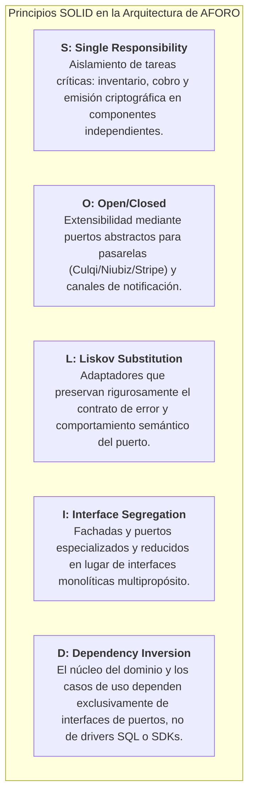
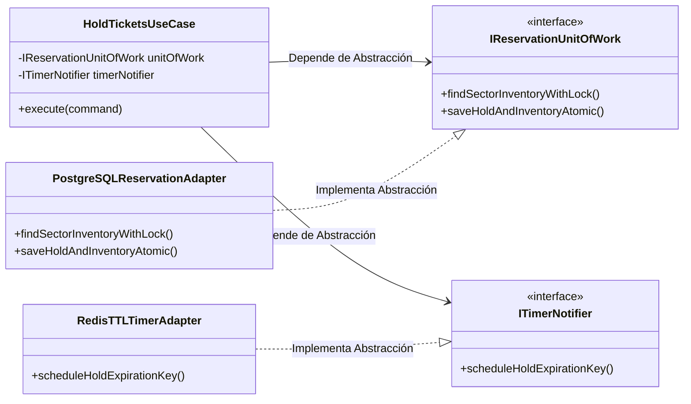
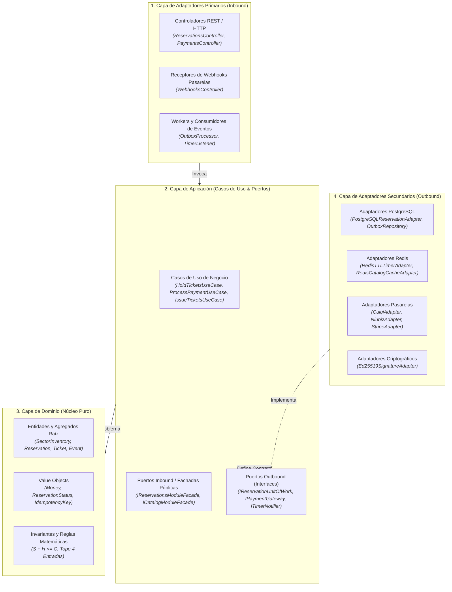
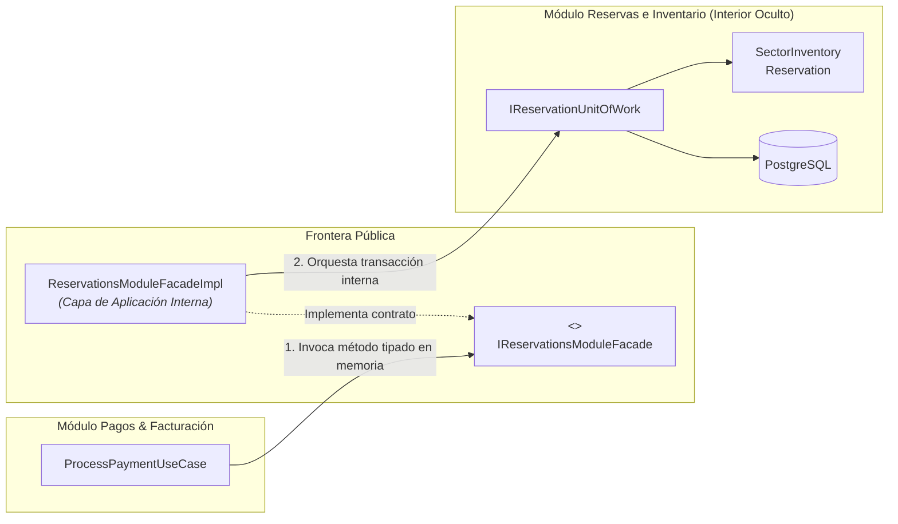

# Capítulo 03: Diseño de Software — 01. Principios SOLID y Diseño Modular

**Sistema**: Plataforma de Descubrimiento, Venta y Validación de Entradas para Eventos y Conciertos en Vivo  
**Contenedor**: `API Core Backend` (Monolito Modular) & `AFORO Web` (Frontend SPA)  
**Documento**: `docs/03-diseño-de-software/diseño-interno/principios-de-diseño.md`  
**Versión**: `1.1.0` | **Fecha**: `2026-10-21`  
**Referencia Metodológica**: Guía 04 de Arquitectura y Diseño de Software, Principios de Robert C. Martin (Clean Architecture / SOLID)  
**Alineación Arquitectónica**: Conforme a la [Constitution](../../../.specify/memory/constitution.md), los [ADRs 001 al 006](../../01-analisis-de-sistema/07-decisiones-arquitectonicas.md) y el [Modelo C4](../../04-modelo-c4/Nivel3-Diagrama-de-Componentes.md)

---

## 1. Propósito y Alcance del Diseño

El presente documento establece las directrices fundamentales de diseño orientado a objetos y modularidad técnica para la plataforma **AFORO**. Su objetivo es definir las reglas estructurales que rigen la separación de responsabilidades, el desacoplamiento de dependencias y el encapsulamiento de componentes dentro del sistema.

### Alcance Técnico
1. **API Core Backend (`[DISEÑO PROPUESTO — NO IMPLEMENTADO]`)**:  
   Formaliza la arquitectura interna de los seis módulos de dominio cohesivos que componen el monolito modular, garantizando que cada componente respete el aislamiento hexagonal, los principios SOLID y la delimitación estricta de fronteras transaccionales.
2. **AFORO Web SPA (`[IMPLEMENTADO EN WEB]`)**:  
   Define cómo los principios de modularidad, cohesión y segregación de responsabilidades se reflejan en el código fuente actual del frontend ([`src/`](file:///g:/2026%20400%20Par/Arquitectura%20de%20Software/AFORO-TF/AFORO-Fusion/src/)), separando componentes visuales, lógica de filtrado de datos, sincronización de estado global y contratos de navegación.

> [!IMPORTANT]
> **Declaración de Realidad Técnica**:  
> Conforme al Principio IV de la Constitución del proyecto, se distingue expresamente la realidad técnica de las partes:  
> - El frontend web se encuentra **físicamente implementado** en React 19 / TypeScript bajo `src/`, respaldado por 30 pruebas unitarias y de integración.  
> - El backend API Core se encuentra **formalizado a nivel de diseño y especificación técnica**; no existen archivos fuente de backend en `src/`.

---

## 2. Aplicación de los Principios SOLID en AFORO

Los cinco principios SOLID no se adoptan como axiomas teóricos o dogmáticos, sino como directrices concretas para resolver los desafíos de alta concurrencia, prevención de sobreventa e integración con pasarelas externas que demanda AFORO:



---

### 2.1. Single Responsibility Principle (SRP) — Responsabilidad Única

> *«Una clase o módulo debe tener una, y solo una, razón para cambiar.»*

#### Problema Evitado
En plataformas de venta de entradas tradicionales, es común encontrar clases o servicios masivos (antipatrón *God Object* como `OrderService` o `TicketManager`) que en un solo método verifican aforo en base de datos, calculan comisiones, llaman a la pasarela de pago, generan el código QR criptográfico, envían correos y descuentan stock. Cuando las tarifas de la pasarela cambian o se altera la biblioteca de códigos QR, toda la lógica transaccional de inventario queda expuesta a regresiones.

#### Decisión Concreta en AFORO
AFORO fragmenta rigurosamente el ciclo de vida de la compra en componentes con una única razón de cambio:
- **`SectorInventory` ([Módulo Reservas e Inventario](../../04-modelo-c4/Nivel4-DiagramadeCodigo.md))**: Su única razón de cambio es la variación en las reglas matemáticas y de conservación del aforo nominal y sectorial ($S + H \le C$, límite de 4 entradas). No conoce pasarelas de pago, clientes HTTP ni correos electrónicos.
- **`HoldTicketsUseCase`**: Su única razón de cambio es la política de retención temporal preventiva (orquestación transaccional de 600 segundos).
- **`ProcessPaymentUseCase` ([Módulo Pagos](../../04-modelo-c4/Nivel3-Diagrama-de-Componentes.md))**: Su única razón de cambio es la interacción de cobro e idempotencia con procesadores de pago externos.
- **`IssueTicketsUseCase` ([Módulo Tickets](../../04-modelo-c4/Nivel3-Diagrama-de-Componentes.md))**: Su única razón de cambio es la emisión formal y firma digital asimétrica (Ed25519) del ticket una vez confirmado el cobro.
- **`EmailNotificationAdapter`**: Su única razón de cambio son los cambios en plantillas HTML o proveedores de correo transaccional (SendGrid/Resend).

#### Manifestación en el Frontend (`src/`)
En el código implementado, SRP se materializa separando la presentación visual de la lógica de transformación:
- [`src/lib/filters.ts`](file:///g:/2026%20400%20Par/Arquitectura%20de%20Software/AFORO-TF/AFORO-Fusion/src/lib/filters.ts): Función pura dedicada exclusivamente a normalización fonética, ordenamiento y filtrado multicriterio de eventos.
- [`src/lib/cart.ts`](file:///g:/2026%20400%20Par/Arquitectura%20de%20Software/AFORO-TF/AFORO-Fusion/src/lib/cart.ts): Lógica pura para cálculo de líneas, límites por sector y totales monetarios.
- [`src/components/TicketPicker.tsx`](file:///g:/2026%20400%20Par/Arquitectura%20de%20Software/AFORO-TF/AFORO-Fusion/src/components/TicketPicker.tsx): Componente visual que únicamente orquesta la interacción del usuario y delega el cálculo a las funciones puras anteriores.

---

### 2.2. Open/Closed Principle (OCP) — Abierto / Cerrado

> *«Las entidades de software deben estar abiertas a la extensión, pero cerradas a la modificación.»*

#### Problema Evitado
Tener sentencias condicionales dispersas (`switch (provider) { case 'CULQI': ... case 'NIUBIZ': ... }`) dentro de la lógica central de negocio, donde la adición de una nueva pasarela exige modificar y recompilar el núcleo del sistema, arriesgando la estabilidad de los flujos preexistentes.

#### Decisión Concreta en AFORO
AFORO define puertos de salida abstractos en la capa de aplicación, permitiendo incorporar nuevos proveedores de infraestructura mediante la adición de clases adaptadoras:
- **Pasarelas de Pago (`IPaymentGateway`)**:  
  El caso de uso `ProcessPaymentUseCase` interactúa exclusivamente con el contrato:
  ```typescript
  interface IPaymentGateway {
    charge(command: ChargeCommand): Promise<ChargeResult>;
    verifyWebhookSignature(payload: string, signature: string): boolean;
  }
  ```
  Para dar soporte a Culqi, Niubiz o Stripe ([ADR-004](../../complementos/adrs/ADR-004-idempotencia-pagos-webhooks.md)), se desarrollan adaptadores secundarios (`CulqiPaymentAdapter`, `NiubizPaymentAdapter`, `StripePaymentAdapter`).  
  **Alcance y Límite de OCP**: La extensibilidad es efectiva siempre y cuando el nuevo proveedor (por ejemplo, Mercado Pago o servicios de transferencias directas) satisfaga los supuestos semánticos del contrato existente (cobro directo o autorización con webhook asíncrono). Si una pasarela impone un flujo fundamentalmente incompatible (como redirecciones de múltiples saltos interactivos o autenticaciones no modeladas), será necesario versionar o ajustar el contrato del puerto y su caso de uso consumidor.
- **Canales de Notificación (`INotificationService`)**:  
  Permite incorporar notificaciones SMS o mensajería instantánea implementando la interfaz sin tocar la emisión de tickets.

---

### 2.3. Liskov Substitution Principle (LSP) — Sustitución de Liskov

> *«Los subtipos deben ser sustituibles por sus tipos base sin alterar el correcto funcionamiento del programa.»*

#### Problema Evitado
Crear adaptadores que implementan una interfaz común pero violan las precondiciones, postcondiciones o semántica de error del contrato base, provocando comportamientos anómalos o estados transaccionales corruptos.

#### Decisión Concreta en AFORO
- **Adaptadores de Pago e Idempotencia**:  
  Cualquier implementación de `IPaymentGateway` debe preservar el contrato semántico y traducir los errores de los SDKs externos a tipos tipados de dominio.  
  Es fundamental **diferenciar la naturaleza del resultado del pago**:
  1. *Rechazo Definitivo* (ej. tarjeta bloqueada o fondos insuficientes): Retorna `PaymentDeclinedResult`. La reserva no se cancela inmediatamente de forma destructiva; el usuario conserva la posibilidad de reintentar con otro medio de pago mientras permanezca vigente el TTL de 600 segundos ([RN-03](../../complementos/03-reglas-de-negocio.md#rn-03-reserva-temporal-con-expiración-determinista-ttl-de-10-minutos)).
  2. *Fallo Técnico Transitorio* (ej. timeout de red con la pasarela): Retorna `GatewayUnavailableError`. No altera el estado de la reserva, permitiendo reintentos idempotentes mediante la misma `Idempotency-Key`.
  3. *Resultado Incierto o Asíncrono* (ej. procesamiento 3D Secure pendiente): La reserva permanece en `PENDING_PAYMENT` hasta recibir el webhook firmado o alcanzar la expiración natural.
- **Aislamiento Semántico en Control de Acceso (Online vs. Offline)**:  
  **Los validadores online y offline no son sustitutos de Liskov intercambiables bajo una misma interfaz única.** Sus garantías de consistencia son asimétricas:
  - *Modo Online (`IOnlineAccessValidator`)*: Garantiza unicidad atómica global mutando el estado en PostgreSQL (`ACTIVE → USED`).
  - *Modo Offline (`IOfflineAccessValidator`)*: Verifica la firma asimétrica del QR y previene el reúso únicamente en el almacenamiento local de la terminal lectora, asumiendo el riesgo inherente de colisión o doble ingreso si dos terminales desconectadas validan el mismo ticket simultáneamente ([ADR-006](../../complementos/adrs/ADR-006-persistencia-operacion-offline-access.md)).  
  Para honrar LSP, AFORO no disfraza estas dos modalidades bajo una interfaz común engañosa, sino que mantiene contratos separados con garantías y limitaciones explícitamente documentadas.

---

### 2.4. Interface Segregation Principle (ISP) — Segregación de Interfaces

> *«Los clientes no deben ser forzados a depender de interfaces que no utilizan.»*

#### Problema Evitado
Crear interfaces generales gigantescas como `IAforoSystemRepository` que agrupen métodos de eventos, catálogo, reservas, cobros, usuarios y auditoría de accesos. Cualquier cambio en la firma de un método de accesos obliga a recompilar módulos ajenos de catálogo o facturación.

#### Decisión Concreta en AFORO
AFORO segrega minuciosamente los puertos e interfaces en contratos específicos de grano fino:
- **Segregación en el Módulo de Reservas ([C4 Código](../../04-modelo-c4/Nivel4-DiagramadeCodigo.md))**:  
  En lugar de mezclar la persistencia relacional con el sistema de alarmas volátiles en una sola interfaz, el módulo define dos puertos independientes:
  - `IReservationUnitOfWork`: Dedicado estrictamente a la delimitación transaccional, bloqueo pesimista `SELECT ... FOR UPDATE` y actualización atómica en PostgreSQL.
  - `ITimerNotifier`: Dedicado exclusivamente al registro de claves temporizadas volátiles en Redis.
- **Coherencia de la Fachada Pública Inter-Módulo (`IReservationsModuleFacade`)**:  
  En estricta consonancia con el [Diagrama C4](../../04-modelo-c4/Nivel4-DiagramadeCodigo.md), la fachada intermodular expone exclusivamente las tres operaciones requeridas por otros módulos del monolito:
  ```typescript
  interface IReservationsModuleFacade {
    getReservationStatus(reservationId: string): ReservationDTO;
    confirmReservationSold(reservationId: string): boolean;
    cancelHoldManually(reservationId: string, reason: string): boolean;
  }
  ```
  Los módulos externos (como Pagos) consumen únicamente esta fachada sin tener visibilidad ni acceso a métodos internos de recálculo de aforo, bloqueos de fila o consultas de infraestructura.
- **Segregación en Acceso de Molinetes**:  
  AFORO Access únicamente consume interfaces específicas de validación en puerta y reconciliación de bitácoras, sin conocer métodos de liquidación comercial ni configuración editorial de conciertos.

---

### 2.5. Dependency Inversion Principle (DIP) — Inversión de Dependencias

> *«Los módulos de alto nivel no deben depender de los módulos de bajo nivel. Ambos deben depender de abstracciones. Las abstracciones no deben depender de los detalles. Los detalles deben depender de las abstracciones.»*

#### Problema Evitado
Casos de uso de negocio que importan directamente clientes de base de datos (`pg`, `PrismaClient`, `ioredis`), SDKs de terceros (`culqi-node`, `stripe`) o APIs nativas del sistema operativo. Esto acopla la regla de negocio a la tecnología, imposibilitando las pruebas unitarias aisladas y dificultando migraciones de infraestructura.

#### Decisión Concreta en AFORO
AFORO aplica la **Arquitectura Hexagonal ([ADR-002](../../complementos/adrs/ADR-002-adopcion-arquitectura-hexagonal.md))** como mecanismo formal para materializar DIP:
- El núcleo de aplicación (`HoldTicketsUseCase`, `ProcessPaymentUseCase`, `IssueTicketsUseCase`) reside en el centro del hexágono y **solo conoce interfaces abstractas** ubicadas en su propia capa (puertos).
- Los módulos de bajo nivel (`PostgreSQLReservationAdapter`, `RedisTTLTimerAdapter`, `CulqiPaymentAdapter`, `Ed25519SignatureAdapter`) residen en la capa exterior de infraestructura e implementan dichas interfaces.
- La inyección de dependencias se realiza en el punto de entrada de la aplicación (*Composition Root*), asegurando que el dominio sea 100% independiente de frameworks y bibliotecas de terceros.



---

## 3. Ejemplos Concretos en los Seis Módulos de API Core

| Módulo de API Core | Principio SOLID Destacado | Decisión de Diseño Específica |
| :--- | :--- | :--- |
| **1. Catálogo & Eventos** | **SRP & OCP** | **SRP**: Separa la recuperación de cartelera pública optimizada para lectura de la edición editorial de conciertos de organizadores.<br>**OCP**: El motor de ordenamiento y filtrado de eventos admite nuevas estrategias de búsqueda (por proximidad geográfica o popularidad) siempre que satisfagan el contrato del repositorio. |
| **2. Reservas e Inventario** | **DIP & ISP** | **DIP**: `HoldTicketsUseCase` desconoce PostgreSQL; delega en el puerto `IReservationUnitOfWork`.<br>**ISP**: Segrega la unidad de trabajo transaccional (`IReservationUnitOfWork`) del despachador de alarmas de expiración (`ITimerNotifier`). |
| **3. Pagos & Facturación** | **OCP & LSP** | **OCP**: Soporte para pasarelas (Culqi, Niubiz, Stripe) implementando `IPaymentGateway`.<br>**LSP**: Cada pasarela traduce sus códigos propietarios diferenciando rechazo definitivo, fallo técnico y resultado incierto. |
| **4. Tickets & Emisión** | **SRP & DIP** | **SRP**: `IssueTicketsUseCase` orquesta la generación de entradas; la criptografía matemática reside exclusivamente en `ISignatureService` (Ed25519).<br>**DIP**: El almacenamiento de entradas en base de datos depende de `ITicketRepository`, aislando el formato relacional de la billetera. |
| **5. Control de Acceso** | **ISP & LSP** | **ISP**: Divide la operativa de puerta en contratos diferenciados: `IOnlineAccessValidator` (atómico en PostgreSQL) e `IOfflineAccessValidator` (reconciliación asíncrona de bitácoras de IndexedDB).<br>**LSP**: No unifica online y offline bajo un contrato engañoso, reconociendo que sus garantías de consistencia son distintas. |
| **6. Identidad & Organizadores** | **SRP** | **SRP**: Aísla la emisión y verificación de tokens de sesión JWT (seguridad de infraestructura) de la lógica de negocio de perfiles de usuario y asignación de permisos de promotor (RBAC). |

---

## 4. Separación de Capas: Dominio, Aplicación y Adaptadores

En coherencia con la **Arquitectura Hexagonal ([ADR-002](../../complementos/adrs/ADR-002-adopcion-arquitectura-hexagonal.md))**, cada uno de los módulos de API Core se estructura internamente en tres capas concéntricas con fronteras inviolables:



### Reglas de Dirección de Dependencias
1. **El Dominio es Inmutable a la Tecnología**: La capa de dominio no importa ninguna biblioteca externa, ni decoradores de ORM, ni anotaciones de base de datos.
2. **La Aplicación Orquesta sin Conocer la Infraestructura**: Los casos de uso conocen las entidades de dominio y los contratos de los puertos, pero desconocen qué base de datos o pasarela los implementa.
3. **Los Adaptadores son Sustituibles**: La capa de infraestructura depende hacia adentro de las interfaces definidas por la aplicación, cumpliendo la inversión de control.

---

## 5. Encapsulamiento de Módulos mediante Fachadas Públicas

Para evitar que el monolito modular degenere en una «gran bola de lodo» (*Big Ball of Mud*), la comunicación entre módulos se rige por contratos estrictos:



### Reglas de Encapsulamiento Inter-Modular
1. **Punto Único de Contacto**: Todo módulo expone una única interfaz de fachada (`I<Nombre>ModuleFacade`) que representa el contrato público del módulo hacia el resto del monolito.
2. **Invocación en Memoria**: Las llamadas inter-módulo son llamadas a métodos locales de TypeScript/Node.js en el mismo proceso; **no utilizan HTTP ni colas de red externas**, eliminando la sobrecarga de red y serialización HTTP inherente a llamadas remotas inter-proceso ([ADR-001](../../complementos/adrs/ADR-001-seleccion-estilo-monolito-modular.md)).
3. **Uso de DTOs Inmutables**: Los parámetros de entrada y salida de las fachadas son objetos de transferencia de datos (`ReservationDTO`, `PaymentConfirmationDTO`). Las entidades internas de dominio (`SectorInventory`, `Reservation`) jamás se exponen fuera del módulo.

---

## 6. Matriz de Dependencias Permitidas y Prohibidas

Para asegurar la gobernanza del código y prevenir acoplamientos indeseados, se establecen formalmente las reglas de importación entre capas y módulos:

| Origen | Destino | Relación | Justificación Técnica |
| :--- | :--- | :---: | :--- |
| **Adaptador Primario** | **Caso de Uso** | ✅ PERMITIDO | El controlador REST delega la ejecución de la petición en la capa de aplicación. |
| **Caso de Uso** | **Entidad de Dominio** | ✅ PERMITIDO | La aplicación coordina la ejecución de las reglas de negocio sobre el dominio. |
| **Caso de Uso** | **Puerto Outbound (Interfaz)** | ✅ PERMITIDO | La aplicación define y utiliza el contrato de persistencia o servicios externos. |
| **Adaptador Outbound** | **Puerto Outbound (Interfaz)** | ✅ PERMITIDO | El adaptador de infraestructura implementa la interfaz requerida (DIP). |
| **Módulo A** | **Fachada Pública de Módulo B** | ✅ PERMITIDO | Integración controlada entre módulos mediante contrato explícito en memoria. |
| **Dominio** | **Cualquier Capa Externa** | ❌ **PROHIBIDO** | El dominio debe ser agnóstico a frameworks, base de datos y protocolos. |
| **Módulo A** | **Entidad de Dominio de Módulo B** | ❌ **PROHIBIDO** | Viola el encapsulamiento del módulo; debe usar los DTOs de la fachada. |
| **Módulo A** | **Adaptador / Repositorio de Módulo B** | ❌ **PROHIBIDO** | Ningún módulo debe conocer cómo otro módulo persiste su información. |
| **Módulo A** | **Tabla de Base de Datos de Módulo B** | ❌ **PROHIBIDO** | Acceso cruzado prohibido; las mutaciones son exclusivas del dueño del módulo. |
| **Módulo A** | **Llamada HTTP a Módulo B** | ❌ **PROHIBIDO** | Dentro del monolito modular no se realizan llamadas de red internas redundantes. |
| **Módulo A $\leftrightarrow$ Módulo B** | **Dependencia Cíclica** | ❌ **PROHIBIDO** | Si A depende de B, B no puede depender de A (requiere inversión con eventos Outbox). |

### 6.1. Gobernanza de Dependencias y Prevención de Acoplamiento Circular (`[DISEÑO PROPUESTO]`)

Para garantizar que las reglas de la matriz anterior se preserven durante la construcción del backend y no se degraden con el tiempo:
1. **Grafo Acíclico Dirigido (DAG) entre Módulos**:  
   Las dependencias sincrónicas en memoria fluyen en una sola dirección jerárquica (`Payments` $\rightarrow$ `Reservations` $\rightarrow$ `Catalog`, y `Access` $\rightarrow$ `Tickets`, con `Identity` como servicio transversal base). Cuando un flujo de negocio requiere notificar en sentido inverso o hacia un módulo aguas abajo tras una transacción crítica (como `Payments` $\rightarrow$ `Tickets`), la dependencia directa se rompe empleando eventos persistidos en **Transactional Outbox** (`outbox_events`), eliminando cualquier ciclo $A \leftrightarrow B$.
2. **Encapsulamiento por Punto de Entrada (`index.ts`)**:  
   Cada módulo expone hacia el exterior únicamente su archivo barrera (`index.ts`), el cual reexporta la interfaz de su fachada pública (`I<Modulo>ModuleFacade`) y sus DTOs inmutables. Las carpetas internas (`domain/`, `application/use-cases/`, `infrastructure/`) permanecen privadas al módulo.
3. **Verificación Estática Automatizada**:  
   En el diseño del pipeline de calidad del backend se contempla la validación estática de importaciones (mediante reglas de `eslint-plugin-boundaries` o `dependency-cruiser`) para bloquear en tiempo de integración continua cualquier importación que atraviese fronteras modulares sin pasar por la fachada pública o que introduzca referencias desde `domain/` hacia capas exteriores.

---

## 7. Relación con ADRs y Diagramas C3/C4

El diseño de software consolidado en este documento materializa de manera coherente las decisiones arquitectónicas previas:

- **Con [ADR-001: Selección del Monolito Modular](../../complementos/adrs/ADR-001-seleccion-estilo-monolito-modular.md)**:  
  El diseño utiliza fachadas en memoria (`IReservationsModuleFacade`) para garantizar que la modularidad no imponga sobrecostos de red ni serialización JSON innecesaria.
- **Con [ADR-002: Adopción de Arquitectura Hexagonal](../../complementos/adrs/ADR-002-adopcion-arquitectura-hexagonal.md)**:  
  Los principios DIP e ISP se implementan dividiendo cada módulo en núcleo hexagonal, puertos tipados y adaptadores de infraestructura sustituibles.
- **Con [ADR-003: Concurrencia e Integridad de Inventario](../../complementos/adrs/ADR-003-concurrencia-integridad-inventario.md)**:  
  Se aplica SRP y delimitación transaccional única en `IReservationUnitOfWork`, protegiendo la comprobación de aforo y el bloqueo pesimista en PostgreSQL sin delegar autoridad en Redis.
- **Con [Diagrama C3 (Componentes)](../../04-modelo-c4/Nivel3-Diagrama-de-Componentes.md) y [Diagrama C4 (Código)](../../04-modelo-c4/Nivel4-DiagramadeCodigo.md)**:  
  La separación estructural detallada en el diagrama de clases (`ReservationsController`, `HoldTicketsUseCase`, `SectorInventory`, `IReservationUnitOfWork`, `ReservationsModuleFacadeImpl`) es la plasmación directa en código de los componentes identificados en C3 y C4.

---

## 8. Limitaciones y Compromisos Reales de Aplicar SOLID

La aplicación rigurosa de los principios SOLID introduce indiscutibles ventajas de mantenibilidad y testeabilidad, pero **no representa una solución mágica sin costos ni garantías automáticas**. El equipo de arquitectura reconoce y gestiona explícitamente los siguientes compromisos (*trade-offs*):

### 1. Sobrecarga de Indirección y Navegabilidad del Código
- **Compromiso**: La introducción de interfaces intermedias para cada repositorio, servicio y adaptador multiplica la cantidad de archivos y niveles de salto en el IDE (un flujo simple pasa por Controlador $\rightarrow$ Caso de Uso $\rightarrow$ Puerto $\rightarrow$ Adaptador $\rightarrow$ Driver).
- **Mitigación en AFORO**: Mantener una estructura de carpetas predecible y estandarizada en todos los módulos (`domain/`, `application/`, `infrastructure/`), evitando crear interfaces artificiales para componentes internos que no poseen más de una implementación previsible.

### 2. Costo de Mapeo y Código Repetitivo (*Boilerplate*)
- **Compromiso**: Separar estrictamente entidades de dominio, modelos de base de datos relacionales y DTOs de transporte exige escribir funciones de transformación continua (`toDomain()`, `toDTO()`, `toPersistence()`), incrementando las líneas de código y el riesgo de omisión de atributos si no se cuenta con tipado estricto.
- **Mitigación en AFORO**: Aprovechar las capacidades del sistema de tipos estático de TypeScript para garantizar en tiempo de compilación que los mapeadores detecten automáticamente campos faltantes o discrepancias de tipos.

### 3. Riesgo de Sobreingeniería (*YAGNI — You Aren't Gonna Need It*)
- **Compromiso**: Forzar el principio Abierto/Cerrado (OCP) o la Segregación de Interfaces (ISP) en áreas donde la variabilidad es nula puede desembocar en jerarquías de herencia artificiales o interfaces de un solo método que aumentan la carga cognitiva sin brindar beneficio operativo.
- **Mitigación en AFORO**: Se aplica OCP e interfaces de puerto exclusivamente donde existe una variabilidad arquitectónica demostrada (múltiples pasarelas de pago, soporte de almacenamiento transaccional vs auxiliar volátil y motores de firma criptográfica).

### 4. Transacciones Inter-Módulo y Desacoplamiento Asíncrono
- **Compromiso**: Dentro de un monolito modular es técnicamente posible coordinar transacciones compartidas en una misma base de datos relacional mediante contratos o unidades de trabajo comunes. Sin embargo, en AFORO la adopción del patrón **Transactional Outbox ([ADR-004](../../complementos/adrs/ADR-004-idempotencia-pagos-webhooks.md))** responde a una decisión arquitectónica deliberada de desacoplamiento temporal, resiliencia ante reinicios del proceso y garantía de emisión idempotente. El compromiso resultante es que la consistencia entre el cobro y la emisión de entradas es eventual y asíncrona, gestionada mediante eventos persistidos y un despachador recuperable.
