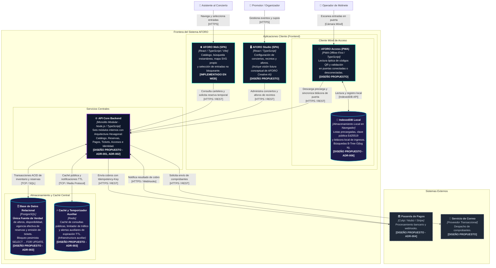

# Modelo C4 — Nivel 2: Diagrama de Contenedores de Software (C2)

**Sistema**: Plataforma de Descubrimiento, Venta y Validación de Entradas para Eventos y Conciertos en Vivo  
**Documento**: `docs/04-modelo-c4/02-diagrama-contenedores-c2.md`  
**Versión**: `1.1.0` | **Fecha**: `2026-10-21`  
**Referencia Metodológica**: C4 Model (Simon Brown) & Guía 04 de Arquitectura de Software  
**Alineación Arquitectónica**: Conforme a la [Constitution](../../.specify/memory/constitution.md), el [Capítulo 01](../01-analisis-de-sistema/) y los [ADRs 001 al 006](../02-arquitectura-software/03-adrs/)

---

## 1. Propósito y Alcance del Diagrama C2

El **Diagrama de Contenedores (C2)** realiza una descomposición del sistema AFORO en sus unidades ejecutables de alto nivel (aplicaciones cliente, servicios de servidor y almacenes de datos). Muestra la topología global de software, las responsabilidades de cada contenedor y los protocolos de comunicación utilizados.

### Criterio de Honestidad Técnica (Principio IV de la Constitution)
- **`[IMPLEMENTADO EN WEB]`**: [`AFORO Web`](../../src/App.tsx) desarrollada en React / Vite con estilos nativos fluidos y 30 pruebas automatizadas en `src/`.
- **`[PROCESO DEMO / SIMULADO]`**: Flujo de compra y emisión de pases QR simulados localmente en navegador con estado `ACTIVA_DEMO` y persistencia en `localStorage`.
- **`[DISEÑO PROPUESTO]`**: Aplicaciones especializadas (`AFORO Studio`, `AFORO Access`), servicio de backend (`API Core`), base de datos relacional (`PostgreSQL`) y caché auxiliar (`Redis`).

---

## 2. Diagrama de Contenedores de Software (Mermaid)

---

## 3. Especificación Técnica de los Contenedores

### 3.1 Contenedores de Clientes (Frontend)

#### C2-01: AFORO Web (SPA)
- **Tecnología**: React, TypeScript, Vite, CSS con Container Queries (`cqi`), React Context API.
- **Responsabilidades**:
  - Catálogo editorial multicriterio (`RF-WEB-01`) y conmutación Mosaico / Ledger (`RF-WEB-02`).
  - Búsqueda modal con atajo `/` (`RF-WEB-03`).
  - Navegación segura con apertura diferenciada en nueva pestaña (`target="_blank" rel="noopener noreferrer"`, `RF-WEB-04`).
  - Desplazamiento y foco automático sobre `#entradas` (`RF-WEB-07`, medido en `33.64 ms`).
  - Mapa interactivo SVG propio (`VenueStageMap.tsx`) sincronizado con la lista de sectores (`TicketPicker.tsx`, `RF-WEB-06`).
  - Selección visual no bloqueante (`RN-02`, [`CartDrawer.tsx`](../../src/components/CartDrawer.tsx)) con tope de 4 entradas por zona (`RN-04`).
  - Sincronización multi-pestaña mediante eventos nativos `storage` (`RNF-PE-03`, medido en `36.2 ms`).
- **Estado de Realidad Técnica**: **`[IMPLEMENTADO EN WEB]`** (30 pruebas automatizadas en `src/`). El flujo de compra y la billetera operan con pases de demostración (`ACTIVA_DEMO`) en `localStorage`.

#### C2-02: AFORO Studio (SPA de Promotores)
- **Tecnología Planificada**: React, TypeScript, Tailwind CSS, biblioteca de gráficos.
- **Responsabilidades**:
  - Autenticación y roles de promotor (`RF-STU-01`).
  - Creación y edición de eventos (`RF-STU-02`).
  - Configuración espacial de recintos y fijación de aforos máximos (`RF-STU-03`).
  - Programación de fases de venta y precios (`RF-STU-04`).
  - Tablero de control de ocupación en vivo (`RF-STU-05`).
  - *Visión Conceptual Futura (AFORO Creative AI)*: Generación asistida de configuraciones estéticas declarativas (paletas y estilos de cartelera) para su renderizado seguro en AFORO Web, sin ejecución de código arbitrario ni alteración de reglas financieras (`01-drivers-y-restricciones.md`).
- **Estado de Realidad Técnica**: **`[DISEÑO PROPUESTO]`**.

#### C2-03: AFORO Access (PWA para Control de Accesos)
- **Tecnología Planificada**: Progressive Web App (PWA) con Service Workers, TypeScript, Web Crypto API.
- **Responsabilidades y Persistencia Local**:
  - Descarga preliminar de listas de entradas autorizadas y clave pública del evento (`RF-ACC-02`, `ADR-005`).
  - Escaneo óptico de códigos QR en molinetes (`RF-ACC-03`).
  - Verificación criptográfica local con clave pública Ed25519 en modo offline (`RF-ACC-04`, `RN-06`).
  - Validación de estado y prevención de reingreso local en esa misma puerta (`RF-ACC-05`, `RN-08`).
  - **Almacenamiento Local (IndexedDB)**: Integrado como parte del cliente en el navegador/dispositivo. Aloja la lista precargada y la bitácora local de accesos concedidos (`gate_access_log`), con consultas indexadas mediante B-Trees en complejidad logarítmica $O(\log N)$ (`ADR-006`).
  - Cola de reconciliación asíncrona hacia la API Core al recuperar conectividad (`RF-ACC-06`).
- **Estado de Realidad Técnica**: **`[DISEÑO PROPUESTO]`**.

---

### 3.2 Contenedor de Backend Central

#### C2-04: API Core Backend (Monolito Modular)
- **Tecnología Planificada**: Node.js, TypeScript, contenedor Docker.
- **Estructura Interna ([`ADR-001`](../02-arquitectura-software/03-adrs/ADR-001-seleccion-estilo-monolito-modular.md), [`ADR-002`](../02-arquitectura-software/03-adrs/ADR-002-adopcion-arquitectura-hexagonal.md))**:
  Un único proceso monolítico modular organizado en seis módulos bajo Arquitectura Hexagonal:
  1. `modules/catalog`: Gestión editorial de conciertos y recintos (`RF-COR-01`).
  2. `modules/reservations`: Bloqueo transaccional de aforo e inserción atómica de reserva con TTL de 10 minutos (`RF-COR-02`, `RN-01`, `RN-03`, `ADR-003`).
  3. `modules/payments`: Procesamiento de pagos con cabecera `Idempotency-Key` y adaptadores dedicados para la recepción de webhooks según cada pasarela (`RF-COR-04`, `RN-05`, `ADR-004`).
  4. `modules/tickets`: Emisión de entradas con firma digital asimétrica Ed25519 (`RF-COR-05`, `RN-06`, `ADR-005`) y máquina de estados (`RN-07`).
  5. `modules/access`: API de validación en tiempo real y reconciliación de bitácoras de molinetes (`RF-COR-07`, `RN-08`).
  6. `modules/identity`: Autenticación JWT y roles RBAC (`RF-STU-01`).
- **Estado de Realidad Técnica**: **`[DISEÑO PROPUESTO]`**.

---

### 3.3 Contenedores de Persistencia y Caché Central

#### C2-05: Base de Datos Relacional (PostgreSQL)
- **Tecnología**: PostgreSQL.
- **Rol Crítico**: **Única Fuente de Verdad** para aforos, disponibilidad por sector, vigencia efectiva de reservas y emisión de boletos (`02-seleccion-y-justificacion-arquitectonica.md`).
- **Estrategia Transaccional ([`ADR-003`](../02-arquitectura-software/03-adrs/ADR-003-concurrencia-inventario.md))**:
  - Transacciones bajo `READ COMMITTED` con bloqueo pesimista a nivel de fila (`SELECT ... FOR UPDATE`) sobre el sector solicitado.
  - Comprobación del invariante de capacidad ($\text{Sold} + \text{ActiveHolds} + \text{Qty} \le \text{Capacity}$) e inserción de la reserva **dentro de la misma transacción atómica**.
  - La vigencia efectiva de las reservas temporales la determina la base de datos comparando las marcas de tiempo transaccionales.
- **Estado de Realidad Técnica**: **`[DISEÑO PROPUESTO]`**.

#### C2-06: Caché y Temporizador Auxiliar (Redis)
- **Tecnología**: Redis.
- **Rol de Soporte**: **Infraestructura estrictamente auxiliar** (no autoridad de inventario):
  1. Caché de consultas públicas de cartelera para mitigar carga en lecturas (`RF-COR-01`, `EAC-01`).
  2. Limitador de tasa de peticiones (*rate limiting*) contra abusos o tráfico desmedido.
  3. Temporizador auxiliar de reservas mediante llaves con TTL de 10 minutos (600 s) para notificar al worker de fondo la conveniencia de liberar reservas abandonadas (`RN-03`, `EAC-03`).
- **Estado de Realidad Técnica**: **`[DISEÑO PROPUESTO]`**.

---

## 4. Trazabilidad con los Seis ADRs Aprobados

| ADR Aprobado | Principio / Decisión Formalizada | Reflejo Técnico en el Diagrama C2 |
| :---: | :--- | :--- |
| **ADR-001** | **Monolito Modular** | Un único contenedor ejecutable (`API_CORE`) en lugar de servicios distribuidos. |
| **ADR-002** | **Arquitectura Hexagonal** | Estructuración modular de `API_CORE` con puertos de entrada (REST/Webhooks) y adaptadores hacia PostgreSQL, Redis y Pasarelas. |
| **ADR-003** | **PostgreSQL como Fuente de Verdad y Locking Pesimista** | Conexión atómica de `API_CORE` con `PG_DB` mediante `SELECT ... FOR UPDATE`, manteniendo a `REDIS_AUX` exclusivamente como caché y timer de expiración TTL. |
| **ADR-004** | **Idempotencia de Pagos y Webhooks** | Flujo con cabecera `Idempotency-Key` y adaptadores desacoplados para la verificación específica de firmas de webhook según el proveedor (Culqi, Niubiz, Stripe). |
| **ADR-005** | **Criptografía Ed25519 para Entradas QR** | `API_CORE` custodia la clave privada para firmar boletos; `ACC_PWA` almacena la clave pública en `ACC_IDB` para validación local offline. |
| **ADR-006** | **Persistencia e IndexedDB Offline en Access** | `ACC_IDB` modelado como almacenamiento local integrado dentro del cliente móvil `ACC_PWA`, con búsquedas B-Tree en $O(\log N)$. |
