# Modelo C4 — Nivel 3: Diagrama de Componentes de API Core (C3)

**Sistema**: Plataforma de Descubrimiento, Venta y Validación de Entradas para Eventos y Conciertos en Vivo  
**Contenedor Analizado**: `API Core Backend` (Monolito Modular)  
**Documento**: `docs/04-modelo-c4/03-diagrama-componentes-c3.md`  
**Versión**: `1.1.0` | **Fecha**: `2026-10-21`  
**Referencia Metodológica**: C4 Model (Simon Brown) & Guía 04 de Arquitectura de Software  
**Alineación Arquitectónica**: Conforme a la [Constitution](../../.specify/memory/constitution.md), el [Capítulo 01](../01-analisis-de-sistema/) y los [ADRs 001 al 006](../02-arquitectura-software/03-adrs/)

---

## 1. Propósito y Alcance del Diagrama C3

El **Diagrama de Componentes (C3)** realiza un *zoom-in* sobre el contenedor central **API Core Backend**, ilustrado en el [Diagrama C2](02-diagrama-contenedores-c2.md). Muestra la organización interna del proceso monolítico en sus seis módulos de dominio cohesivos, detallando el flujo estricto de **Arquitectura Hexagonal (Casos de Uso $\rightarrow$ Puertos de Salida $\rightarrow$ Adaptadores $\rightarrow$ Infraestructura)**, los contratos de fachada inter-módulo, el procesamiento recuperable mediante **Transactional Outbox** y la emisión criptográfica asimétrica.

### Principios Arquitectónicos Fundamentales
1. **Monolito Modular (ADR-001)**: Los seis módulos coexisten dentro de un **único artefacto ejecutable** en Node.js/TypeScript. No existen llamadas de red inter-módulo ni microservicios.
2. **Flujo Hexagonal Estricto (ADR-002)**: Los casos de uso no se conectan directamente a bases de datos ni servicios externos; interactúan exclusivamente a través de **Puertos de Salida** (interfaces tipadas). Los adaptadores secundarios encapsulan el acceso a PostgreSQL, Redis y APIs externas.
3. **Fachadas Públicas Inter-Módulo**: Las fachadas representan contratos de servicio para comunicación entre módulos distintos, no pasos internos de sus propios casos de uso.
4. **Emisión de Tickets Resiliente con Transactional Outbox (ADR-003, ADR-004)**: El desacoplamiento entre el pago y la emisión de entradas no depende de un bus volátil en memoria. Se garantiza mediante persistencia atómica en la tabla `outbox_events` y un despachador recuperable que asegura la emisión idempotente ante reinicios del proceso.
5. **Transición Atómica de Acceso Online (ADR-005, ADR-006)**: La validación online en molinetes no realiza una simple consulta de estado, sino una mutación atómica condicional `ACTIVE → USED` en base de datos para prevenir ingresos concurrentes simultáneos.
6. **Estado de Realidad Técnica**: **`[DISEÑO PROPUESTO]`**. El backend se encuentra formalizado y especificado a nivel de diseño; no existe código backend implementado aún en el repositorio.

---

## 2. Diagrama de Componentes de API Core (Mermaid)

```mermaid
flowchart TD
    %% Clientes Externos
    subgraph CLIENTS["Clientes del Ecosistema"]
        WEB["🌐 AFORO Web SPA<br><i>[IMPLEMENTADO EN WEB]</i>"]
        STU["🖥️ AFORO Studio SPA<br><i>[DISEÑO PROPUESTO]</i>"]
        ACC["📱 AFORO Access PWA<br><i>[DISEÑO PROPUESTO]</i>"]
    end

    %% Contenedor API Core
    subgraph API_CORE["⚙️ Contenedor API Core Backend [Monolito Modular - DISEÑO PROPUESTO]"]

        %% 1. Módulo Catálogo
        subgraph MOD_CAT["1. Módulo Catálogo & Eventos"]
            CTRL_CAT["CatalogController<br><i>(Adaptador Inbound)</i>"]
            UC_CAT["GetCatalogUseCase<br>GetEventDetailUseCase"]
            PORT_CAT_OUT["ICatalogRepository<br><i>(Puerto Outbound)</i>"]
            ADAPT_CAT_PG["PostgreSQLCatalogAdapter<br><i>(Adaptador Outbound)</i>"]
            ADAPT_CAT_RD["RedisCatalogCacheAdapter<br><i>(Adaptador Outbound)</i>"]
            FAC_CAT["ICatalogModuleFacade<br><i>(Fachada Pública Inter-Módulo)</i>"]
            
            CTRL_CAT --> UC_CAT
            UC_CAT --> PORT_CAT_OUT
            PORT_CAT_OUT --> ADAPT_CAT_PG
            PORT_CAT_OUT --> ADAPT_CAT_RD
            UC_CAT -.->|Expone datos de aforo| FAC_CAT
        end

        %% 2. Módulo Reservas
        subgraph MOD_RES["2. Módulo Reservas & Inventario"]
            CTRL_RES["ReservationsController<br><i>(Adaptador Inbound)</i>"]
            UC_RES["HoldTicketsUseCase<br>ReleaseExpiredHoldsUseCase"]
            PORT_RES_OUT["IReservationRepository<br>ITimerNotifier<br><i>(Puertos Outbound)</i>"]
            ADAPT_RES_PG["PostgreSQLReservationAdapter<br><i>(SELECT FOR UPDATE Atómico)</i>"]
            ADAPT_RES_RD["RedisTTLTimerAdapter<br><i>(Alarma Auxiliar 600s)</i>"]
            FAC_RES["IReservationsModuleFacade<br><i>(Fachada Pública Inter-Módulo)</i>"]
            
            CTRL_RES --> UC_RES
            UC_RES --> PORT_RES_OUT
            PORT_RES_OUT --> ADAPT_RES_PG
            PORT_RES_OUT --> ADAPT_RES_RD
            UC_RES -.->|Expone estado de reserva| FAC_RES
        end

        %% 3. Módulo Pagos
        subgraph MOD_PAY["3. Módulo Pagos & Facturación"]
            CTRL_PAY["PaymentsController<br>WebhooksController<br><i>(Adaptadores Inbound)</i>"]
            UC_PAY["ProcessPaymentUseCase<br>HandleGatewayWebhookUseCase"]
            PORT_PAY_OUT["IPaymentRepository<br>IPaymentGateway<br>IOutboxRepository<br><i>(Puertos Outbound)</i>"]
            ADAPT_PAY_PG["PostgreSQLPaymentAdapter<br><i>(Idempotency-Key + Outbox)</i>"]
            ADAPT_PAY_GW["PaymentGatewayAdapters<br><i>(Culqi / Niubiz / Stripe)</i>"]
            
            CTRL_PAY --> UC_PAY
            UC_PAY --> PORT_PAY_OUT
            PORT_PAY_OUT --> ADAPT_PAY_PG
            PORT_PAY_OUT --> ADAPT_PAY_GW
        end

        %% Despachador Recuperable Outbox
        OUTBOX_WORKER["🔄 OutboxProcessor Worker<br><i>(Lector Recuperable de Eventos Persistidos)</i>"]

        %% 4. Módulo Tickets
        subgraph MOD_TCK["4. Módulo Tickets & Emisión"]
            SUB_TCK["TicketIssuanceListener<br><i>(Adaptador Inbound de Outbox)</i>"]
            CTRL_TCK["TicketsController<br><i>(Adaptador Inbound Billetera)</i>"]
            UC_TCK["IssueTicketsUseCase<br><i>(Emisión Idempotente)</i><br>GetTicketDetailUseCase"]
            PORT_TCK_OUT["ITicketRepository<br>ISignatureService<br>INotificationService<br><i>(Puertos Outbound)</i>"]
            ADAPT_TCK_PG["PostgreSQLTicketAdapter"]
            ADAPT_TCK_CRYPTO["Ed25519SignatureAdapter<br><i>(Custodia Clave Privada SK_E)</i>"]
            ADAPT_TCK_MAIL["EmailNotificationAdapter"]
            
            SUB_TCK --> UC_TCK
            CTRL_TCK --> UC_TCK
            UC_TCK --> PORT_TCK_OUT
            PORT_TCK_OUT --> ADAPT_TCK_PG
            PORT_TCK_OUT --> ADAPT_TCK_CRYPTO
            PORT_TCK_OUT --> ADAPT_TCK_MAIL
        end

        %% 5. Módulo Accesos
        subgraph MOD_ACC["5. Módulo Control de Accesos"]
            CTRL_ACC["AccessGateController<br><i>(Adaptador Inbound Puertas)</i>"]
            UC_ACC["ValidateTicketOnlineUseCase<br>ReconcileGateLogsUseCase"]
            PORT_ACC_OUT["IAccessRepository<br><i>(Puerto Outbound)</i>"]
            ADAPT_ACC_PG["PostgreSQLAccessAdapter<br><i>(Transición Atómica ACTIVE → USED)</i>"]
            
            CTRL_ACC --> UC_ACC
            UC_ACC --> PORT_ACC_OUT
            PORT_ACC_OUT --> ADAPT_ACC_PG
        end

        %% 6. Módulo Identidad
        subgraph MOD_IDN["6. Módulo Identidad & Seguridad"]
            CTRL_IDN["AuthController<br><i>(Adaptador Inbound)</i>"]
            UC_IDN["AuthenticateUserUseCase<br>VerifyTokenUseCase"]
            PORT_IDN_OUT["IUserRepository<br>ITokenProvider<br><i>(Puertos Outbound)</i>"]
            ADAPT_IDN_PG["PostgreSQLUserAdapter"]
            ADAPT_IDN_JWT["JwtTokenAdapter"]
            
            CTRL_IDN --> UC_IDN
            UC_IDN --> PORT_IDN_OUT
            PORT_IDN_OUT --> ADAPT_IDN_PG
            PORT_IDN_OUT --> ADAPT_IDN_JWT
        end

    end

    %% Infraestructura Central
    subgraph INFRA["Infraestructura y Persistencia Central [DISEÑO PROPUESTO]"]
        PG[("🗄️ <b>PostgreSQL Relacional</b><br><b>Única Fuente de Verdad</b><br>- Sectores y Aforo (SELECT FOR UPDATE)<br>- Reservas Activas (Vigencia efectiva)<br>- Claves de Idempotencia y Outbox<br>- Tickets Emitidos y Transición ACTIVE → USED")]
        RD[("⚡ <b>Redis Auxiliar</b><br>- Caché Pública de Catálogo<br>- Limitador de Tráfico (Rate Limit)<br>- Temporizador Auxiliar TTL (600s)")]
    end

    %% Pasarelas y Mensajería Externa
    subgraph EXT["Sistemas Externos [DISEÑO PROPUESTO]"]
        GATEWAY["🏛️ Pasarela de Pagos Externa<br><i>(Culqi / Niubiz / Stripe)</i>"]
        MAILER["📨 Servicio de Correo Transaccional<br><i>(SendGrid / AWS SES)</i>"]
    end

    %% Flujos de Clientes a Controladores Inbound
    WEB -->|"Consultas públicas<br>[HTTPS / REST]"| CTRL_CAT
    WEB -->|"Solicitud de reserva temporal<br>[HTTPS / REST]"| CTRL_RES
    WEB -->|"Pago con Idempotency-Key<br>[HTTPS / REST]"| CTRL_PAY
    WEB -->|"Consulta pases de billetera<br>[HTTPS / REST]"| CTRL_TCK
    STU -->|"Administración de eventos y aforos<br>[HTTPS / REST / JWT]"| CTRL_CAT
    ACC -->|"Descarga precarga y reconciliación offline<br>[HTTPS / REST]"| CTRL_ACC
    ACC -->|"Validación online en puerta<br>[HTTPS / REST]"| CTRL_ACC

    %% Comunicación Inter-Módulo (Fachadas y Outbox)
    UC_RES -.->|"1. Consulta capacidad por sector<br>[Contrato ICatalogModuleFacade]"| FAC_CAT
    UC_PAY -.->|"2. Valida vigencia de reserva<br>[Contrato IReservationsModuleFacade]"| FAC_RES
    ADAPT_PAY_PG -->|"3. Persiste cobro y evento OUTBOX en misma TX"| PG
    PG -.->|"4. Lee eventos pendientes de emisión"| OUTBOX_WORKER
    OUTBOX_WORKER -->|"5. Despacha evento recuperable"| SUB_TCK

    %% Conexiones de Adaptadores Outbound a Infraestructura
    ADAPT_CAT_PG <-->|"SQL"| PG
    ADAPT_CAT_RD <-->|"TCP"| RD
    ADAPT_RES_PG <-->|"SQL (FOR UPDATE)"| PG
    ADAPT_RES_RD <-->|"TCP (TTL 600s)"| RD
    ADAPT_PAY_GW -->|"Cobros tokenizados"| GATEWAY
    GATEWAY -->|"Webhooks firmados"| CTRL_PAY
    ADAPT_TCK_PG <-->|"SQL"| PG
    ADAPT_TCK_MAIL -->|"REST / SMTP"| MAILER
    ADAPT_ACC_PG <-->|"UPDATE condicional atómico"| PG
    ADAPT_IDN_PG <-->|"SQL"| PG

    %% Estilos compatibles con GitHub
    classDef client fill:#131c31,stroke:#00f5d4,stroke-width:2px,color:#ffffff;
    classDef backend fill:#0e172a,stroke:#7928ca,stroke-width:3px,color:#ffffff;
    classDef module fill:#1e293b,stroke:#38bdf8,stroke-width:2px,color:#ffffff;
    classDef database fill:#1e1b4b,stroke:#06b6d4,stroke-width:2px,color:#ffffff;
    classDef external fill:#1f2937,stroke:#64748b,stroke-width:2px,stroke-dasharray: 5 5,color:#cbd5e1;

    class WEB,STU,ACC client;
    class API_CORE backend;
    class MOD_CAT,MOD_RES,MOD_PAY,MOD_TCK,MOD_ACC,MOD_IDN module;
    class PG,RD database;
    class GATEWAY,MAILER external;
```



---

## 3. Especificación Arquitectónica y Flujos de Dominio

### 3.1 Flujo Hexagonal Estricto por Módulo
Cada módulo implementa de forma rigurosa la separación en tres planos concéntricos:
1. **Adaptadores de Entrada (Inbound)**: Controladores HTTP REST (`*Controller`) y suscriptores de eventos que reciben las peticiones de clientes o tareas programadas y las traducen a DTOs de comando para la capa de aplicación.
2. **Capa de Aplicación y Dominio Puro**: Casos de uso (`*UseCase`) que orquestan las políticas e invariantes de negocio. **No contienen imports de clientes de base de datos ni SDKs de pasarelas**. Toda dependencia externa se modela como un **Puerto de Salida (Outbound Port)** mediante una interfaz TypeScript pura.
3. **Adaptadores de Salida (Outbound)**: Implementaciones concretas de los puertos que gestionan la interacción con PostgreSQL, Redis, pasarelas de pago y servicios criptográficos.

---

### 3.2 Fachadas Públicas de Comunicación Inter-Módulo
En concordancia con el principio de aislamiento eferente (Principio I de la Constitution y [`ADR-001`](../02-arquitectura-software/03-adrs/ADR-001-seleccion-estilo-monolito-modular.md)):
- Las capas de dominio de los módulos **tienen terminantemente prohibido importar entidades o servicios internos de otros módulos**.
- Cuando un módulo requiere datos de otro, consume exclusivamente una **Fachada Pública Tipada** expuesta en la raíz del módulo proveedor:
  - `ICatalogModuleFacade`: Expuesta por Catálogo; consumida por `HoldTicketsUseCase` (Reservas) para obtener la capacidad autorizada por sector sin acceder a las tablas de catálogo.
  - `IReservationsModuleFacade`: Expuesta por Reservas; consumida por `ProcessPaymentUseCase` (Pagos) para verificar que la reserva temporal continúa activa antes de procesar el cargo financiero.

---

### 3.3 Procesamiento de Pagos y Emisión con Transactional Outbox
Para garantizar que jamás se cobre a un asistente sin emitir sus entradas ni se dependa de un bus volátil en memoria vulnerable a caídas de proceso:
1. **Confirmación del Proveedor de Pagos**: La pasarela externa confirma el cobro (vía respuesta sincrónica tokenizada o webhook firmado).
2. **Persistencia Atómica Relacional**: Dentro de una **única transacción en PostgreSQL**, el módulo de pagos:
   - Actualiza el registro en `payment_idempotency_keys` a estado `SUCCEEDED`.
   - Marca la orden de compra como abonada.
   - Inserta un evento de integración en la tabla `outbox_events` con payload `{ eventId: "PAYMENT_CONFIRMED", orderId, reservationId, holderInfo }` y estado `PENDING`.
3. **Procesamiento Recuperable (OutboxProcessor)**: Un worker en segundo plano dentro del mismo proceso del monolito consulta los eventos pendientes de la tabla `outbox_events`.
4. **Emisión Idempotente en Tickets**: El despachador invoca `TicketIssuanceListener`, el cual ejecuta `IssueTicketsUseCase`. Este caso de uso aplica una clave de deduplicación relacional (`order_id`); si las entradas ya fueron emitidas previamente, omite la duplicación y finaliza con éxito.
5. **Cierre del Outbox**: El evento en `outbox_events` transiciona a estado `PROCESSED`. Si el proceso se reinicia en cualquier punto intermedio, el `OutboxProcessor` reintenta la operación al reiniciar, garantizando consistencia eventual confiable.

---

### 3.4 Control de Accesos: Transición Atómica `ACTIVE → USED`
Para prevenir el doble ingreso concurrente en molinetes con conectividad online:
1. **Insuficiencia de la Consulta Pasiva**: Una secuencia de dos pasos (`SELECT status` y posterior `UPDATE`) es vulnerable a condiciones de carrera; dos personas escaneando una entrada compartida simultáneamente en dos molinetes distintos pasarían ambas la consulta pasiva.
2. **Mutación Condicional Atómica en PostgreSQL**:
   El adaptador `PostgreSQLAccessAdapter` ejecuta una sentencia SQL atómica que combina validación y transición en una sola operación con exclusión mutua:
   ```sql
   UPDATE tickets 
   SET status = 'USED', 
       used_at = NOW(), 
       used_gate = :gateId, 
       used_operator = :operatorId
   WHERE id = :ticketId 
     AND status = 'ACTIVE'
   RETURNING id, event_id, tier_id, holder_name;
   ```
   - Si la sentencia actualiza y retorna la fila: el ingreso es **CONCEDIDO** en tiempo real.
   - Si la sentencia retorna cero filas afectadas: la entrada es **RECHAZADA**, consultándose a continuación si el boleto ya figura como `USED` (mostrando hora y puerta del primer ingreso) o si está `REVOKED`/`EXPIRED`.
3. **Limitación de la Operación Fuera de Línea (Teorema CAP)**:
   Si la terminal física se encuentra desconectada de la red, la transición atómica en PostgreSQL no es accesible. En tal caso, la terminal ejecuta la validación contra su base local IndexedDB (`ADR-006`):
   - Se garantiza la prevención de reingreso en la **misma puerta física**.
   - Se asume el riesgo operativo de que una copia presentada en otra puerta desconectada sea admitida simultáneamente, registrándose la colisión durante la reconciliación post-evento en la API Core.

---

### 3.5 Criptografía: Puerto de Firma y Custodia en Backend
En cumplimiento estricto de [`ADR-005`](../02-arquitectura-software/03-adrs/ADR-005-criptografia-entradas-qr.md):
- El módulo de tickets interactúa con la criptografía a través del puerto de salida `ISignatureService`.
- La implementación `Ed25519SignatureAdapter` custodia la clave privada por evento ($SK_E$), almacenada en variables de entorno cifradas o servicio KMS seguro en la infraestructura confiable del backend.
- La clave privada **jamás sale del servidor ni se transmite a clientes frontend**. Las terminales móviles de molinete en AFORO Access reciben únicamente la clave pública ($PK_E$, 32 bytes) para verificación local.

---

## 4. Trazabilidad con los Seis ADRs Aprobados

| ADR Aprobado | Principio Arquitectónico | Reflejo en Componentes C3 |
| :---: | :--- | :--- |
| **ADR-001** | **Monolito Modular** | Los 6 módulos residen en el mismo contenedor `API_CORE`. La comunicación inter-módulo se produce en memoria mediante contratos de fachada o el patrón Outbox. |
| **ADR-002** | **Arquitectura Hexagonal** | Casos de uso desacoplados de infraestructura mediante puertos de salida (`IReservationRepository`, `IPaymentGateway`, `ISignatureService`). |
| **ADR-003** | **PostgreSQL como Fuente de Verdad** | `HoldTicketsUseCase` adquiere `SELECT ... FOR UPDATE` sobre la fila del sector y valida capacidad en la misma transacción atómica en `PostgreSQLReservationAdapter`. `RedisTTLTimerAdapter` actúa como soporte auxiliar. |
| **ADR-004** | **Idempotencia de Pagos** | `PaymentsController` exige `Idempotency-Key` y persiste estados en PostgreSQL. El flujo de emisión desacoplado se protege mediante Transactional Outbox. |
| **ADR-005** | **Criptografía Ed25519** | Puerto `ISignatureService` implementado por `Ed25519SignatureAdapter`, custodiando la clave privada en backend y publicando claves públicas hacia `AccessGateController`. |
| **ADR-006** | **Persistencia Offline y Reconciliación** | `AccessGateController` y `ReconcileGateLogsUseCase` procesan bitácoras de molinete con auditoría forense para reconciliación post-evento. |
