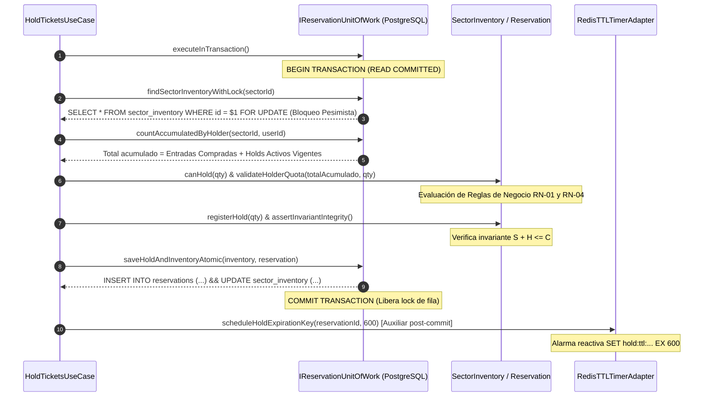

# Modelo C4 — Nivel 4: Diagrama de Código de API Core (C4)

**Sistema**: Plataforma de Descubrimiento, Venta y Validación de Entradas para Eventos y Conciertos en Vivo  
**Contenedor**: `API Core Backend` (Monolito Modular)  
**Componente Analizado**: `Módulo Reservas e Inventario`  
**Documento**: `docs/04-modelo-c4/04-diagrama-codigo-c4.md`  
**Versión**: `1.1.0` | **Fecha**: `2026-10-21`  
**Referencia Metodológica**: C4 Model (Simon Brown) & Guía 04 de Arquitectura de Software  
**Alineación Arquitectónica**: Conforme a la [Constitution](../../.specify/memory/constitution.md), el [Capítulo 01](../01-analisis-de-sistema/) y los [ADRs 001 al 006](../02-arquitectura-software/03-adrs/)  
**Estado de Implementación**: **`[DISEÑO DE CÓDIGO PROPUESTO — NO IMPLEMENTADO]`**

---

## 1. Propósito y Alcance del Diagrama C4

El **Diagrama de Código (C4)** constituye el máximo nivel de detalle del modelo C4. Desciende al diseño estructural orientado a objetos de un componente crítico dentro de [API Core Backend](03-diagrama-componentes-c3.md): el **Módulo de Reservas e Inventario**.

Este componente ha sido seleccionado como representativo de todo el backend debido a que concentra la mayor tensión arquitectónica del sistema:
- Gestión de alta concurrencia en aperturas de venta (*spikes* masivos de demanda).
- Prevención absoluta de sobreventa (*zero overselling*).
- Aplicación de invariantes de negocio estrictos (aforo nominal, cuotas por comprador y temporización determinista).
- Desacoplamiento hexagonal estricto entre dominio, casos de uso, unidad de trabajo transaccional y adaptadores de infraestructura.

> [!IMPORTANT]
> **Declaración de Realidad Técnica del Repositorio**:
> Este documento representa un **diseño de código propuesto y formalizado**. El backend todavía no está implementado en el repositorio (el frontend AFORO Web opera actualmente con datos y flujos simulados en cliente). No se han generado archivos TypeScript ni clases en `src/` para evitar deuda técnica o código huérfano antes del desarrollo planificado del backend.

---

## 2. Diagrama Estructural de Clases e Interfaces (Mermaid)

El siguiente diagrama modela la estructura de clases, interfaces, tipos de datos, visibilidad y relaciones en el **Módulo de Reservas e Inventario** siguiendo los principios de la **Arquitectura Hexagonal (Puertos y Adaptadores)**:

```mermaid
classDiagram
    direction TB

    %% Enums y Value Objects
    class ReservationStatus {
        <<enumeration>>
        PENDING_PAYMENT
        CONFIRMED
        EXPIRED
        CANCELLED
    }

    class HoldTicketsCommand {
        +string eventId
        +string sectorId
        +string userId
        +number quantity
        +string idempotencyKey
    }

    class HoldTicketsResult {
        +boolean success
        +string reservationId
        +Date expiresAt
        +number reservedQuantity
        +string errorCode
        +string errorMessage
    }

    class ReservationDTO {
        +string reservationId
        +string eventId
        +string sectorId
        +string userId
        +number quantity
        +ReservationStatus status
        +Date expiresAt
        +number remainingSeconds
    }

    %% Fachada Pública Inter-Módulo (Inbound Port)
    class IReservationsModuleFacade {
        <<interface>>
        +getReservationStatus(reservationId: string) ReservationDTO
        +confirmReservationSold(reservationId: string) boolean
        +cancelHoldManually(reservationId: string, reason: string) boolean
    }

    %% Implementación de Fachada Inter-Módulo (Capa de Aplicación)
    class ReservationsModuleFacadeImpl {
        -IReservationUnitOfWork unitOfWork
        -ITimerNotifier timerNotifier
        +getReservationStatus(reservationId: string) ReservationDTO
        +confirmReservationSold(reservationId: string) boolean
        +cancelHoldManually(reservationId: string, reason: string) boolean
    }

    %% Adaptador Primario HTTP / REST (Inbound Adapter)
    class ReservationsController {
        -HoldTicketsUseCase holdTicketsUseCase
        -ReleaseExpiredHoldsUseCase releaseExpiredHoldsUseCase
        +createHold(request: HoldTicketsCommand) HttpResponse
        +releaseExpired() HttpResponse
    }

    %% Casos de Uso (Núcleo de Aplicación)
    class HoldTicketsUseCase {
        -IReservationUnitOfWork unitOfWork
        -ITimerNotifier timerNotifier
        +execute(command: HoldTicketsCommand) HoldTicketsResult
    }

    class ReleaseExpiredHoldsUseCase {
        -IReservationUnitOfWork unitOfWork
        +execute() number
    }

    %% Entidades y Agregados del Dominio (Core Hexagonal)
    class SectorInventory {
        -string sectorId
        -string eventId
        -number capacity
        -number soldCount
        -number activeHoldsCount
        +getAvailableCapacity() number
        +canHold(quantity: number) boolean
        +validateHolderQuota(currentAccumulatedTickets: number, requestedQuantity: number) boolean
        +registerHold(quantity: number) void
        +releaseHold(quantity: number) void
        +confirmSale(quantity: number) void
        +assertInvariantIntegrity() void
    }

    class Reservation {
        -string id
        -string eventId
        -string sectorId
        -string userId
        -number quantity
        -ReservationStatus status
        -Date createdAt
        -Date expiresAt
        +isExpired(referenceDate: Date) boolean
        +markConfirmed() void
        +markExpired() void
        +markCancelled() void
        +getRemainingTtlSeconds(referenceDate: Date) number
    }

    %% Puerto de Unidad de Trabajo Transaccional (Outbound Port)
    class IReservationUnitOfWork {
        <<interface>>
        +findSectorInventoryWithLock(sectorId: string) SectorInventory
        +countAccumulatedByHolder(sectorId: string, userId: string, excludeReservationId: string) number
        +saveHoldAndInventoryAtomic(inventory: SectorInventory, reservation: Reservation) void
        +findExpiredReservationsForUpdate(referenceDate: Date, limit: number) Reservation[]
        +transitionHoldConditionally(reservationId: string, fromStatus: ReservationStatus, toStatus: ReservationStatus) boolean
        +executeInTransaction(work: Function) Object
    }

    %% Puerto de Notificaciones Temporizadas (Outbound Port)
    class ITimerNotifier {
        <<interface>>
        +scheduleHoldExpirationKey(reservationId: string, ttlSeconds: number) void
        +cancelHoldExpirationKey(reservationId: string) void
    }

    %% Adaptadores Secundarios (Outbound Adapters)
    class PostgreSQLReservationAdapter {
        -DatabasePool dbConnectionPool
        +findSectorInventoryWithLock(sectorId: string) SectorInventory
        +countAccumulatedByHolder(sectorId: string, userId: string, excludeReservationId: string) number
        +saveHoldAndInventoryAtomic(inventory: SectorInventory, reservation: Reservation) void
        +findExpiredReservationsForUpdate(referenceDate: Date, limit: number) Reservation[]
        +transitionHoldConditionally(reservationId: string, fromStatus: ReservationStatus, toStatus: ReservationStatus) boolean
        +executeInTransaction(work: Function) Object
    }

    class RedisTTLTimerAdapter {
        -RedisClient redisClient
        +scheduleHoldExpirationKey(reservationId: string, ttlSeconds: number) void
        +cancelHoldExpirationKey(reservationId: string) void
    }

    %% Relaciones de Dependencia y Realización
    ReservationsController ..> HoldTicketsUseCase : orquesta
    ReservationsController ..> ReleaseExpiredHoldsUseCase : invoca barrido
    
    ReservationsModuleFacadeImpl ..|> IReservationsModuleFacade : implementa en memoria
    ReservationsModuleFacadeImpl --> IReservationUnitOfWork : transacciona en DB
    ReservationsModuleFacadeImpl --> ITimerNotifier : cancela alarmas

    HoldTicketsUseCase --> IReservationUnitOfWork : delimita transacción atómica
    HoldTicketsUseCase --> ITimerNotifier : programa alarma post-commit
    HoldTicketsUseCase ..> SectorInventory : valida reglas de dominio
    HoldTicketsUseCase ..> Reservation : instancia y transiciona
    HoldTicketsUseCase ..> HoldTicketsCommand : recibe entrada
    HoldTicketsUseCase ..> HoldTicketsResult : retorna resultado

    ReleaseExpiredHoldsUseCase --> IReservationUnitOfWork : consulta y libera condicionalmente

    PostgreSQLReservationAdapter ..|> IReservationUnitOfWork : implementa en PostgreSQL
    RedisTTLTimerAdapter ..|> ITimerNotifier : implementa en Redis

    PostgreSQLReservationAdapter ..> SectorInventory : bloquea fila y actualiza
    PostgreSQLReservationAdapter ..> Reservation : persiste y transiciona
    Reservation --> ReservationStatus : posee estado
```



---

## 3. Catálogo de Responsabilidades de Clases e Interfaces

### 3.1. Puertos de Entrada y Fachadas Públicas

#### `IReservationsModuleFacade` (Puerto Inbound / Fachada Inter-Módulo)
- **Tipo**: Puerto Inbound / Contrato de Integración Modular en Memoria.
- **Responsabilidad**: Expone de manera desacoplada las capacidades del módulo hacia otros módulos del monolito (especialmente el [Módulo Pagos & Facturación](03-diagrama-componentes-c3.md) y el [Módulo Tickets & Emisión](03-diagrama-componentes-c3.md)).
- **Aislamiento**: No es consumido vía HTTP; se ejecuta mediante inyección de dependencias dentro del mismo proceso Node.js.

#### `ReservationsModuleFacadeImpl` (Implementación de Fachada Inter-Módulo)
- **Tipo**: Servicio de Aplicación de Fachada.
- **Responsabilidad**: Implementa `IReservationsModuleFacade` orquestando las llamadas internas a `IReservationUnitOfWork`. Es un componente **independiente del controlador HTTP** (`ReservationsController`), asegurando que los módulos de Pagos o Taquilla interactúen sin intermediación ni sobrecarga de capas web.

#### `ReservationsController` (Adaptador Primario HTTP / REST)
- **Tipo**: Adaptador Inbound (Entrada de Control Web).
- **Responsabilidad**: Atiende exclusivamente solicitudes HTTP externas (AFORO Web / API Gateway), autentica la identidad del usuario, valida esquemas de entrada (formato UUID, valores enteros) y delega la ejecución al caso de uso correspondiente (`HoldTicketsUseCase`). Transforma las respuestas y errores de dominio en códigos HTTP semánticos (`201 Created`, `409 Conflict`, `422 Unprocessable Entity`).

---

### 3.2. Capa de Aplicación (Casos de Uso)

#### `HoldTicketsUseCase` (Caso de Uso de Retención Temporal)
- **Tipo**: Servicio de Aplicación / Caso de Uso Central.
- **Responsabilidad**: Orquestar el flujo integral de retención preventiva en una **única delimitación transaccional**:
  1. Invoca `unitOfWork.executeInTransaction()`, garantizando que todo el ciclo ocurra dentro de una única transacción en PostgreSQL bajo nivel de aislamiento `READ COMMITTED`.
  2. Adquiere el bloqueo pesimista exclusivo de la fila del sector mediante `findSectorInventoryWithLock(sectorId)` (`SELECT ... FOR UPDATE`).
  3. Consulta las entradas previamente acumuladas por el titular en dicho sector mediante `countAccumulatedByHolder()`.
  4. Ejecuta las validaciones de invariantes en el aggregate `SectorInventory`:
     - Verificación de aforo disponible con `canHold(quantity)`.
     - Verificación de tope estricto de 4 entradas con `validateHolderQuota()`.
     - Registro del incremento de retenciones temporales con `registerHold(quantity)` y comprobación de la regla $S + H \le C$ (`assertInvariantIntegrity()`).
  5. Instancia la entidad `Reservation` con temporización determinista de 600 segundos (10 minutos) en estado `PENDING_PAYMENT`.
  6. Persiste atómicamente la reserva y la actualización de los contadores del inventario en PostgreSQL mediante `saveHoldAndInventoryAtomic()`.
  7. Si la transacción hace `COMMIT` satisfactorio, programa asíncronamente la clave auxiliar en Redis mediante `timerNotifier.scheduleHoldExpirationKey()` como mecanismo de alarma secundaria. Si ocurre cualquier excepción de dominio o base de datos, la transacción hace `ROLLBACK` total.

#### `ReleaseExpiredHoldsUseCase` (Caso de Uso de Liberación de Reservas Vencidas)
- **Tipo**: Servicio de Aplicación / Caso de Uso de Mantenimiento.
- **Responsabilidad**: Reincorporar la capacidad al sector cuando una reserva vence sin haberse confirmado el pago, ejecutando transiciones condicionales protegidas para evitar conflictos con confirmaciones tardías.

---

### 3.3. Capa de Dominio (Entidades y Agregados)

#### `SectorInventory` (Agregado / Entidad Raíz de Inventario)
- **Tipo**: Domain Entity / Aggregate Root.
- **Responsabilidad**: Salvaguardar la consistencia matemática y física del aforo de un sector.
- **Atributos**:
  - `capacity`: Capacidad nominal física máxima autorizada para el sector.
  - `soldCount`: Entradas efectivamente pagadas y emitidas ($S$).
  - `activeHoldsCount`: Entradas actualmente retenidas en proceso de compra vigente ($H$, donde $TTL \le 600\text{ s}$).
- **Métodos e Invariantes**:
  - `getAvailableCapacity()`: Retorna $C - (S + H)$.
  - `canHold(quantity)`: Evalúa si $\text{AvailableCapacity} \ge \text{quantity}$.
  - `validateHolderQuota(currentAccumulatedTickets, requestedQuantity)`: Verifica que $\text{currentAccumulatedTickets} + \text{requestedQuantity} \le 4$.
  - `registerHold(quantity)`: Incrementa `activeHoldsCount` y ejecuta `assertInvariantIntegrity()`.
  - `releaseHold(quantity)`: Decrementa `activeHoldsCount` salvaguardando que no tome valores negativos.
  - `confirmSale(quantity)`: Transiciona la retención a venta definitiva ($H \leftarrow H - \text{quantity}$, $S \leftarrow S + \text{quantity}$) en un único paso sin alterar el aforo disponible.
  - `assertInvariantIntegrity()`: Lanza `InvariantViolationException` si $S + H > C$.

#### `Reservation` (Entidad de Reserva)
- **Tipo**: Domain Entity.
- **Responsabilidad**: Representar el contrato de exclusividad temporal de compra otorgado a un usuario específico.
- **Atributos**:
  - `id`: Identificador único de la reserva (UUIDv4).
  - `status`: Estado del ciclo de vida (`PENDING_PAYMENT`, `CONFIRMED`, `EXPIRED`, `CANCELLED`).
  - `createdAt`: Marca temporal de inicio de la reserva.
  - `expiresAt`: Marca temporal de expiración determinista ($createdAt + 600\text{ s}$).
- **Métodos de Ciclo de Vida**:
  - `isExpired(referenceDate)`: Evalúa si `referenceDate > expiresAt`.
  - `markConfirmed()`: Transiciona a `CONFIRMED` tras confirmación de pago.
  - `markExpired()`: Transiciona a `EXPIRED` si el tiempo expira sin pago.
  - `markCancelled()`: Transiciona a `CANCELLED` ante cancelación manual.

---

### 3.4. Puertos y Adaptadores de Salida (Infraestructura)

#### `IReservationUnitOfWork` (Puerto Outbound de Unidad de Trabajo Transaccional)
- **Tipo**: Puerto Secundario (Contrato Transaccional).
- **Responsabilidad**: Define el contrato unificado para operaciones atómicas de reserva e inventario, asegurando que la consulta bajo bloqueo, la validación de cuotas, el alta de reserva y el descuento de capacidad se ejecuten dentro de **un único contexto transaccional indivisible**.

#### `PostgreSQLReservationAdapter` (Adaptador Outbound Relacional)
- **Tipo**: Adaptador Secundario (Implementación de Persistencia en PostgreSQL).
- **Responsabilidad**: Implementa `IReservationUnitOfWork` ejecutando sentencias SQL transaccionales:
  - Inicia la transacción y ejecuta `SELECT ... FROM sector_inventory WHERE id = $1 FOR UPDATE`.
  - Computa la cuota del titular sumando entradas compradas y reservas activas vigentes.
  - Inserta el registro en `reservations` y actualiza los contadores en `sector_inventory`.
  - Resuelve transiciones condicionales atómicas con cláusula `WHERE status = 'PENDING_PAYMENT' RETURNING *`.

#### `ITimerNotifier` (Puerto Outbound de Temporización)
- **Tipo**: Puerto Secundario (Interfaz de Alarmas Volátiles).
- **Responsabilidad**: Define el contrato para programar y cancelar alarmas temporizadas auxiliares asociadas a la vigencia de la reserva.

#### `RedisTTLTimerAdapter` (Adaptador Outbound Auxiliar de Temporización)
- **Tipo**: Adaptador Secundario (Implementación en Redis).
- **Responsabilidad**: Almacena claves temporizadas con tiempo de vida volátil: `SET hold:ttl:{reservationId} "active" EX 600`. Aprovecha los eventos *Keyspace Notifications* (`expired`) para emitir una señal reactiva que alerte al módulo para su liberación inmediata.

---

## 4. Reglas de Negocio y Delimitación Transaccional

### 4.1. Delimitación de Transacción Única en PostgreSQL

Para garantizar consistencia estricta y eliminar cualquier condición de carrera (*race condition*), el diseño establece que **todas las operaciones de reserva ocurren dentro de una misma transacción PostgreSQL**:



> [!CAUTION]
> **El bloqueo pesimista no sustituye la validación de los invariantes de negocio.**  
> `SELECT ... FOR UPDATE` serializa el acceso concurrente a la fila del sector para evitar lecturas sucias y anomalías fantasma. Una vez adquirido el bloqueo de fila, el caso de uso valida explícitamente en el dominio la disponibilidad ($C - (S + H) \ge \text{qty}$) y la cuota del titular ($T_{\text{acumulado}} + \text{qty} \le 4$). Si la regla no se satisface, se dispara de inmediato un `ROLLBACK`, preservando la integridad del inventario.

---

### 4.2. Límite de Cuatro Entradas y Prevención de Doble Conteo (RN-04)

Para cumplir rigurosamente con la política antirrevendedores ([RN-04](../01-analisis-de-sistema/03-reglas-de-negocio.md#rn-04-límite-de-compra-por-usuario-y-política-antirrevendores)), el sistema calcula la cuota acumulada del titular considerando dos fuentes en base de datos:

$$\text{CuotaAcumulada} = \text{EntradasCompradas (CONFIRMED/ACTIVE)} + \sum_{\text{otras reservas}} \text{Cantidad (PENDING\_PAYMENT con expires\_at} > \text{NOW())}$$

- **Al crear una nueva reserva**: Se evalúa que $\text{CuotaAcumulada} + \text{CantidadSolicitada} \le 4$.
- **Al transicionar de reserva a compra confirmada**:  
  El método `confirmSale(quantity)` convierte directamente las entradas retenidas en vendidas ($H \leftarrow H - \text{quantity}$, $S \leftarrow S + \text{quantity}$) y marca la reserva como `CONFIRMED`. **No existe doble conteo**, pues las entradas de la reserva que se confirma dejan de contarse como reserva pendiente y pasan a ser entradas compradas en la misma operación atómica.

---

### 4.3. Resolución de Conflictos Concurrentes: Pago vs. Expiración

Un riesgo arquitectónico crítico ocurre cuando un usuario completa el pago en la pasarela externa en el instante límite de los 10 minutos (segundo 599–601), al mismo tiempo que el worker de expiración intenta liberar las entradas.

Para evitar inconsistencias, **PostgreSQL es la única autoridad de vigencia efectiva** mediante **actualizaciones condicionales atómicas**:

#### Caso A: El Pago se Confirma Antes de la Liberación
1. El [Módulo Pagos](03-diagrama-componentes-c3.md) invoca `confirmReservationSold(reservationId)` a través de `ReservationsModuleFacadeImpl`.
2. Se ejecuta la sentencia transaccional condicional:
   ```sql
   UPDATE reservations 
   SET status = 'CONFIRMED', updated_at = NOW() 
   WHERE id = $1 
     AND status = 'PENDING_PAYMENT' 
     AND expires_at > NOW() 
   RETURNING *;
   ```
3. La consulta actualiza 1 fila satisfactoriamente. Se confirma la venta en `sector_inventory` ($H \leftarrow H - Q, S \leftarrow S + Q$) y se cancela la alarma en Redis (`cancelHoldExpirationKey`).
4. Si el worker de expiración se ejecuta milisegundos después, intentará actualizar la reserva con `WHERE status = 'PENDING_PAYMENT'`; al encontrar 0 filas afectadas, aborta la liberación sin alterar el inventario.

#### Caso B: El Worker de Expiración Libera Antes de la Confirmación
1. El worker de expiración ejecuta la transición condicional atómica:
   ```sql
   UPDATE reservations 
   SET status = 'EXPIRED', updated_at = NOW() 
   WHERE id = $1 
     AND status = 'PENDING_PAYMENT' 
     AND expires_at <= NOW() 
   RETURNING *;
   ```
2. La consulta actualiza 1 fila satisfactoriamente. El worker restituye la capacidad disponible en `sector_inventory` ($H \leftarrow H - Q$).
3. Si el webhook de pago llega con retraso y pretende confirmar la compra, su `UPDATE` condicional retornará 0 filas afectadas (`status` ya no es `PENDING_PAYMENT`).
4. El sistema detecta el conflicto de expiración, rechaza la emisión de tickets y desencadena automáticamente la reversión o reembolso del cobro al comprador a través del Módulo de Pagos.

---

## 5. Matriz de Trazabilidad Arquitectónica del Módulo

Alineación formal con los identificadores exactos del [Catálogo de Requisitos Funcionales](../01-analisis-de-sistema/01-requisitos-funcionales.md), los [Requisitos No Funcionales](../01-analisis-de-sistema/02-requisitos-no-funcionales.md), las [Reglas de Negocio](../01-analisis-de-sistema/03-reglas-de-negocio.md) y los [ADRs](../02-arquitectura-software/03-adrs/):

| Código Exacto | Nombre / Tipo de Requisito | Elemento de Diseño en C4 que lo Satisface |
| :--- | :--- | :--- |
| **RF-WEB-06** | Interacción Espacial de Sectores | `SectorInventory.getAvailableCapacity()` (expuesto vía DTO) |
| **RF-WEB-08** | Selección Visual y Topes por Sector | `SectorInventory.validateHolderQuota()` (tope de 4 entradas) |
| **RF-WEB-12** | Solicitud Formal de Reserva Temporal | `ReservationsController.createHold()`, `HoldTicketsUseCase` |
| **RF-COR-01** | Consulta Pública de Disponibilidad | `IReservationsModuleFacade.getReservationStatus()` |
| **RF-COR-02** | Bloqueo Transaccional con TTL (10 min) | `IReservationUnitOfWork`, `PostgreSQLReservationAdapter` (`SELECT FOR UPDATE`) |
| **RF-COR-03** | Liberación Automática de Reservas Vencidas | `ReleaseExpiredHoldsUseCase`, `RedisTTLTimerAdapter` |
| **RF-COR-04** | Recepción Idempotente de Cobros | Integración vía `ReservationsModuleFacadeImpl.confirmReservationSold()` |
| **RN-01** | Conservación Estricta del Aforo | `SectorInventory.assertInvariantIntegrity()` ($S + H \le C$) |
| **RN-03** | Temporalidad de la Reserva (600 s) | `Reservation.expiresAt`, `Reservation.getRemainingTtlSeconds()` |
| **RN-04** | Límite Máximo de 4 Entradas por Comprador | `countAccumulatedByHolder()` + `SectorInventory.validateHolderQuota()` |
| **EAC-01** | Concurrencia Masiva en Preventas | Serialización en PostgreSQL con `READ COMMITTED` + `FOR UPDATE` |
| **EAC-02** | Prevención Absoluta de Sobreventa | Transacción atómica única indivisible (`IReservationUnitOfWork`) |
| **ADR-001** | Selección del Estilo Monolito Modular | `IReservationsModuleFacade` consumible en memoria sin llamadas HTTP |
| **ADR-002** | Adopción de Arquitectura Hexagonal | Puertos (`IReservationUnitOfWork`, `ITimerNotifier`) y adaptadores aislados |
| **ADR-003** | Concurrencia e Integridad de Inventario | `PostgreSQLReservationAdapter` como autoridad exclusiva de persistencia |

---

## 6. Distinción entre Diseño Propuesto y Realidad Técnica del Proyecto

Para mantener absoluta honestidad técnica y académica en las entregas del proyecto AFORO:

1. **Estado del Frontend (AFORO Web SPA)**:  
   Implementado funcionalmente en el directorio [`src/`](file:///g:/2026%20400%20Par/Arquitectura%20de%20Software/AFORO-TF/AFORO-Fusion/src/) mediante React 19, TypeScript, Tailwind CSS y Zustand. Cuenta con 30 pruebas unitarias y de integración que verifican la interfaz de usuario, renderizado de mapas SVG, filtros y navegación de catálogo. En la entrega actual, la experiencia de reserva y compra opera como una **demostración interactiva en cliente (*client-side demo*)** que simula tiempos de espera y temporizadores de 10 minutos en memoria del navegador.

2. **Estado del Backend (API Core)**:  
   El backend se encuentra formalizado en sus cuatro niveles de abstracción arquitectónica (C1 Contexto, C2 Contenedores, C3 Componentes y C4 Código). No existen clases de backend, repositorios SQL ni conexiones a bases de datos implementadas en el código fuente actual. La implementación física del backend se llevará a cabo en las fases de desarrollo correspondientes a las entregas de construcción de la Guía de Arquitectura de Software.
