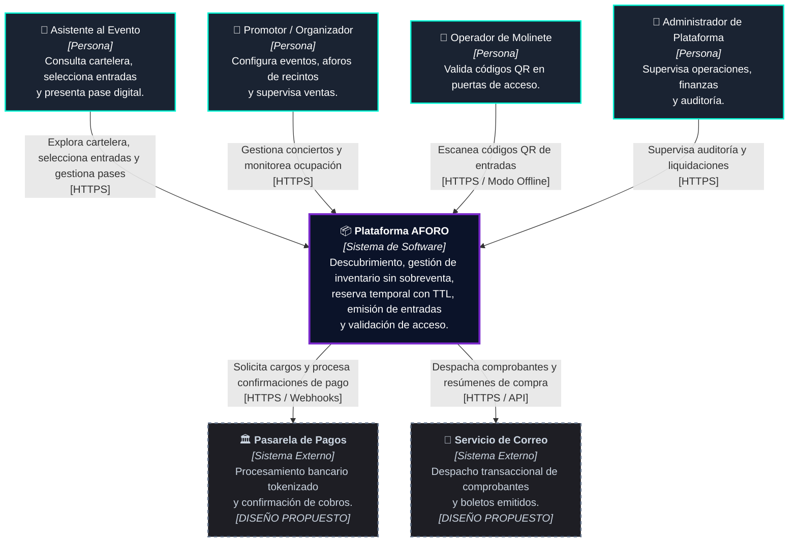

# Modelo C4 — Nivel 1: Diagrama de Contexto del Sistema (C1)

**Sistema**: Plataforma de Descubrimiento, Venta y Validación de Entradas para Eventos y Conciertos en Vivo  
**Documento**: `docs/04-modelo-c4/Nivel1-DiagramadeContextodelSistema.md`  
**Versión**: `1.1.0` | **Fecha**: `2026-10-21`  
**Referencia Metodológica**: C4 Model (Simon Brown) & Guía 04 de Arquitectura de Software  
**Alineación Arquitectónica**: Conforme a la [Constitution](../../.specify/memory/constitution.md), el [Capítulo 01](../01-analisis-de-sistema/) y los [ADRs 001 al 006](../01-analisis-de-sistema/07-decisiones-arquitectonicas.md)

---

## 1. Propósito y Alcance del Diagrama C1

El **Diagrama de Contexto del Sistema (C1)** presenta la vista de más alto nivel de AFORO, mostrando el sistema como una unidad central en su entorno operacional, los actores humanos que lo utilizan y los sistemas externos con los que se comunica.

### Criterio de Honestidad Técnica (Principio IV de la Constitution)
- **`[IMPLEMENTADO EN WEB]`**: Aplicación web accesible al usuario con cartelera editorial, búsqueda instantánea, navegación segura en nueva pestaña, selección visual no bloqueante y mapa interactivo propio desarrollado en SVG nativo (`VenueStageMap.tsx`), sin dependencias de servicios cartográficos externos.
- **`[PROCESO DE COMPRA DEMO]`**: Proceso interactivo de checkout simulado localmente en el navegador, con emisión de pases en estado `ACTIVA_DEMO` y persistencia en almacenamiento local (`localStorage`).
- **`[DISEÑO PROPUESTO]`**: Servicios centrales de backend (`API Core`), aplicaciones para organizadores (`AFORO Studio`) y operadores de puerta (`AFORO Access`), e integraciones reales con pasarelas de pago y mensajería transaccional.

---

## 2. Diagrama de Contexto del Sistema (Mermaid)

---

## 3. Descripción Detallada de Elementos

### 3.1 Actores y Usuarios del Ecosistema

| Actor | Rol en el Negocio | Interacciones Principales con el Sistema | Realidad Técnica Actual |
| :--- | :--- | :--- | :--- |
| **Asistente al Evento (Fan)** | Comprador de boletos y espectador. | - Consulta catálogo y cartelera de conciertos. - Explora sectores en el mapa interactivo propio en SVG (`VenueStageMap.tsx`). - Agrega entradas al carrito sin bloquear inventario de servidor (`RN-02`). - Visualiza su entrada en la billetera local de demostración. | **`[IMPLEMENTADO EN WEB]`** *(Flujo de pago opera en `[PROCESO DEMO]`)* |
| **Promotor / Organizador** | Productor del evento. | - Define conciertos, fechas y recintos. - Configura capacidades máximas por sector y etapas de venta. - Monitorea la recaudación y ventas en vivo. | **`[DISEÑO PROPUESTO]`** *(Previsto para AFORO Studio)* |
| **Operador de Molinete (Puerta)** | Personal de control de accesos. | - Escanea ópticamente códigos QR en molinetes. - Valida autenticidad y previene reutilización local en puerta. - Opera en modo conectado o desconectado de red. | **`[DISEÑO PROPUESTO]`** *(Previsto para AFORO Access)* |
| **Administrador de Plataforma** | Operaciones y finanzas de AFORO. | - Supervisa consistencia contable y auditoría de eventos. - Gestiona conciliación de órdenes y resolución de contingencias. | **`[DISEÑO PROPUESTO]`** |

---

### 3.2 Límite del Sistema: Plataforma AFORO

El sistema central engloba las capacidades necesarias para el ciclo de vida de los espectáculos masivos:
1. **Frontend Web Público ([`src/App.tsx`](../../src/App.tsx))**: Implementado en React 18 con diseño fluido al 100 % de zoom (`RNF-US-01`), navegación en nueva pestaña segura (`target="_blank" rel="noopener noreferrer"`) y mapa interactivo propio desarrollado en SVG nativo sin servicios de mapas de terceros.
2. **Proceso de Compra Simulado (Modo DEMO)**: El asistente completa la selección y emite boletos de prueba (`ACTIVA_DEMO`) en su navegador para validar la experiencia visual sin persistencia en servidor ni transacción financiera real.
3. **Servicios Centrales Propuestos**: Monolito modular con aislamiento transaccional para aforo estricto (`RN-01`, `ADR-001`), reservas con TTL de 10 minutos (`RN-03`, `ADR-003`), cobros idempotentes (`RN-05`, `ADR-004`) y emisión criptográfica con firma asimétrica Ed25519 (`ADR-005`).

---

### 3.3 Sistemas Externos Integrados

| Sistema Externo | Tipo de Integración | Responsabilidad Técnica | Estado de Realidad |
| :--- | :--- | :--- | :--- |
| **Pasarela de Pagos** (ej. Culqi, Niubiz o Stripe) | HTTPS / REST / Webhooks | Procesamiento financiero mediante formularios seguros tokenizados (PCI-DSS SAQ A). Cada pasarela emplea sus propios mecanismos de verificación (como firmas HMAC en cabeceras o tokens de evento), integrados mediante adaptadores específicos (`ADR-004`). | `[DISEÑO PROPUESTO]` *(Checkout actual opera en modo DEMO local)* |
| **Servicio de Correo** (ej. SendGrid o AWS SES) | HTTPS / REST / API | Despacho asíncrono de confirmaciones de compra, comprobantes y enlaces de acceso a la billetera digital tras la confirmación de pago. | `[DISEÑO PROPUESTO]` |

> *Aclaración sobre Servicios Cartográficos*: AFORO Web **no requiere ni utiliza servicios cartográficos de terceros** (como OpenStreetMap, Google Maps o Leaflet). La representación visual de los recintos y distribución de sectores se realiza mediante un componente interactivo vectorial en SVG desarrollado internamente ([`VenueStageMap.tsx`](../../src/components/VenueStageMap.tsx)), eliminando dependencias externas de red para la visualización espacial.

---

## 4. Trazabilidad con Decisiones Arquitectónicas (ADRs)

- **ADR-001 (Monolito Modular)**: Delimita la plataforma como un sistema unificado con fronteras explícitas hacia usuarios y proveedores externos.
- **ADR-004 (Idempotencia de Pagos)**: Establece el contrato de comunicación con la pasarela de pagos externa para evitar cobros dobles ante reintentos de red.
- **ADR-005 (Criptografía QR Ed25519)**: Modela el intercambio de credenciales y verificación de boletos entre el emisor central y los operadores de acceso.
