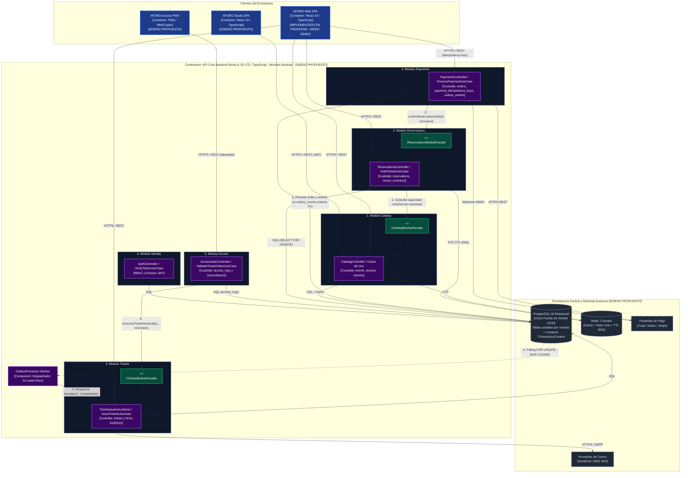

# Modelo C4 — Nivel 3: Diagrama de Componentes de API Core (C3)

**Sistema**: Plataforma de Descubrimiento, Venta y Validación de Entradas para Eventos y Conciertos en Vivo  
**Contenedor Analizado**: `API Core Backend` (Monolito Modular)  
**Documento**: `docs/04-modelo-c4/Nivel3-Diagrama-de-Componentes.md`  
**Versión**: `1.1.0` | **Fecha**: `2026-10-21`  
**Referencia Metodológica**: C4 Model (Simon Brown) & Guía 04 de Arquitectura de Software  
**Alineación Arquitectónica**: Conforme a la [Constitution](../../.specify/memory/constitution.md), el [Capítulo 01](../01-analisis-de-sistema/) y los [ADRs 001 al 006](../01-analisis-de-sistema/07-decisiones-arquitectonicas.md)

---

## 1. Propósito y Alcance del Diagrama C3

El **Diagrama de Componentes (C3)** realiza un *zoom-in* sobre el contenedor central **API Core Backend**, ilustrado en el [Diagrama C2](Nivel2-DiagramadeContenedores.md). Muestra la organización interna del proceso monolítico en sus seis módulos de dominio cohesivos, detallando el flujo estricto de **Arquitectura Hexagonal (Casos de Uso $\rightarrow$ Puertos de Salida $\rightarrow$ Adaptadores $\rightarrow$ Infraestructura)**, los contratos de fachada inter-módulo, el procesamiento recuperable mediante **Transactional Outbox** y la emisión criptográfica asimétrica.

### Principios Arquitectónicos Fundamentales
1. **Monolito Modular (ADR-001)**: Los seis módulos coexisten dentro de un **único artefacto ejecutable** en Node.js/TypeScript. No existen llamadas de red inter-módulo ni microservicios.
2. **Flujo Hexagonal Estricto (ADR-002)**: Los casos de uso no se conectan directamente a bases de datos ni servicios externos; interactúan exclusivamente a través de **Puertos de Salida** (interfaces tipadas). Los adaptadores secundarios encapsulan el acceso a PostgreSQL, Redis y APIs externas.
3. **Fachadas Públicas Inter-Módulo**: Las fachadas representan contratos de servicio para comunicación entre módulos distintos, no pasos internos de sus propios casos de uso.
4. **Emisión de Tickets Resiliente con Transactional Outbox (ADR-003, ADR-004)**: El desacoplamiento entre el pago y la emisión de entradas no depende de un bus volátil en memoria. Se garantiza mediante persistencia atómica en la tabla `outbox_events` y un despachador recuperable que asegura la emisión idempotente ante reinicios del proceso.
5. **Transición Atómica de Acceso Online (ADR-005, ADR-006)**: La validación online en molinetes no realiza una simple consulta de estado, sino una mutación atómica condicional `ACTIVE → USED` en base de datos para prevenir ingresos concurrentes simultáneos.
6. **Estado de Realidad Técnica**: **`[DISEÑO PROPUESTO]`**. El backend se encuentra formalizado y especificado a nivel de diseño; no existe código backend implementado aún en el repositorio.

---

## 2. Diagramas de Componentes de API Core (Mermaid)

Para garantizar máxima legibilidad académica y evitar la saturación visual en un único lienzo, el Nivel 3 (C3) se estructura en dos vistas complementarias:
- **Vista 2.1 (`C3-A` — Topología Intermodular y Custodia de Datos)**: Muestra la interacción entre los seis módulos del monolito a través de fachadas públicas en memoria (`I*ModuleFacade`), el flujo asíncrono mediante `OutboxProcessor` y la custodia estricta de tablas por módulo en PostgreSQL.
- **Vista 2.2 (`C3-B` — Estructura Hexagonal Interna e Inversión de Dependencias)**: Detalla los componentes internos de cada módulo (controladores, casos de uso, implementaciones de fachada, puertos de salida y adaptadores secundarios) respetando la dirección de las flechas de realización (`..|>`) del Principio de Inversión de Dependencias (DIP).

### 2.1 Vista C3-A: Topología Intermodular, Fachadas en Memoria y Custodia de Datos



---

### 2.2 Vista C3-B: Estructura Hexagonal Interna por Módulo e Inversión de Dependencias (DIP)

> **Convención Arquitectónica de Flechas**:
> - `A --> B` indica dependencia funcional o invocación directa de `A` hacia `B`.
> - `Adapter -.->|"implementa (DIP)"| Port` indica **realización/implementación de interfaz (Principio de Inversión de Dependencias — DIP)**: el adaptador de infraestructura depende del puerto de aplicación, apuntando siempre hacia adentro del hexágono.

```mermaid
flowchart TD
    subgraph MOD_CAT["1. Modulo Catalog"]
        CTRL_CAT["CatalogController<br>[Inbound Adapter]"]
        UC_CAT["GetCatalogUseCase /<br>GetEventDetailUseCase"]
        FAC_CAT_IMPL["CatalogModuleFacadeImpl<br>[Application Service]"]
        FAC_CAT["<<Inbound Port>><br>ICatalogModuleFacade"]
        PORT_CAT_OUT["<<Outbound Port>><br>ICatalogRepository / ICatalogCache"]
        ADAPT_CAT_PG["PostgreSQLCatalogAdapter<br>[Outbound Adapter]"]
        ADAPT_CAT_RD["RedisCatalogCacheAdapter<br>[Outbound Adapter]"]

        CTRL_CAT --> UC_CAT
        FAC_CAT_IMPL -.->|"implementa (DIP)"| FAC_CAT
        FAC_CAT_IMPL --> PORT_CAT_OUT
        UC_CAT --> PORT_CAT_OUT
        ADAPT_CAT_PG -.->|"implementa (DIP)"| PORT_CAT_OUT
        ADAPT_CAT_RD -.->|"implementa (DIP)"| PORT_CAT_OUT
    end

    subgraph MOD_RES["2. Modulo Reservations"]
        CTRL_RES["ReservationsController<br>[Inbound Adapter]"]
        UC_RES["HoldTicketsUseCase /<br>ReleaseExpiredHoldsUseCase"]
        FAC_RES_IMPL["ReservationsModuleFacadeImpl<br>[Application Service]"]
        FAC_RES["<<Inbound Port>><br>IReservationsModuleFacade"]
        PORT_RES_OUT["<<Outbound Port>><br>IReservationUnitOfWork / ITimerNotifier"]
        ADAPT_RES_PG["PostgreSQLReservationAdapter<br>[Outbound Adapter]"]
        ADAPT_RES_RD["RedisTTLTimerAdapter<br>[Outbound Adapter]"]

        CTRL_RES --> UC_RES
        FAC_RES_IMPL -.->|"implementa (DIP)"| FAC_RES
        FAC_RES_IMPL --> PORT_RES_OUT
        UC_RES --> PORT_RES_OUT
        ADAPT_RES_PG -.->|"implementa (DIP)"| PORT_RES_OUT
        ADAPT_RES_RD -.->|"implementa (DIP)"| PORT_RES_OUT
    end

    subgraph MOD_PAY["3. Modulo Payments"]
        CTRL_PAY["PaymentsController /<br>WebhooksController"]
        UC_PAY["ProcessPaymentUseCase /<br>HandleGatewayWebhookUseCase"]
        PORT_PAY_OUT["<<Outbound Port>><br>IPaymentRepository / IPaymentGateway /<br>IOutboxRepository"]
        ADAPT_PAY_PG["PostgreSQLPaymentAdapter<br>[Outbound Adapter]"]
        ADAPT_PAY_GW["PaymentGatewayAdapters<br>[Outbound Adapter]"]

        CTRL_PAY --> UC_PAY
        UC_PAY --> PORT_PAY_OUT
        ADAPT_PAY_PG -.->|"implementa (DIP)"| PORT_PAY_OUT
        ADAPT_PAY_GW -.->|"implementa (DIP)"| PORT_PAY_OUT
    end

    subgraph MOD_TCK["4. Modulo Tickets"]
        SUB_TCK["TicketIssuanceListener /<br>TicketsController"]
        UC_TCK["IssueTicketsUseCase /<br>GetTicketDetailUseCase"]
        FAC_TCK_IMPL["TicketsModuleFacadeImpl<br>[Application Service]"]
        FAC_TCK["<<Inbound Port>><br>ITicketsModuleFacade"]
        PORT_TCK_OUT["<<Outbound Port>><br>ITicketRepository / ISignatureService /<br>INotificationService"]
        ADAPT_TCK_PG["PostgreSQLTicketAdapter<br>[Outbound Adapter]"]
        ADAPT_TCK_CRYPTO["Ed25519SignatureAdapter<br>[Outbound Adapter]"]
        ADAPT_TCK_MAIL["EmailNotificationAdapter<br>[Outbound Adapter]"]

        SUB_TCK --> UC_TCK
        FAC_TCK_IMPL -.->|"implementa (DIP)"| FAC_TCK
        FAC_TCK_IMPL --> PORT_TCK_OUT
        UC_TCK --> PORT_TCK_OUT
        ADAPT_TCK_PG -.->|"implementa (DIP)"| PORT_TCK_OUT
        ADAPT_TCK_CRYPTO -.->|"implementa (DIP)"| PORT_TCK_OUT
        ADAPT_TCK_MAIL -.->|"implementa (DIP)"| PORT_TCK_OUT
    end

    subgraph MOD_ACC["5. Modulo Access"]
        CTRL_ACC["AccessGateController<br>[Inbound Adapter]"]
        UC_ACC["ValidateTicketOnlineUseCase /<br>ReconcileGateLogsUseCase"]
        PORT_ACC_OUT["<<Outbound Port>><br>IAccessAuditRepository"]
        ADAPT_ACC_PG["PostgreSQLAccessAdapter<br>[Outbound Adapter]"]

        CTRL_ACC --> UC_ACC
        UC_ACC --> PORT_ACC_OUT
        ADAPT_ACC_PG -.->|"implementa (DIP)"| PORT_ACC_OUT
    end

    subgraph MOD_IDN["6. Modulo Identity"]
        CTRL_IDN["AuthController<br>[Inbound Adapter]"]
        UC_IDN["AuthenticateUserUseCase /<br>VerifyTokenUseCase"]
        PORT_IDN_OUT["<<Outbound Port>><br>IUserRepository / ITokenProvider"]
        ADAPT_IDN_PG["PostgreSQLUserAdapter<br>[Outbound Adapter]"]
        ADAPT_IDN_JWT["JwtTokenAdapter<br>[Outbound Adapter]"]

        CTRL_IDN --> UC_IDN
        UC_IDN --> PORT_IDN_OUT
        ADAPT_IDN_PG -.->|"implementa (DIP)"| PORT_IDN_OUT
        ADAPT_IDN_JWT -.->|"implementa (DIP)"| PORT_IDN_OUT
    end

    %% Invocaciones Intermodulares via Puertos Inbound (Fachadas)
    UC_RES -->|"getSectorCapacity()"| FAC_CAT
    UC_PAY -->|"confirmReservationSold(id, txContext)"| FAC_RES
    UC_ACC -->|"consumeTicketAtomically(..., txContext)"| FAC_TCK

    classDef inboundAdapter fill:#1e3a8a,stroke:#3b82f6,stroke-width:2px,color:#ffffff;
    classDef appLayer fill:#3b0764,stroke:#a855f7,stroke-width:2px,color:#ffffff;
    classDef domainPort fill:#064e3b,stroke:#10b981,stroke-width:2px,color:#ffffff;
    classDef outboundAdapter fill:#1f2937,stroke:#64748b,stroke-width:2px,color:#e2e8f0;

    class CTRL_CAT,CTRL_RES,CTRL_PAY,SUB_TCK,CTRL_ACC,CTRL_IDN inboundAdapter;
    class UC_CAT,UC_RES,UC_PAY,UC_TCK,UC_ACC,UC_IDN,FAC_CAT_IMPL,FAC_RES_IMPL,FAC_TCK_IMPL appLayer;
    class FAC_CAT,FAC_RES,FAC_TCK,PORT_CAT_OUT,PORT_RES_OUT,PORT_PAY_OUT,PORT_TCK_OUT,PORT_ACC_OUT,PORT_IDN_OUT domainPort;
    class ADAPT_CAT_PG,ADAPT_CAT_RD,ADAPT_RES_PG,ADAPT_RES_RD,ADAPT_PAY_PG,ADAPT_PAY_GW,ADAPT_TCK_PG,ADAPT_TCK_CRYPTO,ADAPT_TCK_MAIL,ADAPT_ACC_PG,ADAPT_IDN_PG,ADAPT_IDN_JWT outboundAdapter;
```



---

## 3. Especificación Arquitectónica y Flujos de Dominio

### 3.1 Flujo Hexagonal Estricto por Módulo
Cada módulo implementa de forma rigurosa la separación en tres planos concéntricos:
1. **Adaptadores de Entrada (Inbound)**: Controladores HTTP REST (`*Controller`) y suscriptores de eventos que reciben las peticiones de clientes o tareas programadas y las traducen a DTOs de comando para la capa de aplicación.
2. **Capa de Aplicación y Dominio Puro**: Casos de uso (`*UseCase`) y servicios de fachada (`*ModuleFacadeImpl`) que orquestan las políticas e invariantes de negocio. **No contienen imports de clientes de base de datos ni SDKs de pasarelas**. Toda dependencia externa se modela como un **Puerto de Salida (Outbound Port)** mediante una interfaz TypeScript pura.
3. **Adaptadores de Salida (Outbound)**: Implementaciones concretas de los puertos (`PostgreSQL*Adapter`, `Redis*Adapter`) que realizan las interfaces de salida (`..|>`) conforme al Principio de Inversión de Dependencias (DIP).

---

### 3.2 Fachadas Públicas de Comunicación Inter-Módulo y Contexto Transaccional (`ITransactionContext`)
En concordancia con el principio de aislamiento eferente (Principio I de la Constitution y [`ADR-001`](../complementos/adrs/ADR-001-seleccion-estilo-monolito-modular.md)):
- Las capas de dominio de los módulos **tienen terminantemente prohibido importar entidades, tablas o adaptadores de otros módulos**.
- Cuando un módulo requiere consultar o coordinar cambios de estado con otro módulo dentro de la misma operación atómica, consume exclusivamente una **Fachada Pública Tipada** pasando un token opaco `txContext?: ITransactionContext` gestionado por `PostgreSQLTransactionManager`:
  - `ICatalogModuleFacade`: Expuesta por `Catalog`; consumida por `HoldTicketsUseCase` (`Reservations`) para consultar metadatos de evento/sector sin acceder a las tablas de catálogo.
  - `IReservationsModuleFacade`: Expuesta por `Reservations`; consumida por `ProcessPaymentUseCase` y `HandleGatewayWebhookUseCase` (`Payments`) mediante `confirmReservationSold(reservationId, txContext): Promise<ReservationConfirmationStatus>`, ejecutando la transición de `reservations` y `sector_inventory` en la misma transacción SQL del pago.
  - `ITicketsModuleFacade`: Expuesta por `Tickets`; consumida por `ValidateTicketOnlineUseCase` (`Access`) mediante `consumeTicketAtomically(ticketId, gateId, operatorId, txContext)`, garantizando que solo el módulo `Tickets` ejecute `UPDATE` sobre la tabla `tickets`.

---

### 3.3 Procesamiento de Pagos, Pagos Tardíos y Emisión con Transactional Outbox
Para garantizar que jamás se cobre a un asistente sin emitir sus entradas ni se produzca sobreventa ante webhooks tardíos:
1. **Confirmación del Proveedor de Pagos**: La pasarela externa confirma el cobro (vía respuesta sincrónica tokenizada o webhook firmado).
2. **Coordinación Transaccional Atómica (`Payments` + `Reservations`)**: Dentro de una **única transacción PostgreSQL (`txContext`)** iniciada por `Payments`:
   - Invoca `reservationsFacade.confirmReservationSold(reservationId, txContext)`.
   - **Caso A (`CONFIRMED`)**: La reserva estaba en `PENDING_PAYMENT` con `expires_at > NOW()`. `Reservations` actualiza `reservations.status = 'CONFIRMED'` y transiciona `sector_inventory` (`active_holds_count - Q`, `sold_count + Q`). `Payments` registra la orden como `PAID`, marca `payment_idempotency_keys = 'SUCCEEDED'` e inserta el evento `PAYMENT_CONFIRMED` en `outbox_events`.
   - **Caso B (`EXPIRED` — Pago tardío tras vencimiento del hold)**: Si el hold ya había expirado y su aforo fue liberado, `confirmReservationSold` retorna `'EXPIRED'`. `Payments` **jamás fuerza la venta ni emite entradas**; en la misma transacción registra el pago con estado `REQUIRES_REFUND` e inserta en `outbox_events` el evento `PAYMENT_EXPIRED_REFUND_REQUIRED` para que el worker ejecute el extorno automático ante la pasarela.
3. **Procesamiento Recuperable (`OutboxProcessor`)**: Un worker en segundo plano dentro del mismo proceso del monolito extrae los eventos pendientes de `outbox_events` mediante `SELECT ... FOR UPDATE SKIP LOCKED`.
4. **Emisión Idempotente en `Tickets`**: Para eventos `PAYMENT_CONFIRMED`, el despachador invoca `TicketIssuanceListener` $\rightarrow$ `IssueTicketsUseCase`, el cual verifica la unicidad por `order_id`, genera las entradas con estado inicial `ISSUED` y las firma con `Ed25519SignatureAdapter`.
5. **Cierre del Outbox**: El evento en `outbox_events` transiciona a `PROCESSED`.

---

### 3.4 Control de Accesos: Transición Atómica `ISSUED → USED`, Idempotencia de Escaneo y Separación de Auditoría
Para prevenir el doble ingreso concurrente en molinetes online, respetar las fronteras modulares y tolerar pérdidas de respuesta HTTP en la red del recinto:
1. **Idempotencia por Intento de Escaneo (`attemptId`)**: Cada lectura en el molinete envía un `attemptId` (UUIDv4) único por intento físico. Dentro de una transacción `txContext` iniciada por `ValidateTicketOnlineUseCase` (`Access`), `PostgreSQLAccessAdapter` verifica primero si `attempt_id` ya existe en `access_logs`. Si existe (reintento automático de la PWA porque se perdió la respuesta HTTP tras un commit previo), retorna inmediatamente el resultado original (`GRANTED` o el motivo de rechazo) sin re-ejecutar el consumo del ticket.
2. **Consumo Atómico Delegado al Módulo `Tickets`**:
   Si el `attemptId` es nuevo, `ValidateTicketOnlineUseCase` invoca `ticketsFacade.consumeTicketAtomically(ticketId, gateId, operatorId, txContext)`. El adaptador `PostgreSQLTicketAdapter` (único propietario de la tabla `tickets`) ejecuta en la misma transacción `txContext`:
   ```sql
   UPDATE tickets 
   SET status = 'USED', 
       used_at = NOW(), 
       used_gate = :gateId, 
       used_operator = :operatorId
   WHERE id = :ticketId 
     AND status = 'ISSUED'
   RETURNING id, event_id, sector_id, holder_dni;
   ```
3. **Registro de Auditoría y Regla de Actuación Física del Molinete**:
   - **Éxito (`CONSUMED`)**: Si `UPDATE tickets` afecta 1 fila, `PostgreSQLAccessAdapter` inserta en `access_logs` el registro con `result = 'GRANTED'` y `attempt_id`, ejecuta `COMMIT` de la transacción `txContext` y retorna `HTTP 200 OK (GRANTED)`. **Regla física innegociable**: el relé del molinete solo se destraba tras recibir confirmación de `COMMIT` exitoso.
   - **Rechazo de Negocio (`ALREADY_USED`, `REVOKED`, `NOT_FOUND`)**: Si `UPDATE tickets` afecta 0 filas, `Tickets` consulta el estado actual del boleto en la misma transacción y lo devuelve a `Access`. `PostgreSQLAccessAdapter` inserta el intento fallido en `access_logs` (`DENIED_DUPLICATE` o `DENIED_INVALID`) y ejecuta **`COMMIT`** (para preservar la evidencia forense del intento de fraude), retornando `HTTP 409 Conflict` / `403 Forbidden`. El molinete permanece bloqueado y muestra la alerta roja con los metadatos del primer ingreso.
   - **Fallo Técnico de Infraestructura**: Si ocurre un error de base de datos o timeout antes del `COMMIT`, la transacción ejecuta `ROLLBACK` total (ni el ticket queda como `USED` ni se escribe un falso `GRANTED`), devolviendo `HTTP 503` y manteniendo el molinete cerrado.
4. **Limitación de la Operación Fuera de Línea (Teorema CAP)**:
   Si la terminal física pierde conectividad con `API Core Backend`, valida la firma Ed25519 localmente con WebCrypto y consulta su lista negra local en IndexedDB (`ADR-006`), previniendo el reingreso en la misma puerta física y encolando el evento en `offline_PendingSyncQueue` para reconciliación ulterior mediante `ReconcileGateLogsUseCase`.

---

### 3.5 Criptografía: Puerto de Firma y Custodia en Backend
En cumplimiento estricto de [`ADR-005`](../complementos/adrs/ADR-005-criptografia-entradas-qr.md):
- El módulo de tickets interactúa con la criptografía a través del puerto de salida `ISignatureService`.
- La implementación `Ed25519SignatureAdapter` custodia la clave privada por evento ($SK_E$), almacenada en variables de entorno cifradas o servicio KMS seguro en la infraestructura confiable del backend.
- La clave privada **jamás sale del servidor ni se transmite a clientes frontend**. Las terminales móviles de molinete en AFORO Access reciben únicamente la clave pública ($PK_E$, 32 bytes) para verificación local.

---

## 4. Trazabilidad con los Seis ADRs Aprobados

| ADR Aprobado | Principio Arquitectónico | Reflejo en Componentes C3 |
| :---: | :--- | :--- |
| **ADR-001** | **Monolito Modular** | Los 6 módulos residen en el mismo contenedor `API_CORE`. La comunicación inter-módulo se produce en memoria mediante contratos de fachada o el patrón Outbox. |
| **ADR-002** | **Arquitectura Hexagonal** | Casos de uso desacoplados de infraestructura mediante puertos de salida (`IReservationRepository`, `IPaymentGateway`, `ISignatureService`). |
| **ADR-003** | **PostgreSQL como Fuente de Verdad** | `HoldTicketsUseCase` adquiere `SELECT ... FOR UPDATE` sobre la fila del sector y valida capacidad en la misma transacción atómica en `PostgreSQLReservationAdapter`. `RedisTTLTimerAdapter` actúa como soporte auxiliar. |
| **ADR-004** | **Idempotencia de Pagos** | `PaymentsController` exige `Idempotency-Key` y persiste estados en PostgreSQL. El flujo de emisión desacoplado se protege mediante Transactional Outbox. |
| **ADR-005** | **Criptografía Ed25519** | Puerto `ISignatureService` implementado por `Ed25519SignatureAdapter`, custodiando la clave privada en backend y publicando claves públicas hacia `AccessGateController`. |
| **ADR-006** | **Persistencia Offline y Reconciliación** | `AccessGateController` y `ReconcileGateLogsUseCase` procesan bitácoras de molinete con auditoría forense para reconciliación post-evento. |
