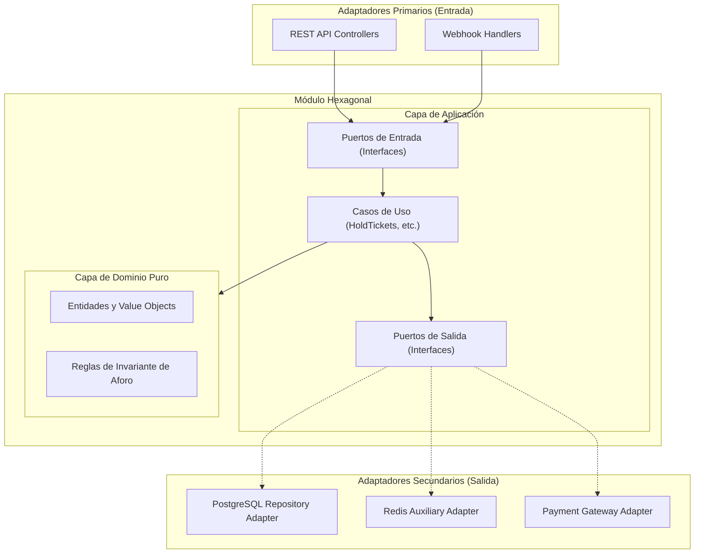

# ADR-002: Adopción del Patrón Arquitectura Hexagonal para Módulos Internos

- **Estado**: `[PROPUESTO]`
- **Fecha**: `2026-10-21`
- **Área**: Arquitectura Interna de Software / Diseño de Módulos
- **Decisores**: Equipo de Arquitectura de Software AFORO
- **Estado de Realidad Técnica**: `[DISEÑO ARQUITECTÓNICO PROPUESTO]`

---

## 1. Contexto y Planteamiento del Problema

Dentro del Monolito Modular seleccionado ([`ADR-001`](ADR-001-seleccion-estilo-monolito-modular.md)), cada módulo de negocio encapsula invariantes y reglas de dominio críticas (validación de capacidades de aforo, control de reservas temporales con TTL de 10 minutos, máquinas de estados de tickets y procesamiento de pagos). Si la lógica de dominio se acopla directamente a frameworks HTTP (Express/Fastify), librerías de persistencia (ORMs como Prisma/TypeORM) o SDKs de terceros, cualquier cambio de biblioteca o evolución tecnológica obligará a modificar la lógica central del negocio.

Se requiere un patrón de diseño que desacople la **lógica de negocio respecto a los detalles de infraestructura técnica**, favoreciendo la comprobabilidad automatizada y la mantenibilidad a largo plazo.

---

## 2. Alternativas Evaluadas

1. **Alternativa A: Estructura Tradicional CRUD / MVC en Capas**:
   - *Descripción*: Controladores que invocan servicios de aplicación que a su vez operan directamente sobre modelos y consultas del ORM.
   - *Evaluación*: Sencilla de implementar inicialmente, pero acopla las reglas de negocio al esquema de base de datos y al framework web, dificultando las pruebas unitarias aisladas y propiciando fugas de dependencias de infraestructura hacia el negocio.

2. **Alternativa B: Clean Architecture Estricta (4 Capas Concéntricas)**:
   - *Descripción*: Modelo completo con entidades, casos de uso, interfaces/gateways y controladores/frameworks externos.
   - *Evaluación*: Muy rigurosa, pero introduce una sobrecarga elevada de mapeadores intermedios, DTOs y clases de transformación para operaciones relativamente sencillas en un equipo pequeño.

3. **Alternativa C: Arquitectura Hexagonal (Puertos y Adaptadores — Alistair Cockburn)**:
   - *Descripción*: El núcleo del módulo define **Puertos** (interfaces que expresan lo que la aplicación ofrece o requiere del exterior). Los componentes externos (controladores HTTP, repositorios de base de datos, clientes de correo o pasarelas) interactúan como **Adaptadores** primarios o secundarios.

---

## 3. Decisión Propuesta

Se decide adoptar la **Arquitectura Hexagonal (Puertos y Adaptadores)** para organizar la estructura interna de los módulos del backend en AFORO.

Cada módulo se estructurará internamente en tres capas delimitadas:
1. **Capa de Dominio (`domain/`)**:
   - Entidades, Objetos de Valor (Value Objects), Eventos de Dominio y Servicios de Dominio.
   - **Regla de Dependencia**: Código TypeScript puro sin referencias a frameworks web, clientes de base de datos ni SDKs externos.
2. **Capa de Aplicación (`application/`)**:
   - Casos de Uso que orquestan los flujos de negocio (ej. `HoldTicketsUseCase`, `ProcessPaymentUseCase`).
   - Puertos de Entrada (interfaces expuestas a los adaptadores primarios).
   - Puertos de Salida (interfaces que definen los contratos para persistencia, notificaciones o integraciones).
3. **Capa de Infraestructura (`infrastructure/`)**:
   - Adaptadores Primarios / Conducidos: Controladores REST, receptores de webhooks.
   - Adaptadores Secundarios / Conductores: Repositorios PostgreSQL, adaptadores auxiliares de Redis, clientes de pasarelas de pago (Culqi, Niubiz, Stripe).

---

## 4. Justificación

1. **Inversión de Dependencias (DIP)**: La lógica de dominio no depende de la base de datos ni de librerías externas; los adaptadores de infraestructura dependen de las interfaces declaradas por la capa de aplicación.
2. **Comprobabilidad Automatizada (`RNF-MA-03`)**: Permite verificar la lógica de los casos de uso simulando adaptadores secundarios mediante dobles de prueba (*mocks/stubs*) en memoria, facilitando pruebas unitarias rápidas y desacopladas de la infraestructura externa (un objetivo alineado a la velocidad lograda en la suite de pruebas del frontend).
3. **Flexibilidad Tecnológica**: Posibilita sustituir o actualizar adaptadores de infraestructura (por ejemplo, cambiar o incorporar proveedores de pago o drivers de base de datos) modificando exclusivamente el adaptador secundario respectivo, sin alterar el núcleo de dominio.

---

## 5. Consecuencias

### Consecuencias Positivas
- Código con responsabilidades bien delimitadas y modularidad comprobable.
- Dominio protegido frente a cambios en APIs o versiones de bibliotecas de terceros.
- Trazabilidad directa entre especificaciones funcionales y casos de uso.

### Compromisos y Consecuencias Negativas (Trade-offs)
- Incremento en el número de interfaces, archivos y código de mapeo (*boilerplate*).
- Requiere disciplina técnica para mantener mapeos explícitos entre modelos de persistencia y entidades de dominio sin filtrar tipos del ORM al núcleo.

---

## 6. Riesgos y Mitigaciones

| Riesgo Identificado | Probabilidad / Impacto | Mitigación Arquitectónica |
| :--- | :---: | :--- |
| **Fuga de Tipos de Infraestructura al Dominio** (ej. tipos generados por el ORM usados en entidades). | Media / Alto | Mapeo obligatorio en los adaptadores entre modelos de persistencia (`*Model.ts`) y entidades de dominio (`*.entity.ts`). |
| **Sobrecarga en Consultas Simples de Lectura**. | Baja / Medio | Permitir consultas de solo lectura optimizadas mediante Puertos de Consulta dedicados (*Read Models*), preservando la pureza en las operaciones de escritura transaccional. |

---

## 7. Trazabilidad

- **Requisitos No Funcionales**: [`RNF-MA-01`](../../01-analisis-de-sistema/04-atributos-de-calidad.md), [`RNF-MA-02`](../../01-analisis-de-sistema/04-atributos-de-calidad.md), [`RNF-MA-03`](../../01-analisis-de-sistema/04-atributos-de-calidad.md).
- **Constitution**: Principio I (Modularidad y Desacoplamiento Arquitectónico) y Principio III (Gobernanza del Sistema de Tipos).
